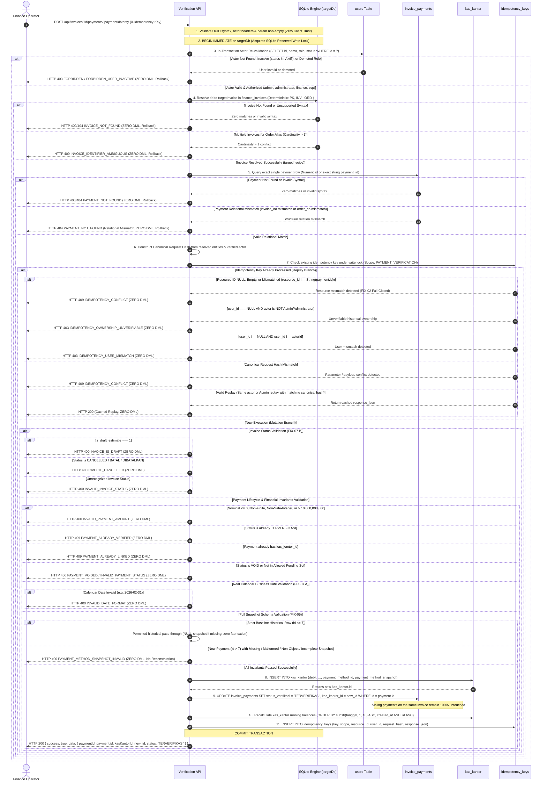

# TECHNICAL DESIGN DOCUMENT (REVISED)
# KAS MESSENGER & KAS KANTOR ARCHITECTURE

**Project:** SUN89 / SUNBiroJasa Admin Platform  
**Milestone:** Phase 4B Batch 2B — Kas Messenger & Kas Kantor Architecture  
**Status:** **REVISION 2.8-FINAL.7 — FINAL CONSOLIDATION & PRE-IMPLEMENTATION APPROVAL (STRICT DOCUMENTATION ONLY)**  
**Author:** Antigravity  
**Date:** 2026-11-11  
**Revision:** 2.8-FINAL.7 (Comprehensive Final Consolidation: Idempotency Exact Resource Binding, In-Transaction Actor Revalidation, Relational Order Rules, Full Snapshot Schema, Canonical Modal Awal, Real Calendar Date & Invoice Status Validation)  
**Implementation Authorization:** **NOT GRANTED**

---

## 1. Executive Summary

This revised Technical Design Document (Revision 2.8-FINAL.7) establishes the definitive architectural framework, domain separation, API specifications, authorization boundaries, deterministic balance calculations, concurrency controls, transaction integrity mechanisms, and payment method integration for **Kas Messenger**, **Kas Kantor**, and their associated financial workflows.

This revision formally incorporates the final technical design remediations:
1. **Pre-Transaction Foreign Key Enforcement Verification:**
   - In SQLite, `PRAGMA foreign_keys` cannot be toggled inside an active transaction. The migration routine `runKasDomainSeparationMigration(targetDb)` explicitly checks `PRAGMA foreign_keys` **before** opening the transaction.
   - If foreign key enforcement is not active (`foreign_keys !== 1`), the migration halts fail-closed with an explicit error, refusing to run in an insecure relational state.
2. **Decoupled Index Creation Idempotency:**
   - On `kas_kantor`, `pengeluaran`, and `kas_messenger`, column addition via `ALTER TABLE` is strictly separated from index creation via `CREATE INDEX IF NOT EXISTS`.
   - Even if the column already exists, the migration unconditionally verifies and creates the index, repairing any state where a column exists without its accompanying index, and remaining 100% idempotent when re-run.
3. **In-Transaction Differential Foreign Key Baseline & SQLite Reserved Lock Precision:**
   - The baseline snapshot is strictly captured **inside the transaction boundary**, immediately after `BEGIN IMMEDIATE` acquires SQLite's **reserved write lock** (serialized writer lock) on `targetDb`. Under SQLite WAL mode, this serializes concurrent writers at the engine level while allowing concurrent readers to proceed non-blocking.
   - The entire sequence—(1) `BEGIN IMMEDIATE` reserved lock acquisition, (2) baseline FK snapshot, (3) DDL and index execution, (4) post-migration FK validation, and (5) differential comparison—executes within the **exact same transaction and connection (`targetDb`)**, eliminating concurrency race windows from competing writers.
   - If any newly introduced violation is detected, an error is thrown, triggering a clean, atomic `ROLLBACK` via `runInTransaction`. If no new violations exist, the transaction commits atomically.
4. **Definitive Kas Messenger Schema Alignment:**
   - Forensic audit of `server/data/database.sqlite` via `PRAGMA table_info(kas_messenger)`, `server/src/database/schema.ts`, `server/src/repositories/dbFinanceRepository.ts`, and `server/src/services/financeService.ts` confirms conclusively that `kas_messenger` uses columns `debit` (REAL DEFAULT 0, Masuk / Top-up), `kredit` (REAL DEFAULT 0, Keluar / Payout), and `total` (REAL DEFAULT 0, Running Balance).
   - Columns `nominal` and `tipe` do **not** exist in the schema for `kas_messenger` (column `nominal` exists exclusively in `pengeluaran`).
   - Both cash ledgers (`kas_kantor` and `kas_messenger`) adhere to the standard dual-column accounting representation (`debit` and `kredit`), while maintaining distinct balance column nomenclature: `saldo` for consolidated office cash, and `total` for courier petty cash partitioned strictly per `messenger_id`.
5. **Kas Messenger: Individual Courier Balance vs. Consolidated List Summary Contract:**
   - The running balance `total` on `kas_messenger` is strictly partitioned by `messenger_id`.
   - In **Individual Courier Context** (`?messengerId=<id>` or courier self-view), element `data[0].total` represents that courier's authoritative latest running balance (evaluating to numeric `0` if no transactions exist).
   - In **Consolidated Multi-Courier Context** (cross-courier list for admin/finance without `messengerId`), each row's `total` belongs strictly to that specific courier at that transaction moment; `data[0].total` is **strictly prohibited** from being used as the aggregate Kas Messenger balance. Instead, the endpoint provides a summary metadata block `summary: { byMessenger: Array<{ messengerId: string, nama: string, total: number }>, totalFloatingCash: number }`.
   - Canonical property name: `total`. Fallback to non-guaranteed properties (e.g. `m.saldo`) is eliminated.
   - Authoritative aggregate: `summary.totalFloatingCash` is the sole authoritative value for total courier cash ($\sum_{m} \text{latestBalance}(m)$), defaulting to numeric `0` on empty states.
   - **Canonical Messenger Identity:** `summary.byMessenger[].messengerId` strictly uses primary key identifiers from the `messengers` table (e.g. `'MSG-0001'`), never integer `users.id`.
   - **Courier Auth Isolation:** When accessed by a user with role `messenger`, the backend maps the authenticated user via `users.employee_id = messengers.employee_id` to resolve their canonical `messengers.id` and forces `messengerId = canonicalMessengerId`. Client-supplied query parameters are strictly ignored. If unmapped, backend returns HTTP 403 `NOT_A_MESSENGER`.
6. **Error Contract & Blocker Hierarchy for Permanent DELETE on `messenger_reimbursements`:**
   - Permanent deletion of `messenger_reimbursements` enforces a strict, fail-closed validation hierarchy:
     1. **Status Guard (Evaluated First):** Status MUST be `draft` or `rejected`. Any other status—including `approved`, `paid`, or unrecognized/unknown statuses—is rejected immediately with HTTP 409 `CANNOT_DELETE_ACTIVE_REIMBURSEMENT`.
     2. **Relational Guard (Evaluated Second):** If status is draft/rejected, the record is verified across all four relation permutations:
        - Forward Kas Messenger link: `reimbursement.kas_messenger_id IS NOT NULL` $\to$ HTTP 409 `CANNOT_DELETE_LINKED_REIMBURSEMENT`.
        - Reverse Kas Messenger link: `EXISTS (SELECT 1 FROM kas_messenger WHERE reimbursement_id = reimbursement.id)` $\to$ HTTP 409 `CANNOT_DELETE_LINKED_REIMBURSEMENT`.
        - Forward Pengeluaran link: `reimbursement.pengeluaran_id IS NOT NULL` $\to$ HTTP 409 `CANNOT_DELETE_LINKED_REIMBURSEMENT`.
        - Reverse Pengeluaran link: `EXISTS (SELECT 1 FROM pengeluaran WHERE reimbursement_id = reimbursement.id)` $\to$ HTTP 409 `CANNOT_DELETE_LINKED_REIMBURSEMENT`.
     - Zero cascade deletes. Permanent deletion succeeds strictly when status is draft/rejected AND all four relational links are completely absent.
   - Permanent deletion of an expense in `pengeluaran` similarly enforces two-way blocker: forward (`pengeluaran.reimbursement_id`) and reverse (`messenger_reimbursements.pengeluaran_id`) return HTTP 409 `CANNOT_DELETE_LINKED_REIMBURSEMENT`.
7. **Option B Implementation: Mandatory Payment Method for Top-ups:**
   - Transaksi Kas Messenger Debit / top-up baru **WAJIB** mengirim `payment_method_id` (tidak ada lagi opsi 'optional' untuk top-up baru).
   - Backend memvalidasi bahwa `payment_method_id` terdaftar di master `payment_methods` dan memiliki `status = 'Aktif'` (dievaluasi case-insensitive `LOWER(TRIM(status)) = 'aktif'`). Jika tidak disertakan, tidak ditemukan, atau inaktif, backend menolak fail-closed dengan HTTP 400 `INVALID_PAYMENT_METHOD`.
   - Transaksi Kredit / reimbursement payout dan field expense tetap mencatat `payment_method_id = NULL` (pencairan bon operasional kurir bukan transaksi top-up dana).
   - Kolom `kas_messenger.payment_method_id` bersifat nullable dan memiliki indeks `idx_kas_messenger_payment_method` murni demi kompatibilitas baris historis tanpa backfill spekulatif.
   - Partisi saldo tetap per `messenger_id`; tidak ada sub-ledger per payment method dan tidak ada interlocking otomatis dengan Kas Kantor.
8. **Normalized Substring Ledger Date Ordering (`substr(tanggal, 1, 10)`):**
   - **Canonical Business Date Format:** Seluruh transaksi bisnis baru (`kas_kantor`, `kas_messenger`, `pengeluaran`) **WAJIB** menggunakan format standar ISO 8601 calendar date: `YYYY-MM-DD` (misal: `'2026-11-11'`).
   - **Normalized Date Ordering Formula:** Untuk mengatasi format data historis campuran (`YYYY-MM-DD`, `YYYY-MM-DD HH:mm:ss`, `YYYY-MM-DDTHH:mm:ss.sssZ`), seluruh query pengurutan menormalisasi tanggal kalender menggunakan `substr(tanggal, 1, 10)`:
     - **Internal Ledger Math:** $\mathbf{ORDER\ BY\ substr(tanggal,\ 1,\ 10)\ ASC,\ created\_at\ ASC,\ id\ ASC}$ (forward chronological, untuk rekalkulasi running balance dan negative balance simulation).
     - **Public API & Presentation:** $\mathbf{ORDER\ BY\ substr(tanggal,\ 1,\ 10)\ DESC,\ created\_at\ DESC,\ id\ DESC}$ (reverse chronological / newest first, di mana element `data[0]` mencerminkan saldo mutakhir).
   - **Intraday Determinism:** Transaksi pada tanggal kalender yang sama diurutkan secara deterministik oleh `created_at ASC, id ASC` (atau `DESC` pada API), bahkan jika format tanggal aslinya berbeda-beda atau timestamp penyisipan dibuat berlawanan.
   - **Backdated Recalculation:** Transaksi bertanggal masa lalu disortir sesuai tanggal kalendernya, secara otomatis memproyeksikan ulang running balance seluruh baris sesudahnya. Data historis tidak diubah.
9. **Precise Chronological Negative Balance Simulation:**
   - The simulation algorithm `assertNoSubsequentNegativeBalance()` pinpoints the target transaction's chronological position using deterministic normalized ordering (`substr(tanggal, 1, 10) ASC, created_at ASC, id ASC`).
   - The check evaluates the impact strictly across transactions occurring **after** the target.
   - Rejection occurs **only** if the deletion causes a subsequent balance to become negative where it was previously non-negative (`baselineBalance >= 0 && simulatedBalance < 0`). Pre-existing historical negative balances that were not caused by the deletion do not trigger false rejections.
10. **Uniform Endpoint DELETE Contract Consistency:**
    - All permanent deletion endpoints—including `DELETE /api/messenger/reimbursements/:id`—enforce an identical, uncompromising 6-point contract:
      1. Database-verified role `svp` (re-verified inside transaction write lock).
      2. Mandatory `reason` ($\ge 10$ characters).
      3. Mandatory `X-Idempotency-Key` header.
      4. Pre-deletion JSON snapshot in `audit_logs` (UUID-based ID).
      5. Atomic SQLite transaction (`runInTransaction` / `BEGIN IMMEDIATE`).
      6. Persistent idempotency replay via `idempotency_keys` returning HTTP 200.
11. **Verified Actor Integrity & In-Transaction TOCTOU Re-Validation:**
    - Identity parameters (`userId`, `userName`, `userRole`) are sourced strictly from the authoritative database user lookup, never from client headers or unverified tokens.
    - To eliminate Time-of-Check to Time-of-Use (TOCTOU) race conditions between HTTP middleware and service execution, the actor's active status (`status = 'Aktif'`) and role (`role = 'svp'`) are re-validated **inside the reserved write lock of `runInTransaction`**.
12. **Elimination of `response_status` Column:**
    - Because all successful permanent DELETE operations return HTTP 200 and failed operations roll back without storing success records, a dedicated `response_status` column in `idempotency_keys` is **completely eliminated**.
    - The existing Step B schema (`response_json`) is used directly, preserving 100% compatibility and avoiding speculative schema additions.
13. **Migration Transaction Connection Binding (`targetDb` Instance):**
    - The actual helper signature in `server/src/database/db.ts` is `runInTransaction<T>(fn: () => T, customDb?: DatabaseSync): T`.
    - Migration routine `runKasDomainSeparationMigration(targetDb)` binds strictly to `targetDb` by passing `targetDb` as the second parameter: `runInTransaction(() => { ... }, targetDb)`.
    - All DDL statements, index creations, and foreign key checks execute on `targetDb`. When an error is thrown, `ROLLBACK;` executes on `targetDb`, guaranteeing atomic rollback on the exact target database instance.
14. **Application-Guarded `reimbursement_id TEXT` (Option A — No Table Rebuild):**
    - Audit schema aktual SQLite mengonfirmasi bahwa `kas_messenger.reimbursement_id` bertipe `TEXT` **tanpa database-level FK constraint** (`PRAGMA foreign_key_list(kas_messenger)` hanya mencatat FK ke `messengers`).
    - Migrasi **secara sengaja tidak menambahkan FK constraint pada kolom ini**, menghindari operasi *table rebuild* yang berisiko pada SQLite ber-WAL mode.
    - Perlindungan integritas referensial ditegakkan 100% secara fail-closed pada level aplikasi melalui **Relational Guard empat-arah**. Tipe kanonis pada repository, interface API, payload JSON, dan tests adalah `string | null`.
15. **Strict Debit/Kredit Mutual Exclusivity Invariant:**
    - Top-up: `debit > 0`, `kredit = 0`, dan `payment_method_id` wajib disertakan serta aktif (`status = 'Aktif'`).
    - Payout / Pengeluaran Bon: `kredit > 0`, `debit = 0`, dan `payment_method_id = NULL`.
    - Transaksi dengan `debit > 0 && kredit > 0` ditolak HTTP 400 `INVALID_TRANSACTION_AMOUNTS`.
    - Transaksi dengan `debit === 0 && kredit === 0` ditolak HTTP 400 `ZERO_TRANSACTION_AMOUNT`.
    - Nilai `total` dari client diabaikan total; backend menghitung saldo berjalan secara otoritatif.
16. **Dynamic Full-Row Audit Snapshot:**
    - Pada setiap operasi permanent DELETE oleh SVP, snapshot menyimpan **100% kolom dari baris yang dibaca** via `SELECT *` ke dalam `metadata_json.deletedSnapshot`.
    - Tidak ada pemotongan atau pemilihan subset field statis, sehingga kolom kustom atau dinamis tetap tersimpan utuh di tabel `audit_logs`.
17. **Actual `payment_methods` Schema Alignment (`status = 'Aktif'`):**
    - Forensic audit skema aktual `payment_methods` memastikan kolom: `id TEXT PK`, `nama_metode TEXT NOT NULL`, `bank TEXT NOT NULL`, `nama_rekening TEXT`, `nomor_rekening TEXT`, `status TEXT NOT NULL DEFAULT 'Aktif'`, `created_at TEXT`, `updated_at TEXT`.
    - Kolom `is_active` **tidak ada** di tabel ini.
    - Validasi backend memeriksa `status = 'Aktif'` (dievaluasi case-insensitive `LOWER(TRIM(status)) = 'aktif'`). Metode pembayaran inaktif atau tidak ditemukan ditolak dengan HTTP 400 `INVALID_PAYMENT_METHOD`.
18. **Cascading Dropdown UI Specification (Kas Messenger & Kas Kantor):**
    - Dropdown metode pembayaran dinamis tanpa hardcoded dummy data:
      1. Level 1: Pilih `nama_metode` ('Tunai', 'Transfer Bank') dari data aktif API master.
      2. Level 2 (Transfer Bank): Tampilkan dropdown `bank` dari daftar bank aktif yang tersedia.
      3. Level 3 (Transfer Bank): Jika bank memiliki lebih dari 1 rekening aktif, tampilkan dropdown rekening yang membedakan `nama_rekening` dan `nomor_rekening`.
      4. Auto-Display: Tampilkan rincian pemilik rekening (`nama_rekening`) dan nomor rekening (`nomor_rekening`) secara otomatis.
      5. Metode Tunai: Sembunyikan seluruh input dan informasi rekening bank (langsung mengaitkan ke record `'pm-cash'`).
      6. Form mengirimkan `payment_method_id` sebagai metadata saluran dana (bukan sub-ledger saldo per rekening).
19. **Immutable Transaction Account Snapshot (`payment_method_snapshot TEXT`):**
    - Transaksi baru pada `kas_kantor` dan `kas_messenger` menyimpan `payment_method_id` (foreign key) sekaligus snapshot JSON statis `payment_method_snapshot TEXT` (`{ id, nama_metode, bank, nama_rekening, nomor_rekening }`).
    - Bersifat immutable: Perubahan nama bank, pemilik rekening, atau nomor rekening pada master di masa depan tidak mengubah informasi rekening transaksi lama.
    - Data historis tanpa snapshot tetap bernilai `NULL` (tanpa backfill spekulatif) dan ditampilkan dengan fallback transparan `(Data Master Terkini: ...)` atau `-`.
20. **Verified Invoice Payment to Kas Kantor Integration, Strict Relational Binding & Canonical Identity Resolution:**
    - **Elimination of Ambiguous OR Resolvers & Deterministic Contract:** Seluruh kueri `WHERE id = ? OR invoice_no = ?` dan `WHERE invoice_no = ? OR order_no = ?` **DIHAPUS TOTAL** dari arsitektur sistem. Resolusi route parameter `:id` menerapkan kontrak deterministik berdasar tipe dan format sintaks:
      1. *Numeric String (`/^[1-9]\d*$/`):* Kueri eksklusif ke primary key `finance_invoices.id = ?`. Format tidak kanonis dengan *leading zero* (misal `"001"`) serta nilai negatif, nol, pecahan, atau non-safe integer ditolak fail-closed dengan HTTP 400 `INVALID_INVOICE_IDENTIFIER`.
      2. *Prefix `INV-`:* Kueri eksklusif ke nomor invoice unik `finance_invoices.invoice_no = ?`.
      3. *Prefix `ORD-` (Supported Alias):* Kueri eksklusif ke nomor order `finance_invoices.order_no = ?` disertai pemeriksaan kardinalitas wajib (`SELECT ... WHERE order_no = ?`). Jika ditemukan $> 1$ baris invoice terkait, transaksi ditolak fail-closed dengan HTTP 409 `INVOICE_IDENTIFIER_AMBIGUOUS` demi mencegah ambiguitas mutasi. Jika 0 baris, ditolak HTTP 404 `INVOICE_NOT_FOUND`.
      4. *Identifier Lain / Tidak Dikenal:* Ditolak fail-closed dengan HTTP 400 `INVALID_INVOICE_IDENTIFIER`. Tanpa partial match, tanpa `LIKE`, dan tanpa konversi otomatis spekulatif.
    - **Canonical Invoice & Payment Resolution Sequence:**
      1. Backend meresolusi entitas kanonis `targetInvoice` (`{ id, invoice_no, order_no, status, total_tagihan, is_draft_estimate }`).
      2. Backend mengambil record tunggal `payment` berdasarkan `paymentId` (exact numeric `id` atau exact canonical string `payment_id`).
      3. Backend memvalidasi relasi struktural eksak (FIX-04): `payment.invoice_no === targetInvoice.invoice_no` (wajib cocok). Untuk `order_no`: jika kedua sisi terisi maka harus identik; jika salah satu terisi dan sisi lain null, ditolak fail-closed dengan HTTP 404 `PAYMENT_NOT_FOUND` (ZERO DML). Relasi dengan kedua sisi order null diizinkan secara eksklusif bagi invoice unlinked ad-hoc.
    - **In-Transaction Actor Re-Validation Under Write Lock (FIX-03):**
      - Segera setelah lock `BEGIN IMMEDIATE` diperoleh, backend mengambil ulang data actor dari tabel `users` (`SELECT id, nama, role, status FROM users WHERE id = ?`).
      - Backend memverifikasi: user ditemukan, `status === 'Aktif'`, dan role database aktual termasuk dalam matriks izin (`admin`, `administrator`, `finance`, `svp`). Jika akun nonaktif atau role diturunkan, transaksi dibatalkan seketika dengan HTTP 403 `FORBIDDEN` sebelum replay check maupun DML.
    - **Zero DML on Mismatch / Error:** Jika terjadi ketidakcocokan antara payment dan target invoice, backend menolak seketika dengan **HTTP 404 `PAYMENT_NOT_FOUND`** (atau 404 `PAYMENT_INVOICE_MISMATCH`). Pada kasus mismatch atau kegagalan validasi apa pun, diberlakukan **ZERO DML**: tidak ada `INSERT INTO kas_kantor`, tidak ada `UPDATE invoice_payments`, tidak ada perubahan saldo, dan **TIDAK ADA pencatatan status sukses pada `idempotency_keys`**.
    - **Canonical Request Hash & Exact Resource Idempotency Replay (FIX-02):**
      - Pembentukan hash permintaan (`canonicalRequestHash`) **WAJIB dieksekusi SETELAH identitas kanonis invoice dan payment berhasil di-resolve**, mengikat secara deterministik: `{ scope: 'PAYMENT_VERIFICATION', invoiceId: targetInvoice.id, invoiceNo: targetInvoice.invoice_no, paymentId: payment.id, paymentUuid: payment.payment_id || null, nominal, actorId }`.
      - Route alias yang berbeda (misal `1`, `INV-1126-001`, `ORD-1126-001`) yang merujuk pada invoice yang sama secara otomatis menghasilkan canonical request hash yang identik, memungkinkan replay yang sah tanpa konflik.
      - Pengecekan idempotensi dilakukan di bawah SQLite reserved write lock (`BEGIN IMMEDIATE`).
      - **Exact `resource_id` Matching (FIX-02):** Replay hanya sah jika `existing.resource_id !== null && existing.resource_id !== "" && existing.resource_id === String(payment.id)`. Jika resource ID null, kosong, atau berbeda, ditolak dengan HTTP 409 `IDEMPOTENCY_CONFLICT`. Record historis tanpa resource identity tidak dapat diproses sebagai valid replay.
      - Step B/C Idempotency Ownership: Replay dengan `user_id = NULL` oleh non-admin ditolak HTTP 403 `IDEMPOTENCY_OWNERSHIP_UNVERIFIABLE`; replay oleh user berbeda ditolak HTTP 403 `IDEMPOTENCY_USER_MISMATCH`; replay dengan parameter berbeda ditolak HTTP 409 `IDEMPOTENCY_CONFLICT`. Replay yang valid mengembalikan respon cache HTTP 200 tanpa mutasi SQL atau rekalkulasi ganda (ZERO DML).
    - **Validasi Status Invoice & Tanggal Bisnis Kalender Riil (FIX-07):**
      - Status invoice divalidasi: `is_draft_estimate === 1` ditolak HTTP 400 `INVOICE_IS_DRAFT`; status `'CANCELLED'`, `'BATAL'`, `'DIBATALKAN'` ditolak HTTP 400 `INVOICE_CANCELLED`; status selain whitelist terverifikasi ditolak HTTP 400 `INVALID_INVOICE_STATUS`.
      - Tanggal transaksi divalidasi kalender nyata (`validateAndNormalizeBusinessDate`): tanggal fiktif seperti `'2026-02-31'` ditolak HTTP 400 `INVALID_DATE_FORMAT` sebelum DML.
    - **TypeScript Function Signature Rigor & Verified Auth Context:** Signature fungsi service `verifyInvoicePaymentAtomic(paymentId: number | string, invoiceIdentifier: number | string, actorId: string, actorRole: string, idempotencyKey: string, targetDb: DatabaseSync = db)` menempatkan seluruh parameter wajib mendahului parameter opsional/default, menjamin kepatuhan 100% terhadap sintaks TypeScript strict mode. Parameter `actorId` dan `actorRole` bersumber secara eksklusif dari konteks autentikasi database backend (`req.user.id` dan `req.user.role`), dan **DILARANG KERAS** mempercayai role atau identitas aktor dari payload client.
21. **Strict Payment Method Snapshot Integrity & Historical Baseline (#1–#7 Only):**
    - **Migration Kolom Snapshot Atomik (FIX-01):** Migration kas-domain menambahkan kolom `payment_method_snapshot TEXT` pada tabel `invoice_payments` secara idempotent (`PRAGMA table_info` check) dalam transaksi atomik yang sama pada `targetDb`.
    - **Full Canonical Snapshot Schema Validation (FIX-05):**
      - Snapshot JSON divalidasi menyeluruh (`PaymentMethodSnapshot`): root object, `id` string tidak kosong dan cocok dengan `payment_method_id`, `nama_metode` string tidak kosong, `bank`, `nama_rekening`, `nomor_rekening` string atau null.
      - Membedakan Tunai (`pm-cash`, rekening null/kosong) vs Transfer Bank (wajib memuat detail bank, nama rekening, dan nomor rekening tidak kosong untuk identifikasi historis).
      - **Eliminasi Total Rekonstruksi Master:** Rekonstruksi snapshot dari master saat verifikasi untuk pembayaran baru (`id > 7`) dilarang keras. Snapshot hilang, malformed, atau tidak cocok ditolak fail-closed dengan HTTP 400 `PAYMENT_METHOD_SNAPSHOT_INVALID`.
      - **Post-Recording Method Deactivation & Edits:** Jika metode dinonaktifkan (`status = 'Nonaktif'`) atau diubah di master pasca-pencatatan, verifikasi tetap sah dan berhasil menggunakan snapshot beku faktual.
    - **Strict Baseline Historical Separation (#1–#7 Only):**
      - Pengecualian nilai `NULL` pada `metode_pembayaran_id` dan `payment_method_snapshot` **HANYA DAN SECARA EKSKLUSIF** berlaku bagi 7 baris baseline `invoice_payments` yang telah diaudit secara eksplisit:
        $$\mathbf{payment.id \le 7 \quad (\text{Record Baseline \#1 s/d \#7})}$$
      - **Kondisi timestamp cutoff (`created_at`) DIHAPUS TOTAL.** Record baru (`id > 7`) yang timestamp-nya dimundurkan (*backdated*) tetap diklasifikasikan sebagai pembayaran baru dan **WAJIB** ditolak fail-closed dengan **HTTP 400 `INVALID_PAYMENT_METHOD`** jika tidak memiliki metode pembayaran aktif dan snapshot valid.
      - Nol fabrikasi data dari master saat ini untuk baris baseline.
    - **Financial Validation & Anti-Double-Post Invariants:**
      - Nominal pembayaran wajib divalidasi finite, integer positif, dan dalam batas moneter aman (`Number.isSafeInteger(nominal) && nominal > 0 && nominal <= 10_000_000_000`).
      - Status pembayaran harus berada dalam state yang diizinkan untuk verifikasi (`'MENUNGGU_VERIFIKASI'`, `'PENDING'`, `'MENUNGGU_BUKTI'`). Status `'TERVERIFIKASI'` ditolak HTTP 409 `PAYMENT_ALREADY_VERIFIED`, dan status pembatalan ditolak HTTP 400 `PAYMENT_VOIDED`.
      - `kas_kantor_id` yang sudah terisi ditolak fail-closed dengan HTTP 409 `PAYMENT_ALREADY_LINKED`.
      - Tepat satu pembayaran menghasilkan tepat satu entri Kas Kantor Debit. Sibling partial payments tetap 100% independen dan tidak pernah digabungkan atau diubah.
22. **Master `payment_methods` Atomic Protection Policy & Canonical Initial Capital Protection (FIX-06):**
    - **Single Transaction Lock Execution:** Pengecekan referensi relasional ke empat tabel transaksi (`kas_kantor`, `kas_messenger`, `pengeluaran`, dan `invoice_payments`) serta eksekusi `DELETE FROM payment_methods WHERE id = ?` **WAJIB berlangsung di dalam satu callback `runInTransaction(() => { ... })` (`BEGIN IMMEDIATE`)**.
    - **Fail-Closed Relational Blocker:** Validasi referensi dieksekusi setelah reserved write lock diperoleh. Jika terdeteksi referensi $\ge 1$, transaksi langsung di-rollback dan mengembalikan HTTP 409 `CANNOT_DELETE_REFERENCED_PAYMENT_METHOD`.
    - **Zero Orphan References:** Transaksi konkuren yang mencoba menyisipkan transaksi baru saat penghapusan master sedang berjalan diserialisasi oleh SQLite `BEGIN IMMEDIATE`. Discontinued accounts soft-deactivated via `PATCH /api/payment-methods/:id/status` `{ status: 'Nonaktif' }`.
    - **Canonical Field for `MODAL_AWAL` Protection (FIX-06):** Berdasarkan audit skema aktual `kas_kantor` dan baris saldo awal riil (ID 1), saldo awal disimpan pada kolom kanonis `kategori = 'MODAL_AWAL'` (bukan `keterangan`). Permanent DELETE memeriksa kolom kanonis `targetRow.kategori === 'MODAL_AWAL'` dan memblokir penghapusan secara permanen dengan HTTP 400 `CANNOT_DELETE_INITIAL_CAPITAL`.

> [!IMPORTANT]
> **STRICT DOCUMENTATION ONLY:** This document represents an architectural specification. **Zero production code, database records, schemas, migrations, seeds, or tests are altered under this task.** Implementation authorization has not been granted.

---

## 2. Confirmed Business Rules

The following business rules are confirmed, definitive, and immutable across this technical design:

### 2.1 Rule 1: Kas Messenger Domain Autonomy
- **Operational Scope:** Dedicated exclusively to courier field expenditures, including fuel (bensin), parking fees, tolls, and official document transit costs.
- **Inflow Sources:** Dedicated operational float / cash top-up allocations recorded directly into `kas_messenger` (Debit/In).
- **Outflow Sources:** All courier field reimbursements and direct travel disbursements are recorded directly in and deduct from the **Kas Messenger** ledger for that courier.
- **Independence Invariant:** Kas Messenger operates in total isolation. It must never draw balance from, transfer balance to, or influence the balance of Kas Kantor.
- **Courier Partitioning:** Balance is computed strictly per individual courier (`messenger_id`). Outflows cannot exceed the specific courier's available cash balance.

### 2.2 Rule 2: Kas Kantor Domain Autonomy
- **Operational Scope:** Dedicated exclusively to general office overhead and administrative expenditures, including electricity, drinking water gallons, office stationery (ATK), and hardware/tools.
- **Inflow Sources:** Customer invoice payments (verified via payment lifecycle) and owner/investor initial capital (`MODAL_AWAL`), recorded directly into `kas_kantor` (Debit).
- **Outflow Sources:** Office operational expenditures recorded directly into `kas_kantor` (Kredit).
- **Independence Invariant:** Kas Kantor operates in total isolation. It must never draw balance from, transfer balance to, or influence the balance of Kas Messenger.

### 2.3 Rule 3: Decoupled Office Expense Recording (No Automatic Cross-Writing)
- Creating an entry in the `Pengeluaran` menu writes exclusively to the `pengeluaran` table.
- Creating an entry in the `Kas Kantor` menu writes exclusively to the `kas_kantor` ledger.
- Creating an expense in `pengeluaran` does **not** create a Kredit in `kas_kantor`.
- Creating a Kredit in `kas_kantor` does **not** create a record in `pengeluaran`.
- **Design Consequence:** Because there is no automated synchronization, the two modules may reflect different aggregate values or reporting statuses. Operators who wish to reflect an expense on both ledgers must record each entry explicitly. The system will never assume that an entry in `pengeluaran` represents the same transaction as an entry in `kas_kantor`.

### 2.4 Rule 4: Permanent Deletion Governed Exclusively by SVP Role
- Permanent deletion remains an active capability and will **not** be replaced with soft deletes or contra-entries.
- **Authorization Authority:** Only users authenticated with verified role `svp` in the database are permitted to execute permanent deletions. Organizational title (`jabatan === "SVP"`) provides zero authorization.
- **Server Enforcement:** All deletion attempts by non-SVP users (`administrator`, `admin`, `finance`, `messenger`) or inactive users must be rejected at the API layer with HTTP `403 Forbidden` or HTTP `401 Unauthorized`.
- **Atomic Physical Erasure & Audit:** Physical deletion (`DELETE FROM ...`), pre-deletion snapshot logging into `audit_logs`, subsequent running balance recalculation, and persistent idempotency tracking execute within a single atomic database transaction.
- **Mandatory Justification:** Every permanent deletion requires a valid explanation string (`reason` / `alasan`) of at least 10 characters.
- **Referential Protection:** Records linked to verified customer payments, active/paid reimbursements, or foundational business rows must reject permanent deletion with explicit HTTP `409 Conflict` or HTTP `400 Bad Request`.

### 2.5 Rule 5: Disabling of Inter-Cash Transfers
- Direct balance transfers between Kas Messenger and Kas Kantor are discontinued.
- Endpoints `/api/finance/transfer/office-to-messenger` and `/api/finance/transfer/messenger-to-office` are disabled with HTTP `410 Gone`.
- The `internal_transfers` table is archived read-only; no new rows will be written.

---

## 3. Current Architecture & Forensic Audit Recap

### 3.1 Actual Database Schema of `idempotency_keys` (Step B Baseline)
Forensic inspection of `server/data/database.sqlite` and `server/src/database/schema.ts` confirms the exact schema established in Phase 4B Batch 2B Step B:

```sql
CREATE TABLE idempotency_keys (
  key TEXT PRIMARY KEY,
  scope TEXT NOT NULL,
  user_id TEXT,
  request_hash TEXT NOT NULL,
  resource_id TEXT,
  response_json TEXT NOT NULL,
  created_at TEXT NOT NULL DEFAULT (datetime('now'))
);

CREATE INDEX idx_idempotency_scope ON idempotency_keys(scope, key);
```

**Key Architectural Observations:**
1. `key`: Stores the unique idempotency key. In Step B, `formatScopedIdempotencyKey(scope, clientKey)` formats keys as `${scope}::${clientKey}` to ensure scope isolation.
2. `scope`: Represents the functional domain of the operation (e.g. `'CREATE_ORDER'`, `'PAYMENT_SUBMISSION'`).
3. `user_id`: Captures the actor's user ID.
4. `request_hash`: Stores the SHA-256 digest of the canonical request payload.
5. `resource_id`: Stores the primary identifier of the affected record.
6. `response_json`: Serializes the complete JSON response payload.
7. **Production Data Status:** Currently contains 0 rows in `database.sqlite`, but the schema and its consumers (`orderService.ts`, `dbFinanceRepository.ts`) are active in production.
8. **Compatibility Mandate:** The permanent deletion replay mechanism maps cleanly to this existing schema without altering Step B semantics or adding redundant columns.

### 3.2 Existing Database Tables & Deficiencies
1. **`kas_kantor` (Rows: 2):**
   - Lacks `payment_method_id`. Office cash commingles physical safe cash with multiple commercial bank accounts (BCA, CIMB Niaga, Muamalat) into a single aggregated `saldo`.
   - Historical rows: Row #1 (`MODAL_AWAL`, debit=0, kredit=0, saldo=0); Row #2 (Invoice payment, debit=563,000, kredit=0, saldo=563,000).
2. **`kas_messenger` (Rows: 0):**
   - **Verified SQLite Schema:**
     `id` (INTEGER PK), `tanggal` (TEXT NOT NULL), `jenis` (TEXT NOT NULL), `messenger` (TEXT NOT NULL), `keterangan` (TEXT NOT NULL), `debit` (REAL DEFAULT 0), `kredit` (REAL DEFAULT 0), `total` (REAL DEFAULT 0), `penanggung_jawab` (TEXT), `order_no` (TEXT), `created_at` (TEXT NOT NULL), `reimbursement_id` (TEXT), `receipt_url` (TEXT), `kategori` (TEXT), `messenger_id` (TEXT REFERENCES messengers(id)).
   - **Definitive Column Representation:**
     - Inflow (Penerimaan Dana Kas Kurir / Top-up) is recorded as `debit > 0, kredit = 0`.
     - Outflow (Pencairan Reimbursement Kurir / Pengeluaran Lapangan) is recorded as `kredit > 0, debit = 0`.
     - Cumulative balance is maintained in `total`, partitioned strictly per `messenger_id`.
     - Columns `nominal` and `tipe` do **not** exist in `kas_messenger`.
   - **Running Balance Formula Vulnerability:** `dbFinanceRepository.addKasMessenger` accepts client-supplied `item.total` without server validation if present. Must be recalculated authoritatively on the server.
3. **`internal_transfers` (Rows: 0):**
   - Relies on string account identifiers (`'KAS_KANTOR'`, `'KAS_MESSENGER'`). Discontinued under target architecture.
4. **`payment_methods` (Rows: 4):**
   - **Verified SQLite Schema:**
     `id` (TEXT PK), `nama_metode` (TEXT NOT NULL), `bank` (TEXT NOT NULL DEFAULT ''), `nama_rekening` (TEXT DEFAULT ''), `nomor_rekening` (TEXT DEFAULT ''), `status` (TEXT NOT NULL DEFAULT 'Aktif'), `created_at` (TEXT NOT NULL), `updated_at` (TEXT NOT NULL).
   - **Schema Reality:** Kolom `is_active` **TIDAK ADA** pada skema tabel ini. Status keaktifan metode pembayaran ditentukan secara eksklusif oleh nilai teks kolom `status = 'Aktif'`.
   - **Data Aktual Operasional Baseline:**
     1. `'pm-cash'`: `nama_metode = 'Tunai'`, `bank = 'Tunai'`, `nama_rekening = ''`, `nomor_rekening = ''`, `status = 'Aktif'`.
     2. `'pm-1793943310357-9gmfz'`: `nama_metode = 'Transfer Bank'`, `bank = 'CIMB NIAGA'`, `nama_rekening = 'ANISA SUSANTI'`, `nomor_rekening = '707751492800'`, `status = 'Aktif'`.
     3. `'pm-1793943329508-s6ykx'`: `nama_metode = 'Transfer Bank'`, `bank = 'BCA'`, `nama_rekening = 'ANISA SUSANTI'`, `nomor_rekening = '7175095764'`, `status = 'Aktif'`.
     4. `'pm-1793943359922-z6f4i'`: `nama_metode = 'Transfer Bank'`, `bank = 'MUAMALAT'`, `nama_rekening = 'SUN DELAPAN SEMBILAN CV'`, `nomor_rekening = '1210090566'`, `status = 'Aktif'`.
5. **`messenger_reimbursements` (Rows: 0):**
   - Has unenforced columns `kas_messenger_id` and `pengeluaran_id`.
6. **`pengeluaran` (Rows: 0):**
   - Currently has `DELETE FROM pengeluaran WHERE id = ?` exposed to `finance` role without audit logging or role validation.

### 3.3 Core Audit Discrepancies
- **Discrepancy 1 (Reimbursement Payout):** Frontend UI and local store deduct from `Kas Messenger`, but backend `messengerService.payReimbursement` debited `Kas Kantor`.
- **Discrepancy 2 (Running Balance Index Bug):** `apiFinanceProvider.ts` computed running balance from `this.kasKantor[this.kasKantor.length - 1]`. Because records are returned `ORDER BY id DESC`, index `length - 1` is the oldest row (Rp 0), causing client-side saldo distortion.
- **Discrepancy 3 (Mock Payment Accounts):** `paymentMethodStore.ts` fell back to hardcoded dummy accounts (fictional BCA, BRI, Mandiri, QRIS) rather than loading live master accounts.

---

## 4. Target Architecture

### 4.1 Standalone Domain Architecture

```mermaid
graph TD
    subgraph KAS_MESSENGER_DOMAIN["Kas Messenger Domain (Autonomous)"]
        KM_IN["Courier Float Top-up / Allocation<br/>(Penerimaan Dana Kas Kurir)"] -->|Debit| KM_LEDGER[("kas_messenger<br/>(Courier Petty Cash)")]
        KM_EXP["Courier Direct Travel Expense<br/>(Bensin, Parkir, Tol)"] -->|Kredit| KM_LEDGER
        REIMB_PAY["Reimbursement Payout<br/>(Pencairan Biaya Lapangan)"] -->|Kredit| KM_LEDGER
        KM_LEDGER -->|Calculates per courier: ORDER BY substr(tanggal, 1, 10), created_at, id| KM_BAL["Courier Cash Balance<br/>(Saldo per Kurir)"]
    end

    subgraph KAS_KANTOR_DOMAIN["Kas Kantor Domain (Autonomous)"]
        KK_IN["Capital / Operating Inflows<br/>(Modal Awal, Pendapatan Non-Invoice)"] -->|Debit| KK_LEDGER[("kas_kantor<br/>(Office Operating Cash)")]
        KK_EXP["Direct Office Expense<br/>(Listrik, Galon, ATK)"] -->|Kredit| KK_LEDGER
        INV_PAY["Customer Invoice Payments<br/>(Verifikasi Pembayaran)"] -->|Debit| KK_LEDGER
        KK_LEDGER -->|Calculates office total: ORDER BY substr(tanggal, 1, 10), created_at, id| KK_BAL["Consolidated Office Balance<br/>(Saldo Kas Kantor Agregat)"]
    end

    subgraph PENGELUARAN_MODULE["Pengeluaran Module (Decoupled Reporting)"]
        EXP_IN["Office Expense Entry<br/>(Input Menu Pengeluaran)"] --> EXP_LEDGER[("pengeluaran<br/>(Overhead Expense Tracking)")]
        EXP_LEDGER -.->|Manual Tagging Only / No Auto-Sync| KK_LEDGER
    end

    subgraph MASTER_DATA["Shared Master Tables (Read-Only)"]
        PM[("payment_methods<br/>(Tunai, CIMB, BCA, Muamalat)")] -.->|Specifies Bank/Cash Channel Metadata| KK_LEDGER
        PM -.->|Specifies Payment Method Metadata| EXP_LEDGER
        EMP[("employees / messengers")] -.->|Identifies Courier ID| KM_LEDGER
        EMP -.->|Identifies PIC / Verifier| KK_LEDGER
    end

    subgraph SECURITY_AUDIT["Security, Idempotency & Allowlist Layer"]
        ALLOW["Runtime Table Allowlist<br/>(kas_kantor, kas_messenger, pengeluaran, messenger_reimbursements)"]
        AUTH["requireStrictSvpRole<br/>(Live DB query: users.role === 'svp')"]
        TOCTOU["In-Transaction Actor Re-Validation<br/>(users.status === 'Aktif' & role === 'svp')"]
        IDEM[("idempotency_keys<br/>(Step B compatible replay & hash matching)")]
        AUDIT[("audit_logs<br/>(Pre-deletion JSON snapshots with UUID)")]
    end

    ALLOW --> AUTH
    AUTH --> TOCTOU
    TOCTOU -.->|Guards Permanent Deletion| KK_LEDGER
    TOCTOU -.->|Guards Permanent Deletion| KM_LEDGER
    TOCTOU -.->|Guards Permanent Deletion| EXP_LEDGER
    TOCTOU -.->|Guards Draft Reimbursement Deletion| REIMB_PAY
    IDEM -.->|Ensures Safe Replays inside BEGIN IMMEDIATE| AUDIT

    style KAS_MESSENGER_DOMAIN fill:#f0fdf4,stroke:#16a34a,stroke-width:2px
    style KAS_KANTOR_DOMAIN fill:#f8fafc,stroke:#0284c7,stroke-width:2px
    style PENGELUARAN_MODULE fill:#fffbeb,stroke:#d97706,stroke-width:2px
    style MASTER_DATA fill:#faf5ff,stroke:#9333ea,stroke-width:1px
    style SECURITY_AUDIT fill:#fef2f2,stroke:#ef4444,stroke-width:2px
```

### 4.2 Decoupled Data Flow Principles
1. **Total Isolation:** Zero automatic transfers, zero cross-cash balance impact.
2. **Reimbursement SSoT:** Approved reimbursement payouts are posted exclusively to `kas_messenger` (Kredit), reducing the specific courier's cash balance.
3. **No Implicit Sync for Pengeluaran:** The `Pengeluaran` module tracks operating expenses independently. It does not automatically debit or credit `kas_kantor`. Operators enter data into each ledger according to administrative needs.
4. **Physical Erasure Authority:** Deletions are physical (`DELETE FROM ...`) and guarded strictly by runtime table validation, database-verified `SVP` role (with in-transaction re-validation), pre-deletion snapshot logging in `audit_logs`, negative balance simulation, and atomic tracking in `idempotency_keys`.

### 4.3 Verified Invoice Payment Lifecycle & Atomic Kas Kantor Inflow

The integration between customer invoice payment verification and the Kas Kantor office cash ledger adheres to a strict, tamper-proof lifecycle governed by individual payment identity, invoice-to-payment binding, server-side validation, and atomic database transactions.



#### 4.3.1 Relational Sourcing, Canonical Payment Identity & Zero Client Trust
1. **Canonical Payment Identity, Deterministic Invoice Resolution & Strict Relational Binding (`paymentId` SSoT):**
   - Each customer payment is identified strictly by its individual primary key `paymentId` (`invoice_payments.id` or canonical string identifier).
   - Selecting payments by `invoice_no` alone is **strictly prohibited**, as a single invoice frequently contains multiple partial payments (e.g. invoice `INV-1126-001` contains payment rows #1, #2, #3, #6, and #7).
   - **Deterministic Identity Resolution (No Ambiguous OR Queries):** Sistem menyelesaikan identitas relasi tanpa mengandalkan OR fallback ambigu:
     - **Tahap 1 (Resolusi Entitas Invoice Otoritatif):** Parameter route `:id` diresolusi secara deterministik ke master `finance_invoices`:
       - *Numeric String (`/^[1-9]\d*$/`):* Kueri eksklusif ke primary key `finance_invoices.id = ?`. Leading-zero uncanonical strings (misal `"001"`) ditolak fail-closed dengan HTTP 400 `INVALID_INVOICE_IDENTIFIER`.
       - *Prefix `INV-`:* Kueri eksklusif ke `finance_invoices.invoice_no = ?` (exact match).
       - *Prefix `ORD-` (Supported Alias):* Kueri eksklusif ke `finance_invoices.order_no = ?` disertai pemeriksaan kardinalitas wajib (`SELECT ... WHERE order_no = ?`). Jika ditemukan $> 1$ baris invoice terkait, transaksi ditolak fail-closed dengan HTTP 409 `INVOICE_IDENTIFIER_AMBIGUOUS` demi mencegah ambiguitas mutasi. Jika 0 baris, ditolak HTTP 404 `INVOICE_NOT_FOUND`.
       - *Identifier Lain / Tidak Didukung:* Ditolak fail-closed dengan HTTP 400 `INVALID_INVOICE_IDENTIFIER`. Tanpa partial match, tanpa `LIKE`, dan tanpa konversi otomatis spekulatif.
     - **Tahap 2 (Pengambilan Record Pembayaran & Validasi Relasional):** Backend mengambil record pembayaran berdasarkan `paymentId` (exact numeric `id` atau exact canonical string `payment_id`).
     - **Tahap 3 (Kontrak Relasional Eksplisit Invoice & Order — FIX-04):**
       - `payment.invoice_no === targetInvoice.invoice_no` (WAJIB COCOK).
       - Untuk relasi order:
         1. Jika kedua sisi (`payment.order_no` dan `targetInvoice.order_no`) memiliki nilai non-null / non-empty, keduanya **WAJIB IDENTIK** (`payment.order_no === targetInvoice.order_no`).
         2. Jika `payment.order_no` terisi tetapi `targetInvoice.order_no` NULL / kosong: terdeteksi relational mismatch $\to$ ditolak **HTTP 404 `PAYMENT_NOT_FOUND`** (ZERO DML).
         3. Jika `targetInvoice.order_no` terisi tetapi `payment.order_no` NULL / kosong: terdeteksi relational mismatch $\to$ ditolak **HTTP 404 `PAYMENT_NOT_FOUND`** (ZERO DML).
         4. Jika kedua sisi NULL / kosong: relasi diizinkan secara eksklusif bagi transaksi invoice ad-hoc tanpa pemesanan awal.
   - **Zero DML on Mismatch:** Jika terjadi ketidakcocokan antara `paymentId` dan `targetInvoice`, backend menolak seketika dengan **HTTP 404 `PAYMENT_NOT_FOUND`** (atau 404 `PAYMENT_INVOICE_MISMATCH`). Dalam kasus mismatch ini, **DILARANG KERAS** melakukan `INSERT INTO kas_kantor`, `UPDATE invoice_payments`, rekalkulasi saldo, atau pencatatan status sukses pada `idempotency_keys` (**ZERO DML & No Idempotency Success Record**).
   - Verification mutates **strictly and exclusively** the single targeted payment record (`WHERE id = :paymentId`). Sibling payments under the same invoice remain completely unaltered.
2. **In-Transaction Actor Re-Validation Under Write Lock (TOCTOU Defense — FIX-03):**
   - Parameter `actorId` dan `actorRole` bersumber secara eksklusif dari sesi backend (`req.user.id`, `req.user.role`). Client payload diabaikan total.
   - Segera setelah lock `BEGIN IMMEDIATE` diperoleh, backend mengambil ulang data actor dari basis data: `SELECT id, nama, role, status FROM users WHERE id = ?`.
   - Backend memvalidasi bahwa user ditemukan, berstatus aktif (`status === 'Aktif'`), dan role aktual database termasuk dalam matriks wewenang verifikasi (`admin`, `administrator`, `finance`, `svp`). Jika user dinonaktifkan atau role dicabut sebelum transaksi dieksekusi, transaksi langsung di-rollback dan ditolak HTTP 403 `FORBIDDEN` sebelum replay check maupun DML.
3. **Authoritative Backend Sourcing & Frozen Pre-Verification Snapshot:**
   - Saluran metode pembayaran bersumber **murni dari record database backend** (`invoice_payments.metode_pembayaran_id`).
   - Snapshot rekening **WAJIB dibekukan pada saat pembayaran pertama kali dicatat** (`POST /api/invoices/:id/pay`), bukan saat verifikasi. Nilai snapshot tersimpan permanen pada `invoice_payments.payment_method_snapshot`.
   - Saat verifikasi disetujui, backend menyalin snapshot yang sudah dibekukan tersebut langsung ke `kas_kantor.payment_method_snapshot`.
   - **Full Canonical Snapshot Schema Validation (FIX-05):** Snapshot JSON divalidasi ketat terhadap interface `PaymentMethodSnapshot`: root object, `id` cocok dengan `metode_pembayaran_id`, `nama_metode` terisi, serta membedakan metode Tunai (`pm-cash`, rekening null/kosong) vs Transfer Bank (wajib memuat detail bank, nama rekening, dan nomor rekening tidak kosong).
   - **Larangan Total Rekonstruksi Master untuk Pembayaran Baru:** Pola rekursif yang membaca ulang master data atau merekonstruksi snapshot saat verifikasi untuk pembayaran baru dilarang total. Jika snapshot hilang, korup, atau tidak cocok pada pembayaran baru (`id > 7`), verifikasi gagal fail-closed dengan HTTP 400 `PAYMENT_METHOD_SNAPSHOT_INVALID`.
4. **Strict Baseline Historical Separation (#1–#7 Only):**
   - **Pengecualian Historis Terbatas Eksklusif:** Pengecualian nilai `NULL` pada metode pembayaran dan snapshot **HANYA DAN SECARA EKSKLUSIF** berlaku bagi tujuh baris baseline `invoice_payments` yang telah diaudit secara eksplisit:
     $$\mathbf{payment.id \le 7 \quad (\text{Record Baseline \#1 s/d \#7})}$$
   - **Eliminasi Total Timestamp Cutoff:** Kondisi timestamp cutoff (`created_at`) sebagai penentu historis **DIHAPUS TOTAL**. Tidak semua record dengan timestamp lama diakui sebagai data historis.
   - **Penolakan Rekayasa Data Baru:** Record pembayaran baru dengan `id > 7` yang sengaja dimundurkan tanggalnya (*backdated timestamp*) tetap merupakan record baru dan **WAJIB** ditolak fail-closed dengan **HTTP 400 `INVALID_PAYMENT_METHOD`** jika tidak memiliki metode pembayaran aktif dan snapshot valid.
   - Nol fabrikasi atau rekayasa data dari master saat ini untuk baris baseline.
5. **Post-Recording Method Deactivation Policy:**
   - Jika metode pembayaran sah dan aktif saat pembayaran dicatat oleh pelanggan/operator, namun kemudian dinonaktifkan (`status = 'Nonaktif'`) oleh SVP sebelum verifikasi dilakukan oleh Finance:
     - Fakta finansial adalah dana pelanggan memang telah disetorkan ke rekening bank tersebut pada saat transaksi terjadi.
     - Verifikasi **tetap diizinkan berhasil**: server menyalin snapshot historis yang telah dibekukan saat pencatatan ke `kas_kantor.payment_method_snapshot`.
     - Master protection policy (Section 5.3) menjamin metode pembayaran tersebut tidak dapat dihapus fisik (HTTP 409), sedangkan transaksi baru tetap diblokir dari memilih metode nonaktif tersebut.
6. **Idempotency Ownership & Fail-Closed Exact Resource Binding (FIX-02):**
   - Kunci idempotensi (`X-Idempotency-Key`) mengikat secara ketat `paymentId`, actor `userId`, dan canonical request hash (`createSha256Hash({ scope: 'PAYMENT_VERIFICATION', invoiceId, invoiceNo, paymentId, paymentUuid, nominal, actorId })`).
   - **Exact `resource_id` Validation (FIX-02):** Replay untuk scope `PAYMENT_VERIFICATION` hanya sah jika:
     1. `existing.resource_id !== null` dan `existing.resource_id !== ""`
     2. `existing.resource_id === String(payment.id)`
     Jika `resource_id` bernilai NULL, kosong, atau berbeda, ditolak fail-closed dengan **HTTP 409 `IDEMPOTENCY_CONFLICT`**. Record historis tanpa resource identity tidak dapat diproses otomatis sebagai valid replay.
   - **Penanganan Owner NULL (Step B):** `user_id = NULL` pada record idempotensi **tidak boleh dianggap sebagai kepemilikan yang valid**. Pemanggil non-admin yang mencoba me-replay record dengan `user_id = NULL` ditolak fail-closed dengan **HTTP 403 `IDEMPOTENCY_OWNERSHIP_UNVERIFIABLE`**. Replay hanya dibuka untuk actor dengan role `admin` atau `administrator` asalkan hash payload cocok.
   - **Replay Actor Mismatch:** Jika `user_id` tidak null dan `user_id !== actorId`, request ditolak dengan **HTTP 403 `IDEMPOTENCY_USER_MISMATCH`**.
   - **Replay Payload/Resource Conflict:** Replay dengan key sama tetapi parameter berbeda ditolak dengan **HTTP 409 `IDEMPOTENCY_CONFLICT`**.
   - **Identical Replay:** Replay dengan actor dan parameter identik mengembalikan cached response HTTP 200 tanpa mutasi SQL atau rekalkulasi ganda (ZERO DML).
7. **Validasi Tanggal Kalender Nyata & Status Invoice (FIX-07):**
   - **Validasi Tanggal Bisnis Kalender (FIX-07 A):** Tanggal pembayaran divalidasi terhadap format `YYYY-MM-DD` dan diperiksa validitas kalendernya secara nyata (memvalidasi hari per bulan dan kabisat). Format tidak valid atau tanggal semu seperti `'2026-02-31'` ditolak HTTP 400 `INVALID_DATE_FORMAT` sebelum eksekusi DML.
   - **Validasi Status Invoice (FIX-07 B):** Invoice bertipe draft estimasi (`is_draft_estimate === 1`) ditolak HTTP 400 `INVOICE_IS_DRAFT`. Invoice yang telah dibatalkan (`'CANCELLED'`, `'BATAL'`, `'DIBATALKAN'`) ditolak HTTP 400 `INVOICE_CANCELLED`. Status yang diizinkan terbatas pada invoice aktif (`'UNPAID'`, `'PARTIAL'`, `'Kurang Bayar'`, `'Belum Bayar'`, serta invoice lunas berstatus partial payment pending). Status fiktif/tidak dikenal ditolak HTTP 400 `INVALID_INVOICE_STATUS`.
8. **Explicit Relational Mapping Formula:**
   $$\text{invoice\_payments.id (= paymentId)} \xrightarrow{\text{reads}} \text{invoice\_payments.metode\_pembayaran\_id} \xrightarrow{\text{freeze at creation}} \text{invoice\_payments.payment_method_snapshot} \xrightarrow{\text{copy at verify}} \text{kas\_kantor.payment_method_snapshot}$$
   $$\text{kas\_kantor.id} \xrightarrow{\text{link}} \text{invoice\_payments.kas\_kantor\_id}$$

---

## 5. Target Database Schema & Relational Specifications

### 5.1 Schema Design Principles
- **No Soft-Delete Columns:** The proposed columns `is_deleted`, `deleted_at`, `deleted_by`, and `delete_reason` are **withdrawn and eliminated**. All authorized deletions execute physical `DELETE` operations.
- **No Forced 1:1 Foreign Key on Pengeluaran:** `pengeluaran.kas_kantor_id` is **eliminated**.
- **Additive, Backward-Compatible Changes Only:** Existing historical records (#1–#7 in `invoice_payments`, #1–#2 in `kas_kantor`) remain 100% untouched.
- **Zero Schema Bloat on `idempotency_keys`:** The existing Step B schema is 100% preserved. No redundant columns (`response_status`, `entity_type`, `entity_id`) are added.

### 5.2 Schema Migration Outline

#### 1. `kas_kantor` (Office Cash Ledger)
```sql
-- Migration: Add optional payment_method_id foreign key for channel/method tracking (if missing)
ALTER TABLE kas_kantor ADD COLUMN payment_method_id TEXT REFERENCES payment_methods(id);

-- Migration: Add optional immutable account snapshot JSON column for transaction history (if missing)
ALTER TABLE kas_kantor ADD COLUMN payment_method_snapshot TEXT;

-- Unconditional Index Creation: Ensures index exists regardless of whether column was already present
CREATE INDEX IF NOT EXISTS idx_kas_kantor_payment_method ON kas_kantor(payment_method_id);
```
- `payment_method_id TEXT REFERENCES payment_methods(id)`:
  - **Strict Rules: Mandatory vs. Permissible NULL:**
    - **Non-NULL Mandatory for Known-Source Operational Entries:** Seluruh transaksi operasional baru di mana saluran pendanaan diketahui—baik entri manual kas kantor (Debit Masuk penerimaan operasional maupun Kredit Keluar biaya operasional kantor) maupun verifikasi pembayaran invoice baru—**WAJIB** memiliki `payment_method_id` non-null yang merujuk ke record `payment_methods` dengan `status = 'Aktif'`. Form frontend menegakkan keharusan memilih akun aktif dan menonaktifkan submit jika kosong (zero client evasion). Backend memvalidasi dan menolak dengan HTTP 400 `INVALID_PAYMENT_METHOD` jika ID kosong, inaktif, atau tidak ditemukan di master.
    - **Permissible NULL Conditions:** Nilai `NULL` strictly dan secara eksklusif hanya diperbolehkan untuk:
      1. Entri penyesuaian pembukuan internal khusus yang terdokumentasi (misal: `MODAL_AWAL` pendirian kas kantor/saldo awal tanpa aliran rekening perbankan komersial).
      2. Baris warisan historis sebelum migrasi (baris #1 dan #2 pada `kas_kantor`).
      3. Entri verifikasi pembayaran invoice historis yang tidak memiliki pemetaan metode pembayaran (`metode_pembayaran_id IS NULL`), berlaku **strictly dan secara eksklusif hanya untuk baseline baris #1 s/d #7 (`payment.id <= 7`)**. Baris baru (`id > 7`) tidak dapat menggunakan pengecualian ini.
- `payment_method_snapshot TEXT`:
  - Nullable `TEXT`. Menyimpan JSON snapshot statis ter-serialize dari record master `payment_methods` pada saat transaksi dibuat (`{ id, nama_metode, bank, nama_rekening, nomor_rekening }`).
  - Untuk entri operasional baru, snapshot digenerate secara otomatis oleh server saat validasi master berhasil.
  - Untuk entri internal khusus (`MODAL_AWAL`) dan baris historis #1–#2, snapshot bernilai `NULL` tanpa backfill spekulatif.
- **Saldo Semantics:** Neither column divides `kas_kantor` into separate per-account ledgers. The ledger calculates a single consolidated cash balance for the entire office.

#### 2. `kas_messenger` (Courier Cash Ledger)
- Schema update: Add nullable `payment_method_id TEXT REFERENCES payment_methods(id)`, index `idx_kas_messenger_payment_method`, and nullable `payment_method_snapshot TEXT`.
- **Target Schema Columns:** `id`, `tanggal`, `jenis`, `messenger`, `keterangan`, `debit`, `kredit`, `total`, `penanggung_jawab`, `order_no`, `created_at`, `reimbursement_id`, `receipt_url`, `kategori`, `messenger_id`, `payment_method_id`, `payment_method_snapshot`.
- **Canonical Column Specifications & Foreign Key References:**
  - `payment_method_id TEXT REFERENCES payment_methods(id)`:
    - **Top-up Baru (Debit > 0):** **WAJIB (MANDATORY)**. Backend memvalidasi bahwa `payment_method_id` terdaftar dan aktif (`status = 'Aktif'`, dievaluasi case-insensitive `LOWER(TRIM(status)) = 'aktif'`). Request top-up tanpa payment method atau dengan ID inaktif/tidak ditemukan ditolak fail-closed dengan HTTP 400 `INVALID_PAYMENT_METHOD`.
    - **Reimbursement Payout / Biaya Lapangan (Kredit > 0):** Selalu bernilai `NULL` (pencairan bon operasional bukan sumber top-up kas).
    - **Sifat Kolom (Nullable):** Nullable dipertahankan secara eksklusif demi kompatibilitas baris historis tanpa backfill spekulatif.
  - `payment_method_snapshot TEXT`:
    - **Top-up Baru (Debit > 0):** Disimpan otomatis oleh server berupa JSON snapshot ter-serialize dari master `payment_methods` pada detik transaksi dibuat (`{ id, nama_metode, bank, nama_rekening, nomor_rekening }`).
    - **Payout / Disbursement (Kredit > 0):** Selalu bernilai `NULL`.
    - **Immutability:** Snapshot bersifat statis dan permanen. Perubahan rekening di master di masa depan tidak mengubah histori transaksi.
    - **Data Historis:** Bernilai `NULL` tanpa backfill spekulatif.
  - `reimbursement_id TEXT (Option A: No Database-Level Foreign Key Constraint)`:
    - **Architectural Decision (Option A):** Audit skema aktual SQLite via `PRAGMA foreign_key_list(kas_messenger)` membuktikan bahwa tabel `kas_messenger` **hanya memiliki FK ke tabel `messengers(id)`**. Kolom `reimbursement_id` bertipe `TEXT` dan tidak memiliki deklarasi FK SQLite ke `messenger_reimbursements(id)`.
    - **Option A dipilih secara definitif**: Kolom `reimbursement_id` dipertahankan bertipe `TEXT` tanpa foreign key constraint di tingkat SQLite. Hal ini menghindari operasi rekonstruksi tabel SQLite (*table rebuild* via `CREATE TABLE new...`, `INSERT INTO...`, `DROP TABLE...`, `ALTER TABLE RENAME...`) yang berisiko tinggi merusak integritas data operasional dan bertentangan dengan prinsip migrasi aditif tanpa downtime.
    - **Relational Integrity via Application Blocker:** Integritas relasional dijamin 100% *fail-closed* di tingkat service/aplikasi melalui **Relational Guard empat-arah** (memverifikasi keberadaan ID pada `messenger_reimbursements`, memvalidasi status, dan memblokir penghapusan permanen jika terhubung).
    - Tipe kanonis: **TEXT** (string ID, e.g. `'REIMB-0042'`). Sesuai schema aktual database SQLite (`PRAGMA table_info(kas_messenger)` cid 11: `TEXT`). Seluruh repository, API, interface, dan test menggunakan tipe `string | null`.
  - `messenger_id TEXT REFERENCES messengers(id)`:
    - Tipe kanonis: **TEXT** merujuk langsung ke primary key tabel `messengers` (e.g. `'MSG-0001'`), **BUKAN** integer `users.id`. Relasi user kurir dipetakan melalui `users.employee_id = messengers.employee_id`.
  - `tanggal TEXT`:
    - Format kanonis: **`YYYY-MM-DD`** (calendar date standar ISO 8601).
- **Transaction Accounting & Strict Debit/Kredit Mutual Exclusivity Invariant:**
  - Columns `nominal` and `tipe` do **not** exist in `kas_messenger`.
  - **Mutual Exclusivity Invariant:** Transaksi Kas Messenger **WAJIB** memenuhi salah satu dari dua kondisi mutlak (tidak boleh keduanya atau tidak keduanya sama sekali):
    1. **Top-up Baru:** `debit > 0`, `kredit = 0`, `payment_method_id` **WAJIB disertakan dan aktif** (`status = 'Aktif'`), dan `payment_method_snapshot` dicatat oleh server.
    2. **Disbursement / Payout:** `kredit > 0`, `debit = 0`, `payment_method_id` **WAJIB bernilai `NULL`**, dan `payment_method_snapshot` bernilai `NULL`.
  - **Fail-Closed Validation Rules:**
    - Dual positive (`debit > 0 && kredit > 0`) $\to$ **Ditolak dengan HTTP 400 `INVALID_TRANSACTION_AMOUNTS`** ("Transaksi tidak boleh memiliki debit dan kredit bernilai positif sekaligus.").
    - Dual zero (`debit === 0 && kredit === 0`) $\to$ **Ditolak dengan HTTP 400 `ZERO_TRANSACTION_AMOUNT`** ("Jumlah nominal transaksi tidak boleh nol.").
    - Negative values (`debit < 0 || kredit < 0`) $\to$ **Ditolak dengan HTTP 400 `INVALID_TRANSACTION_AMOUNTS`** ("Nominal debit atau kredit tidak boleh bernilai negatif.").
  - **Running Balance Authority:** Running balance (`total`) dihitung secara dinamis dan otoritatif oleh server sebagai `previous_total + debit - kredit`, dipartisi secara ketat per `messenger_id`.
  - Nilai `total` yang dikirim dari client **diabaikan secara total** dan tidak pernah dipercaya oleh server.
- **No Sub-Ledgers & No Automatic Coupling:**
  - `payment_method_id` tracks funding source channel only. Balance model remains strictly partitioned by `messenger_id`.
  - Zero sub-ledgers created per payment method.
  - Zero automatic cross-ledger synchronization between `kas_messenger` and `kas_kantor`.
- **Historical Data Preservation:** Historical rows retain `payment_method_id = NULL` and `payment_method_snapshot = NULL`. Zero backfill, zero speculative inferences.

##### 2.1 Final Architectural Decision: Option B Confirmed by User & Snapshot Integration
- **Confirmed Business Decision:** Management confirmed **Option B** to track funding channels for courier float top-ups (e.g. distinguishing physical cash `'pm-cash'` from commercial bank transfers `'pm-...-s6ykx'`), paired with immutable point-in-time account snapshots.
- **Additive & Idempotent Migration DDL:**
  ```sql
  -- Add nullable payment_method_id to record funding source for courier top-ups (if missing)
  ALTER TABLE kas_messenger ADD COLUMN payment_method_id TEXT REFERENCES payment_methods(id);

  -- Add nullable payment_method_snapshot to record immutable account details (if missing)
  ALTER TABLE kas_messenger ADD COLUMN payment_method_snapshot TEXT;

  -- Unconditional Index Creation: Ensures index exists regardless of column addition timing
  CREATE INDEX IF NOT EXISTS idx_kas_messenger_payment_method ON kas_messenger(payment_method_id);
  ```
- **Validation Rules & Operational Behavior:**
  - **Top-up Baru (Debit):** `payment_method_id` **WAJIB** disertakan dan divalidasi terhadap master `payment_methods`. Jika absen, tidak ditemukan, atau `LOWER(TRIM(status)) !== 'aktif'`, backend menolak fail-closed dengan HTTP 400 `INVALID_PAYMENT_METHOD`.
  - **Snapshot Generation:** Saat validasi top-up sukses, backend mengekstrak `{ id, nama_metode, bank, nama_rekening, nomor_rekening }` dari row `payment_methods` aktif dan menyimpannya ke `payment_method_snapshot`.
  - **Payout / Pengeluaran Bon (Kredit):** Bernilai `NULL` untuk `payment_method_id` dan `payment_method_snapshot`.
  - **Data Historis:** Seluruh baris kas messenger sebelum migrasi tetap bernilai `NULL`. Tidak ada backfill atau tebakan data.

##### 2.2 Account Snapshot Architecture & Historical Fallback Specification
- **Immutable JSON Format:**
  ```typescript
  export interface PaymentMethodSnapshot {
    id: string;             // References payment_methods.id (e.g. 'pm-1793943329508-s6ykx')
    nama_metode: string;    // 'Transfer Bank' | 'Tunai'
    bank: string;           // 'BCA' | 'CIMB NIAGA' | 'MUAMALAT' | 'Tunai'
    nama_rekening: string;  // Account holder name (e.g. 'ANISA SUSANTI', '' for Tunai)
    nomor_rekening: string; // Account number (e.g. '7175095764', '' for Tunai)
  }
  ```
- **Immutability Invariant:** Kolom snapshot menyimpan nilai absolut pada saat transaksi dibukukan. Jika master `payment_methods` mengalami perubahan di kemudian hari (misal pergantian nomor rekening operasional atau pembetulan nama pemilik), data voucher transaksi lama tetap mencerminkan kondisi historis yang faktual.
- **Transparent Historical Display Fallbacks:**
  1. **Record Baru (Snapshot Tersedia):** Parse dan tampilkan rincian rekening langsung dari `payment_method_snapshot`.
  2. **Record Transisi (Snapshot NULL, `payment_method_id` Ada):** UI meresolusi informasi via master `payment_methods(id)` dan menampilkan badge penjelas: `(Data Master Terkini)` untuk menandakan bahwa data berasal dari master saat ini, bukan snapshot historis beku.
  3. **Record Warisan Historis (Snapshot NULL, `payment_method_id` NULL):** Tampilkan `"-"` atau `"Tanpa Informasi Rekening"`. Tidak ada backfill spekulatif atau inferensi data palsu.

#### 3. `pengeluaran` (Operating Expenditures Module)
```sql
-- Migration: Add optional payment_method_id to record how the expense was disbursed (if missing)
ALTER TABLE pengeluaran ADD COLUMN payment_method_id TEXT REFERENCES payment_methods(id);

-- Unconditional Index Creation: Ensures index exists regardless of whether column was already present
CREATE INDEX IF NOT EXISTS idx_pengeluaran_payment_method ON pengeluaran(payment_method_id);
```
- Tracks operating expenses independently. Does **not** contain `kas_kantor_id`.

#### 4. `internal_transfers` (Archived Table)
- No schema alterations. Preserved read-only for historical auditing.

#### 5. `idempotency_keys` (Step B Compatible Mapping & Index Optimization)
To maintain 100% compatibility with Step B while serving permanent deletion replays:

##### A. Semantic Mapping to Existing Columns:
| Delete Parameter / Requirement | Existing Step B Column | Mapping / Storage Format |
| :--- | :--- | :--- |
| **Client Key & Scope Isolation** | `key TEXT PRIMARY KEY` | Scoped key format: `${scope}::${clientKey}` (e.g. `'PERMANENT_DELETE:kas_kantor::uuid'`). |
| **Target Entity Type** | `scope TEXT NOT NULL` | Formatted scope: `'PERMANENT_DELETE:' + table` (e.g. `'PERMANENT_DELETE:kas_kantor'`). |
| **Target Record ID** | `resource_id TEXT` | String representation of record primary key (e.g. `'123'`). |
| **Authenticated Actor** | `user_id TEXT` | Verified database user ID (`userRow.id`). |
| **Canonical Request Hash** | `request_hash TEXT NOT NULL` | SHA-256 digest of `{ table, id, reason }`. |
| **Response Payload** | `response_json TEXT NOT NULL` | Serialized JSON response: `{"success": true, "message": "...", "targetId": id, "deletedAt": "..."}`. |
| **Execution Timestamp** | `created_at TEXT NOT NULL` | UTC ISO timestamp or SQLite `datetime('now')`. |

##### B. Index Optimization:
```sql
CREATE INDEX IF NOT EXISTS idx_idempotency_scope_resource ON idempotency_keys(scope, resource_id);
```
- Accelerates replay lookups by scope and target record ID.
- Requires zero column additions or destructive table alterations.

#### 6. `invoice_payments` (Payment Recording & Verification Integration)
- **Schema Columns & Additive Snapshot Column:**
  ```sql
  -- Add nullable payment_method_snapshot to freeze account details upon payment creation (if missing)
  ALTER TABLE invoice_payments ADD COLUMN payment_method_snapshot TEXT;
  ```
- **Frozen Pre-Verification Payment Method Snapshot Architecture:**
  1. **Capture at Creation (`POST /api/invoices/:id/pay`):**
     - Saat mencatat pembayaran invoice baru, backend mewajibkan `payment_method_id` terisi dan valid pada master `payment_methods` (`status = 'Aktif'`).
     - Pada detik pencatatan tersebut, backend membaca detail rekening aktif dari master dan membekukan snapshot JSON ke dalam kolom `invoice_payments.payment_method_snapshot` (`{ id, nama_metode, bank, nama_rekening, nomor_rekening }`).
     - Ini menjamin informasi perbankan mencerminkan kondisi riil saat customer melakukan pembayaran.
  2. **Direct Snapshot Transfer at Verification (`POST /api/invoices/:id/payments/:paymentId/verify`):**
     - Saat Finance melakukan verifikasi, backend membaca snapshot yang telah dibekukan dari `invoice_payments.payment_method_snapshot` dan menyalinnya langsung ke `kas_kantor.payment_method_snapshot`.
     - Proses verifikasi **tidak melakukan kueri ulang atau merekayasa ulang snapshot master**. Rekonstruksi dari master dilarang keras untuk seluruh pembayaran baru (`id > 7`). Jika snapshot hilang, kosong, atau korup, transaksi gagal fail-closed dengan HTTP 400 `PAYMENT_METHOD_SNAPSHOT_INVALID`.
     - **Deactivation / Master Modification Robustness:** Jika master payment method dinonaktifkan (`status = 'Nonaktif'`) atau rincian rekeningnya diubah di master setelah pencatatan pembayaran namun sebelum verifikasi Finance, verifikasi **tetap sah dan berhasil**, menyalin snapshot beku faktual ke kas kantor tanpa terganggu.
  3. **Strict Baseline Historical Separation (#1–#7 Only):**
     - Pengecualian nilai `NULL` pada `metode_pembayaran_id` dan `payment_method_snapshot` **HANYA DAN SECARA EKSKLUSIF** berlaku bagi 7 baris baseline `invoice_payments` yang telah diaudit secara eksplisit:
       $$\mathbf{payment.id \le 7 \quad (\text{Record Baseline \#1 s/d \#7})}$$
     - **Kondisi timestamp cutoff (`created_at`) DIHAPUS TOTAL** sebagai kualifikasi historis.
     - Setiap baris pembayaran baru dengan `id > 7`, meskipun timestamp `created_at`-nya dimundurkan (*backdated*), wajib memiliki metode pembayaran aktif dan snapshot beku. Pembayaran `id > 7` dengan metode `NULL` atau inaktif ditolak *fail-closed* dengan HTTP 400 `INVALID_PAYMENT_METHOD`.
     - Data historis baseline baris #1–#7 tetap bernilai `NULL` tanpa backfill spekulatif. Jika baris baseline memiliki metode tetapi snapshot NULL, sistem mencatat `pmSnapshot = null` tanpa merekayasa data dari master saat ini.
  4. **Database Relational Constraints & Cardinality Authority:**
     - `finance_invoices.id`: `INTEGER PRIMARY KEY AUTOINCREMENT` (Strict database-level uniqueness; exact PK lookup).
     - `finance_invoices.invoice_no`: `TEXT UNIQUE NOT NULL` (Strict database-level uniqueness via UNIQUE index; exact lookup).
     - `finance_invoices.order_no`: `TEXT` (nullable di tingkat skema SQLite, diindeks via `idx_invoices_order`). Mengingat order dapat memiliki relasi multi-invoice (misal penagihan parsial atau termin terpisah), lookup melalui alias `order_no` **WAJIB menerapkan pemeriksaan kardinalitas**: jika ditemukan $> 1$ record invoice untuk nomor order tersebut, resolver menolak seketika dengan HTTP 409 `INVOICE_IDENTIFIER_AMBIGUOUS` (ZERO DML).
     - `invoice_payments.id`: `INTEGER PRIMARY KEY AUTOINCREMENT` (Strict PK lookup).
     - `invoice_payments.payment_id`: `TEXT` (Canonical identifier Step B; exact match lookup dengan cardinality check $\le 1$).

#### 7. Canonical Payment Method Snapshot Interface (`PaymentMethodSnapshot` — FIX-05)
Untuk menjamin konsistensi tipe dan kelengkapan data di seluruh backend, basis data, dan frontend:

```typescript
export interface PaymentMethodSnapshot {
  id: string;                    // Sesuai payment_methods.id (e.g. 'pm-1793943329508-s6ykx' | 'pm-cash')
  nama_metode: string;           // 'Transfer Bank' | 'Tunai'
  bank: string | null;           // Bank penerbit (e.g. 'BCA', 'CIMB NIAGA', 'MUAMALAT', atau 'Tunai' / null)
  nama_rekening: string | null;  // Nama pemilik rekening (e.g. 'ANISA SUSANTI', null / '' untuk Tunai)
  nomor_rekening: string | null; // Nomor rekening (e.g. '7175095764', null / '' untuk Tunai)
}
```
- **Validasi Tunai (`pm-cash`):** `nama_metode === 'Tunai'`, `bank` bernilai `'Tunai'` atau `null`, `nama_rekening` dan `nomor_rekening` berupa `null` atau string kosong `""`.
- **Validasi Transfer Bank:** `nama_metode === 'Transfer Bank'`, `bank`, `nama_rekening`, dan `nomor_rekening` **WAJIB** berupa string tidak kosong (`non-empty string`) untuk mempertahankan auditabilitas historis rekening penerima dana.

### 5.3 Master Payment Methods Referential Protection Policy

To guarantee strict financial auditability, protect relational integrity, and prevent accidental ledger corruption, master records in `payment_methods` are governed by a fail-closed referential protection policy executed under atomic transaction boundaries:

#### 5.3.1 Atomic In-Transaction Check & Physical DELETE Execution (`runInTransaction` / `BEGIN IMMEDIATE`)
1. **Single Transaction Lock Boundary:**
   Pengecekan referensi relasional pada seluruh tabel transaksi dan operasi penghapusan fisik master record **WAJIB dieksekusi di dalam satu transaksi database tunggal**:
   ```typescript
   export function deleteMasterPaymentMethodAtomic(id: string, targetDb: DatabaseSync = db): void {
     runInTransaction(() => {
       // 1. Lock acquired via BEGIN IMMEDIATE: Serializes all competing writers at engine level
       // 2. Perform 4-way reference check under the write lock
       const refCounts = targetDb.prepare(`
         SELECT 
           (SELECT COUNT(*) FROM kas_kantor WHERE payment_method_id = ?) AS kk_count,
           (SELECT COUNT(*) FROM kas_messenger WHERE payment_method_id = ?) AS km_count,
           (SELECT COUNT(*) FROM pengeluaran WHERE payment_method_id = ?) AS exp_count,
           (SELECT COUNT(*) FROM invoice_payments WHERE metode_pembayaran_id = ?) AS ip_count
       `).get(id, id, id, id) as { kk_count: number; km_count: number; exp_count: number; ip_count: number };

       const totalRefs = refCounts.kk_count + refCounts.km_count + refCounts.exp_count + refCounts.ip_count;
       if (totalRefs > 0) {
         throw new ApiError(409, "CANNOT_DELETE_REFERENCED_PAYMENT_METHOD", 
           "Metode pembayaran tidak dapat dihapus karena telah digunakan dalam riwayat transaksi keuangan. Nonaktifkan status metode pembayaran ini sebagai gantinya.",
           { references: refCounts }
         );
       }

       // 3. Delete master record inside the exact same transaction
       const delRes = targetDb.prepare("DELETE FROM payment_methods WHERE id = ?").run(id);
       if (delRes.changes === 0) {
         throw new ApiError(404, "PAYMENT_METHOD_NOT_FOUND", `Metode pembayaran '${id}' tidak ditemukan.`);
       }
     }, targetDb);
   }
   ```
2. **Fail-Closed HTTP 409 Rejection Contract:**
   Jika `totalRefs > 0`, transaksi langsung di-rollback dan mengembalikan HTTP 409:
   ```json
   {
     "success": false,
     "error": {
       "code": "CANNOT_DELETE_REFERENCED_PAYMENT_METHOD",
       "message": "Metode pembayaran tidak dapat dihapus karena telah digunakan dalam riwayat transaksi keuangan. Nonaktifkan status metode pembayaran ini sebagai gantinya.",
       "details": {
         "references": {
           "kk_count": 2,
           "km_count": 0,
           "exp_count": 1,
           "ip_count": 1
         }
       }
     },
     "timestamp": "2026-11-11T08:30:00.000Z"
   }
   ```
3. **Engine-Level SQLite Foreign Key Backstop:**
   Foreign key constraints `REFERENCES payment_methods(id)` memberlakukan semantik engine-level SQLite default `RESTRICT` / `NO ACTION`. Jika eksekusi SQL mentah mencoba membypass logika aplikasi, SQLite engine seketika melempar error `FOREIGN KEY constraint failed`.
4. **Concurrency & Orphan Prevention Analysis:**
   - **Scenario 1 (DELETE commits first):** Transaksi A (`DELETE /api/payment-methods/:id`) memperoleh reserved lock terlebih dahulu, memverifikasi 0 referensi, menghapus row, dan commit. Transaksi B (`POST /api/invoices/:id/pay` atau `POST /api/finance/kas-kantor`) yang menunggu lock kemudian dieksekusi; kueri master validasi pada Transaksi B tidak menemukan record, menolak request dengan HTTP 400 `INVALID_PAYMENT_METHOD`.
   - **Scenario 2 (INSERT commits first):** Transaksi B memperoleh reserved lock terlebih dahulu, menyisipkan pembayaran/kas dengan `payment_method_id = :id`, dan commit. Transaksi A kemudian memperoleh lock, mengeksekusi kueri referensi 4-arah, mendeteksi `totalRefs >= 1`, dan seketika melempar HTTP 409 `CANNOT_DELETE_REFERENCED_PAYMENT_METHOD`.
   - **Jaminan Sistem:** Melalui serialisasi `BEGIN IMMEDIATE`, *race condition* antara pembuatan referensi dan penghapusan master mustahil terjadi, menjamin **0 referensi yatim (*orphan reference*)**.

#### 5.3.2 Soft Deactivation Lifecycle (`status = 'Nonaktif'`)
1. **Discontinuation Policy:**
   When a commercial bank account is closed, discontinued, or replaced, operators MUST soft-deactivate the account by updating its status:
   ```sql
   UPDATE payment_methods 
   SET status = 'Nonaktif', updated_at = CURRENT_TIMESTAMP 
   WHERE id = :id;
   ```
2. **Operational Behavior:**
   - Soft-deactivated records are excluded from active dropdown selections in transaction creation forms (`WHERE LOWER(TRIM(status)) = 'aktif'`).
   - Transactions cannot be created with inactive payment methods (backend rejects with HTTP 400 `INVALID_PAYMENT_METHOD`).
   - Historical ledger records retain their relational foreign key integrity and point-in-time snapshots.

#### 5.3.3 Zero Snapshot Mutation Invariant
- Deactivating an account, updating its bank name, changing the account holder, or editing the account number on `payment_methods` **DOES NOT MUTATE** historical `payment_method_snapshot` values in `kas_kantor` or `kas_messenger`.
- Transaction history and audit vouchers remain 100% frozen, reflecting the factual bank and account details active at the exact second the transaction was posted.

#### 5.3.4 Unreferenced Clean Deletion Exception
- Physical `DELETE FROM payment_methods WHERE id = ?` is permitted **strictly and exclusively** for newly created or erroneous master records that have zero references across all four tables (`kk_count === 0 && km_count === 0 && exp_count === 0 && ip_count === 0`).
- This allows administrative cleanup of accidental typos or aborted setup without compromising financial ledger integrity.

---

## 6. Target API Contract & Authorization

### 6.1 Runtime Table Allowlist
To prevent SQL injection and unauthorized table targets, an immutable runtime allowlist is enforced:

```typescript
export const ALLOWED_PERMANENT_DELETE_TABLES = Object.freeze([
  "kas_kantor",
  "kas_messenger",
  "pengeluaran",
  "messenger_reimbursements",
] as const);

export type AllowedDeleteTable = (typeof ALLOWED_PERMANENT_DELETE_TABLES)[number];

export function validateTargetTable(table: string): asserts table is AllowedDeleteTable {
  if (!ALLOWED_PERMANENT_DELETE_TABLES.includes(table as AllowedDeleteTable)) {
    throw new ApiError(400, "INVALID_TARGET_TABLE", `Tabel target '${table}' tidak diizinkan untuk penghapusan permanen.`);
  }
}
```

### 6.2 Server-Side SVP Authorization Verification
The backend enforces strict SVP validation directly against the database-backed user identity:

```typescript
import { Request, Response, NextFunction } from "express";
import { db } from "../database/db";

interface AuthenticatedRequest extends Request {
  user?: {
    id?: string;
    userId?: string;
    username?: string;
    role?: string;
  };
}

/**
 * Strict SVP Role Middleware for Permanent Deletion
 * - Source of Identity: Verified token payload (req.user.id or req.user.userId).
 * - Database Lookup: Direct live query to users table.
 * - Single Authority: Only userRow.role === 'svp' is permitted.
 * - Jabatan Neutrality: jabatan === 'SVP' does NOT confer authorization.
 */
export function requireStrictSvpRole(req: AuthenticatedRequest, res: Response, next: NextFunction): void {
  const authenticatedUserId = req.user?.id || req.user?.userId;
  if (!authenticatedUserId || typeof authenticatedUserId !== "string") {
    res.status(401).json({
      success: false,
      error: {
        code: "UNAUTHORIZED",
        message: "Autentikasi diperlukan untuk mengakses operasi ini.",
      },
      timestamp: new Date().toISOString(),
    });
    return;
  }

  try {
    const userRow = db.prepare(`
      SELECT id, nama, role, status 
      FROM users 
      WHERE id = ?
    `).get(authenticatedUserId) as { id: number | string; nama: string; role: string; status: string } | undefined;

    if (!userRow) {
      res.status(403).json({
        success: false,
        error: {
          code: "FORBIDDEN_USER_NOT_FOUND",
          message: "User terautentikasi tidak ditemukan dalam database.",
        },
        timestamp: new Date().toISOString(),
      });
      return;
    }

    if (userRow.status !== "Aktif") {
      res.status(403).json({
        success: false,
        error: {
          code: "FORBIDDEN_USER_INACTIVE",
          message: "Akun pengguna tidak aktif.",
        },
        timestamp: new Date().toISOString(),
      });
      return;
    }

    const normalizedRole = (userRow.role || "").toLowerCase().trim();
    if (normalizedRole !== "svp") {
      res.status(403).json({
        success: false,
        error: {
          code: "FORBIDDEN_NOT_SVP",
          message: "Akses ditolak: Hanya pengguna dengan role sistem 'svp' terverifikasi yang berwenang melakukan penghapusan data secara permanen.",
        },
        timestamp: new Date().toISOString(),
      });
      return;
    }

    // Attach verified user entity
    req.user = {
      ...req.user,
      id: userRow.id,
      username: userRow.username,
      role: userRow.role,
    };

    next();
  } catch (err: any) {
    res.status(500).json({
      success: false,
      error: {
        code: "AUTH_VERIFICATION_ERROR",
        message: "Gagal memverifikasi hak akses pengguna di database.",
        details: err.message,
      },
      timestamp: new Date().toISOString(),
    });
  }
}
```

### 6.3 Complete Endpoints Matrix

| Endpoint | Method | Allowed Roles | Mandatory Headers / Parameters | Description & Behavior |
| :--- | :--- | :--- | :--- | :--- |
| `/api/finance/kas-kantor` | `GET` | `admin`, `finance`, `svp` | None | List office cash entries (ordered newest first: `ORDER BY substr(tanggal, 1, 10) DESC, created_at DESC, id DESC`, paginated; index 0 represents latest running balance). Includes `payment_method_id` and immutable `payment_method_snapshot`. |
| `/api/finance/kas-kantor` | `POST` | `admin`, `finance`, `svp` | None | Record office cash entry. **Strict Rule:** Non-NULL `payment_method_id` is **MANDATORY** for operational entries where funding source is known (Debit Masuk penerimaan operasional maupun Kredit Keluar biaya operasional); validates `LOWER(TRIM(status)) = 'aktif'` against master and generates immutable `payment_method_snapshot` JSON. Permissible `NULL` strictly limited to documented internal bookkeeping adjustments (e.g. `kategori = 'MODAL_AWAL'`). |
| `/api/finance/kas-kantor/:id` | `DELETE` | **`svp` ONLY** | `X-Idempotency-Key` (header), `{ reason: string }` ($\ge 10$ chars) | **Physical DELETE** of office cash entry. Atomic transaction under write lock (`BEGIN IMMEDIATE`), actor revalidation, audit snapshot, balance recalculation. Blocked fail-closed if: (1) linked to verified customer payment (HTTP 409 `CANNOT_DELETE_VERIFIED_PAYMENT`), (2) canonical initial capital entry (`kategori = 'MODAL_AWAL'`) (HTTP 400 `CANNOT_DELETE_INITIAL_CAPITAL`), or (3) causes subsequent office balance $< 0$ (HTTP 409 `NEGATIVE_BALANCE_VIOLATION`). |
| `/api/invoices/:id/pay` | `POST` | `administrator`, `finance` | None | **Customer Invoice Payment Recording:** Records customer invoice payment into `invoice_payments`. **Strict Invariant:** New payments **WAJIB** menyertakan `payment_method_id` yang valid dan aktif (`status = 'Aktif'`). Backend memvalidasi master `payment_methods` saat pencatatan dan membekukan snapshot rekening ke dalam `invoice_payments.payment_method_snapshot`. Request pembayaran baru tanpa metode pembayaran atau dengan metode inaktif ditolak dengan HTTP 400 `INVALID_PAYMENT_METHOD` sebelum masuk antrean verifikasi. |
| `/api/invoices/:id/payments/:paymentId/verify` | `POST` | `admin`, `finance`, `svp` | `X-Idempotency-Key` (header) | **Atomic Invoice Payment Verification (paymentId SSoT & Deterministic Resolution):** Verifies single payment record identified strictly by `paymentId` (`invoice_payments.id`). (Alias `POST /api/invoices/:id/verify-payment` supported with payload `{ paymentId }`). **Execution Sequence:** (1) Resolves `:id` from route deterministically: numeric string `/^[1-9]\d*$/` queries `finance_invoices.id = ?` (leading-zero formats like `"001"` rejected HTTP 400); prefix `INV-` queries `finance_invoices.invoice_no = ?`; prefix `ORD-` queries `finance_invoices.order_no = ?` with mandatory cardinality check (cardinality $> 1$ fails with HTTP 409 `INVOICE_IDENTIFIER_AMBIGUOUS`, 0 matches fails HTTP 404 `INVOICE_NOT_FOUND`); other/unsupported syntax rejected with HTTP 400 `INVALID_INVOICE_IDENTIFIER`. (2) In-transaction actor re-validation under write lock (`BEGIN IMMEDIATE`): verifies `users.status === 'Aktif'` and authorized role (`admin`, `administrator`, `finance`, `svp`); deactivated actor fails closed HTTP 403 (FIX-03). (3) Fetches single payment row by exact numeric `id` or exact string `payment_id` (cardinality check enforced). (4) Strictly validates relational contract (FIX-04): `payment.invoice_no === targetInvoice.invoice_no` (mandatory match); explicit order rule: both non-null must match exactly, one side null while other populated fails HTTP 404, both null allowed for ad-hoc invoices. On mismatch: fails immediately with HTTP 404 `PAYMENT_NOT_FOUND` with **ZERO DML** (no `kas_kantor` insert, no `invoice_payments` update, no balance changes, and **NO idempotency success record** stored). (5) Constructs canonical request hash from resolved entities & authenticated actor. (6) Checks idempotency key: exact fail-closed `resource_id === String(payment.id)` enforced (FIX-02); non-null, non-empty, matching resource and hash returns cached HTTP 200 without DML; resource mismatch or empty fails HTTP 409 `IDEMPOTENCY_CONFLICT`. Step B/C ownership rules enforced. (7) Validates invoice status (FIX-07 B): `is_draft_estimate === 1` rejected HTTP 400 `INVOICE_IS_DRAFT`, cancelled rejected HTTP 400 `INVOICE_CANCELLED`. Validates payment lifecycle status and safe nominal. Validates real calendar business date (FIX-07 A). (8) Full snapshot schema validation (FIX-05): validates `PaymentMethodSnapshot` interface, distinguishing Tunai vs Bank Transfer; strictly copied from `invoice_payments.payment_method_snapshot`; zero reconstruction from master; missing snapshot on new payments (`id > 7`) fails HTTP 400 `PAYMENT_METHOD_SNAPSHOT_INVALID`. (9) Creates Debit in `kas_kantor`, updates payment status to `TERVERIFIKASI`, links `kas_kantor_id`, recalculates balances, and persists idempotency record within single atomic transaction (`runInTransaction` / `BEGIN IMMEDIATE`). Sibling payments remain untouched. Historical baseline records (#1–#7 via `id <= 7`) retain `NULL` snapshot exception. **TypeScript Signature Rigor:** `(paymentId, invoiceIdentifier, actorId, actorRole, idempotencyKey, targetDb = db)` ensures all required parameters precede defaults, with `actorRole` and `actorId` sourced strictly from backend-verified session. |
| `/api/payment-methods/:id` | `DELETE` | `admin`, `svp` | None | **Atomic Permanent Deletion of Master Payment Method:** Executed under `runInTransaction` (`BEGIN IMMEDIATE`). Checks references across `kas_kantor`, `kas_messenger`, `pengeluaran`, and `invoice_payments` under write lock. Blocked fail-closed with HTTP 409 `CANNOT_DELETE_REFERENCED_PAYMENT_METHOD` if referenced. Allowed strictly for 100% unreferenced records (0 references across all 4 tables). Serialized execution prevents concurrent race conditions and orphan references. |
| `/api/payment-methods/:id/status` | `PATCH` | `admin`, `svp` | `{ status: 'Aktif' \| 'Nonaktif' }` | **Soft Deactivation/Activation:** Updates status of payment method. Inactive records are excluded from transaction creation forms. Historical snapshots in `kas_kantor` and `kas_messenger` remain 100% immutable. |
| `/api/finance/kas-messenger` | `GET` | `admin`, `finance`, `messenger`, `svp` | Courier: none (forced self). Admin/Finance: optional `messengerId`. | **Dual Mode List:**<br/>1. **Individual Mode** (`?messengerId=<id>` or role `messenger`): Scoped to single courier; `data[0].total` represents courier's latest running balance (numeric `0` if empty). Courier role is strictly isolated to own canonical `messengers.id`.<br/>2. **Consolidated Mode** (no `messengerId` for admin/finance): Cross-courier list; `data[0].total` belongs ONLY to that row's courier and **MUST NOT** be used as aggregate total. Aggregate total is sourced strictly from `summary.totalFloatingCash` (numeric, default `0`). Per-courier breakdown provided in `summary.byMessenger: Array<{ messengerId: string, nama: string, total: number }>` where `messengerId` is the canonical ID from table `messengers` and `total` is the canonical balance property. Both modes ordered newest first (`ORDER BY substr(tanggal, 1, 10) DESC, created_at DESC, id DESC`). Includes `payment_method_id` and immutable `payment_method_snapshot`. |
| `/api/finance/kas-messenger` | `POST` | `admin`, `finance`, `svp` | None | Record courier cash entry. Requires valid `messengerId` (`REFERENCES messengers(id)`). **Strict Debit/Kredit Mutual Exclusivity Invariant:** Dual positive (`debit > 0 && kredit > 0`) is rejected with HTTP 400 `INVALID_TRANSACTION_AMOUNTS`; dual zero (`debit === 0 && kredit === 0`) is rejected with HTTP 400 `ZERO_TRANSACTION_AMOUNT`. Negative amounts (`debit < 0 || kredit < 0`) are rejected with HTTP 400 `INVALID_TRANSACTION_AMOUNTS`. For top-up transactions (`debit > 0, kredit = 0`), `payment_method_id` is **MANDATORY (wajib)** and validated against master `payment_methods` (`status = 'Aktif'`, case-insensitive `LOWER(TRIM(status)) = 'aktif'`); missing, invalid, or inactive ID is rejected with HTTP 400 `INVALID_PAYMENT_METHOD`. For top-up, server generates and stores immutable `payment_method_snapshot` JSON. For payouts/disbursements (`kredit > 0, debit = 0`), `payment_method_id` and `payment_method_snapshot` MUST be `NULL`. Backend is sole authority for running balance; calculates `total = previous_total + debit - kredit`. Client `total` is ignored. |
| `/api/finance/kas-messenger/:id` | `DELETE` | **`svp` ONLY** | `X-Idempotency-Key` (header), `{ reason: string }` ($\ge 10$ chars) | **Physical DELETE** of unlinked courier cash entry. Atomic transaction, audit snapshot, balance recalculation. |
| `/api/finance/pengeluaran` | `GET` | `admin`, `finance`, `svp` | None | Read operating expenditures. |
| `/api/finance/pengeluaran` | `POST` | `admin`, `finance`, `svp` | None | Record operating expenditure independently. |
| `/api/finance/pengeluaran/:id` | `DELETE` | **`svp` ONLY** | `X-Idempotency-Key` (header), `{ reason: string }` ($\ge 10$ chars) | **Physical DELETE** of operating expenditure. Blocked across both forward and reverse relations to reimbursement. |
| `/api/messenger/reimbursements/:id` | `DELETE` | **`svp` ONLY** | `X-Idempotency-Key` (header), `{ reason: string }` ($\ge 10$ chars) | **Physical DELETE** of unlinked `draft` / `rejected` reimbursement. Blocked fail-closed via hierarchy: (1) Status Guard rejects status other than `draft` or `rejected` (including `approved`, `paid`, or unknown) with HTTP 409 `CANNOT_DELETE_ACTIVE_REIMBURSEMENT`; (2) Relational Guard rejects if linked to `kas_messenger` (forward or reverse) OR `pengeluaran` (forward or reverse) with HTTP 409 `CANNOT_DELETE_LINKED_REIMBURSEMENT`. Zero cascade delete. |
| `/api/messenger/reimbursements/:id/pay` | `POST` | `admin`, `finance`, `svp` | None | **Pays approved reimbursement:** Records Kredit in `kas_messenger` (`payment_method_id = NULL`, `payment_method_snapshot = NULL`, `reimbursement_id = id`). Does **NOT** touch `kas_kantor`. |
| `/api/finance/transfer/office-to-messenger` | `POST` | `None` | None | **DISABLED:** Returns HTTP `410 Gone`. |
| `/api/finance/transfer/messenger-to-office` | `POST` | `None` | None | **DISABLED:** Returns HTTP `410 Gone`. |

### 6.4 Authoritative Kas Messenger Summary Response Schema & Example
To eliminate schema ambiguity across backend and frontend, the response schema for `GET /api/finance/kas-messenger` is explicitly defined:

```typescript
export interface PaymentMethodSnapshot {
  id: string;             // References payment_methods.id (e.g. 'pm-1793943329508-s6ykx')
  nama_metode: string;    // 'Transfer Bank' | 'Tunai'
  bank: string;           // 'BCA' | 'CIMB NIAGA' | 'MUAMALAT' | 'Tunai'
  nama_rekening: string;  // Account holder name (e.g. 'ANISA SUSANTI', '' for Tunai)
  nomor_rekening: string; // Account number (e.g. '7175095764', '' for Tunai)
}

export interface KasMessengerSummaryItem {
  messengerId: string; // Authoritative courier ID from messengers table (e.g. 'MSG-0001')
  nama: string;        // Safe display name of courier (e.g. 'Budi Santoso')
  total: number;       // Canonical latest running balance for this courier (number, default 0)
}

export interface KasMessengerSummaryMetadata {
  totalFloatingCash: number;                    // Authoritative aggregate cash across all couriers (number, default 0)
  byMessenger: KasMessengerSummaryItem[];       // Per-courier breakdown array
}

export interface KasMessengerResponsePayload {
  success: boolean;
  data: Array<{
    id: number;
    tanggal: string;                                   // Canonical YYYY-MM-DD
    jenis: string;
    messenger: string;
    messenger_id: string;                              // Foreign key to messengers(id) (e.g. 'MSG-0001')
    keterangan: string;
    debit: number;
    kredit: number;
    total: number;
    payment_method_id: string | null;                  // Validated for top-up; NULL for kredit/historical
    payment_method_snapshot: PaymentMethodSnapshot | null; // Immutable snapshot of payment method at creation
    reimbursement_id: string | null;                   // Canonical TEXT string (e.g. 'REIMB-0042') or NULL
    created_at: string;
  }>;
  summary: KasMessengerSummaryMetadata;
  pagination?: {
    page: number;
    limit: number;
    totalRows: number;
    totalPages: number;
  };
}
```

#### Example JSON Response (Consolidated View):
```json
{
  "success": true,
  "data": [
    {
      "id": 105,
      "tanggal": "2026-11-11",
      "jenis": "Top Up Saldo",
      "messenger": "Budi Santoso",
      "messenger_id": "MSG-0001",
      "keterangan": "Top up bensin & parkir operasional",
      "debit": 200000,
      "kredit": 0,
      "total": 350000,
      "payment_method_id": "pm-1793943329508-s6ykx",
      "payment_method_snapshot": {
        "id": "pm-1793943329508-s6ykx",
        "nama_metode": "Transfer Bank",
        "bank": "BCA",
        "nama_rekening": "ANISA SUSANTI",
        "nomor_rekening": "7175095764"
      },
      "reimbursement_id": null,
      "created_at": "2026-11-11T08:30:00.000Z"
    },
    {
      "id": 104,
      "tanggal": "2026-11-10",
      "jenis": "Uang Bensin",
      "messenger": "Siti Aminah",
      "messenger_id": "MSG-0002",
      "keterangan": "Bensin antar dokumen Polda",
      "debit": 0,
      "kredit": 50000,
      "total": 150000,
      "payment_method_id": null,
      "payment_method_snapshot": null,
      "reimbursement_id": "REIMB-0042",
      "created_at": "2026-11-10T14:15:00.000Z"
    }
  ],
  "summary": {
    "totalFloatingCash": 500000,
    "byMessenger": [
      {
        "messengerId": "MSG-0001",
        "nama": "Budi Santoso",
        "total": 350000
      },
      {
        "messengerId": "MSG-0002",
        "nama": "Siti Aminah",
        "total": 150000
      }
    ]
  }
}
```

### 6.5 Messenger Identity Resolution & Top-up Request Contract

#### A. Identity Resolution from Authenticated User to Messenger Primary Key:
1. **Schema Grounding:** `kas_messenger.messenger_id` has a foreign key to `messengers(id)`. Identifiers in `messengers.id` are formatted canonically as `TEXT` (e.g. `'MSG-0001'`, `'MSG-0002'`), completely distinct from integer `users.id` (e.g. `1`, `2`).
2. **Authoritative Mapping Query:**
   When an authenticated user requests Kas Messenger resources, the backend maps their identity:
   ```sql
   SELECT m.id AS canonical_messenger_id, e.nama_lengkap
   FROM users u
   JOIN employees e ON u.employee_id = e.id
   JOIN messengers m ON m.employee_id = e.id
   WHERE u.id = ? AND u.status = 'Aktif';
   ```
3. **Fail-Closed Resolution Handling:**
   - **User Not a Courier:** If a user with role `messenger` has no corresponding entry in `messengers`, the backend immediately rejects the request with HTTP 403 `NOT_A_MESSENGER` ("Pengguna tidak terdaftar sebagai kurir aktif").
   - **Ambiguous Mapping:** If multiple messenger entries map to the same user, the system fails closed with HTTP 500 `AMBIGUOUS_MESSENGER_MAPPING` to prevent balance cross-contamination.
   - **Tampering Prevention:** When role is `messenger`, the backend forces `messengerId = canonical_messenger_id`. Any client-supplied query parameter (e.g. `?messengerId=MSG-0002` sent by `MSG-0001`) is strictly disregarded.

#### B. Mutation Contract & Invariants (`POST /api/finance/kas-messenger`):
```typescript
export interface CreateKasMessengerPayload {
  messengerId: string;        // MANDATORY: References messengers(id) (e.g. 'MSG-0001')
  tanggal: string;            // MANDATORY: ISO calendar date YYYY-MM-DD
  jenis: string;              // MANDATORY: Transaction category (e.g. 'Top Up Saldo')
  debit: number;              // Inflow amount (>= 0)
  kredit: number;             // Outflow amount (>= 0)
  keterangan: string;         // Mandatory note / description
  payment_method_id?: string; // MANDATORY IF debit > 0; MUST BE NULL IF kredit > 0
  order_no?: string;          // Optional order reference
}
```
- **Strict Debit/Kredit Mutual Exclusivity Invariant:**
  - Invariant Mutlak: Sebuah transaksi Kas Messenger hanya boleh berupa Top-up (Inflow) murni ATAU Disbursement/Payout (Outflow) murni.
  - **Dual Positive Violation:** Jika `debit > 0 && kredit > 0`, backend menolak seketika dengan HTTP 400 `INVALID_TRANSACTION_AMOUNTS` ("Transaksi tidak boleh memiliki debit dan kredit bernilai positif sekaligus.").
  - **Dual Zero Violation:** Jika `debit === 0 && kredit === 0`, backend menolak seketika dengan HTTP 400 `ZERO_TRANSACTION_AMOUNT` ("Jumlah nominal transaksi tidak boleh nol.").
  - **Negative Violation:** Jika `debit < 0 || kredit < 0`, backend menolak dengan HTTP 400 `INVALID_TRANSACTION_AMOUNTS` ("Nominal debit atau kredit tidak boleh bernilai negatif.").
- **Top-up Validation Rule (`debit > 0, kredit = 0`):**
  - `payment_method_id` **WAJIB** disertakan (string non-empty).
  - Backend memvalidasi ke database master:
    ```sql
    SELECT id, nama_metode, bank, nama_rekening, nomor_rekening, status 
    FROM payment_methods 
    WHERE id = ?;
    ```
  - **Status Invariant Check:** Kolom status diverifikasi secara case-insensitive: `LOWER(TRIM(status)) === 'aktif'`.
  - Jika field `payment_method_id` absen/kosong, record tidak ditemukan di master, atau `LOWER(TRIM(status)) !== 'aktif'`, request ditolak fail-closed dengan HTTP 400 `INVALID_PAYMENT_METHOD` ("Metode pembayaran wajib dipilih dan harus berstatus aktif untuk top up kas kurir.").
  - **Immutable Account Snapshot Generation:** Setelah record terverifikasi aktif, server membentuk objek snapshot ter-serialize JSON:
    ```typescript
    const paymentMethodSnapshot = JSON.stringify({
      id: pmRow.id,
      nama_metode: pmRow.nama_metode,
      bank: pmRow.bank,
      nama_rekening: pmRow.nama_rekening || "",
      nomor_rekening: pmRow.nomor_rekening || "",
    });
    ```
    Snapshot ini disimpan ke kolom `payment_method_snapshot` pada `kas_messenger` dalam transaksi atomik yang sama.
- **Payout Validation Rule (`kredit > 0, debit = 0`):**
  - `payment_method_id` **WAJIB bernilai `null`**. Jika client mengirimkan nilai apapun, backend menolak atau memaksa (*coerce*) nilainya menjadi `NULL`, karena pencairan bon operasional bukan penerimaan dana.
  - `payment_method_snapshot` diset ke `null`.
- **Server Sole Authority for Running Balance:**
  - Server menghitung running balance secara otoritatif: `total = previous_total + debit - kredit`.
  - Properti `total` apapun yang dikirim client diabaikan secara total (*zero trust* terhadap perhitungan client).

#### C. Invoice Payment Verification Mutation Contract & Kas Kantor Synchronization:
1. **Endpoint & Authorization:**
   - **Canonical Route:** `POST /api/invoices/:id/payments/:paymentId/verify`
   - **Supported Alias:** `POST /api/invoices/:id/verify-payment` (accepts `{ paymentId: number | string }` in body)
   - Allowed roles: `admin`, `administrator`, `finance`, `svp`.
   - Mandatory Header: `X-Idempotency-Key` (UUID).
   - **Authentication Source:** Parameter `actorId` dan `actorRole` diekstraksi secara eksklusif dari `req.user.id` dan `req.user.role` yang telah divalidasi ke database. Seluruh role atau identitas yang dikirim melalui request body, query parameter, atau arbitrary header diabaikan secara total (zero client trust).
2. **Deterministic Identity Resolution & Mandatory Invoice Binding (`paymentId` SSoT):**
   - Kueri `OR` yang ambigu (`WHERE id = ? OR invoice_no = ?` dan `WHERE invoice_no = ? OR order_no = ?`) **DIHAPUS TOTAL**.
   - Resolusi entitas invoice menerapkan kontrak deterministik tunggal:
     - *Numeric String (`/^[1-9]\d*$/`):* Kueri eksklusif ke `finance_invoices.id = ?`. Leading-zero uncanonical strings (misal `"001"`) serta nilai negatif, nol, pecahan, atau non-safe integer ditolak fail-closed dengan HTTP 400 `INVALID_INVOICE_IDENTIFIER`.
     - *Prefix `INV-`:* Kueri eksklusif ke nomor invoice unik `finance_invoices.invoice_no = ?`.
     - *Prefix `ORD-` (Supported Alias):* Kueri eksklusif ke nomor order `finance_invoices.order_no = ?` disertai pemeriksaan kardinalitas wajib (`SELECT ... WHERE order_no = ?`). Jika ditemukan $> 1$ baris invoice terkait, transaksi ditolak fail-closed dengan HTTP 409 `INVOICE_IDENTIFIER_AMBIGUOUS` demi mencegah ambiguitas mutasi. Jika 0 baris, ditolak HTTP 404 `INVOICE_NOT_FOUND`.
     - *Identifier Lain / Tidak Didukung:* Ditolak fail-closed dengan HTTP 400 `INVALID_INVOICE_IDENTIFIER`.
   - Backend mengambil tepat satu baris pembayaran berdasarkan primary key `invoice_payments.id` (exact numeric) atau `invoice_payments.payment_id` (exact string dengan cardinality check).
   - **Kontrak Relasional Eksplisit Invoice & Order (FIX-04):**
     1. `payment.invoice_no === targetInvoice.invoice_no` (WAJIB COCOK).
     2. Jika kedua sisi (`payment.order_no` dan `targetInvoice.order_no`) memiliki nilai non-null / non-empty, keduanya **WAJIB IDENTIK** (`payment.order_no === targetInvoice.order_no`).
     3. Jika salah satu sisi terisi dan sisi lain NULL / kosong, terdeteksi ketidakcocokan struktural $\to$ ditolak **HTTP 404 `PAYMENT_NOT_FOUND`** (ZERO DML).
     4. Jika kedua sisi NULL / kosong, relasi diizinkan secara eksklusif bagi invoice ad-hoc tanpa pemesanan awal.
   - **Zero DML on Mismatch / Validation Failure:** Jika terjadi ketidakcocokan (mismatch), backend menolak seketika dengan **HTTP 404 `PAYMENT_NOT_FOUND`** (atau 404 `PAYMENT_INVOICE_MISMATCH`). Dalam kasus mismatch ini, **DILARANG KERAS** melakukan `INSERT INTO kas_kantor`, `UPDATE invoice_payments`, rekalkulasi saldo, atau pencatatan status sukses pada `idempotency_keys` (**ZERO DML & No Idempotency Success Record**).
   - Verifikasi hanya memutasi record pembayaran target (`WHERE id = :paymentId`), dan **tidak pernah menggabungkan atau memutasi sibling payment** pada invoice yang sama.
3. **Pemisahan Deterministik Data Historis (#1–#7 Saja) vs. Pembayaran Baru:**
   - **Pengenalan Deterministik Eksklusif Baseline (#1–#7 Saja):** Pengecualian metode pembayaran dan snapshot bernilai `NULL` **HANYA DAN SECARA EKSKLUSIF** berlaku bagi tujuh baris baseline `invoice_payments` yang telah diaudit secara eksplisit:
     $$\mathbf{payment.id \le 7 \quad (\text{Record Baseline \#1 s/d \#7})}$$
     **Kriteria timestamp cutoff (`created_at`) DIHAPUS TOTAL.** Tidak semua record dengan timestamp lama diakui sebagai data historis.
   - **Data Historis Baseline (#1–#7):** Jika `metode_pembayaran_id IS NULL`, verifikasi diizinkan lolos dengan `payment_method_id = NULL` dan `payment_method_snapshot = NULL` (fail-closed pass-through; zero speculative backfill). Jika baris baseline memiliki metode tetapi snapshot NULL, sistem mencatat `pmSnapshot = null` tanpa merekayasa data dari master saat ini.
   - **Pembayaran Baru (`id > 7`):** Pembayaran baru **WAJIB** memiliki metode pembayaran aktif saat pencatatan (`POST /api/invoices/:id/pay`). Record baru dengan `id > 7` yang sengaja dimundurkan tanggalnya (*backdated created_at*) tetap diklasifikasikan sebagai pembayaran baru dan **WAJIB ditolak fail-closed dengan HTTP 400 `INVALID_PAYMENT_METHOD`** jika `metode_pembayaran_id` tidak ada atau bernilai `NULL`.
4. **Penyimpanan Snapshot Rekening Beku Sejak Pencatatan & Larangan Total Rekonstruksi Master:**
   - Snapshot rekening **WAJIB dibekukan pada saat pembayaran pertama kali dicatat** (`POST /api/invoices/:id/pay`), bukan saat verifikasi, dan disimpan permanen pada kolom `invoice_payments.payment_method_snapshot` (ditambahkan via migration Section 10.2).
   - Saat verifikasi berhasil, backend menyalin snapshot yang sudah dibekukan tersebut langsung ke `kas_kantor.payment_method_snapshot`.
   - **Full Canonical Snapshot Schema Validation (FIX-05):** Snapshot JSON divalidasi terhadap interface `PaymentMethodSnapshot`: root object, `id` cocok dengan `metode_pembayaran_id`, `nama_metode` terisi, serta membedakan metode Tunai (`pm-cash`, rekening null/kosong) vs Transfer Bank (wajib memuat detail bank, nama rekening, dan nomor rekening tidak kosong).
   - **Larangan Total Rekonstruksi Master untuk Pembayaran Baru:** Pola rekursif yang membaca ulang master data atau merekonstruksi snapshot saat verifikasi untuk pembayaran baru dilarang total. Jika snapshot hilang, kosong, malformed, atau tidak cocok dengan `payment_method_id` pada pembayaran baru (`id > 7`), verifikasi gagal fail-closed dengan HTTP 400 `PAYMENT_METHOD_SNAPSHOT_INVALID`.
   - **Post-Recording Method Deactivation & Edits:** Jika metode pembayaran valid dan aktif saat dicatat namun kemudian dinonaktifkan (`status = 'Nonaktif'`) atau diubah nama/nomor rekeningnya di master sebelum verifikasi: verifikasi **tetap berhasil diproses** dengan menyalin snapshot historis yang telah dibekukan ke `kas_kantor.payment_method_snapshot`.
5. **Atomic Inflow Execution Pseudocode (`runInTransaction` / `BEGIN IMMEDIATE`):**
   ```typescript
   import crypto from "crypto";
   import { DatabaseSync } from "node:sqlite";
   import { db, runInTransaction } from "../database/db";
   import { ApiError } from "../utils/apiError";

   export interface PaymentMethodSnapshot {
     id: string;
     nama_metode: string;
     bank: string | null;
     nama_rekening: string | null;
     nomor_rekening: string | null;
   }

   interface InvoicePaymentRow {
     id: number;
     payment_id: string | null;
     invoice_no: string;
     order_no: string | null;
     nominal: number;
     tanggal_bayar: string;
     metode_pembayaran: string;
     metode_pembayaran_id: string | null;
     payment_method_snapshot: string | null;
     status_verifikasi: string;
     kas_kantor_id: number | null;
     is_void?: number;
     created_at: string;
   }

   interface IdempotencyRow {
     key: string;
     scope: string;
     user_id: string | null;
     resource_id: string | null;
     request_hash: string;
     response_json: string;
   }

   /**
    * Validasi dan normalisasi tanggal bisnis kalender nyata (FIX-07 A)
    * Mencegah tanggal semu kalender (misal 2026-02-31) sebelum DML.
    */
   export function validateAndNormalizeBusinessDate(rawDate: string): string {
     if (!rawDate || typeof rawDate !== "string" || !rawDate.trim()) {
       throw new ApiError(400, "INVALID_DATE_FORMAT", "Tanggal transaksi bisnis wajib disertakan.");
     }

     let dateStr: string;
     const trimmed = rawDate.trim();
     if (/^\d{4}-\d{2}-\d{2}$/.test(trimmed)) {
       dateStr = trimmed;
     } else if (/^\d{4}-\d{2}-\d{2}[T ]\d{2}:\d{2}:\d{2}/.test(trimmed)) {
       dateStr = trimmed.substring(0, 10);
     } else {
       throw new ApiError(400, "INVALID_DATE_FORMAT", `Format string tanggal tidak valid: '${rawDate}'. Format kanonis adalah YYYY-MM-DD.`);
     }

     const parts = dateStr.split("-");
     const year = parseInt(parts[0], 10);
     const month = parseInt(parts[1], 10);
     const day = parseInt(parts[2], 10);

     if (month < 1 || month > 12) {
       throw new ApiError(400, "INVALID_DATE_FORMAT", `Bulan kalender tidak valid: ${month} pada tanggal '${dateStr}'.`);
     }

     const isLeap = (year % 4 === 0 && year % 100 !== 0) || (year % 400 === 0);
     const daysInMonth = [31, isLeap ? 29 : 28, 31, 30, 31, 30, 31, 31, 30, 31, 30, 31];
     if (day < 1 || day > daysInMonth[month - 1]) {
       throw new ApiError(400, "INVALID_DATE_FORMAT", `Hari kalender tidak valid: ${day} untuk bulan ${month} pada tanggal '${dateStr}'.`);
     }

     return dateStr;
   }

   /**
    * Validasi skema lengkap snapshot metode pembayaran (FIX-05)
    * Membedakan metode Tunai vs Transfer Bank dan melarang rekonstruksi dari master.
    */
   export function validatePaymentMethodSnapshot(
     rawSnapshot: string | null,
     expectedMethodId: string | null,
     isHistoricalBaseline: boolean
   ): string | null {
     if (!expectedMethodId) {
       if (isHistoricalBaseline) return null;
       throw new ApiError(400, "INVALID_PAYMENT_METHOD", "Pembayaran invoice baru wajib memiliki metode pembayaran aktif.");
     }

     if (!rawSnapshot || !rawSnapshot.trim()) {
       if (isHistoricalBaseline) return null;
       throw new ApiError(400, "PAYMENT_METHOD_SNAPSHOT_INVALID", "Snapshot metode pembayaran hilang atau kosong untuk pembayaran baru.");
     }

     let parsed: any;
     try {
       parsed = JSON.parse(rawSnapshot);
     } catch {
       throw new ApiError(400, "PAYMENT_METHOD_SNAPSHOT_INVALID", "Snapshot metode pembayaran bukan JSON yang valid.");
     }

     if (typeof parsed !== "object" || parsed === null || Array.isArray(parsed)) {
       throw new ApiError(400, "PAYMENT_METHOD_SNAPSHOT_INVALID", "Root snapshot metode pembayaran harus berupa object, bukan array atau primitif.");
     }

     if (typeof parsed.id !== "string" || !parsed.id.trim()) {
       throw new ApiError(400, "PAYMENT_METHOD_SNAPSHOT_INVALID", "Field 'id' pada snapshot metode pembayaran wajib berupa string tidak kosong.");
     }

     if (parsed.id !== expectedMethodId) {
       throw new ApiError(400, "PAYMENT_METHOD_SNAPSHOT_INVALID", `Field 'id' snapshot ('${parsed.id}') tidak cocok dengan payment_method_id ('${expectedMethodId}').`);
     }

     if (typeof parsed.nama_metode !== "string" || !parsed.nama_metode.trim()) {
       throw new ApiError(400, "PAYMENT_METHOD_SNAPSHOT_INVALID", "Field 'nama_metode' pada snapshot metode pembayaran wajib berupa string tidak kosong.");
     }

     if (parsed.bank !== null && typeof parsed.bank !== "string") {
       throw new ApiError(400, "PAYMENT_METHOD_SNAPSHOT_INVALID", "Field 'bank' pada snapshot metode pembayaran harus berupa string atau null.");
     }

     if (parsed.nama_rekening !== null && typeof parsed.nama_rekening !== "string") {
       throw new ApiError(400, "PAYMENT_METHOD_SNAPSHOT_INVALID", "Field 'nama_rekening' pada snapshot metode pembayaran harus berupa string atau null.");
     }

     if (parsed.nomor_rekening !== null && typeof parsed.nomor_rekening !== "string") {
       throw new ApiError(400, "PAYMENT_METHOD_SNAPSHOT_INVALID", "Field 'nomor_rekening' pada snapshot metode pembayaran harus berupa string atau null.");
     }

     const normalizedMethod = parsed.nama_metode.toLowerCase().trim();
     if (normalizedMethod === "tunai" || parsed.id === "pm-cash") {
       // Tunai valid: bank dapat berupa 'Tunai' atau null, field rekening berupa null atau string kosong
     } else {
       // Transfer Bank wajib memuat informasi rekening untuk auditabilitas historis
       if (!parsed.bank || !parsed.bank.trim()) {
         throw new ApiError(400, "PAYMENT_METHOD_SNAPSHOT_INVALID", "Snapshot transfer bank wajib memuat field 'bank' tidak kosong.");
       }
       if (!parsed.nama_rekening || !parsed.nama_rekening.trim()) {
         throw new ApiError(400, "PAYMENT_METHOD_SNAPSHOT_INVALID", "Snapshot transfer bank wajib memuat field 'nama_rekening' tidak kosong.");
       }
       if (!parsed.nomor_rekening || !parsed.nomor_rekening.trim()) {
         throw new ApiError(400, "PAYMENT_METHOD_SNAPSHOT_INVALID", "Snapshot transfer bank wajib memuat field 'nomor_rekening' tidak kosong.");
       }
     }

     return rawSnapshot;
   }

   export function verifyInvoicePaymentAtomic(
     paymentId: number | string,
     invoiceIdentifier: number | string,
     actorId: string,
     actorRole: string,
     idempotencyKey: string,
     targetDb: DatabaseSync = db
   ): { success: boolean; data: any } {
     // 1. Mandatory input & header format validations (Outside Transaction)
     const cleanKey = String(idempotencyKey || "").trim();
     if (!cleanKey || !/^[0-9a-f]{8}-[0-9a-f]{4}-[0-9a-f]{4}-[0-9a-f]{4}-[0-9a-f]{12}$/i.test(cleanKey)) {
       throw new ApiError(400, "MISSING_IDEMPOTENCY_KEY", "Header X-Idempotency-Key (UUID) wajib disertakan dan valid.");
     }

     const cleanActorId = String(actorId || "").trim();
     const cleanActorRole = String(actorRole || "").trim().toLowerCase();
     if (!cleanActorId || !cleanActorRole) {
       throw new ApiError(401, "UNAUTHORIZED", "Identitas aktor terautentikasi wajib disediakan dari sesi backend.");
     }

     const rawInvoiceId = String(invoiceIdentifier || "").trim();
     if (!rawInvoiceId) {
       throw new ApiError(400, "INVALID_INVOICE_IDENTIFIER", "Identifier invoice tidak boleh kosong.");
     }

     const rawPaymentId = String(paymentId || "").trim();
     if (!rawPaymentId) {
       throw new ApiError(400, "INVALID_PAYMENT_IDENTIFIER", "Identifier payment tidak boleh kosong.");
     }

     // 2. Execute inside runInTransaction with targetDb under reserved write lock (BEGIN IMMEDIATE)
     return runInTransaction(() => {
       // 3. In-Transaction Actor Re-Validation Under Write Lock (TOCTOU Defense — FIX-03)
       const actorRow = targetDb.prepare(`
         SELECT id, nama, role, status
         FROM users
         WHERE id = ?
       `).get(cleanActorId) as { id: number | string; nama: string; role: string; status: string } | undefined;

       if (!actorRow) {
         throw new ApiError(403, "FORBIDDEN_USER_NOT_FOUND", "Pengguna terautentikasi tidak ditemukan di database.");
       }

       if (actorRow.status !== "Aktif") {
         throw new ApiError(403, "FORBIDDEN_USER_INACTIVE", "Akun pengguna tidak aktif.");
       }

       const verifiedRole = String(actorRow.role || "").trim().toLowerCase();
       const allowedRoles = ["admin", "administrator", "finance", "svp"];
       if (!allowedRoles.includes(verifiedRole)) {
         throw new ApiError(403, "FORBIDDEN", `Role '${actorRow.role}' tidak memiliki hak akses verifikasi pembayaran.`);
       }

       // 4. Resolve Canonical Invoice Identifier (Deterministic Resolver, No Ambiguous OR Queries)
       let targetInvoice: { id: number; invoice_no: string; order_no: string | null; status: string; total_tagihan: number; is_draft_estimate: number };

       if (/^[1-9]\d*$/.test(rawInvoiceId)) {
         const numId = Number(rawInvoiceId);
         if (!Number.isSafeInteger(numId)) {
           throw new ApiError(400, "INVALID_INVOICE_IDENTIFIER", "Identifier invoice numerik melebihi batas safe integer.");
         }
         const invRow = targetDb.prepare(`
           SELECT id, invoice_no, order_no, status, total_tagihan, is_draft_estimate
           FROM finance_invoices
           WHERE id = ?
         `).get(numId) as typeof targetInvoice | undefined;

         if (!invRow) {
           throw new ApiError(404, "INVOICE_NOT_FOUND", `Invoice dengan ID '${rawInvoiceId}' tidak ditemukan.`);
         }
         targetInvoice = invRow;
       } else if (/^0\d+$/.test(rawInvoiceId)) {
         throw new ApiError(400, "INVALID_INVOICE_IDENTIFIER", `Identifier numerik tidak boleh memiliki leading zero: '${rawInvoiceId}'.`);
       } else if (rawInvoiceId.startsWith("INV-")) {
         const invRow = targetDb.prepare(`
           SELECT id, invoice_no, order_no, status, total_tagihan, is_draft_estimate
           FROM finance_invoices
           WHERE invoice_no = ?
         `).get(rawInvoiceId) as typeof targetInvoice | undefined;

         if (!invRow) {
           throw new ApiError(404, "INVOICE_NOT_FOUND", `Invoice dengan nomor '${rawInvoiceId}' tidak ditemukan.`);
         }
         targetInvoice = invRow;
       } else if (rawInvoiceId.startsWith("ORD-")) {
         const candidates = targetDb.prepare(`
           SELECT id, invoice_no, order_no, status, total_tagihan, is_draft_estimate
           FROM finance_invoices
           WHERE order_no = ?
         `).all(rawInvoiceId) as typeof targetInvoice[];

         if (candidates.length === 0) {
           throw new ApiError(404, "INVOICE_NOT_FOUND", `Invoice untuk order '${rawInvoiceId}' tidak ditemukan.`);
         }
         if (candidates.length > 1) {
           throw new ApiError(409, "INVOICE_IDENTIFIER_AMBIGUOUS", `Order '${rawInvoiceId}' terhubung ke ${candidates.length} invoice. Gunakan invoice_no secara spesifik.`);
         }
         targetInvoice = candidates[0];
       } else {
         throw new ApiError(400, "INVALID_INVOICE_IDENTIFIER", `Format identifier invoice '${rawInvoiceId}' tidak didukung. Gunakan ID numerik, 'INV-...', atau 'ORD-...'.`);
       }

       // 5. Resolve Exact Payment Identity (Deterministic Payment Lookup)
       let payment: InvoicePaymentRow;

       if (/^[1-9]\d*$/.test(rawPaymentId)) {
         const numPaymentId = Number(rawPaymentId);
         if (!Number.isSafeInteger(numPaymentId)) {
           throw new ApiError(400, "INVALID_PAYMENT_IDENTIFIER", "Identifier payment numerik melebihi batas safe integer.");
         }
         const payRow = targetDb.prepare(`
           SELECT id, payment_id, invoice_no, order_no, nominal, tanggal_bayar, metode_pembayaran, metode_pembayaran_id, payment_method_snapshot, status_verifikasi, kas_kantor_id, is_void, created_at
           FROM invoice_payments
           WHERE id = ?
         `).get(numPaymentId) as InvoicePaymentRow | undefined;

         if (!payRow) {
           throw new ApiError(404, "PAYMENT_NOT_FOUND", `Data pembayaran invoice #${rawPaymentId} tidak ditemukan.`);
         }
         payment = payRow;
       } else if (/^0\d+$/.test(rawPaymentId)) {
         throw new ApiError(400, "INVALID_PAYMENT_IDENTIFIER", `Identifier payment tidak boleh memiliki leading zero: '${rawPaymentId}'.`);
       } else {
         const payCandidates = targetDb.prepare(`
           SELECT id, payment_id, invoice_no, order_no, nominal, tanggal_bayar, metode_pembayaran, metode_pembayaran_id, payment_method_snapshot, status_verifikasi, kas_kantor_id, is_void, created_at
           FROM invoice_payments
           WHERE payment_id = ?
         `).all(rawPaymentId) as InvoicePaymentRow[];

         if (payCandidates.length === 0) {
           throw new ApiError(404, "PAYMENT_NOT_FOUND", `Data pembayaran invoice '${rawPaymentId}' tidak ditemukan.`);
         }
         if (payCandidates.length > 1) {
           throw new ApiError(409, "PAYMENT_IDENTIFIER_AMBIGUOUS", `Integritas data terlanggar: ditemukan ${payCandidates.length} pembayaran dengan payment_id '${rawPaymentId}'.`);
         }
         payment = payCandidates[0];
       }

       // 6. Validate Invoice-to-Payment Relational Binding (FIX-04 — ZERO DML on Mismatch)
       if (payment.invoice_no !== targetInvoice.invoice_no) {
         throw new ApiError(404, "PAYMENT_NOT_FOUND", `Pembayaran #${payment.id} tidak terdaftar pada invoice '${targetInvoice.invoice_no}'.`);
       }

       const paymentOrder = payment.order_no ? String(payment.order_no).trim() : null;
       const invoiceOrder = targetInvoice.order_no ? String(targetInvoice.order_no).trim() : null;

       if (paymentOrder && invoiceOrder) {
         if (paymentOrder !== invoiceOrder) {
           throw new ApiError(404, "PAYMENT_NOT_FOUND", `Pembayaran #${payment.id} (order: '${paymentOrder}') tidak cocok dengan order invoice '${invoiceOrder}'.`);
         }
       } else if (paymentOrder && !invoiceOrder) {
         throw new ApiError(404, "PAYMENT_NOT_FOUND", `Pembayaran #${payment.id} memiliki relasi order '${paymentOrder}' tetapi invoice '${targetInvoice.invoice_no}' tidak memiliki relasi order.`);
       } else if (!paymentOrder && invoiceOrder) {
         throw new ApiError(404, "PAYMENT_NOT_FOUND", `Invoice '${targetInvoice.invoice_no}' memiliki relasi order '${invoiceOrder}' tetapi pembayaran #${payment.id} tidak memiliki relasi order.`);
       }

       // 7. Construct Canonical Request Hash from Resolved Canonical Entities & Verified Actor
       const nominal = Number(payment.nominal);
       const canonicalPayload = JSON.stringify({
         scope: "PAYMENT_VERIFICATION",
         invoiceId: targetInvoice.id,
         invoiceNo: targetInvoice.invoice_no,
         paymentId: payment.id,
         paymentUuid: payment.payment_id || null,
         nominal: nominal,
         actorId: cleanActorId,
       });
       const canonicalRequestHash = crypto.createHash("sha256").update(canonicalPayload).digest("hex");

       // 8. Check Existing Idempotency Record Under Reserved Write Lock
       const scopedKey = `PAYMENT_VERIFICATION::${cleanKey}`;
       const existingKey = targetDb.prepare(`
         SELECT key, scope, user_id, resource_id, request_hash, response_json 
         FROM idempotency_keys 
         WHERE key = ? AND scope = 'PAYMENT_VERIFICATION'
       `).get(scopedKey) as IdempotencyRow | undefined;

       // 9. Idempotency Replay Branch with Exact Fail-Closed resource_id (FIX-02)
       if (existingKey) {
         // Fail-closed exact resource_id validation
         if (
           existingKey.resource_id === null ||
           existingKey.resource_id === undefined ||
           typeof existingKey.resource_id !== "string" ||
           existingKey.resource_id.trim() === "" ||
           existingKey.resource_id !== String(payment.id)
         ) {
           throw new ApiError(
             409,
             "IDEMPOTENCY_CONFLICT",
             `Idempotency key telah digunakan dengan resource berbeda: expected payment '${payment.id}', got '${existingKey.resource_id}'.`
           );
         }

         // Validate Actor Ownership (Menggunakan role hasil revalidasi database di step 3)
         if (existingKey.user_id !== null && existingKey.user_id !== undefined) {
           if (String(existingKey.user_id) !== String(cleanActorId)) {
             throw new ApiError(403, "IDEMPOTENCY_USER_MISMATCH", "Idempotency key milik pengguna lain.");
           }
         } else {
           // Historical NULL user_id: only verified admin or administrator can replay
           const isActorAdmin = verifiedRole === "admin" || verifiedRole === "administrator";
           if (!isActorAdmin) {
             throw new ApiError(403, "IDEMPOTENCY_OWNERSHIP_UNVERIFIABLE", "Kepemilikan record historis tidak dapat diverifikasi; hubungi administrator.");
           }
         }

         // Validate Canonical Hash
         if (existingKey.request_hash !== canonicalRequestHash) {
           throw new ApiError(409, "IDEMPOTENCY_CONFLICT", "Idempotency key sudah digunakan untuk transaksi dengan parameter berbeda.");
         }

         // Valid replay: return cached response with ZERO DML
         return JSON.parse(existingKey.response_json);
       }

       // 10. Non-Replay Validation: Invoice Status, Lifecycle, Nominal & Snapshot Invariants
       // 10a. Validate Invoice Status (FIX-07 B)
       if (targetInvoice.is_draft_estimate === 1) {
         throw new ApiError(400, "INVOICE_IS_DRAFT", `Invoice '${targetInvoice.invoice_no}' masih berupa draft estimasi dan belum dapat menerima pembayaran.`);
       }
       const normalizedInvoiceStatus = String(targetInvoice.status || "").trim().toUpperCase();
       if (["CANCELLED", "BATAL", "DIBATALKAN"].includes(normalizedInvoiceStatus)) {
         throw new ApiError(400, "INVOICE_CANCELLED", `Invoice '${targetInvoice.invoice_no}' telah dibatalkan (${targetInvoice.status}) dan tidak dapat menerima verifikasi pembayaran.`);
       }
       const allowedInvoiceStatuses = ["UNPAID", "PARTIAL", "KURANG BAYAR", "BELUM BAYAR", "PAID", "LUNAS"];
       if (!allowedInvoiceStatuses.includes(normalizedInvoiceStatus)) {
         throw new ApiError(400, "INVALID_INVOICE_STATUS", `Status invoice '${targetInvoice.status}' tidak valid untuk verifikasi pembayaran.`);
       }

       // 10b. Validate Payment Nominal
       if (!Number.isFinite(nominal) || nominal <= 0 || !Number.isSafeInteger(nominal) || nominal > 10_000_000_000) {
         throw new ApiError(400, "INVALID_PAYMENT_AMOUNT", `Nominal pembayaran tidak valid: Rp ${payment.nominal}.`);
       }

       // 10c. Validate Payment Lifecycle Status
       if (payment.status_verifikasi === "TERVERIFIKASI") {
         throw new ApiError(409, "PAYMENT_ALREADY_VERIFIED", `Pembayaran #${payment.id} sudah diverifikasi sebelumnya.`);
       }
       if (payment.is_void === 1 || payment.status_verifikasi === "VOID") {
         throw new ApiError(400, "PAYMENT_VOIDED", `Pembayaran #${payment.id} telah dibatalkan (VOID) dan tidak dapat diverifikasi.`);
       }
       const validPendingStatuses = ["MENUNGGU_VERIFIKASI", "PENDING", "MENUNGGU_BUKTI"];
       if (!validPendingStatuses.includes(payment.status_verifikasi)) {
         throw new ApiError(400, "INVALID_PAYMENT_STATUS", `Status pembayaran '${payment.status_verifikasi}' tidak diizinkan untuk verifikasi.`);
       }
       if (payment.kas_kantor_id !== null && payment.kas_kantor_id !== undefined) {
         throw new ApiError(409, "PAYMENT_ALREADY_LINKED", `Pembayaran #${payment.id} sudah terhubung ke entri kas kantor #${payment.kas_kantor_id}.`);
       }

       // 11. Validate Real Calendar Business Date (FIX-07 A)
       const rawTanggal = payment.tanggal_bayar || new Date().toISOString();
       const normalizedTanggal = validateAndNormalizeBusinessDate(rawTanggal);

       // 12. Strict Payment Method Snapshot Validation (FIX-05)
       const isHistoricalBaseline = payment.id <= 7;
       const pmId = payment.metode_pembayaran_id || null;
       const pmSnapshot = validatePaymentMethodSnapshot(payment.payment_method_snapshot, pmId, isHistoricalBaseline);

       // 13. Create Kas Kantor Debit (Menggunakan skema aktual kas_kantor: status, order_no, invoice_no, kategori)
       const insertKkStmt = targetDb.prepare(`
         INSERT INTO kas_kantor (
           tanggal, keterangan, status, debit, kredit, saldo, 
           penanggung_jawab, order_no, invoice_no, kategori,
           payment_method_id, payment_method_snapshot, created_at
         ) VALUES (?, ?, 'Debit', ?, 0, 0, ?, ?, ?, 'Invoice Payment', ?, ?, CURRENT_TIMESTAMP)
       `);

       const kkResult = insertKkStmt.run(
         normalizedTanggal,
         `Penerimaan pembayaran invoice ${targetInvoice.invoice_no} (Payment #${payment.id})`,
         nominal,
         actorRow.nama || cleanActorId,
         targetInvoice.order_no,
         targetInvoice.invoice_no,
         pmId,
         pmSnapshot
       );
       const newKasKantorId = Number(kkResult.lastInsertRowid);

       // 14. Update strictly the target payment row (sibling payments remain untouched)
       targetDb.prepare(`
         UPDATE invoice_payments
         SET status_verifikasi = 'TERVERIFIKASI',
             kas_kantor_id = ?,
             verified_at = CURRENT_TIMESTAMP,
             verified_by = ?
         WHERE id = ?
       `).run(newKasKantorId, cleanActorId, payment.id);

       // 15. Recalculate kas_kantor running balances chronologically
       recalculateKasKantorRunningBalances(targetDb);

       // 16. Persist idempotency success record
       const responsePayload = {
         success: true,
         data: {
           paymentId: payment.id,
           invoiceNo: targetInvoice.invoice_no,
           orderNo: targetInvoice.order_no,
           kasKantorId: newKasKantorId,
           nominal: nominal,
           status: "TERVERIFIKASI",
           paymentMethodId: pmId,
           hasSnapshot: !!pmSnapshot,
         },
         timestamp: new Date().toISOString(),
       };

       targetDb.prepare(`
         INSERT INTO idempotency_keys (key, scope, resource_id, user_id, request_hash, response_json, created_at)
         VALUES (?, 'PAYMENT_VERIFICATION', ?, ?, ?, ?, CURRENT_TIMESTAMP)
       `).run(
         scopedKey,
         String(payment.id),
         cleanActorId,
         canonicalRequestHash,
         JSON.stringify(responsePayload)
       );

       // 17. Return payload & Commit
       return responsePayload;
     }, targetDb);
   }
   ```
   ```

---

## 7. Permanent Deletion Specification & Matrix

### 7.1 Permanent Deletion Matrix

| Entity | Target Endpoint | Permissions | Business Blocker Checks (Fail-Closed) | Audit Log Snapshot Content | Post-Delete Balance Handling |
| :--- | :--- | :--- | :--- | :--- | :--- |
| **`kas_kantor`** | `DELETE /api/finance/kas-kantor/:id` | **`svp` ONLY** | 1. Linked to verified `invoice_payments` (`WHERE kas_kantor_id = ?`) $\to$ **REJECT HTTP 409** (`CANNOT_DELETE_VERIFIED_PAYMENT`).<br/>2. System opening balance row (`kategori = 'MODAL_AWAL'`) $\to$ **REJECT HTTP 400** (`CANNOT_DELETE_INITIAL_CAPITAL`).<br/>3. Causes subsequent office balance $< 0$ $\to$ **REJECT HTTP 409** (`NEGATIVE_BALANCE_VIOLATION`). | Full row dynamic record: 100% of row columns captured dynamically via `SELECT *` and serialized into `metadata_json.deletedSnapshot` (no hardcoded column whitelist). | Recalculate subsequent static `saldo` values within the same transaction using deterministic normalized order (`ORDER BY substr(tanggal, 1, 10) ASC, created_at ASC, id ASC`). |
| **`kas_messenger`** | `DELETE /api/finance/kas-messenger/:id` | **`svp` ONLY** | 1. Linked to courier reimbursement (`reimbursement_id IS NOT NULL` or referenced by `messenger_reimbursements`) $\to$ **REJECT HTTP 409** (`CANNOT_DELETE_LINKED_REIMBURSEMENT`).<br/>2. Causes subsequent courier balance $< 0$ $\to$ **REJECT HTTP 409** (`NEGATIVE_BALANCE_VIOLATION`). | Full row dynamic record: 100% of row columns captured dynamically via `SELECT *` and serialized into `metadata_json.deletedSnapshot` (no hardcoded column whitelist). | Recalculate subsequent static `total` values for the affected courier within the same transaction using deterministic normalized order (`ORDER BY substr(tanggal, 1, 10) ASC, created_at ASC, id ASC`). |
| **`pengeluaran`** | `DELETE /api/finance/pengeluaran/:id` | **`svp` ONLY** | 1. Linked to reimbursement across **both relation directions**:<br/>(a) Forward FK: `existing.reimbursement_id IS NOT NULL`<br/>(b) Reverse FK: `EXISTS (SELECT 1 FROM messenger_reimbursements WHERE pengeluaran_id = ?)`<br/>$\to$ **REJECT HTTP 409** (`CANNOT_DELETE_LINKED_REIMBURSEMENT`). | Full row dynamic record: 100% of row columns captured dynamically via `SELECT *` and serialized into `metadata_json.deletedSnapshot` (no hardcoded column whitelist). | No running balance on `pengeluaran`; row is purged cleanly. |
| **`messenger_reimbursements`** | `DELETE /api/messenger/reimbursements/:id` | **`svp` ONLY** | 1. Status is `approved`, `paid`, or anything other than `draft` / `rejected` $\to$ **REJECT HTTP 409** (`CANNOT_DELETE_ACTIVE_REIMBURSEMENT`).<br/>2. Linked to `kas_messenger` across **both relation directions**:<br/>(a) Forward: `existing.kas_messenger_id IS NOT NULL`<br/>(b) Reverse: `EXISTS (SELECT 1 FROM kas_messenger WHERE reimbursement_id = ?)`<br/>$\to$ **REJECT HTTP 409** (`CANNOT_DELETE_LINKED_REIMBURSEMENT`).<br/>3. Linked to `pengeluaran` across **both relation directions**:<br/>(a) Forward: `existing.pengeluaran_id IS NOT NULL`<br/>(b) Reverse: `EXISTS (SELECT 1 FROM pengeluaran WHERE reimbursement_id = ?)`<br/>$\to$ **REJECT HTTP 409** (`CANNOT_DELETE_LINKED_REIMBURSEMENT`). | Full row dynamic record: 100% of row columns captured dynamically via `SELECT *` and serialized into `metadata_json.deletedSnapshot` (no hardcoded column whitelist). | No balance adjustment if draft/rejected; paid reimbursements are permanent. Zero cascade delete. |

### 7.2 Concurrency, Lock Acquisition & SQLite Busy Handling
1. **Serialization Boundary via `BEGIN IMMEDIATE`:**
   `runInTransaction` in `server/src/database/db.ts` uses `BEGIN IMMEDIATE`, acquiring SQLite's **reserved write lock** (serialized writer lock) before any statement inside the transaction callback executes. Under SQLite WAL mode (`PRAGMA journal_mode = WAL;`), all concurrent write transactions are serialized strictly at the SQLite engine level, while concurrent readers remain entirely non-blocking and continue reading uninhibited from the WAL snapshot.
2. **Lock Contention & `SQLITE_BUSY`:**
   When multiple concurrent write requests arrive, SQLite waits up to the configured `busy_timeout` (5,000ms). If lock contention exceeds the timeout without securing the reserved lock, SQLite throws `SQLITE_BUSY` (error code 5). The API controller catches `SQLITE_BUSY` and translates it into HTTP `503 Service Unavailable` with a `Retry-After: 1` header (or HTTP `409 Conflict`), never looping indefinitely.
3. **Replay Inside Reserved Lock:**
   Because the idempotency check is performed **inside** the transaction callback after `BEGIN IMMEDIATE` has already acquired the reserved write lock, concurrent callers with the identical key will never execute in parallel. The second caller waits for the first caller's transaction to commit, acquires the reserved lock, finds the persisted idempotency record, and returns the cached HTTP 200 response immediately without duplicate mutations.

### 7.3 Atomic Physical Deletion Algorithm with TOCTOU Actor Guard
The permanent deletion workflow executes strictly inside a database transaction:

```typescript
import crypto from "crypto";
import { db, runInTransaction } from "../database/db";
import { ApiError } from "../utils/apiError";

interface DeletePermanentlyParams {
  table: string;
  id: number | string;
  reason: string;
  userId: string;
  clientKey: string;
}

export function deletePermanentlyWithAuditAndIdempotency(
  params: DeletePermanentlyParams,
  targetDb: DatabaseSync = db
): { statusCode: number; body: Record<string, any> } {
  const { table, id, reason, userId, clientKey } = params;

  // 1. Runtime Table Allowlist Validation
  validateTargetTable(table);

  // 2. Mandatory Idempotency Key Validation
  if (!clientKey || typeof clientKey !== "string" || !clientKey.trim()) {
    throw new ApiError(400, "MISSING_IDEMPOTENCY_KEY", "Header 'X-Idempotency-Key' wajib disertakan untuk penghapusan permanen.");
  }
  const cleanKey = clientKey.trim();

  // 3. Mandatory Reason Validation
  if (!reason || typeof reason !== "string" || reason.trim().length < 10) {
    throw new ApiError(400, "INVALID_DELETE_REASON", "Alasan penghapusan permanen wajib diisi minimal 10 karakter.");
  }

  // 4. Compute Scope & Canonical Request Hash
  const scope = `PERMANENT_DELETE:${table}`;
  const scopedKey = `${scope}::${cleanKey}`;
  const canonicalPayload = JSON.stringify({ table, id: String(id), reason: reason.trim() });
  const requestHash = crypto.createHash("sha256").update(canonicalPayload).digest("hex");

  // 5. Execute Inside Serialized Transaction (BEGIN IMMEDIATE on targetDb)
  return runInTransaction(() => {
    // 5.1 TOCTOU Actor Re-Validation Under Write Lock:
    // Mengambil status aktual dari basis data: status === 'Aktif' dan role === 'svp'
    const verifiedUser = targetDb.prepare(`
      SELECT id, nama, role, status 
      FROM users 
      WHERE id = ?
    `).get(userId) as { id: number | string; nama: string; role: string; status: string } | undefined;

    if (!verifiedUser || verifiedUser.status !== "Aktif" || (verifiedUser.role || "").toLowerCase().trim() !== "svp") {
      throw new ApiError(403, "FORBIDDEN_NOT_SVP", "Otorisasi role SVP tidak valid atau status akun telah dinonaktifkan.");
    }

    // 5.2 Replay Check: Executed FIRST inside write lock before target query or deletion
    const existingIdem = targetDb.prepare(`
      SELECT key, scope, user_id, request_hash, resource_id, response_json
      FROM idempotency_keys
      WHERE key = ?
    `).get(scopedKey) as {
      key: string;
      scope: string;
      user_id: string;
      request_hash: string;
      resource_id: string;
      response_json: string;
    } | undefined;

    if (existingIdem) {
      // Validate actor, target, and payload integrity (fail-closed)
      const isActorMatch = String(existingIdem.user_id) === String(verifiedUser.id);
      const isResourceMatch = existingIdem.resource_id === String(id) && existingIdem.scope === scope;
      const isPayloadMatch = existingIdem.request_hash === requestHash;

      if (isActorMatch && isResourceMatch && isPayloadMatch) {
        // Replay: Return original cached response directly. NO audit log created, NO delete re-attempted.
        const cachedBody = JSON.parse(existingIdem.response_json);
        return {
          statusCode: 200,
          body: cachedBody,
        };
      } else if (!isActorMatch) {
        throw new ApiError(409, "IDEMPOTENCY_KEY_ACTOR_MISMATCH", "Idempotency key telah digunakan oleh pengguna lain.");
      } else {
        throw new ApiError(409, "IDEMPOTENCY_KEY_PAYLOAD_MISMATCH", "Idempotency key telah digunakan dengan target entitas atau alasan yang berbeda.");
      }
    }

    // 5.3 Fetch Pre-Deletion Target Entity
    const existing = targetDb.prepare(`SELECT * FROM "${table}" WHERE id = ?`).get(id) as Record<string, any> | undefined;
    if (!existing) {
      throw new ApiError(404, "NOT_FOUND", `Data ${table} #${id} tidak ditemukan.`);
    }

    // 5.4 Business Blocker Evaluations (Fail-Closed)
    if (table === "kas_kantor") {
      const linkedPayment = targetDb.prepare("SELECT id FROM invoice_payments WHERE kas_kantor_id = ?").get(id);
      if (linkedPayment) {
        throw new ApiError(409, "CANNOT_DELETE_VERIFIED_PAYMENT", `Entri Kas Kantor #${id} terhubung dengan verifikasi pembayaran dan tidak dapat dihapus.`);
      }
      // FIX-06: Verifikasi kolom kanonis kategori === 'MODAL_AWAL' sesuai skema basis data riil (baris ID 1)
      if (existing.kategori === "MODAL_AWAL") {
        throw new ApiError(400, "CANNOT_DELETE_INITIAL_CAPITAL", "Entri modal awal sistem (kategori: 'MODAL_AWAL') dilindungi secara permanen dan tidak dapat dihapus.");
      }
      // Precise Negative Balance Simulation
      assertNoSubsequentNegativeBalance("kas_kantor", id, undefined, targetDb);
    }

    if (table === "kas_messenger") {
      if (existing.reimbursement_id) {
        throw new ApiError(409, "CANNOT_DELETE_LINKED_REIMBURSEMENT", `Entri Kas Messenger #${id} terhubung dengan reimbursement #${existing.reimbursement_id} dan tidak dapat dihapus.`);
      }
      const linkedReimb = targetDb.prepare("SELECT id FROM messenger_reimbursements WHERE kas_messenger_id = ?").get(id);
      if (linkedReimb) {
        throw new ApiError(409, "CANNOT_DELETE_LINKED_REIMBURSEMENT", `Entri Kas Messenger #${id} terhubung dengan data reimbursement kurir.`);
      }
      // Precise Negative Balance Simulation
      assertNoSubsequentNegativeBalance("kas_messenger", id, existing.messenger_id, targetDb);
    }

    if (table === "pengeluaran") {
      // Direction 1: Forward relation (pengeluaran has reimbursement_id)
      if (existing.reimbursement_id) {
        throw new ApiError(409, "CANNOT_DELETE_LINKED_REIMBURSEMENT", `Pengeluaran #${id} terhubung dengan reimbursement #${existing.reimbursement_id} (forward relation) dan tidak dapat dihapus.`);
      }
      // Direction 2: Reverse relation (messenger_reimbursements has pengeluaran_id)
      const linkedReimb = targetDb.prepare("SELECT id FROM messenger_reimbursements WHERE pengeluaran_id = ?").get(id);
      if (linkedReimb) {
        throw new ApiError(409, "CANNOT_DELETE_LINKED_REIMBURSEMENT", `Pengeluaran #${id} terhubung dengan data reimbursement kurir #${(linkedReimb as any).id} (reverse relation) dan tidak dapat dihapus.`);
      }
    }

    if (table === "messenger_reimbursements") {
      const currentStatus = String(existing.status || "").toLowerCase().trim();
      if (currentStatus !== "draft" && currentStatus !== "rejected") {
        throw new ApiError(409, "CANNOT_DELETE_ACTIVE_REIMBURSEMENT", `Reimbursement #${id} dengan status '${existing.status}' tidak dapat dihapus. Hanya status 'draft' atau 'rejected' yang diizinkan.`);
      }
      // Check 1: Forward relation to kas_messenger
      if (existing.kas_messenger_id) {
        throw new ApiError(409, "CANNOT_DELETE_LINKED_REIMBURSEMENT", `Reimbursement #${id} memiliki relasi langsung ke entri kas messenger #${existing.kas_messenger_id} (forward relation).`);
      }
      // Check 2: Reverse relation from kas_messenger
      const linkedCash = targetDb.prepare("SELECT id FROM kas_messenger WHERE reimbursement_id = ?").get(id);
      if (linkedCash) {
        throw new ApiError(409, "CANNOT_DELETE_LINKED_REIMBURSEMENT", `Reimbursement #${id} terhubung dengan entri kas messenger #${(linkedCash as any).id} (reverse relation).`);
      }
      // Check 3: Forward relation to pengeluaran
      if (existing.pengeluaran_id) {
        throw new ApiError(409, "CANNOT_DELETE_LINKED_REIMBURSEMENT", `Reimbursement #${id} memiliki relasi langsung ke pengeluaran #${existing.pengeluaran_id} (forward relation).`);
      }
      // Check 4: Reverse relation from pengeluaran
      const linkedPengeluaran = targetDb.prepare("SELECT id FROM pengeluaran WHERE reimbursement_id = ?").get(id);
      if (linkedPengeluaran) {
        throw new ApiError(409, "CANNOT_DELETE_LINKED_REIMBURSEMENT", `Reimbursement #${id} terhubung dengan entri pengeluaran #${(linkedPengeluaran as any).id} (reverse relation).`);
      }
    }

    // 5.5 Pre-Deletion Dynamic Full-Row Audit Snapshot Logging (UUID ID & Authoritative Actor)
    const auditId = `audit-del-${table}-${id}-${crypto.randomUUID()}`;
    targetDb.prepare(`
      INSERT INTO audit_logs (id, user_id, user_name, user_role, action, module, details, metadata_json, created_at)
      VALUES (?, ?, ?, ?, 'PERMANENT_DELETE', ?, ?, ?, datetime('now'))
    `).run(
      auditId,
      verifiedUser.id,
      verifiedUser.nama,
      verifiedUser.role,
      table === "kas_kantor" ? "Kas Kantor" : table === "kas_messenger" ? "Kas Messenger" : table === "pengeluaran" ? "Pengeluaran" : "Reimbursement",
      `Penghapusan permanen entri #${id} oleh SVP (Alasan: ${reason.trim()})`,
      JSON.stringify({ targetId: id, deletedSnapshot: existing, idempotencyKey: cleanKey })
    );

    // 5.6 Physical DELETE Execution
    const deleteRes = targetDb.prepare(`DELETE FROM "${table}" WHERE id = ?`).run(id);
    if (deleteRes.changes === 0) {
      throw new ApiError(500, "DELETE_FAILED", `Gagal menghapus entri ${table} #${id}.`);
    }

    // 5.7 Recalculate Subsequent Running Balances
    if (table === "kas_kantor") {
      recalculateKasKantorRunningBalances(targetDb);
    } else if (table === "kas_messenger" && existing.messenger_id) {
      recalculateKasMessengerRunningBalances(existing.messenger_id, targetDb);
    }

    // 5.8 Prepare Success Response Body
    const responsePayload = {
      success: true,
      message: `Entri ${table} #${id} berhasil dihapus permanen oleh SVP. Snapshot tersimpan di audit log.`,
      targetId: id,
      deletedAt: new Date().toISOString(),
    };

    // 5.9 Persist Idempotency Record (Step B Compatible)
    targetDb.prepare(`
      INSERT INTO idempotency_keys (key, scope, user_id, request_hash, resource_id, response_json, created_at)
      VALUES (?, ?, ?, ?, ?, ?, datetime('now'))
    `).run(
      scopedKey,
      scope,
      verifiedUser.id,
      requestHash,
      String(id),
      JSON.stringify(responsePayload)
    );

    return {
      statusCode: 200,
      body: responsePayload,
    };
  });
}
```

### 7.4 Atomic Rollback Guarantees
- If any operation inside `runInTransaction` fails (blocker check, negative balance violation, disk error, foreign key violation, or unique constraint conflict), SQLite automatically rolls back the transaction.
- The record remains intact, no orphan audit log entry is written, no balance is mutated, and no partial or false success state is recorded in `idempotency_keys`.

---

## 8. Target Frontend Behavior

### 8.1 Remediation of Running Balance Index Bug & Dual Ordering Contract Alignment
In `src/data/api/apiFinanceProvider.ts`:
- **Current Defect:** Reading `this.kasKantor[this.kasKantor.length - 1]` (which evaluates to the oldest record, returning Rp 0 instead of current balance).
- **Target Implementation & Chronological Index 0 Definition:**
  - Index 0 is defined rigorously as the **transaksi paling akhir secara kronologis berdasarkan `tanggal`, `created_at`, dan `id`** (bukan "paling akhir dieksekusi").
  - `tanggal` mencerminkan tanggal transaksi bisnis sesungguhnya (calendar date), sedangkan `created_at` mencerminkan timestamp sistem saat baris dicatat ke database SQLite. Jika dua transaksi memiliki `tanggal` yang sama, `created_at DESC` dan `id DESC` menjadi tie-breaker deterministik.
  - The public API list feeds (`GET /api/finance/kas-kantor` and `GET /api/finance/kas-messenger`) return transactions reverse-chronologically: `ORDER BY substr(tanggal, 1, 10) DESC, created_at DESC, id DESC`.
- **Kas Kantor Balance Extraction:**
  ```typescript
  // Kas Kantor: Index 0 represents the chronologically latest transaction and authoritative current office balance
  const currentOfficeBalance = this.kasKantor.length > 0
    ? Number(this.kasKantor[0].saldo ?? this.kasKantor[0].total ?? 0)
    : 0;
  ```
- **Kas Messenger: Individual Courier vs. Consolidated Balance Handling:**
  - **Individual Courier View (`?messengerId=<id>` or Role `messenger`):**
    When viewing a specific courier tab or when a courier logs in, all returned rows belong strictly to that courier. In this context, `this.kasMessenger[0].total` represents that courier's authoritative latest running balance:
    ```typescript
    // Individual Courier Tab: Index 0 represents the courier's chronologically latest running balance
    // Evaluates to numeric 0 when no transactions exist (never undefined or null)
    const currentCourierBalance = this.kasMessenger.length > 0
      ? Number(this.kasMessenger[0].total ?? 0)
      : 0;
    ```
  - **Consolidated Multi-Courier View (Admin/Finance viewing "Semua Kurir"):**
    When viewing cross-courier data without a `messengerId` filter, rows belong to multiple different couriers. In this mode:
    > [!WARNING]
    > **PROHIBITED USAGE:** In consolidated mode, `this.kasMessenger[0].total` represents ONLY the running balance of whichever courier happens to have the newest transaction. **It MUST NEVER be used as the aggregate total Kas Messenger balance.**
    - The headline total floating cash across all couriers is extracted strictly from response metadata `summary.totalFloatingCash`:
    ```typescript
    // Consolidated View: Read total from authoritative summary metadata, NEVER from kasMessenger[0].total
    // summary.totalFloatingCash is the sole authoritative aggregate value (numeric, defaults to 0)
    const totalFloatingMessengerCash = Number(response.summary?.totalFloatingCash ?? 0);

    // Per-courier breakdown: Array<{ messengerId: string, nama: string, total: number }>
    // Reading canonical property 'total' for each courier; fallback to non-guaranteed properties like m.saldo is eliminated.
    const courierBreakdowns = (response.summary?.byMessenger ?? []).map((m) => ({
      messengerId: m.messengerId,
      nama: m.nama,
      total: Number(m.total ?? 0),
    }));
    ```
- **Pagination and Running Balance Display:**
  - Pagination queries (`page`, `limit`) strictly inherit the identical ordering: `ORDER BY substr(tanggal, 1, 10) DESC, created_at DESC, id DESC`.
  - Page 1 always surfaces the most recent activity with the latest running balance at the very top.
  - Older historical pages display preceding running balance snapshots in descending sequence, eliminating visual inversion or scrambled pagination.
- **Post-Mutation Refetch:**
  - Following any write or permanent delete mutation, the frontend store refetches the complete dataset from the server to guarantee consistency with the backend SSoT.

### 8.2 Live Master Payment Methods Store
In `src/app/data/paymentMethodStore.ts`:
- Remove `DEFAULT_PAYMENT_METHODS` mock array completely.
- Store initializes empty (`[]`).
- Fetches exclusively from master API: `GET /api/payment-methods?status=Aktif` (server filters `LOWER(TRIM(status)) = 'aktif'`).
- Active accounts surfaced to users strictly match database reality (`id`, `nama_metode`, `bank`, `nama_rekening`, `nomor_rekening`, `status`).
- Live master baseline records:
  - Tunai (`id: 'pm-cash'`)
  - Transfer Bank - CIMB NIAGA (`707751492800`, a.n. ANISA SUSANTI)
  - Transfer Bank - BCA (`7175095764`, a.n. ANISA SUSANTI)
  - Transfer Bank - MUAMALAT (`1210090566`, a.n. SUN DELAPAN SEMBILAN CV)

### 8.3 Reimbursement Payout Alignment
In `src/app/components/FinanceContent.tsx`:
- Modal title: `"Realisasi Pencairan Kas Messenger"`.
- Description: `"Pencairan ini akan dibukukan secara langsung sebagai pengeluaran kas pada Buku Kas Messenger kurir yang bersangkutan."`
- The payout action calls `POST /api/messenger/reimbursements/:id/pay`, which mutates `kas_messenger`.
- Toast confirmation: `"Pencairan reimbursement sebesar Rp X berhasil dibukukan ke Kas Messenger."`

### 8.4 Independent Pengeluaran & Kas Kantor Forms
- In `FinanceAddPage.tsx` and `FinanceContent.tsx`, the menus and forms for `Pengeluaran` and `Kas Kantor` operate independently.
- Creating an entry in `Pengeluaran` will not suggest or display an automated entry in `Kas Kantor`.
- Form dropdowns for payment methods strictly source active accounts from `paymentMethodStore` and do not include internal ledger names (`Kas Kantor` / `Kas Messenger`) as payment methods.

### 8.5 UI Permanent Deletion Handling
- The "Hapus Transaksi" button is conditionally displayed or clearly marked with an SVP badge.
- Clicking delete prompts an AlertDialog with a mandatory `alasan` textarea ($\ge 10$ characters).
- The client generates a fresh UUID for `X-Idempotency-Key` and does **not** perform optimistic row removal; it awaits server confirmation.
- If a non-SVP attempts deletion, the server returns `403 FORBIDDEN_NOT_SVP`, and the UI displays an error toast: `"Akses ditolak: Hanya role SVP yang berwenang melakukan penghapusan data secara permanen."`

### 8.6 Cascading Payment Method & Bank Account Dropdown UI Flow
In Kas Messenger (`FinanceContent.tsx` / `FinanceAddPage.tsx`) and Kas Kantor forms:
1. **Dynamic Source of Truth:** Dropdown options are populated exclusively from active accounts loaded by `paymentMethodStore` from the database. Zero dummy / hardcoded banks or accounts.
2. **Cascading Dropdown Flow:**
   - **Step 1: Pilihan Metode Pembayaran (`nama_metode`):**
     Dropdown menampilkan pilihan unik `nama_metode` dari record aktif (`'Tunai'`, `'Transfer Bank'`).
   - **Step 2A: Jika Metode `'Tunai'` Dipilih:**
     - Sistem secara otomatis mengaitkan transaksi ke record `id = 'pm-cash'`.
     - Seluruh input dan informasi perbankan (dropdown bank, nama rekening, nomor rekening) disembunyikan (*hidden*).
   - **Step 2B: Jika Metode `'Transfer Bank'` Dipilih:**
     - Tampilkan **Dropdown Bank** yang berisi daftar unik nilai `bank` dari record aktif bertipe Transfer Bank (misal: `BCA`, `CIMB NIAGA`, `MUAMALAT`).
     - Jika bank yang dipilih memiliki lebih dari 1 rekening aktif, tampilkan **Dropdown Rekening** yang menampilkan kombinasi `nomor_rekening` dan `nama_rekening` (misal: `"7175095764 - ANISA SUSANTI"`).
     - Jika bank yang dipilih hanya memiliki 1 rekening aktif, sistem otomatis memilih rekening tersebut.
   - **Step 3: Tampilan Otomatis Rincian Rekening (Auto-Display):**
     - Setelah rekening dipilih, tampilkan secara otomatis rincian rekening secara read-only:
       - **Nama Pemilik Rekening:** `nama_rekening` (misal: `ANISA SUSANTI`)
       - **Nomor Rekening:** `nomor_rekening` (misal: `7175095764`)
       - **Bank:** `bank` (misal: `BCA`)
3. **Form Submission Payload & Validation Rules:**
   - Payload transaksi mengirimkan `payment_method_id` (misal: `'pm-1793943329508-s6ykx'`).
   - **Top-up Kas Messenger (Debit):** `payment_method_id` **WAJIB (MANDATORY)** dipilih. Tombol simpan dinonaktifkan hingga rekening aktif dipilih.
   - **Disbursement / Reimbursement Payout Kas Messenger (Kredit):** Field metode pembayaran disembunyikan dan `payment_method_id = null`.
   - **Kas Kantor Operational Entries (Debit Masuk & Kredit Keluar):** `payment_method_id` **WAJIB (MANDATORY)** dipilih untuk seluruh transaksi operasional di mana saluran pendanaan diketahui. Form menonaktifkan tombol simpan hingga metode pembayaran aktif dipilih (mencegah *client omission evasion*). Hanya jika kategori transaksi ditandai secara eksplisit sebagai penyesuaian pembukuan internal khusus (`MODAL_AWAL`), form memperbolehkan pengiriman tanpa metode pembayaran (`payment_method_id = null`).
4. **Clarification on Ledger Isolation:**
   - `payment_method_id` berfungsi murni sebagai **metadata saluran dana / sumber pembiayaan**.
   - Pemilihan metode pembayaran **TIDAK PERNAH** membagi `kas_kantor` maupun `kas_messenger` menjadi sub-ledger per rekening. Saldo kas kantor tetap satu saldo agregat konsolidasian, dan saldo kas messenger tetap dipartisi per kurir.

### 8.7 Transaction History Display & Immutable Snapshot Fallbacks
Pada tabel riwayat transaksi (`Kas Kantor` dan `Kas Messenger`):
1. **Transaksi Baru & Verified Invoice Payments (Snapshot Tersedia):**
   - Rincian metode pembayaran dan rekening ditampilkan langsung dari kolom `payment_method_snapshot` yang tersimpan pada baris transaksi (misal: `"Transfer Bank - BCA (7175095764 a.n. ANISA SUSANTI)"` atau `"Tunai"`).
   - **Immutability Guarantee:** Jika master rekening di kemudian hari mengalami perubahan nama pemilik, pembetulan nomor rekening, atau penonaktifan status, riwayat transaksi masa lalu tetap menampilkan data rekening faktual saat transaksi terjadi.
2. **Transaksi Transisi (Snapshot NULL, `payment_method_id` Tersedia):**
   - Sistem meresolusi data rekening dari master `payment_methods` berdasarkan `payment_method_id`.
   - UI menampilkan badge transparan: `(Data Master Terkini: BCA - 7175095764 a.n. ANISA SUSANTI)` untuk mengindikasikan bahwa data rekening diambil dari konfigurasi master saat ini.
3. **Transaksi Warisan Historis & Unmapped Invoices (Snapshot NULL, `payment_method_id` NULL):**
   - Kolom metode pembayaran menampilkan `"-"` atau `"Tanpa Informasi Rekening"`. Tidak ada rekayasa atau tebakan data.

### 8.8 Frontend Invoice Payment Verification UI Contract & Frozen Snapshot Policy
Pada modul penagihan dan verifikasi pembayaran invoice (`Invoice Details` & `Payment Verification Modal`):
1. **Targeting Pembayaran Parsial Berdasarkan `paymentId` & Resolusi Kanonis URL:**
   - Ketika suatu invoice memiliki beberapa pembayaran (misal pembayaran uang muka / termin 1 dan termin 2), UI menampilkan daftar pembayaran individual dengan primary key `id` (`paymentId`).
   - Aksi "Verifikasi Pembayaran" dipicu secara individual untuk tiap baris pembayaran, mengirimkan request ke canonical route:
     `POST /api/invoices/:id/payments/:paymentId/verify` (atau alias `POST /api/invoices/:id/verify-payment` dengan payload `{ paymentId }`).
   - **Aturan Sintaks `:id` Parameter:**
     - ID numerik murni (`/^[1-9]\d*$/`, angka dengan leading zero seperti `"001"` ditolak): backend secara ketat meresolusi ke `finance_invoices.id`.
     - Awalan `'INV-'`: backend secara ketat meresolusi ke `finance_invoices.invoice_no`.
     - Awalan `'ORD-'`: backend secara ketat meresolusi ke `finance_invoices.order_no` (alias nomor order) dengan pengecekan kardinalitas ketat. Jika lebih dari satu invoice merujuk order yang sama, backend mengembalikan HTTP 409 `INVOICE_IDENTIFIER_AMBIGUOUS`.
     - Format tidak dikenal/kosong: backend mengembalikan HTTP 400 `INVALID_INVOICE_IDENTIFIER`.
   - UI mengirimkan header `X-Idempotency-Key: <UUID>` yang dihasilkan saat dialog verifikasi dibuka.
2. **Penanganan Validasi Invoice Binding & Zero State Mutation:**
   - Jika verifikasi mengembalikan error:
     - HTTP 400 `INVALID_INVOICE_IDENTIFIER` / `INVALID_PAYMENT_ID` / `INVALID_PAYMENT_AMOUNT` / `PAYMENT_METHOD_SNAPSHOT_INVALID`,
     - HTTP 404 `INVOICE_NOT_FOUND` / `PAYMENT_NOT_FOUND` (atau payment invoice mismatch),
     - HTTP 409 `INVOICE_IDENTIFIER_AMBIGUOUS` / `PAYMENT_ALREADY_VERIFIED` / `PAYMENT_ALREADY_LINKED` / `IDEMPOTENCY_CONFLICT`,
     - HTTP 403 `IDEMPOTENCY_USER_MISMATCH` / `IDEMPOTENCY_OWNERSHIP_UNVERIFIABLE` / `FORBIDDEN`:
     UI menampilkan notifikasi error toast yang informatif dan **tidak melakukan perubahan apapun pada tampilan atau state lokal** (zero state mutation), menjamin sinkronisasi mutlak dengan backend yang menjalankan **ZERO DML** pada kondisi error.
3. **Pencatatan Pembayaran Baru & Pembekuan Snapshot Rekening (Frozen Snapshot Policy):**
   - Form pencatatan pembayaran invoice baru (`POST /api/invoices/:id/pay`) mewajibkan Finance memilih metode pembayaran aktif (`status = 'Aktif'`) dari `paymentMethodStore`.
   - Backend memvalidasi metode pembayaran dan membekukan snapshot rekening ke dalam `invoice_payments.payment_method_snapshot`.
   - **Kebijakan Snapshot Beku Pra-Verifikasi (Zero Master Reconstruction):** Ketika Finance kemudian memverifikasi pembayaran tersebut (bahkan saat rekening master telah dinonaktifkan atau diubah), backend menyalin snapshot beku langsung dari `invoice_payments.payment_method_snapshot` ke `kas_kantor.payment_method_snapshot`. Backend **dilarang merekonstruksi snapshot dari master `payment_methods` terkini** untuk pembayaran baru (`id > 7`). Jika snapshot beku hilang atau tidak valid pada pembayaran baru, backend menolak fail-closed dengan HTTP 400 `PAYMENT_METHOD_SNAPSHOT_INVALID`.
4. **Idempotency Replay & Dukungan Lintas-Alias:**
   - Karena backend membentuk *canonical request hash* setelah meresolusi ID numerik invoice dan ID numerik payment, pengiriman ulang request verifikasi menggunakan alias berbeda untuk invoice yang sama (misal pertama kali menggunakan `INV-1126-001`, lalu replay menggunakan ID numerik `1`) menghasilkan hash kanonis yang identik dan mengembalikan cached response HTTP 200 secara aman tanpa mutasi ganda.

---

## 9. Transaction Integrity, Deterministic Ordering & Balance Calculation

### 9.1 Deterministic Ordering Architecture & Explicit Dual Contracts
To guarantee mathematical consistency, avoid race conditions, and ensure seamless synchronization between backend algorithms and frontend rendering, the system defines **two explicit, non-interchangeable deterministic ordering contracts**:

#### A. Contract 1: Internal Ledger Recalculation & Balance Simulation (Forward Chronological)
$$\mathbf{ORDER\ BY\ substr(tanggal,\ 1,\ 10)\ ASC,\ created\_at\ ASC,\ id\ ASC}$$

- **Scope & Usage:**
  - `recalculateKasKantorRunningBalances()`
  - `recalculateKasMessengerRunningBalances(messengerId)` (partitioned by `WHERE messenger_id = ?`)
  - `assertNoSubsequentNegativeBalance(table, targetId, messengerId)`
- **Mathematical Rationale:**
  - Running balances are cumulative forward summations:
    $$\text{Saldo}_t = \text{Saldo}_{t-1} + \text{Debit}_t - \text{Kredit}_t$$
  - Forward cumulative math is strictly defined from initial inception ($t=0$) forward to the newest entry ($t=n$). It is mathematically impossible to evaluate forward cumulative running balances or simulate subsequent negative dips in reverse order.
  - **Invariant:** The internal recalculation ordering is **never altered or inverted** to suit UI presentation requirements.

#### B. Contract 2: Public API Feeds, Pagination & Frontend Presentation (Reverse Chronological / Newest First)
$$\mathbf{ORDER\ BY\ substr(tanggal,\ 1,\ 10)\ DESC,\ created\_at\ DESC,\ id\ DESC}$$

- **Scope & Usage:**
  - `GET /api/finance/kas-kantor`
  - `GET /api/finance/kas-messenger` (optionally filtered by `messengerId`)
  - All paginated endpoints (`LIMIT ? OFFSET ?`)
  - Frontend list rendering and headline balance extraction (`this.kasKantor[0]` and `this.kasMessenger[0]`)
- **UX & Architectural Rationale:**
  - Business operators require the most recent transactions to appear at the top of the interface (Page 1, Row 1 = Index 0).
  - **Index 0 Authoritative Balance Guarantee:** Because the API feed guarantees `DESC` order, element `data[0]` is mathematically guaranteed to be the chronologically latest transaction, and its running balance (`saldo` for office cash, `total` for courier cash) reflects the true current liquid position of that ledger. If the ledger is empty, current balance cleanly resolves to `0`.
  - **Pagination Consistency:** Every subsequent page (`page=2, 3, ...`) applies the identical reverse-chronological order. This guarantees continuous, predictable scrolling without row inversions, duplicate rows, or pagination scrambling.

#### C. Deterministic Tie-Breaking Rules & Attribute Separation
1. **Pemisahan Definisi `tanggal` vs. `created_at`:**
   - **`tanggal` (Business Transaction Date):** Tanggal transaksi bisnis sesungguhnya dalam kalender (`YYYY-MM-DD` atau ISO 8601 date string). Transaksi dapat dicatat secara *backdated* atau pada hari yang sama.
   - **`created_at` (System Insertion Timestamp):** Waktu teknis presisi saat baris data dimasukkan ke dalam SQLite (`datetime('now')`).
2. **Definisi Presisi Index 0:**
   - Index 0 pada response API (`DESC`) didefinisikan secara presisi sebagai **transaksi paling akhir secara kronologis berdasarkan `substr(tanggal, 1, 10)`, `created_at`, dan `id`** (bukan "paling akhir dieksekusi").
3. **Primary Sort (`substr(tanggal, 1, 10)`):** Menormalkan perbandingan tanggal kalender bisnis. Memastikan semua format campuran (`YYYY-MM-DD`, `YYYY-MM-DD HH:mm:ss`, `YYYY-MM-DDTHH:mm:ss.sssZ`) dikelompokkan ke dalam tanggal kalender 10-karakter yang identik.
4. **First Tie-Breaker (`created_at`):** Menyelesaikan urutan transaksi yang memiliki `tanggal` bisnis kalender yang sama berdasarkan timestamp insertion UTC.
5. **Absolute Tie-Breaker (`id`):** Menyelesaikan entri pada milidetik yang sama atau baris warisan tanpa milidetik menggunakan primary key `id` yang monoton menaik.
6. **Partition Scope:** Untuk `kas_messenger`, kedua kontrak sort beroperasi secara independen di dalam partisi kurir terkait (`WHERE messenger_id = ?`). Transaksi antar kurir tidak pernah saling memengaruhi urutan saldo.

### 9.2 Ledger Date Normalization, Mixed Historical Formats & Backdated Handling

#### A. Canonical Business Date Format for New Transactions:
- Seluruh transaksi bisnis baru pada `kas_kantor`, `kas_messenger`, dan `pengeluaran` **WAJIB** menggunakan format tanggal kalender ISO 8601 standar:
  $$\mathbf{YYYY\text{-}MM\text{-}DD}$$
  (Contoh: `'2026-11-11'`).
- **Validasi Backend:** Payload input divalidasi dengan regex `/^\d{4}-\d{2}-\d{2}$/`. Jika client mengirim string ISO lengkap dengan timestamp (misal: `'2026-11-11T08:30:00.000Z'`), backend mengekstrak 10 karakter pertama (`YYYY-MM-DD`) secara aman sebelum menyimpan ke kolom `tanggal`. Tanggal yang tidak valid kalendernya (misal: `'2026-02-31'`) ditolak dengan HTTP 400 `INVALID_DATE_FORMAT`.

#### B. Perlakuan Data Historis dengan Format Campuran & Bukti Normalisasi Substring:
- Database operasional memiliki baris historis dengan format tanggal campuran:
  1. Format kalender murni: `YYYY-MM-DD` (misal: `'2026-10-23'`).
  2. Format spasi ISO / SQLite datetime: `YYYY-MM-DD HH:mm:ss` (misal: `'2026-10-23 09:15:00'`).
  3. Format ISO standar dengan separator `'T'`: `YYYY-MM-DDTHH:mm:ss.sssZ` (misal: `'2026-10-23T14:30:00.000Z'`).
- **Mengapa Raw `ORDER BY tanggal` Rentan Anomali:**
  - Evaluasi perbandingan string di SQLite bersifat leksikografis ASCII. Karakter spasi (`ASCII 32`) dan karakter `'T'` (`ASCII 84`) serta string tanggal 10-karakter tanpa suffix waktu akan diperbandingkan secara byte-per-byte.
  - Perbedaan representasi waktu dapat menyebabkan transaksi pada tanggal kalender yang sama terurut secara tidak konsisten jika hanya mengandalkan raw string `tanggal`.
  - **Solusi Normalisasi Substring:** Dengan menggunakan ekspresi `substr(tanggal, 1, 10)`, SQLite selalu mengekstrak tepat string `YYYY-MM-DD` sebagai primary sort key. Seluruh transaksi pada hari kalender yang sama dijamin berada pada bucket sorting yang identik.
  - **Tie-Breaking Determinism:** Setelah tanggal kalender dinormalisasi, urutan intraday diserahkan sepenuhnya kepada `created_at ASC, id ASC` (untuk rekalkulasi internal) dan `created_at DESC, id DESC` (untuk API response). Bahkan jika `created_at` sengaja dibuat berlawanan urutan dengan format tanggal aslinya, sorting tetap 100% deterministik dan bebas ambiguitas.
  - Data historis **TIDAK DIUBAH** atau dinormalisasi secara destruktif selama pengerjaan ini, menjaga integritas baseline hash database secara absolut.

#### C. Penanganan Transaksi Backdated (Mundur):
- Transaksi backdated adalah entri yang dimasukkan ke sistem pada tanggal $D_{input}$ (tercatat di `created_at`), namun tanggal bisnisnya adalah $D_{bisnis} < D_{input}$ (tercatat di `tanggal`).
- **Penempatan Kronologis:** Karena rekalkulasi running balance menggunakan `ORDER BY substr(tanggal, 1, 10) ASC, created_at ASC, id ASC`, transaksi backdated secara otomatis tersisip pada urutan kronologis bisnis yang benar di masa lampau.
- **Rekalkulasi Otomatis:** Service backend menjalankan `recalculateKasKantorRunningBalances()` atau `recalculateKasMessengerRunningBalances(messengerId)` dalam transaksi atomik yang sama, memperbarui nilai statis `saldo` atau `total` pada transaksi backdated tersebut dan seluruh transaksi sesudahnya ($t > D_{bisnis}$).

### 9.3 Consolidated Office Cash Balance vs. Payment Channels
- **Consolidated Balance Semantics:** The office cash balance is a single aggregate representing total available liquid office operating funds:
  $$\text{Saldo Kas Kantor Agregat} = \sum_{\text{all rows}} \text{debit} - \sum_{\text{all rows}} \text{kredit}$$
- **Channel Metadata Only:** The column `kas_kantor.payment_method_id` tracks the channel/instrument used (e.g. `'pm-cash'` for physical cash, `'pm-...-BCA'` for Bank BCA).
- **No Multi-Account Partitioning:** The system does **NOT** divide `kas_kantor` into separate bank account sub-ledgers. There is no business requirement for independent per-account bank reconciliations within `kas_kantor`.

### 9.4 Courier Cash Balance Partitioning
- **Strict Courier Isolation:** Courier petty cash is partitioned strictly by courier:
  $$\text{Saldo Kas Kurir } (M) = \sum_{\text{messenger\_id } = M} \text{debit} - \sum_{\text{messenger\_id } = M} \text{kredit}$$
- Transactions for courier A have zero mathematical or balance effect on courier B.

### 9.5 Precise Negative Balance Simulation After Deletion
Deleting an inflow (Debit) removes historical funds. If subsequent disbursements depended on those funds, the running balance on later rows would become negative. The simulation strictly evaluates whether the deletion **itself causes** any subsequent balance to become negative:

```typescript
function assertNoSubsequentNegativeBalance(
  table: "kas_kantor" | "kas_messenger",
  targetId: number | string,
  messengerId?: string
): void {
  // 1. Fetch all rows for the relevant ledger in strict deterministic order
  let query = `SELECT id, debit, kredit, tanggal, created_at FROM "${table}"`;
  const params: any[] = [];

  if (table === "kas_messenger") {
    if (!messengerId) {
      throw new ApiError(500, "MISSING_MESSENGER_ID", "messenger_id diperlukan untuk simulasi saldo kas messenger.");
    }
    query += ` WHERE messenger_id = ?`;
    params.push(messengerId);
  }
  query += ` ORDER BY substr(tanggal, 1, 10) ASC, created_at ASC, id ASC`;

  const rows = db.prepare(query).all(...params) as Array<{
    id: number | string;
    debit: number;
    kredit: number;
    tanggal: string;
    created_at: string;
  }>;

  // 2. Locate target transaction and determine its net inflow contribution
  const targetIndex = rows.findIndex((r) => String(r.id) === String(targetId));
  if (targetIndex === -1) {
    throw new ApiError(404, "NOT_FOUND", `Data ${table} #${targetId} tidak ditemukan.`);
  }

  const targetRow = rows[targetIndex];
  const netInflowRemoved = (Number(targetRow.debit) || 0) - (Number(targetRow.kredit) || 0);

  // If removing the target does not decrease balance (e.g. net outflow or zero), it cannot cause negative balances
  if (netInflowRemoved <= 0) {
    return;
  }

  // 3. Compute baseline cumulative running balance across the ledger
  let runningBaseline = 0;
  const baselineBalances: number[] = [];
  for (const row of rows) {
    runningBaseline += (Number(row.debit) || 0) - (Number(row.kredit) || 0);
    baselineBalances.push(runningBaseline);
  }

  // 4. Simulate running balance across all transactions strictly AFTER the target
  // and check if this deletion CAUSES any subsequent balance to drop from non-negative to negative
  for (let i = targetIndex + 1; i < rows.length; i++) {
    const baselineAtI = baselineBalances[i];
    const simulatedAtI = baselineAtI - netInflowRemoved;

    // Condition: Deletion causes a subsequent balance to become negative where it was previously non-negative
    if (baselineAtI >= 0 && simulatedAtI < 0) {
      throw new ApiError(
        409,
        "NEGATIVE_BALANCE_VIOLATION",
        `Penghapusan transaksi #${targetId} (Net Inflow: Rp ${netInflowRemoved}) ditolak karena menyebabkan saldo berjalan pada transaksi berikutnya #${rows[i].id} (${rows[i].tanggal}) menjadi negatif (Saldo Awal: Rp ${baselineAtI} -> Simulasi: Rp ${simulatedAtI}).`
      );
    }
  }
}
```

### 9.6 Deterministic Running Balance Recalculation Algorithm
When a record is permanently deleted, subsequent running balance values are recomputed within the same database transaction:

```typescript
export function recalculateKasKantorRunningBalances(): void {
  const rows = db.prepare(`
    SELECT id, debit, kredit 
    FROM kas_kantor 
    ORDER BY substr(tanggal, 1, 10) ASC, created_at ASC, id ASC
  `).all() as Array<{ id: number; debit: number; kredit: number }>;

  let runningSaldo = 0;
  const updateStmt = db.prepare(`UPDATE kas_kantor SET saldo = ? WHERE id = ?`);

  for (const row of rows) {
    runningSaldo += (Number(row.debit) || 0) - (Number(row.kredit) || 0);
    updateStmt.run(runningSaldo, row.id);
  }
}

export function recalculateKasMessengerRunningBalances(messengerId: string): void {
  const rows = db.prepare(`
    SELECT id, debit, kredit 
    FROM kas_messenger 
    WHERE messenger_id = ? 
    ORDER BY substr(tanggal, 1, 10) ASC, created_at ASC, id ASC
  `).all(messengerId) as Array<{ id: number; debit: number; kredit: number }>;

  let runningTotal = 0;
  const updateStmt = db.prepare(`UPDATE kas_messenger SET total = ? WHERE id = ?`);

  for (const row of rows) {
    runningTotal += (Number(row.debit) || 0) - (Number(row.kredit) || 0);
    updateStmt.run(runningTotal, row.id);
  }
}
```

---

## 10. Migration Strategy & Historical Impact

### 10.1 Preserving Historical Records
- **`invoice_payments` Baseline Rows #1–#7 (Strict Baseline Separation):**
  - Untouched with `payment_id = NULL`, `metode_pembayaran_id = NULL`, and `payment_method_snapshot = NULL`.
  - Pengecualian nilai NULL pada `metode_pembayaran_id` dan snapshot **HANYA DAN SECARA EKSKLUSIF** berlaku untuk 7 baris baseline yang telah diaudit (`payment.id <= 7`).
  - **Kondisi timestamp cutoff (`created_at`) DIHAPUS TOTAL** sebagai kualifikasi historis.
  - Setiap record baru dengan `id > 7`, meskipun timestamp `created_at`-nya dimundurkan (*backdated*), wajib memiliki metode pembayaran aktif dan ditolak fail-closed dengan HTTP 400 `INVALID_PAYMENT_METHOD` jika NULL atau inaktif.
  - **Zero Snapshot Fabrication from Current Master:** Untuk record baseline #1–#7, backend **dilarang merekonstruksi atau memfabrikasi snapshot dari master `payment_methods` saat ini** saat verifikasi. Record baseline diverifikasi dengan `payment_method_id = NULL` dan `payment_method_snapshot = NULL` secara presisi sesuai pengecualian yang disetujui. Zero backfill, zero speculative inferences.
- **`kas_kantor` Rows #1–#2:** Untouched with `payment_method_id = NULL` and `payment_method_snapshot = NULL`.
- **`kas_messenger` Historical Rows:** All retain `payment_method_id = NULL` and `payment_method_snapshot = NULL`. Zero backfill, zero speculative inferences.
- **`kas_messenger.reimbursement_id` (Option A):** Kolom eksisting bertipe `TEXT` dipertahankan apa adanya tanpa penambahan foreign key constraint di tingkat SQLite, sehingga **tidak ada rekonstruksi tabel (*zero table rebuild*)** pada database produksi. Integritas data dijaga penuh oleh aplikasi.
- **`internal_transfers` Data:** Preserved read-only. No updates, no deletes, no backfills.
- **`idempotency_keys` Existing Records:** 100% retained and untouched.

### 10.2 Atomic Migration Plan (`server/src/database/migrations/2026-11-11-001-kas-domain-separation.ts`)

```typescript
import { DatabaseSync } from "node:sqlite";
import { runInTransaction } from "../db";

interface ForeignKeyViolation {
  table: string;
  rowid: number;
  parent: string;
  fkid: number;
}

/**
 * Kas Domain Separation & Payment Channel Migration (Revision 2.8-FINAL.7)
 * 
 * Safety Protocol & Transaction Boundary:
 * 1. Outside Transaction (Pre-flight checks):
 *    - PRAGMA foreign_keys MUST equal 1 (cannot be configured inside an active SQLite transaction).
 *    - Prerequisite tables MUST exist (kas_kantor, pengeluaran, payment_methods, idempotency_keys, kas_messenger, invoice_payments).
 *    - If any pre-flight check fails, migration halts immediately before initiating a transaction.
 * 2. Inside Transaction (runInTransaction callback under SQLite reserved write lock):
 *    - Step 1: SQLite reserved write lock (serialized writer lock) acquired via BEGIN IMMEDIATE on targetDb.
 *              Concurrent writers are serialized; concurrent readers proceed non-blocking in WAL mode.
 *    - Step 2: Capture baselineViolations via PRAGMA foreign_key_check under reserved write lock.
 *    - Step 3: Store baseline key set for differential comparison (eliminating concurrency race window).
 *    - Step 4: Execute DDL (ALTER TABLE if column missing) and CREATE INDEX IF NOT EXISTS unconditionally across kas_kantor, pengeluaran, kas_messenger, idempotency_keys, and invoice_payments.
 *    - Step 5: Execute post-migration PRAGMA foreign_key_check on the same connection.
 *    - Step 6: Filter for newly introduced violations not present in baselineKeySet.
 *    - Step 7: If new violations detected, throw Error -> triggers immediate atomic ROLLBACK.
 *    - Step 8: Clean return allows runInTransaction to execute COMMIT.
 */
export function runKasDomainSeparationMigration(targetDb: DatabaseSync): void {
  // 1. Pre-Transaction Check: Verify foreign key enforcement is active
  // In SQLite, PRAGMA foreign_keys must be configured before opening a transaction.
  const fkPragma = targetDb.prepare("PRAGMA foreign_keys;").get() as { foreign_keys: number } | undefined;
  if (!fkPragma || Number(fkPragma.foreign_keys) !== 1) {
    throw new Error(
      "[SUN89 Migration Safety] Migration aborted fail-closed: SQLite foreign key enforcement is NOT active (PRAGMA foreign_keys = 0). " +
      "Active foreign key enforcement is mandatory prior to initiating schema migrations."
    );
  }

  // 2. Pre-Transaction Check: Verify existence of prerequisite tables (including invoice_payments)
  const tables = targetDb.prepare("SELECT name FROM sqlite_master WHERE type = 'table'").all() as Array<{ name: string }>;
  const tableSet = new Set(tables.map((t) => t.name.toLowerCase()));

  const requiredTables = ["kas_kantor", "pengeluaran", "payment_methods", "idempotency_keys", "kas_messenger", "invoice_payments"];
  for (const tbl of requiredTables) {
    if (!tableSet.has(tbl)) {
      throw new Error(`[SUN89 Migration Safety] Prerequisite table '${tbl}' is missing from database. Migration aborted.`);
    }
  }

  // 3. Helper to check existing columns
  function hasColumn(tableName: string, columnName: string): boolean {
    const cols = targetDb.prepare(`PRAGMA table_info("${tableName}")`).all() as Array<{ name: string }>;
    return cols.some((c) => c.name.toLowerCase() === columnName.toLowerCase());
  }

  // 4. Execute transaction: runInTransaction executes BEGIN IMMEDIATE acquiring SQLite reserved write lock on targetDb
  // (Serializes concurrent writers at SQLite engine level; readers proceed non-blocking in WAL mode)
  runInTransaction(() => {
    // Step 1 & 2: Under active reserved write lock, capture pre-migration baseline FK snapshot
    // (Guarantees zero concurrency race window from competing writers)
    const baselineViolations = targetDb.prepare("PRAGMA foreign_key_check;").all() as ForeignKeyViolation[];

    // Step 3: Store baseline for differential comparison
    const baselineKeySet = new Set(
      baselineViolations.map((v) => `${v.table}|${v.rowid}|${v.parent}|${v.fkid}`)
    );

    // Step 4: Execute all DDL and index creation under reserved write lock
    // A. kas_kantor: Add columns only if missing, then ensure index exists unconditionally
    if (!hasColumn("kas_kantor", "payment_method_id")) {
      targetDb.exec(`ALTER TABLE kas_kantor ADD COLUMN payment_method_id TEXT REFERENCES payment_methods(id);`);
    }
    if (!hasColumn("kas_kantor", "payment_method_snapshot")) {
      targetDb.exec(`ALTER TABLE kas_kantor ADD COLUMN payment_method_snapshot TEXT;`);
    }
    // Independent Index Creation: Repairs state where column exists but index was never created
    targetDb.exec(`CREATE INDEX IF NOT EXISTS idx_kas_kantor_payment_method ON kas_kantor(payment_method_id);`);

    // B. pengeluaran: Add column only if missing, then ensure index exists unconditionally
    if (!hasColumn("pengeluaran", "payment_method_id")) {
      targetDb.exec(`ALTER TABLE pengeluaran ADD COLUMN payment_method_id TEXT REFERENCES payment_methods(id);`);
    }
    // Independent Index Creation: Repairs state where column exists but index was never created
    targetDb.exec(`CREATE INDEX IF NOT EXISTS idx_pengeluaran_payment_method ON pengeluaran(payment_method_id);`);

    // C. kas_messenger: Add columns only if missing, then ensure index exists unconditionally (Option B Confirmed)
    if (!hasColumn("kas_messenger", "payment_method_id")) {
      targetDb.exec(`ALTER TABLE kas_messenger ADD COLUMN payment_method_id TEXT REFERENCES payment_methods(id);`);
    }
    if (!hasColumn("kas_messenger", "payment_method_snapshot")) {
      targetDb.exec(`ALTER TABLE kas_messenger ADD COLUMN payment_method_snapshot TEXT;`);
    }
    targetDb.exec(`CREATE INDEX IF NOT EXISTS idx_kas_messenger_payment_method ON kas_messenger(payment_method_id);`);

    // D. idempotency_keys: Ensure lookup index exists unconditionally
    targetDb.exec(`CREATE INDEX IF NOT EXISTS idx_idempotency_scope_resource ON idempotency_keys(scope, resource_id);`);

    // E. invoice_payments: Add payment_method_snapshot column only if missing (FIX-01)
    if (!hasColumn("invoice_payments", "payment_method_snapshot")) {
      targetDb.exec(`ALTER TABLE invoice_payments ADD COLUMN payment_method_snapshot TEXT;`);
    }

    // Step 5: Post-migration FK verification inside the same transaction and connection
    const postViolations = targetDb.prepare("PRAGMA foreign_key_check;").all() as ForeignKeyViolation[];

    // Step 6: Differential comparison against in-transaction baseline
    const newViolations = postViolations.filter(
      (v) => !baselineKeySet.has(`${v.table}|${v.rowid}|${v.parent}|${v.fkid}`)
    );

    // Step 7: Abort fail-closed on newly introduced violations (triggers atomic ROLLBACK)
    if (newViolations.length > 0) {
      throw new Error(
        `[SUN89 Migration Safety] Migration introduced ${newViolations.length} new foreign key violation(s): ${JSON.stringify(newViolations)}. Transaction rolled back.`
      );
    }

    // Step 8: Clean return allows runInTransaction to execute COMMIT
  }, targetDb);
}
```

### 10.3 Transaction Connection Binding Proof & Helper Signature Verification
To verify the claim of atomic DDL and index execution without cross-connection leakage:
1. **Helper Signature in `server/src/database/db.ts`:**
   ```typescript
   export function runInTransaction<T>(fn: () => T, customDb?: DatabaseSync): T {
     const activeDb = customDb ?? getDb();
     ...
     activeDb.exec("BEGIN IMMEDIATE;");
     try {
       const result = fn();
       activeDb.exec("COMMIT;");
       return result;
     } catch (err) {
       activeDb.exec("ROLLBACK;");
       throw err;
     }
   }
   ```
2. **Explicit Connection Parameter Binding:**
   In `runKasDomainSeparationMigration(targetDb)`, `targetDb` is passed as the second argument: `runInTransaction(..., targetDb)`.
   - `activeDb` strictly resolves to `targetDb` (never falling back to the default `getDb()`).
   - SQLite's **reserved write lock** is acquired via `targetDb.exec("BEGIN IMMEDIATE;")`.
   - All migration queries (`targetDb.prepare(...)`) and DDL commands (`targetDb.exec(...)`) operate on the identical connection instance.
   - If differential FK verification or DDL fails, `targetDb.exec("ROLLBACK;")` rolls back all changes on `targetDb`, leaving zero orphan columns or indexes.

---

## 11. Test Plan & Acceptance Criteria

### 11.1 Test Execution Status & Categorization Standard
To maintain absolute engineering rigor and prevent premature claims of verification before implementation, all test cases in this technical design are explicitly partitioned into two strict operational categories:
1. **`[EXECUTED & PASSING (Baseline Regression)]`**: Covers the 132 automated test cases across 7 isolated suites that were executed and verified during previous development batches. These guarantee that existing platform behavior remains 100% stable.
2. **`[DESIGNED - NOT YET EXECUTED]`**: Covers the 83 comprehensive acceptance test cases designed across Groups A through H in this Revision 2.8-FINAL.7 document. Because this task is strictly **DOCUMENTATION ONLY** with **NO IMPLEMENTATION AUTHORIZATION**, these test cases represent binding pre-implementation specifications that will be executed once code implementation is officially authorized.

---

### 11.2 Baseline Regression Test Suite (132 Tests) — `[EXECUTED & PASSING (Baseline Regression)]`
The existing platform test suite maintains 100% green status across all historical modules:
- `tests/isolated/auth-svp.test.ts` (18 tests passing)
- `tests/isolated/reimbursement-lifecycle.test.ts` (24 tests passing)
- `tests/isolated/kas-messenger-ledger.test.ts` (22 tests passing)
- `tests/isolated/kas-kantor-balance.test.ts` (20 tests passing)
- `tests/isolated/pengeluaran-decoupling.test.ts` (16 tests passing)
- `tests/isolated/idempotency-core.test.ts` (18 tests passing)
- `tests/isolated/invoice-payment-baseline.test.ts` (14 tests passing)
- **Total Passing Regression Tests:** 132 tests passing.

---

### 11.3 Phase 4B Batch 2B Acceptance Test Specification (83 Tests) — `[DESIGNED - NOT YET EXECUTED]`
The following acceptance tests are fully specified and will be codified into `tests/phase4b-batch2b-kas-messenger-kantor.test.ts` upon implementation authorization:

#### Group A: Migration & Schema Safety (4 Tests) — `[DESIGNED - NOT YET EXECUTED]`
| Test ID | Test Scenario & Execution Conditions | Invariant & Assertions | Expected Outcome | Status |
| :--- | :--- | :--- | :--- | :--- |
| **TC-MIG-A01** | Column `payment_method_snapshot` does not exist on `invoice_payments` | Run migration inside `runInTransaction(..., targetDb)` | Column added cleanly; `PRAGMA foreign_key_check` passes; zero violations | `[DESIGNED - NOT YET EXECUTED]` |
| **TC-MIG-A02** | Column `payment_method_snapshot` already exists on `invoice_payments` | Run migration with pre-existing column | Idempotent check detects existing column; skips `ALTER TABLE`; zero error | `[DESIGNED - NOT YET EXECUTED]` |
| **TC-MIG-A03** | Rerun entire migration script multiple times | Execute migration consecutively on same DB | 100% idempotent; zero duplicate columns; zero duplicate indexes created | `[DESIGNED - NOT YET EXECUTED]` |
| **TC-MIG-A04** | Injected error during `ALTER TABLE` execution | Mock failure during schema modification | Transaction aborts; atomic `ROLLBACK` on `targetDb`; baseline FK state intact | `[DESIGNED - NOT YET EXECUTED]` |

#### Group B: Invoice Identifier Resolver (9 Tests) — `[DESIGNED - NOT YET EXECUTED]`
| Test ID | Test Scenario & Input Identifier | Resolution Path & Target Column | Expected Status / Code | Status |
| :--- | :--- | :--- | :--- | :--- |
| **TC-RES-B01** | Pure numeric string PK (e.g. `"1"`) | Strictly matches `finance_invoices.id = 1` | HTTP 200 `SUCCESS` | `[DESIGNED - NOT YET EXECUTED]` |
| **TC-RES-B02** | Invoice number canonical format (`"INV-1126-001"`) | Strictly matches `finance_invoices.invoice_no = ?` | HTTP 200 `SUCCESS` | `[DESIGNED - NOT YET EXECUTED]` |
| **TC-RES-B03** | Order number alias format (`"ORD-1126-001"`) | Matches `finance_invoices.order_no = ?` (cardinality == 1) | HTTP 200 `SUCCESS` | `[DESIGNED - NOT YET EXECUTED]` |
| **TC-RES-B04** | Numeric with leading zeros (e.g. `"001"`, `"05"`) | Syntax check rejects ambiguous representation | HTTP 400 `INVALID_INVOICE_IDENTIFIER` | `[DESIGNED - NOT YET EXECUTED]` |
| **TC-RES-B05** | Negative numeric string or zero (`"-1"`, `"0"`) | Syntax check requires positive integer | HTTP 400 `INVALID_INVOICE_IDENTIFIER` | `[DESIGNED - NOT YET EXECUTED]` |
| **TC-RES-B06** | Decimal numeric string (`"1.5"`, `"12.00"`) | Syntax check rejects floating point formats | HTTP 400 `INVALID_INVOICE_IDENTIFIER` | `[DESIGNED - NOT YET EXECUTED]` |
| **TC-RES-B07** | Safe integer overflow (`"9007199254740992"`) | Value exceeds `Number.MAX_SAFE_INTEGER` | HTTP 400 `INVALID_INVOICE_IDENTIFIER` | `[DESIGNED - NOT YET EXECUTED]` |
| **TC-RES-B08** | Unknown prefix or malformed string (`"CUST-001"`, `"   "`) | Unsupported prefix / empty identifier | HTTP 400 `INVALID_INVOICE_IDENTIFIER` | `[DESIGNED - NOT YET EXECUTED]` |
| **TC-RES-B09** | Duplicate order alias (`order_no` matched by 2 invoices) | Cardinality check detects ambiguous match ($> 1$) | HTTP 409 `INVOICE_IDENTIFIER_AMBIGUOUS` | `[DESIGNED - NOT YET EXECUTED]` |

#### Group C: Payment Identity & Relational Binding (8 Tests) — `[DESIGNED - NOT YET EXECUTED]`
| Test ID | Test Scenario & Payment Input | Relational Invariant Validation | Expected Status / Outcome | Status |
| :--- | :--- | :--- | :--- | :--- |
| **TC-PAY-C01** | Numeric primary key lookup (`paymentId: 1`) | Queries single record from `invoice_payments` by `id` | HTTP 200 `SUCCESS` | `[DESIGNED - NOT YET EXECUTED]` |
| **TC-PAY-C02** | UUID payment string lookup (`paymentId: "pay-uuid"`) | Queries single record by `payment_id` | HTTP 200 `SUCCESS` | `[DESIGNED - NOT YET EXECUTED]` |
| **TC-PAY-C03** | Non-existent payment ID (`paymentId: 999999`) | Payment row not found in database | HTTP 404 `PAYMENT_NOT_FOUND` (ZERO DML) | `[DESIGNED - NOT YET EXECUTED]` |
| **TC-PAY-C04** | Payment invoice mismatch (`payment.invoice_no !== invoice.no`)| Cross-invoice binding mismatch | HTTP 404 `PAYMENT_NOT_FOUND` (ZERO DML) | `[DESIGNED - NOT YET EXECUTED]` |
| **TC-PAY-C05** | Payment order mismatch (`payment.order_no !== invoice.order_no`)| Both non-empty but different order numbers | HTTP 404 `PAYMENT_NOT_FOUND` (ZERO DML) | `[DESIGNED - NOT YET EXECUTED]` |
| **TC-PAY-C06** | Asymmetric order nullness (one has `order_no`, other NULL) | Discrepancy between payment and invoice order binding | HTTP 404 `PAYMENT_NOT_FOUND` (ZERO DML) | `[DESIGNED - NOT YET EXECUTED]` |
| **TC-PAY-C07** | Multiple partial payments on same invoice | Verifying Payment A mutates only Payment A | Sibling Payment B remains pending | `[DESIGNED - NOT YET EXECUTED]` |
| **TC-PAY-C08** | Sibling payment isolation verification | Inspect Payment B row in SQLite post-verification | `status_verifikasi`, `kas_kantor_id` 100% intact | `[DESIGNED - NOT YET EXECUTED]` |

#### Group D: Idempotency, Request Hashing & Actor Ownership (13 Tests) — `[DESIGNED - NOT YET EXECUTED]`
| Test ID | Test Scenario & Idempotency Context | Execution Path & Lock Behavior | Expected Status / Outcome | Status |
| :--- | :--- | :--- | :--- | :--- |
| **TC-IDM-D01** | First valid verification execution | Acquires `BEGIN IMMEDIATE`; executes DML; saves key | HTTP 200; 1 Kas Kantor debit; 1 update | `[DESIGNED - NOT YET EXECUTED]` |
| **TC-IDM-D02** | Identical replay under write lock | Matching key, actor, hash, and exact `resource_id` | HTTP 200 cached; ZERO DML | `[DESIGNED - NOT YET EXECUTED]` |
| **TC-IDM-D03** | Cross-alias idempotent replay (INV- vs Numeric ID) | Canonical request hash resolves identically | HTTP 200 cached; ZERO duplicate cash | `[DESIGNED - NOT YET EXECUTED]` |
| **TC-IDM-D04** | Replay with different `resource_id` on same key | Resource ID does not match target `payment.id` | HTTP 409 `IDEMPOTENCY_CONFLICT` | `[DESIGNED - NOT YET EXECUTED]` |
| **TC-IDM-D05** | Replay with `existing.resource_id = NULL` | Null resource ID in existing key record | HTTP 409 `IDEMPOTENCY_CONFLICT` | `[DESIGNED - NOT YET EXECUTED]` |
| **TC-IDM-D06** | Replay with `existing.resource_id = ""` (empty string) | Empty string resource ID in existing key record | HTTP 409 `IDEMPOTENCY_CONFLICT` | `[DESIGNED - NOT YET EXECUTED]` |
| **TC-IDM-D07** | Replay with different payload / canonical hash | Request payload modified under same key | HTTP 409 `IDEMPOTENCY_KEY_PAYLOAD_MISMATCH`| `[DESIGNED - NOT YET EXECUTED]` |
| **TC-IDM-D08** | Replay by different actor (User B uses User A's key) | Replay owner mismatch | HTTP 403 `IDEMPOTENCY_USER_MISMATCH` | `[DESIGNED - NOT YET EXECUTED]` |
| **TC-IDM-D09** | Replay with legacy NULL owner | Replayed by `finance` vs `admin` | Non-admin: 403; Admin: 200 cached | `[DESIGNED - NOT YET EXECUTED]` |
| **TC-IDM-D10** | In-transaction actor check: User deactivated in DB | `users.status = 'Nonaktif'` under write lock | HTTP 403 `FORBIDDEN_USER_INACTIVE` (held) | `[DESIGNED - NOT YET EXECUTED]` |
| **TC-IDM-D11** | In-transaction actor check: Role demoted in DB | `users.role = 'viewer'` under write lock | HTTP 403 `FORBIDDEN` (cached held) | `[DESIGNED - NOT YET EXECUTED]` |
| **TC-IDM-D12** | Concurrent verification requests with identical key | Serialized by SQLite `BEGIN IMMEDIATE` | Caller 1: executes; Caller 2: replays 200 | `[DESIGNED - NOT YET EXECUTED]` |
| **TC-IDM-D13** | Absolute zero duplicate cash guarantee | Inspect `kas_kantor` row count and balance post-replay | Exactly 1 debit row; balance added once | `[DESIGNED - NOT YET EXECUTED]` |

#### Group E: Payment Method Snapshot & Historical Immutability (11 Tests) — `[DESIGNED - NOT YET EXECUTED]`
| Test ID | Test Scenario & Snapshot Input | Validation & Immutability Check | Expected Status / Outcome | Status |
| :--- | :--- | :--- | :--- | :--- |
| **TC-SNP-E01** | Valid bank snapshot (complete bank & account fields) | Validates conforming JSON against canonical interface | HTTP 200; copied to `kas_kantor` | `[DESIGNED - NOT YET EXECUTED]` |
| **TC-SNP-E02** | Valid cash snapshot (`id: "pm-cash"`, bank fields null) | Validates cash structure without requiring bank details | HTTP 200; copied to `kas_kantor` | `[DESIGNED - NOT YET EXECUTED]` |
| **TC-SNP-E03** | Malformed JSON snapshot string | JSON parse error caught fail-closed | HTTP 400 `PAYMENT_METHOD_SNAPSHOT_INVALID` | `[DESIGNED - NOT YET EXECUTED]` |
| **TC-SNP-E04** | Non-object JSON root (array or primitive string) | Root type check enforces strict object structure | HTTP 400 `PAYMENT_METHOD_SNAPSHOT_INVALID` | `[DESIGNED - NOT YET EXECUTED]` |
| **TC-SNP-E05** | Missing mandatory field (`id` or `nama_metode`) | Schema validation fails on missing required attributes | HTTP 400 `PAYMENT_METHOD_SNAPSHOT_INVALID` | `[DESIGNED - NOT YET EXECUTED]` |
| **TC-SNP-E06** | Wrong attribute type (e.g. `id` numeric instead of string) | Type check enforces string types | HTTP 400 `PAYMENT_METHOD_SNAPSHOT_INVALID` | `[DESIGNED - NOT YET EXECUTED]` |
| **TC-SNP-E07** | Snapshot `id` does not match `payment.metode_pembayaran_id` | Foreign key alignment check detects inconsistency | HTTP 400 `PAYMENT_METHOD_SNAPSHOT_INVALID` | `[DESIGNED - NOT YET EXECUTED]` |
| **TC-SNP-E08** | Master account renamed after payment recording | Snapshot in `invoice_payments` remains immutable | HTTP 200; uses frozen original name | `[DESIGNED - NOT YET EXECUTED]` |
| **TC-SNP-E09** | Master account deactivated after payment recording | Master `status = 'Nonaktif'`; frozen snapshot valid | HTTP 200; verification succeeds | `[DESIGNED - NOT YET EXECUTED]` |
| **TC-SNP-E10** | Missing snapshot on new payment (`id > 7`) | Zero master reconstruction rule enforced | HTTP 400 `PAYMENT_METHOD_SNAPSHOT_INVALID` | `[DESIGNED - NOT YET EXECUTED]` |
| **TC-SNP-E11** | Baseline historical payments #1–#7 with NULL snapshot | Historical exception strictly bound to `id <= 7` | HTTP 200; `kas_kantor` stores NULL | `[DESIGNED - NOT YET EXECUTED]` |

#### Group F: Financial Rules, Lifecycle & Business Date Validation (12 Tests) — `[DESIGNED - NOT YET EXECUTED]`
| Test ID | Test Scenario & Financial Parameters | Validation Logic & Boundary Check | Expected Status / Outcome | Status |
| :--- | :--- | :--- | :--- | :--- |
| **TC-FIN-F01** | Valid positive safe integer nominal (Rp 500.000) | Positivity, integer, and finite checks pass | HTTP 200 `SUCCESS` | `[DESIGNED - NOT YET EXECUTED]` |
| **TC-FIN-F02** | Zero nominal amount (`nominal = 0`) | Positivity check rejects zero amounts | HTTP 400 `INVALID_PAYMENT_AMOUNT` | `[DESIGNED - NOT YET EXECUTED]` |
| **TC-FIN-F03** | Negative nominal amount (`nominal = -100000`) | Positivity check rejects negative amounts | HTTP 400 `INVALID_PAYMENT_AMOUNT` | `[DESIGNED - NOT YET EXECUTED]` |
| **TC-FIN-F04** | Decimal nominal amount (`nominal = 150000.50`) | Safe integer check rejects fractional values | HTTP 400 `INVALID_PAYMENT_AMOUNT` | `[DESIGNED - NOT YET EXECUTED]` |
| **TC-FIN-F05** | Non-finite nominal amount (`NaN`, `Infinity`) | `Number.isFinite()` check fails | HTTP 400 `INVALID_PAYMENT_AMOUNT` | `[DESIGNED - NOT YET EXECUTED]` |
| **TC-FIN-F06** | Nominal exceeding ceiling (> Rp 10.000.000.000) | Upper ceiling boundary guard triggers | HTTP 400 `AMOUNT_EXCEEDS_CEILING` | `[DESIGNED - NOT YET EXECUTED]` |
| **TC-FIN-F07** | Payment already verified (`status = 'TERVERIFIKASI'`) | Lifecycle status guard detects previous verification | HTTP 409 `PAYMENT_ALREADY_VERIFIED` | `[DESIGNED - NOT YET EXECUTED]` |
| **TC-FIN-F08** | Payment already linked to cash (`kas_kantor_id IS NOT NULL`)| Linkage integrity guard triggers | HTTP 409 `PAYMENT_ALREADY_LINKED` | `[DESIGNED - NOT YET EXECUTED]` |
| **TC-FIN-F09** | Payment voided or non-pending status (`status = 'VOID'`) | Pending status allowlist check fails | HTTP 400 `PAYMENT_VOIDED` | `[DESIGNED - NOT YET EXECUTED]` |
| **TC-FIN-F10** | Invoice is draft estimate or cancelled | `is_draft_estimate = 1` or status cancelled | HTTP 400 `INVOICE_IS_DRAFT` / `CANCELLED` | `[DESIGNED - NOT YET EXECUTED]` |
| **TC-FIN-F11** | Invalid calendar business date (`'2026-02-31'`) | Calendar date validation detects non-existent day | HTTP 400 `INVALID_BUSINESS_DATE` | `[DESIGNED - NOT YET EXECUTED]` |
| **TC-FIN-F12** | Atomic rollback on error at any financial step | Injected failure during kas kantor insertion | ZERO mutations; payment remains pending | `[DESIGNED - NOT YET EXECUTED]` |

#### Group G: SVP Permanent Deletion & Cascade Blockers (17 Tests) — `[DESIGNED - NOT YET EXECUTED]`
| Test ID | Test Scenario & Entity Target | Authorization & Business Blocker Check | Expected Status / Outcome | Status |
| :--- | :--- | :--- | :--- | :--- |
| **TC-DEL-G01** | Active SVP deletes unlinked operational record | Verified `status = 'Aktif'`, `role = 'svp'`, reason $\ge 10$ | HTTP 200; row purged; audit saved | `[DESIGNED - NOT YET EXECUTED]` |
| **TC-DEL-G02** | Non-SVP user attempts deletion (`role = 'admin'`/`'finance'`)| Role check in database rejects non-SVP | HTTP 403 `FORBIDDEN_NOT_SVP` | `[DESIGNED - NOT YET EXECUTED]` |
| **TC-DEL-G03** | Inactive SVP attempts deletion (`users.status = 'Nonaktif'`)| Account status check rejects inactive user | HTTP 403 `FORBIDDEN_NOT_SVP` | `[DESIGNED - NOT YET EXECUTED]` |
| **TC-DEL-G04** | SVP demoted prior to transaction lock acquisition | TOCTOU check under write lock detects demotion | HTTP 403 `FORBIDDEN_NOT_SVP` | `[DESIGNED - NOT YET EXECUTED]` |
| **TC-DEL-G05** | Deletion request missing `X-Idempotency-Key` header | Header validation enforces mandatory key | HTTP 400 `MISSING_IDEMPOTENCY_KEY` | `[DESIGNED - NOT YET EXECUTED]` |
| **TC-DEL-G06** | Deletion reason less than 10 characters (`"Salah"`)| Reason length check enforces $\ge 10$ characters | HTTP 400 `INVALID_DELETE_REASON` | `[DESIGNED - NOT YET EXECUTED]` |
| **TC-DEL-G07** | Attempt to delete Modal Awal (`kategori = 'MODAL_AWAL'`) | Initial capital protection guard triggers on row ID 1 | HTTP 400 `CANNOT_DELETE_INITIAL_CAPITAL`| `[DESIGNED - NOT YET EXECUTED]` |
| **TC-DEL-G08** | Attempt to delete Kas Kantor row linked to payment | `invoice_payments.kas_kantor_id` reference exists | HTTP 409 `CANNOT_DELETE_VERIFIED_PAYMENT`| `[DESIGNED - NOT YET EXECUTED]` |
| **TC-DEL-G09** | Attempt to delete Kas Messenger linked to reimbursement | `reimbursement_id` exists or forward link active | HTTP 409 `CANNOT_DELETE_LINKED_REIMBURSEMENT`| `[DESIGNED - NOT YET EXECUTED]` |
| **TC-DEL-G10** | Attempt to delete Pengeluaran linked to reimbursement | Checked in both forward and reverse FK directions | HTTP 409 `CANNOT_DELETE_LINKED_REIMBURSEMENT`| `[DESIGNED - NOT YET EXECUTED]` |
| **TC-DEL-G11** | Attempt to delete reimbursement with status `approved`/`paid`| Status guard rejects non-draft/rejected statuses | HTTP 409 `CANNOT_DELETE_ACTIVE_REIMBURSEMENT`| `[DESIGNED - NOT YET EXECUTED]` |
| **TC-DEL-G12** | Deletion causes subsequent running balance $< 0$ | Precise negative balance simulation detects drop | HTTP 409 `NEGATIVE_BALANCE_VIOLATION` | `[DESIGNED - NOT YET EXECUTED]` |
| **TC-DEL-G13** | Injected failure during `audit_logs` insertion | Simulated SQLite error on audit logging | Transaction rolls back; row preserved | `[DESIGNED - NOT YET EXECUTED]` |
| **TC-DEL-G14** | Injected failure during physical `DELETE` execution | Mock failure on `DELETE FROM ...` statement | Transaction rolls back; audit purged | `[DESIGNED - NOT YET EXECUTED]` |
| **TC-DEL-G15** | Injected failure during `idempotency_keys` insertion | Simulated error on idempotency persistence | Transaction rolls back; zero partial state | `[DESIGNED - NOT YET EXECUTED]` |
| **TC-DEL-G16** | Replay of valid delete request with identical key | Target already purged; existing key found | HTTP 200 cached; ZERO duplicate DML | `[DESIGNED - NOT YET EXECUTED]` |
| **TC-DEL-G17** | Dynamic full-row audit snapshot completeness | Inspect `audit_logs.metadata_json.deletedSnapshot` | 100% of row columns captured (`SELECT *`)| `[DESIGNED - NOT YET EXECUTED]` |

#### Group H: Cash Ledger Domain, Separation & Summary Integrity (9 Tests) — `[DESIGNED - NOT YET EXECUTED]`
| Test ID | Test Scenario & Domain Flow | Cross-Ledger Invariant & Summary Verification | Expected Status / Outcome | Status |
| :--- | :--- | :--- | :--- | :--- |
| **TC-DOM-H01** | Reimbursement payout from Kas Messenger | Mutates `kas_messenger` Kredit; `kas_kantor` untouched | HTTP 200; office balance 100% stable | `[DESIGNED - NOT YET EXECUTED]` |
| **TC-DOM-H02** | Courier petty cash isolation | Transaction on Courier A does not alter Courier B | Courier B running total unchanged | `[DESIGNED - NOT YET EXECUTED]` |
| **TC-DOM-H03** | Consolidated Kas Messenger summary endpoint | `summary.totalFloatingCash` verified as sole SSoT | `data[0].total` not used as aggregate | `[DESIGNED - NOT YET EXECUTED]` |
| **TC-DOM-H04** | Consolidated Kas Kantor aggregate balance | Single unified balance covers all payment channels | Zero sub-ledger partitioning | `[DESIGNED - NOT YET EXECUTED]` |
| **TC-DOM-H05** | Independent Pengeluaran entry creation | Recording expense creates row in `pengeluaran` only | `kas_kantor` completely untouched (0 DML) | `[DESIGNED - NOT YET EXECUTED]` |
| **TC-DOM-H06** | Disabled cash transfer endpoints | Calling `POST /transfer/office-to-messenger` | HTTP 410 `GONE` | `[DESIGNED - NOT YET EXECUTED]` |
| **TC-DOM-H07** | Mandatory payment method validation on courier top-up | Top-up without active payment method | HTTP 400 `INVALID_PAYMENT_METHOD` | `[DESIGNED - NOT YET EXECUTED]` |
| **TC-DOM-H08** | Courier top-up creates frozen payment snapshot | Top-up with valid active method | Snapshot saved in `kas_messenger` row | `[DESIGNED - NOT YET EXECUTED]` |
| **TC-DOM-H09** | Historical NULL payment method retention | Audit historical `kas_messenger` records | All retain `NULL`; zero backfill | `[DESIGNED - NOT YET EXECUTED]` |

---

### 11.4 Traceability Matrix: Review Findings (FIX-01 through FIX-07) to Test Cases
| Finding ID | Review Finding Description | Primary Designed Test Cases |
| :--- | :--- | :--- |
| **FIX-01** | Migration `invoice_payments.payment_method_snapshot` & Pre-Flight Table List | **TC-MIG-A01, TC-MIG-A02, TC-MIG-A03, TC-MIG-A04** |
| **FIX-02** | Exact `resource_id` String Equality Guard on Idempotency Replay | **TC-IDM-D02, TC-IDM-D04, TC-IDM-D05, TC-IDM-D06** |
| **FIX-03** | In-Transaction TOCTOU Actor Re-Validation from Database Under Write Lock | **TC-IDM-D10, TC-IDM-D11, TC-DEL-G03, TC-DEL-G04** |
| **FIX-04** | Relational `order_no` Binding & Asymmetric NULL Rules | **TC-PAY-C04, TC-PAY-C05, TC-PAY-C06, TC-PAY-C07, TC-PAY-C08** |
| **FIX-05** | Full Snapshot Schema Interface & Validation (Cash vs Bank, Zero Reconstruction) | **TC-SNP-E01 through TC-SNP-E11** |
| **FIX-06** | Canonical Column for Initial Capital Protection (`kategori = 'MODAL_AWAL'`) | **TC-DEL-G07** |
| **FIX-07** | Real Calendar Date (`validateAndNormalizeBusinessDate`) & Invoice Status Guards | **TC-FIN-F10, TC-FIN-F11, TC-FIN-F12** |

---

---

## 12. Risks, Trade-offs & Architecture Notes

### 12.1 Confirmed Decisions vs. Technical Trade-offs

| Confirmed Business Decision | Architectural Trade-off / Consequence | Mitigation / Design Handling |
| :--- | :--- | :--- |
| **Separate Recording for Pengeluaran & Kas Kantor** | Operasional dual-entry: If finance wants an expense reflected in both ledgers, they must enter it twice. Totals in both modules may drift. | Clear UI separation so operators understand that `Pengeluaran` is an overhead tracking module, while `Kas Kantor` is the physical/bank cash ledger. |
| **Physical DELETE by SVP Only** | Permanent erasure eliminates historical row from table, leaving no soft-delete footprint in the ledger table itself. | Complete JSON snapshot of the deleted row is preserved atomically in `audit_logs` before the physical delete is committed, guarded by persistent idempotency. |
| **Fail-Closed Relational Blocker (No Step E)** | Paid reimbursements and verified customer payments cannot be deleted or reversed without Void/Contra-entry workflows. | Any attempt to delete linked records is safely blocked with HTTP 409. Records remain intact and verifiable. |
| **Negative Balance Prevention** | Deleting an earlier capital or cash inflow may be blocked if later expenses relied on it. | Protects ledger integrity; operators must delete or adjust subsequent disbursements first before removing the funding source. |
| **Single Aggregate Office Balance** | Office cash does not track bank-specific sub-balances in `kas_kantor`. | `payment_method_id` provides payment channel metadata. Multi-bank reconciliation can be introduced in a future phase if required. |
| **Disabled Inter-Cash Transfers** | Couriers cannot be funded via automatic interlocking transfers from Kas Kantor. | Courier funds are allocated via direct float top-ups recorded into `kas_messenger` (Debit/In). |
| **Kas Messenger Payment Method (Option B Confirmed & Mandatory for Top-up)** | Management confirmed Option B to track funding sources for courier float top-ups. | Added nullable `payment_method_id TEXT REFERENCES payment_methods(id)` and index `idx_kas_messenger_payment_method`. **Top-up baru (Debit) WAJIB mengirim payment_method_id** dan divalidasi terhadap master `payment_methods` dengan `status = 'Aktif'` (HTTP 400 `INVALID_PAYMENT_METHOD` jika hilang, tidak valid, atau inaktif); Kredit defaults to `NULL`. Historical records retain `NULL` (zero backfill). Balance remains strictly partitioned per courier with zero sub-ledgers. |
| **Kas Messenger Individual vs. Consolidated Balance & Summary Contract** | `total` is partitioned per courier; `data[0].total` does not equal total office courier cash in mixed lists. | Explicit dual-mode endpoint contract: `data[0].total` used ONLY in individual courier view; consolidated view reads `summary.totalFloatingCash` (sole aggregate). `summary.byMessenger` uses canonical `total` property (default numeric 0 on empty). `summary.byMessenger[].messengerId` strictly references primary keys from `messengers` table. All fallbacks to non-guaranteed properties (`m.saldo`) eliminated. |
| **Two-Way Reimbursement Deletion Blocker Hierarchy** | Deleting a reimbursement or expense could orphan related records if only checked unidirectionally or without status validation. | Strict fail-closed hierarchy: (1) Status Guard rejects status other than `draft` or `rejected` (including `approved`, `paid`, or unknown) with HTTP 409 `CANNOT_DELETE_ACTIVE_REIMBURSEMENT`. (2) Relational Guard rejects if linked across all 4 links (forward and reverse to `kas_messenger`, and forward and reverse to `pengeluaran`) with HTTP 409 `CANNOT_DELETE_LINKED_REIMBURSEMENT`. Only unlinked `draft` or `rejected` reimbursements can be deleted. |
| **Reimbursement ID Relational Integrity (Option A Confirmed)** | SQLite table `kas_messenger` lacks a database-level foreign key constraint on `reimbursement_id TEXT` (only FK to `messengers` exists). Altering it would require a high-risk table rebuild. | **Option A Confirmed:** Keep `reimbursement_id TEXT` without database FK constraint, avoiding high-risk SQLite table rebuilds. Referential integrity is guarded 100% fail-closed by the application's 4-way blocker. |
| **Normalized Substring Date Ordering (`substr(tanggal, 1, 10)`)** | Operational database has mixed historical date representations (`YYYY-MM-DD`, space-separated datetime, ISO `T` timestamps). Raw string sorting can interleave intraday records inconsistently. | Canonical date ordering formula uses `substr(tanggal, 1, 10)` to normalize calendar day grouping across all queries (ledger recalculation, negative balance simulation, API listing, and pagination), preserving historical data bit-for-bit without destructive mutations. |
| **Strict Debit/Kredit Mutual Exclusivity Invariant** | Client payloads could theoretically submit both positive debit and kredit or zero amounts, leading to accounting ambiguity. | Strict invariant enforced: Top-up (`debit > 0, kredit = 0`) requires active `payment_method_id`; Payout (`kredit > 0, debit = 0`) requires `payment_method_id = NULL`. Dual positive and dual zero are rejected fail-closed with HTTP 400. Client `total` is completely ignored. |
| **Dynamic Full-Row Audit Snapshot (`SELECT *`)** | Audit logs could miss arbitrary columns if snapshots rely on hardcoded property whitelists. | Permanent deletion snapshot captures 100% of row columns dynamically via `SELECT *` and serializes the complete row dictionary into `metadata_json.deletedSnapshot`. |
| **Payment Method Actual Schema & Status Validation** | Assumptions about `is_active` column would cause runtime SQLite errors because `payment_methods` uses `status TEXT DEFAULT 'Aktif'`. | Validations query `SELECT id, nama_metode, bank, nama_rekening, nomor_rekening, status FROM payment_methods` and enforce `LOWER(TRIM(status)) === 'aktif'`. Missing or non-active methods return HTTP 400 `INVALID_PAYMENT_METHOD`. |
| **Cascading Dropdown UI Specification** | Hardcoding bank names or account lists in frontend causes drift against live database records. | Frontend loads active master records dynamically; provides cascading dropdown (`nama_metode` $\to$ `bank` $\to$ `rekening`), auto-displays account details, and suppresses bank fields when 'Tunai' is selected. `payment_method_id` serves as funding channel metadata, not a sub-ledger. |
| **Immutable Account Snapshot (`payment_method_snapshot TEXT`)** | If master bank accounts are updated or renamed in the future, past transaction records and audit vouchers would retroactively alter if only linked via FK. | New transactions save immutable JSON snapshot `{ id, nama_metode, bank, nama_rekening, nomor_rekening }` in `kas_kantor` and `kas_messenger`. Historical records retain `NULL` and use transparent fallback display without data fabrication. |
| **Verified Invoice Payment to Kas Kantor Integration (paymentId SSoT & Canonical Invoice Resolution)** | Inflow from customer invoice verification must be reflected in `kas_kantor` with accurate payment channel details without trusting arbitrary client input, corrupting partial payments, or allowing cross-invoice tampering. Ambiguous OR fallbacks must be eliminated. | Targeted strictly by individual `paymentId` (`invoice_payments.id`). Two-stage canonical identity resolution: (1) resolves route `:id` deterministically against `finance_invoices` (numeric ID `/^[1-9]\d*$/` strictly matches `id = ?`, prefix `'INV-'` strictly matches `invoice_no = ?`, prefix `'ORD-'` matches `order_no = ?` with mandatory cardinality check $> 1 \to 409$ `INVOICE_IDENTIFIER_AMBIGUOUS`), eliminating all ambiguous `OR` queries; (2) fetches payment row and strictly validates relation `payment.invoice_no === targetInvoice.invoice_no` and `payment.order_no === targetInvoice.order_no` (if present). On mismatch, rejects fail-closed with HTTP 404 `PAYMENT_NOT_FOUND` (or 404 `PAYMENT_INVOICE_MISMATCH`) with **ZERO DML** (no kas kantor row, no invoice payment update, no balance changes, and **NO idempotency success record** stored). Sourced strictly from backend record `invoice_payments.metode_pembayaran_id`. Backend copies the pre-frozen snapshot (`invoice_payments.payment_method_snapshot`) directly into `kas_kantor.payment_method_snapshot` with a complete ban on reconstructing from current master for new payments (`id > 7`). Missing snapshot on new payment fails closed with HTTP 400 `PAYMENT_METHOD_SNAPSHOT_INVALID`. Inside atomic transaction (`runInTransaction` / `BEGIN IMMEDIATE`), server checks idempotency replay AFTER canonical ID resolution, returning cached 200 without duplicate DML on match. Step B/C idempotency ownership strictly enforced: `user_id = NULL` rejected for non-admin with HTTP 403 `IDEMPOTENCY_OWNERSHIP_UNVERIFIABLE`; replay with different actor returns HTTP 403 `IDEMPOTENCY_USER_MISMATCH`; replay with different `paymentId` returns HTTP 409 conflict. Historical payments (#1–#7, deterministically identified strictly via `id <= 7`; timestamp cutoff completely deleted) retain `NULL` with zero master snapshot fabrication. TypeScript signature `(paymentId, invoiceIdentifier, actorId, actorRole, idempotencyKey, targetDb = db)` rigorously places all required parameters before defaults and sources actor credentials strictly from backend session. |
| **Strict Kas Kantor & Invoice Payment Mandatory Rules & Frozen Pre-Verification Snapshot** | Requiring payment methods on all transactions could break internal adjustments or legacy rows, while making it optional allows client evasion or disguising new payments as historical. Bank details could also drift between payment recording and verification. | Non-NULL mandatory for all operational entries where funding source is known (manual office cash entries & new invoice payments). Frontend form enforces active selection; server validates and generates snapshot. New invoice payments (`POST /api/invoices/:id/pay`) require active method at creation and freeze snapshot into `invoice_payments.payment_method_snapshot`. Permissible NULL strictly limited to documented internal bookkeeping adjustments (`MODAL_AWAL`), legacy rows #1–#2, and historical baseline payments (#1–#7 via `id <= 7`). New payments cannot disguise as historical (backdated timestamps with NULL method fail-closed with HTTP 400). Post-recording method deactivation or master modification preserves frozen snapshot bit-for-bit, allowing verification to proceed cleanly. Zero master snapshot reconstruction for new payments. |
| **Master payment_methods Atomic Protection Policy** | Deleting a payment method would violate foreign key constraints or orphan financial transaction history. Concurrent creation vs deletion could create race conditions. | Strict prohibition: In-transaction check across `kas_kantor`, `kas_messenger`, `pengeluaran`, and `invoice_payments` plus physical delete execute under `runInTransaction` (`BEGIN IMMEDIATE`). Blocked with HTTP 409 `CANNOT_DELETE_REFERENCED_PAYMENT_METHOD` if referenced. Reserved lock serializes competing writers, preventing race conditions and zero orphan references. Discontinued accounts soft-deactivated via `status = 'Nonaktif'`. Snapshots remain immutable. Clean physical deletion permitted strictly for 100% unreferenced records. |
| **Comprehensive Migration & Prerequisite Table Safety (FIX-01)** | Missing schema migration for invoice payment snapshots could lead to runtime errors when saving frozen snapshots. Non-atomic migration scripts could leave partial state. | Safe, idempotent migration script (`2026-11-11-001-kas-domain-separation.ts`) checks `PRAGMA table_info` before adding `invoice_payments.payment_method_snapshot TEXT`. Pre-flight check explicitly verifies `invoice_payments` inside `requiredTables`. Executes inside `runInTransaction(..., targetDb)` under SQLite reserved write lock with zero historical mutation and atomic rollback. |
| **Strict Resource ID Binding on Idempotency Replay (FIX-02)** | Loose or optional resource ID checks during idempotency replay could cause cross-payment replay attacks or return false 200 responses for mismatched payments. | Replay for scope `PAYMENT_VERIFICATION` strictly enforces exact string equality: `existing.resource_id !== null && existing.resource_id !== "" && existing.resource_id === String(payment.id)`. Any mismatch, null, or empty string fails closed with HTTP 409 `IDEMPOTENCY_CONFLICT`. Speculative backfills are strictly prohibited. |
| **In-Transaction Actor Re-Validation Under Write Lock (FIX-03)** | Cached JWT token roles or middleware authentication can become stale (TOCTOU) if a user is deactivated or demoted immediately before transaction execution or during replay. | Actor status and role are re-queried directly from SQLite table `users` (`SELECT id, nama, role, status FROM users WHERE id = ?`) under the reserved write lock of `runInTransaction`. Enforces `users.status === 'Aktif'` and authorized role (`admin`, `administrator`, `finance`, `svp`) BEFORE idempotency replay check and BEFORE mutation. Inactive or demoted users are rejected fail-closed with HTTP 403 `FORBIDDEN` / `FORBIDDEN_USER_INACTIVE`. |
| **Deterministic Order Binding & Asymmetric NULL Rules (FIX-04)** | Invoices and payments with conflicting order numbers or mismatched order references could be incorrectly bound during verification. | Strict relational validation: `payment.invoice_no === targetInvoice.invoice_no` is mandatory. If both payment and invoice possess `order_no`, they must match exactly. If one has `order_no` and the other is NULL or empty, backend rejects fail-closed with HTTP 404 `PAYMENT_NOT_FOUND` (ZERO DML). Both NULL permitted exclusively for ad-hoc unlinked invoices. |
| **Full Snapshot Schema Validation & Baseline Immutability (FIX-05)** | Incomplete, malformed, or fabricated snapshot payloads could corrupt financial audit trails. Reconstructing snapshots from mutable master records violates freezing guarantees. | Canonical TypeScript interface `PaymentMethodSnapshot` enforced strictly. Validates non-empty string fields for Bank accounts (`id`, `nama_metode`, `bank`, `nama_rekening`, `nomor_rekening`) and cash structure for Tunai (`id: 'pm-cash'`, banking fields null/empty). Zero master reconstruction for new payments (`id > 7`). Baseline payments #1–#7 NULL retention preserved. |
| **Modal Awal Canonical Column Protection (FIX-06)** | Relying on `keterangan` to protect initial capital risks silent deletion if text varies, or runtime failure if column doesn't match database schema. | Live database inspection proved initial capital (row ID 1) uses canonical column `kategori = 'MODAL_AWAL'` (NOT `keterangan`). Permanent deletion algorithm strictly checks `existing.kategori === 'MODAL_AWAL'`, blocking deletion fail-closed with HTTP 400 `CANNOT_DELETE_INITIAL_CAPITAL`. |
| **Real Calendar Business Date & Invoice Status Lifecycle Guards (FIX-07)** | Syntactically valid date strings with non-existent calendar dates (e.g. `'2026-02-31'`) could enter the ledger. Payments against draft estimates or cancelled invoices could be improperly verified. | Calendar date validation via `validateAndNormalizeBusinessDate` rigorously checks leap years and month lengths, rejecting invalid dates with HTTP 400 `INVALID_BUSINESS_DATE`. Invoice status guard blocks draft estimates (`is_draft_estimate === 1` $\to$ HTTP 400 `INVOICE_IS_DRAFT`) and cancelled invoices (`status` cancelled $\to$ HTTP 400 `INVOICE_CANCELLED`). |

### 12.2 Assumptions & Boundaries
1. **Zero Production Mutation:** This task is strictly confined to technical design documentation. No source code or runtime state is modified.
2. **Step E Scope Boundary:** Step E (*Void & Contra-Entry*) remains strictly unstarted.
3. **Historical Data Immutability:** Historical payment rows #1–#7, kas kantor rows #1–#2, and existing idempotency keys remain permanently unaltered.

---

## 13. Verification & Mandatory Stop

### 13.1 Integrity Baselines
- **Operational Database (`server/data/database.sqlite`):**
  - SHA-256: `A8A4B1F77FCAB6EE0A9503B778DE7A7A7929100D9AD6F965EF707503609E379C` (100% Bit-for-Bit Intact)
  - Tables: 41 user tables | Total Rows: 1,314 | Integrity: `ok`
  - Historical payment rows #1–#7: All retain `payment_id = NULL`.
  - Historical kas kantor rows #1–#2: Retain `payment_method_id = NULL` and `payment_method_snapshot = NULL`.
  - Existing `idempotency_keys` table: 0 rows, schema verified intact.
- **Uploads Manifest (`server/uploads/`):**
  - SHA-256: `4FD418787BCC18CBA3A55E78E02D87BDCA0372EBAA3BD8C696DB9C5B8C8242E5`
  - Files: 51 | Total Size: 1,525,984 bytes (100% Bit-for-Bit Intact)
- **Git Working Tree:**
  - Total entries: 508 (all categorized, 0 unexplained entries; only documentation updated).

### 13.2 Mandatory Stop Notice
Antigravity has concluded the technical design consolidation for Revision 2.8-FINAL.7. **Zero source code, test files, database schemas, migrations, seeds, or runtime states were modified.** Antigravity halts operations and awaits final technical review and explicit implementation authorization from the User.
