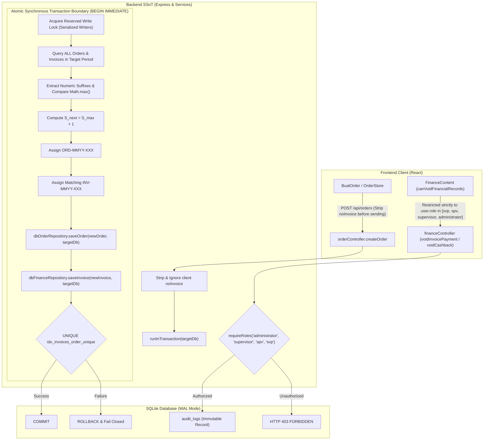
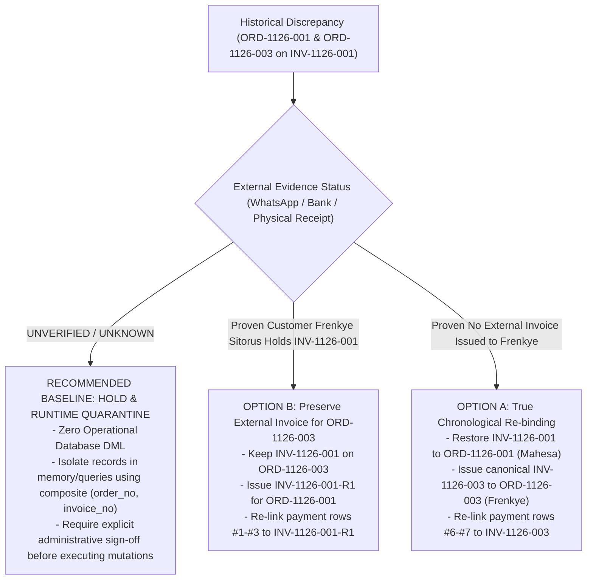

# PHASE 4B BATCH 2C — TECHNICAL DESIGN DOCUMENT
## FINANCIAL DATA RECONCILIATION, BACKEND INVOICE SSoT & RBAC ALIGNMENT

**Project:** SUN89 / SUNBiroJasa Admin Platform  
**Target Milestone:** Phase 4B Batch 2C  
**Document Revision:** 1.1-DESIGN (Targeted Corrections & Evidentiary Consolidation)  
**Mode:** STRICT DESIGN ONLY — IMPLEMENTATION NOT AUTHORIZED  
**Baseline:** Phase 4B Batch 2B Acceptance (Revision 2.8-FINAL.7 + Final Snapshot & Delete Contract Fix)  
**Date:** 2026-11-11  

---

## Document Revision History

| Revision | Date | Author | Summary of Changes |
| :--- | :---: | :---: | :--- |
| **1.0-DESIGN** | 2026-11-11 | Antigravity Pairing Agent | Initial draft covering Backend Invoice SSoT (`BD-FIN-03`), Order-Invoice Uniqueness (`GAP-FIN-02`), Frontend Void RBAC (`GAP-FIN-07`), Historical Reconciliation (`BD-FIN-01`), and Pricing Scaffold Deprecation (`DEF-05`). |
| **1.1-DESIGN** | 2026-11-11 | Antigravity Pairing Agent | **Targeted Corrections & Rigorous Alignment:**<br>1. *Historical Reconciliation:* Corrected external issuance conclusion to **UNKNOWN**; added external evidence sources, verification checklists, and evidence boundaries; removed Option A as definitive recommendation; recommended **HOLD** pending verifiable external proof.<br>2. *Payment Mapping:* Added granular mapping table for `invoice_payments` rows #1–#7, explicitly detailing lifecycle transitions (#2→#3, #6→#7), unresolved relations (#1 vs #3), and impact on `kas_kantor`.<br>3. *Sequence Generation:* Replaced textual sorting with numeric suffix extraction, regex validation, period-wide max calculation across orders & invoices, fail-closed error handling, and realistic gap semantics.<br>4. *Transaction Infrastructure:* Aligned strictly with accepted Step A infrastructure (`BEGIN IMMEDIATE` reserved lock, concurrent WAL readers, driver-level `busy_timeout`, explicit `SQLITE_BUSY` error handling, synchronous callbacks, uniform `targetDb`).<br>5. *Frontend RBAC:* Removed all `jabatan` and substring matching from `canVoidFinancialRecords`; enforced canonical `user.role` from authenticated user context; guaranteed strict exclusion of `admin`.<br>6. *UNIQUE Index Migration:* Expanded preconditions (6 criteria including whitespace, invalid format, and dangling references); ensured old index is preserved until new index is created and verified.<br>7. *Invoice Revision Model:* Added dedicated architecture for invoice adjustments, credit notes, and document identity preservation.<br>8. *Test Strategy:* Formulated 12 explicit acceptance test scenarios without test execution. |

---

## 1. Executive Summary & Batch Objectives

Phase 4B Batch 2C represents the final architectural and financial integrity stabilization milestone of Phase 4. Following the successful acceptance of Batch 2B (which established atomic transaction infrastructure, canonical payment UUIDs, payment lifecycle in-place verification, cash ledger separation between Kas Messenger and Kas Kantor, and SVP-restricted permanent deletion), Batch 2C addresses the remaining systemic financial gaps identified during the Phase 4A audit and post-Batch 2B discovery.

### Primary Objectives:
1. **Backend Invoice Numbering SSoT (`BD-FIN-03` / `DEF-01`):**  
   Establish the backend as the sole, uncompromised Single Source of Truth (SSoT) for invoice number generation. Client requests (`data.noInvoice`, `data.payment.invoiceNo`) will be completely stripped and ignored at the API boundary. Invoice numbers will be generated sequentially inside `runInTransaction()` under a SQLite `BEGIN IMMEDIATE` reserved write lock using strict numeric suffix parsing, preventing race conditions, collisions, and forged numbering.
2. **Order–Invoice Uniqueness Enforcement (`GAP-FIN-02` / `DEF-02`):**  
   Enforce the fundamental 1-to-1 domain invariant between orders and invoices by adding an idempotent `UNIQUE INDEX` on `finance_invoices(order_no)` with comprehensive preconditions, accompanied by application-level anti-collision guards in `dbFinanceRepository.saveInvoice()`. The old index is preserved until the replacement index is verified.
3. **Frontend Void RBAC Alignment (`GAP-FIN-07` / `DEF-03`):**  
   Synchronize frontend UI visibility rules in `FinanceContent.tsx` with backend authorization. Specifically, remove role `admin` and eliminate all fragile `jabatan` substring matching from Void action helpers. Void buttons and modals will only be accessible to verified Supervisor (`svp`, `spv`, `supervisor`) and Administrator (`administrator`) identities parsed from the canonical authenticated session, eliminating misleading HTTP 403 errors.
4. **Historical Invoice Reconciliation Strategy (`BD-FIN-01` / `DEF-04`):**  
   Formulate a rigorous, evidence-based decision framework for the historical collision on `INV-1126-001` (shared between `ORD-1126-001` and `ORD-1126-003`). Because internal absence of documents does not prove absence of external issuance, external delivery status is classified as **UNKNOWN**. No speculative database mutations will be performed; the system recommends a **HOLD** on operational DML until external physical receipts, bank statements, or WhatsApp communications are formally verified.
5. **Invoice Revision / Reissue Domain Model:**  
   Define an explicit model for billing corrections, credit adjustments, and document reprints that preserves historical document identity and audit trails without violating table-level relational invariants.
6. **Dead Pricing Scaffold Deprecation (`DEF-05`):**  
   Safely deprecate and remove the dormant `addSamsatItem()` method in `apiPricingProvider.ts` which calls an unrouted Express endpoint (`POST /pricing/samsat`).

---

## 2. Current Architecture & Empirical Evidence

### 2.1 Invoice Numbering Divergence
Currently, invoice number creation is decentralized. Frontend stores calculate candidate numbers, and `server/src/services/orderService.ts` accommodates client input:

```typescript
// server/src/services/orderService.ts (Lines 672-678)
const rawNoInvoice = data.noInvoice !== undefined
  ? data.noInvoice
  : (data.payment?.invoiceNo !== undefined ? data.payment.invoiceNo : undefined);

let resolvedNoInvoice = (rawNoInvoice && String(rawNoInvoice).trim() && !String(rawNoInvoice).startsWith("INV-2026"))
  ? String(rawNoInvoice).trim()
  : matchingInvoiceNo;
```

**Architectural Defect:** If a client passes an invoice number, the backend adopts it. If it collides with another order's invoice, lines 680–701 execute a while-loop sequence search *outside* a write transaction using naive textual sorting (`ORDER BY order_no DESC LIMIT 50`), creating concurrency vulnerabilities and alphanumeric sorting errors (e.g. `ORD-1126-9` sorting after `ORD-1126-10`). Furthermore, `src/app/data/orderStore.ts` (lines 208, 237, 540) and `src/app/components/BuatOrder.tsx` explicitly generate and send `noInvoice`.

### 2.2 Lack of Database Unique Constraint on `order_no`
In `server/src/database/schema.ts` (lines 510–524), `finance_invoices` is defined as:

```sql
CREATE TABLE IF NOT EXISTS finance_invoices (
  id INTEGER PRIMARY KEY AUTOINCREMENT,
  invoice_no TEXT UNIQUE NOT NULL,
  order_no TEXT NOT NULL,
  customer TEXT NOT NULL,
  layanan TEXT NOT NULL,
  ...
);
CREATE INDEX IF NOT EXISTS idx_invoices_order ON finance_invoices(order_no);
```

**Architectural Defect:** `idx_invoices_order` is a standard non-unique index (`unique: 0`). While `dbFinanceRepository.saveInvoice()` contains application-level checks, the physical database schema permits multiple rows with the same `order_no`.

### 2.3 RBAC Divergence on Void Operations
Backend route definitions in `server/src/routes/financeRoutes.ts` enforce:

```typescript
// server/src/routes/financeRoutes.ts (Lines 123-136)
financeRouter.post(
  "/invoices/:id/payments/:paymentId/void",
  requireAuth,
  requireRoles("administrator", "supervisor", "spv", "svp"),
  voidInvoicePayment
);
financeRouter.post(
  "/invoices/:id/cashback-payout/void",
  requireAuth,
  requireRoles("administrator", "supervisor", "spv", "svp"),
  voidCashbackPayout
);
```

However, frontend `src/app/components/FinanceContent.tsx` defines:

```typescript
// src/app/components/FinanceContent.tsx (Lines 1084-1101)
const isSpvOrAdmin = useMemo(() => {
  ...
  return (
    ["administrator", "supervisor", "spv", "svp", "admin"].includes(r) ||
    j.includes("admin")
  );
}, []);
```

**Architectural Defect:** `isSpvOrAdmin` includes `"admin"` and performs substring checks on `j` (`jabatan`). In line 5168, `{isSpvOrAdmin && (<Button ...>)}` renders the Void button for Admin operators. Clicking it sends a request that is unconditionally rejected by Express with HTTP 403 `FORBIDDEN`. Furthermore, reliance on `jabatan` is an unverified heuristic that violates the canonical backend role contract.

### 2.4 Empirical Operational State of `INV-1126-001` and Payment Rows #1–#7
Direct inspection of `server/data/database.sqlite` reveals the physical state:

#### A. Invoices & Orders:
- **`finance_invoices`:**
  - Row 1: `id = 1`, `invoice_no = 'INV-1126-001'`, `order_no = 'ORD-1126-003'`, `customer = 'Frenkye Sitorus'`, `total_tagihan = 1258000`, `dibayar = 1258000`, `status = 'PAID'`.
  - Row 2: `id = 2`, `invoice_no = 'INV-1126-002'`, `order_no = 'ORD-1126-002'`, `customer = 'Gibran rakabuming raka'`, `total_tagihan = 59028000`, `status = 'UNPAID'`.
- **`orders`:**
  - `ORD-1126-001`: Customer Mahesa Alghifari S.Kom, created `2026-11-04 14:46`, `total_biaya = 613000`, `payment.invoiceNo = 'INV-1126-001'`. Has NO corresponding row in `finance_invoices`.
  - `ORD-1126-003`: Customer Frenkye Sitorus, created `2026-11-05 06:17`, `total_biaya = 1258000`, `payment.invoiceNo = 'INV-1126-001'`. Linked to Row 1 in `finance_invoices`.

#### B. Cash Ledger State (`kas_kantor`):
- Row 1: Saldo Awal = Rp 0.
- Row 2: `tanggal = 2026-11-04T14:46:40.982Z`, `keterangan = 'Pembayaran: INV-1126-001 - Mahesa Alghifari S.Kom (B 1234 V / BCA)'`, `debit = 563000`, `saldo = 563000`, `order_no = 'ORD-1126-001'`, `invoice_no = 'INV-1126-001'`.
- *Finding:* Only payment row #1 (`ORD-1126-001`) wrote an entry into `kas_kantor`. Payment rows #6 and #7 (`ORD-1126-003`) have `kas_kantor_id = null` and never posted cash entries to `kas_kantor`.

---

## 3. Defect Inventory

| Defect ID | Severity | Location | Root Cause | Concrete Business Impact |
| :--- | :---: | :--- | :--- | :--- |
| **DEF-01** | **HIGH** | `server/src/services/orderService.ts:672-700`<br>`src/app/data/orderStore.ts:208` | Backend allows client `noInvoice` input; sequence determination uses textual sorting (`ORDER BY DESC LIMIT 50`) outside write lock. | Race conditions under concurrent load; alphanumeric sorting errors; client can forge or skew invoice numbering sequence. |
| **DEF-02** | **HIGH** | `server/src/database/schema.ts:524`<br>`server/src/repositories/dbFinanceRepository.ts:350` | `idx_invoices_order` is non-unique; schema permits multiple invoices per order. | Risk of multiple invoices bound to a single order, breaking 1-to-1 ledger integrity and double-counting revenue. |
| **DEF-03** | **MEDIUM** | `src/app/components/FinanceContent.tsx:1084-1101, 5168` | Frontend check `isSpvOrAdmin` allows `admin` and inspects `jabatan` substring, diverging from backend middleware. | False-positive UI affordance; Admin users attempt Void actions and receive confusing HTTP 403 errors. |
| **DEF-04** | **MEDIUM** | `server/data/database.sqlite`<br>(Row ID 1 in `finance_invoices`) | Historical overwrite during startup backfill of `ORD-1126-003` into `INV-1126-001`; physical external issuance status is **UNKNOWN**. | `ORD-1126-001` has payment records and cash ledger entries but no invoice record; physical database contains cross-order invoice reference. |
| **DEF-05** | **LOW** | `src/data/api/apiPricingProvider.ts:184-201` | Method `addSamsatItem` calls unrouted Express path `POST /pricing/samsat`. | Dead code emitting unhandled 404 network requests if invoked (currently has 0 UI callers). |

---

## 4. Target Architecture & Design Principles



### Core Design Principles:
1. **Decision SSoT-1: Strip & Ignore Strategy:**  
   Backend will **strip and ignore** any client-provided `noInvoice` or `payment.invoiceNo` at the controller/service boundary, rather than rejecting with HTTP 400. This provides forward/backward compatibility during rolling frontend deployments while guaranteeing that client input has zero influence over the final database record.
2. **Decision SSoT-2: In-Transaction Numeric Sequence Generation:**  
   Sequence determination occurs strictly **inside** `runInTransaction()` under a SQLite `BEGIN IMMEDIATE` lock. The algorithm validates format, parses the numeric suffix, computes `Math.max()` numerically, and fails closed if the sequence cannot be safely determined.
3. **Decision UNIQ-1: Safe Two-Stage Unique Index Migration:**  
   The non-unique `idx_invoices_order` index will be migrated to `idx_invoices_order_unique` enforcing `UNIQUE(order_no)`. A 6-point precondition audit verifies zero duplicates, anomalies, or dangling references before creating the index. The old index is only dropped *after* the new index is verified.
4. **Decision RBAC-1: Canonical Role-Based Void Authorization:**  
   `FinanceContent.tsx` replaces `isSpvOrAdmin` with `canVoidFinancialRecords`, checking strictly against `user.role` matching `["administrator", "supervisor", "spv", "svp"]`. All `jabatan` checks and substring matching are removed, and role `"admin"` is completely excluded.
5. **Decision TX-1: Strict Compatibility with Accepted Step A Transaction Infrastructure:**  
   All transaction callbacks are synchronous, execute on the uniform `targetDb` instance, leverage `BEGIN IMMEDIATE` for reserved write locking while allowing concurrent WAL readers, treat `busy_timeout` (5000ms) as a driver-level wait, and handle `SQLITE_BUSY` as an explicit retryable failure.

---

## 5. API Contract Changes

### 5.1 `POST /api/orders` (Order Creation)
- **Request Payload Modification:**
  - Field `noInvoice`: Ignored if sent by client. Stripped before service processing.
  - Field `payment.invoiceNo`: Ignored if sent by client. Stripped before service processing.
  - Field `rejectDuplicateInvoice`: Deprecated.
- **Response Contract (Unchanged Structure, Guaranteed Backend Identity):**
  - Returns `data.orderNo` (`ORD-MMYY-XXX`) and `data.payment.invoiceNo` (`INV-MMYY-XXX`).
  - Invoice number is guaranteed to be generated authoritatively by the backend.
- **Error Mapping:**
  - `SQLITE_BUSY` / `BUSY_TIMEOUT`: Mapped to HTTP 503 `SERVICE_UNAVAILABLE` with error message `"Sistem sedang sibuk memproses transaksi lain. Silakan coba beberapa saat lagi."`
  - `SQLITE_CONSTRAINT_UNIQUE`: Mapped to HTTP 409 `CONFLICT`.

### 5.2 `POST /api/finance/invoices/:id/payments/:paymentId/void` & `cashback-payout/void`
- **Contract Enforcement:**
  - Route signatures remain identical.
  - Role requirements remain: `administrator`, `supervisor`, `spv`, `svp`.
  - HTTP 403 `FORBIDDEN` error message standardized: `"Hanya Supervisor atau Administrator yang berwenang membatalkan transaksi finansial."`

---

## 6. Backend Service/Repository Changes

### 6.1 `server/src/services/orderService.ts`
- **Location:** Lines 640–705 (`createOrder`).
- **Changes:**
  1. Remove `rawNoInvoice` extraction from `data.noInvoice` and `data.payment.invoiceNo`.
  2. Move order number and invoice number sequence computation **inside** `runInTransaction(targetDb)`.
  3. Format order and invoice numbers deterministically using the numeric suffix algorithm (Section 9).
  4. Ensure all database writes (`orders`, `finance_invoices`, `kas_kantor`) execute synchronously on `targetDb`.

### 6.2 `server/src/repositories/dbFinanceRepository.ts`
- **Location:** Lines 350–370 (`saveInvoice`).
- **Changes:**
  1. Add strict validation:
     ```typescript
     if (!invoice.orderNo || !invoice.orderNo.trim()) {
       throw new ApiError(400, "INVALID_ORDER_RELATION", "Order number is mandatory for invoice persistence.");
     }
     ```
  2. Enforce 1-to-1 relational validation: query `SELECT id, invoice_no FROM finance_invoices WHERE order_no = ?`. If an existing record exists with a different `invoice_no`, throw `ApiError(409, "RELATIONAL_INTEGRITY_VIOLATION", "Order already has an assigned invoice.")`.
  3. Catch SQLite `SQLITE_CONSTRAINT_UNIQUE` error and map to `ApiError(409, "DUPLICATE_ORDER_INVOICE", "Invoice for this order already exists.")`.

---

## 7. Frontend Changes

### 7.1 `src/app/data/orderStore.ts` & `src/app/data/financeStore.ts`
- Remove client-side invoice sequence computation.
- Remove `noInvoice` property from order creation dispatch payloads.
- Store updates adopt the backend-returned `invoiceNo` from the API response payload.

### 7.2 `src/app/components/BuatOrder.tsx`
- Remove all visual inputs or hidden form fields for `noInvoice`.
- Display informative placeholder: `"Nomor Invoice akan di-generate otomatis oleh sistem setelah order dibuat."`

### 7.3 `src/app/components/FinanceContent.tsx`
- Replace `isSpvOrAdmin` with `canVoidFinancialRecords`:
  ```typescript
  const canVoidFinancialRecords = useMemo(() => {
    try {
      const savedUserStr = localStorage.getItem("auth_user");
      if (!savedUserStr) return false;
      const user = JSON.parse(savedUserStr);
      // STRICT RBAC: Only canonical user.role evaluated against allowed roles
      // No 'jabatan' inspection, no substring checks, and 'admin' is strictly excluded
      const r = String(user?.role || "").trim().toLowerCase();
      const allowedRoles = ["administrator", "supervisor", "spv", "svp"];
      return allowedRoles.includes(r);
    } catch {
      return false;
    }
  }, []);
  ```
- Update line 5168 (`voidTargetCashback` button) and payment void action triggers to use `canVoidFinancialRecords`.
- Role `"admin"` will evaluate to `false` and will NOT see Void buttons in the UI.

---

## 8. Database Schema and Migration Design

### 8.1 Migration Script: `2026-11-12-001-invoice-order-unique.ts`
The migration applies a safe two-stage transition with 6 explicit preconditions:

```typescript
export function runInvoiceOrderUniqueMigration(targetDb: DatabaseSync = db): { success: boolean; message: string } {
  return runInTransaction(() => {
    // PRECONDITION 1: Exact duplicate order_no
    const duplicates = targetDb.prepare(`
      SELECT order_no, COUNT(*) as cnt
      FROM finance_invoices
      WHERE order_no IS NOT NULL AND trim(order_no) != ''
      GROUP BY order_no
      HAVING cnt > 1
    `).all() as { order_no: string; cnt: number }[];
    if (duplicates.length > 0) {
      throw new Error(`[MIGRATION_BLOCKED] Precondition 1 failed: Found ${duplicates.length} duplicate order_no entries.`);
    }

    // PRECONDITION 2: NULL or empty order_no
    const emptyRows = targetDb.prepare(`
      SELECT id, invoice_no FROM finance_invoices
      WHERE order_no IS NULL OR trim(order_no) = ''
    `).all() as any[];
    if (emptyRows.length > 0) {
      throw new Error(`[MIGRATION_BLOCKED] Precondition 2 failed: Found ${emptyRows.length} rows with NULL/empty order_no.`);
    }

    // PRECONDITION 3: Whitespace anomalies
    const whitespaceRows = targetDb.prepare(`
      SELECT id, order_no FROM finance_invoices
      WHERE order_no != trim(order_no)
    `).all() as any[];
    if (whitespaceRows.length > 0) {
      throw new Error(`[MIGRATION_BLOCKED] Precondition 3 failed: Found ${whitespaceRows.length} rows with untrimmed whitespace.`);
    }

    // PRECONDITION 4: Invalid format structure
    const invalidFormatRows = targetDb.prepare(`
      SELECT id, order_no FROM finance_invoices
      WHERE order_no NOT GLOB 'ORD-[0-9][0-9][0-9][0-9]-*'
    `).all() as any[];
    if (invalidFormatRows.length > 0) {
      throw new Error(`[MIGRATION_BLOCKED] Precondition 4 failed: Found ${invalidFormatRows.length} rows with invalid format.`);
    }

    // PRECONDITION 5: Dangling order_no not found in orders table
    const danglingRows = targetDb.prepare(`
      SELECT fi.id, fi.order_no FROM finance_invoices fi
      LEFT JOIN orders o ON fi.order_no = o.order_no
      WHERE o.order_no IS NULL
    `).all() as any[];
    if (danglingRows.length > 0) {
      throw new Error(`[MIGRATION_BLOCKED] Precondition 5 failed: Found ${danglingRows.length} dangling invoice-order relations.`);
    }

    // PRECONDITION 6: Domain equivalent format variations (e.g. leading zeros ORD-1126-1 vs ORD-1126-001)
    const allInvoices = targetDb.prepare(`SELECT id, order_no FROM finance_invoices`).all() as { id: number; order_no: string }[];
    const canonicalOrderSet = new Set<string>();
    for (const row of allInvoices) {
      const match = row.order_no.match(/^ORD-(\d{4})-(\d+)$/);
      if (match) {
        const canonicalKey = `ORD-${match[1]}-${parseInt(match[2], 10)}`;
        if (canonicalOrderSet.has(canonicalKey)) {
          throw new Error(`[MIGRATION_BLOCKED] Precondition 6 failed: Equivalent numerical order variant detected for ${row.order_no}.`);
        }
        canonicalOrderSet.add(canonicalKey);
      }
    }

    // SAFE TWO-STAGE INDEX CREATION:
    // 1. Create the new unique index first
    targetDb.exec(`CREATE UNIQUE INDEX IF NOT EXISTS idx_invoices_order_unique ON finance_invoices(order_no);`);

    // 2. Verify that the unique index exists and is valid
    const indexCheck = targetDb.prepare(`
      SELECT name, "unique" FROM pragma_index_list('finance_invoices') WHERE name = 'idx_invoices_order_unique'
    `).get() as { name: string; unique: number } | undefined;

    if (!indexCheck || indexCheck.unique !== 1) {
      throw new Error(`[MIGRATION_FAILED] Verification of idx_invoices_order_unique failed.`);
    }

    // 3. Only after verification, safely drop the old non-unique index
    targetDb.exec(`DROP INDEX IF EXISTS idx_invoices_order;`);

    return { success: true, message: "UNIQUE index idx_invoices_order_unique successfully created and verified." };
  }, targetDb);
}
```

### 8.2 Rollback Strategy
```sql
CREATE INDEX IF NOT EXISTS idx_invoices_order ON finance_invoices(order_no);
DROP INDEX IF EXISTS idx_invoices_order_unique;
```

---

## 9. Invoice Numbering Algorithm & Concurrency Behavior

### 9.1 SSoT Sequential Generation Algorithm
Naive textual sorting (`ORDER BY order_no DESC LIMIT 50`) is strictly forbidden because alphanumeric sorting misorders numbers of differing digit lengths (e.g., `'ORD-1126-10'` sorts before `'ORD-1126-9'`).

The authoritative algorithm operates as follows:

```typescript
function generateNextMonotonicOrderAndInvoice(
  targetDb: DatabaseSync,
  referenceDate: Date = new Date()
): { orderNo: string; invoiceNo: string } {
  // 1. Derive current 4-digit period code (MMYY), e.g., '1126'
  const mm = String(referenceDate.getMonth() + 1).padStart(2, "0");
  const yy = String(referenceDate.getFullYear()).slice(-2);
  const periodCode = `${mm}${yy}`;
  const orderPrefix = `ORD-${periodCode}-`;
  const invoicePrefix = `INV-${periodCode}-`;

  // 2. Query ALL orders and invoices in the period using the transaction's targetDb
  const existingOrders = targetDb.prepare(`
    SELECT order_no FROM orders WHERE order_no GLOB ?
  `).all(`${orderPrefix}*`) as { order_no: string }[];

  const existingInvoices = targetDb.prepare(`
    SELECT invoice_no FROM finance_invoices WHERE invoice_no GLOB ?
  `).all(`${invoicePrefix}*`) as { invoice_no: string }[];

  // 3. Extract and parse numeric suffixes numerically
  let maxSuffix = 0;
  const orderRegex = new RegExp(`^ORD-${periodCode}-(\\d+)$`);
  const invoiceRegex = new RegExp(`^INV-${periodCode}-(\\d+)$`);

  for (const row of existingOrders) {
    const match = row.order_no.match(orderRegex);
    if (!match) {
      // Non-standard historical format detected
      console.warn(`[SEQUENCE_ANOMALY] Non-standard order number format: ${row.order_no}`);
      continue;
    }
    const num = parseInt(match[1], 10);
    if (isNaN(num)) {
      throw new Error(`[SEQUENCE_CORRUPTION] Non-numeric suffix found in order: ${row.order_no}`);
    }
    if (num > maxSuffix) maxSuffix = num;
  }

  for (const row of existingInvoices) {
    const match = row.invoice_no.match(invoiceRegex);
    if (!match) {
      console.warn(`[SEQUENCE_ANOMALY] Non-standard invoice number format: ${row.invoice_no}`);
      continue;
    }
    const num = parseInt(match[1], 10);
    if (isNaN(num)) {
      throw new Error(`[SEQUENCE_CORRUPTION] Non-numeric suffix found in invoice: ${row.invoice_no}`);
    }
    if (num > maxSuffix) maxSuffix = num;
  }

  // 4. Next sequence suffix S_next = maxSuffix + 1
  const nextSuffix = maxSuffix + 1;
  if (nextSuffix > 999999) {
    throw new Error(`[SEQUENCE_OVERFLOW] Suffix limit reached for period ${periodCode}.`);
  }

  const paddedSuffix = String(nextSuffix).padStart(3, "0");
  const candidateOrderNo = `${orderPrefix}${paddedSuffix}`;
  const candidateInvoiceNo = `${invoicePrefix}${paddedSuffix}`;

  // 5. Relational Verification Guard: Verify candidate availability in both domains
  const existingOrderCheck = targetDb.prepare(`SELECT 1 FROM orders WHERE order_no = ?`).get(candidateOrderNo);
  const existingInvoiceCheck = targetDb.prepare(`SELECT 1 FROM finance_invoices WHERE invoice_no = ?`).get(candidateInvoiceNo);

  if (existingOrderCheck || existingInvoiceCheck) {
    throw new Error(`[SEQUENCE_COLLISION_DETECTED] Computed candidate ${candidateOrderNo} or ${candidateInvoiceNo} already exists.`);
  }

  return { orderNo: candidateOrderNo, invoiceNo: candidateInvoiceNo };
}
```

### 9.2 Transaction Infrastructure Compatibility & Concurrency Behavior
This design strictly conforms to Step A transaction infrastructure:
1. **`BEGIN IMMEDIATE` Reserved Write Lock:**  
   `runInTransaction(callback, targetDb)` executes `BEGIN IMMEDIATE`. In SQLite, `BEGIN IMMEDIATE` reserves the write lock immediately, preventing other connections from acquiring write locks or beginning write transactions simultaneously.
2. **Concurrent WAL Readers:**  
   Because SQLite runs in Write-Ahead Logging (WAL) mode, read queries from other connections are never blocked by the reserved write lock.
3. **Driver-Level `busy_timeout`:**  
   The configured `busy_timeout = 5000` instructs the SQLite driver to pause and wait up to 5000ms if another writer holds the reserved lock. It is NOT an application-level loop.
4. **Explicit `SQLITE_BUSY` Handling:**  
   If the lock cannot be acquired within 5000ms, SQLite throws an error with `errcode = 5` (`SQLITE_BUSY`). The backend catches this, aborts the request, and returns HTTP 503 `SERVICE_UNAVAILABLE` to the client.
5. **Synchronous Execution:**  
   Node.js `node:sqlite` (`DatabaseSync`) requires all statements within transactions to be synchronous. The callback must execute synchronously on the exact same `targetDb` instance passed to the helper.
6. **Gap Semantics & Monotonicity:**  
   In accounting systems, transactions that roll back (e.g. Due to network loss or validation failure before commit) do not reuse rolled-back sequence numbers. Therefore, the sequence is guaranteed to be strictly monotonic (`N+1 > N`), but zero-gap cannot and should not be guaranteed across hard crashes or rollbacks.

---

## 10. Order–Invoice Uniqueness Strategy

1. **Domain Rule:** In SUN89, an order represents a single commercial engagement and is bound to exactly one authoritative financial invoice throughout its lifecycle.
2. **Database Constraint:** `UNIQUE INDEX idx_invoices_order_unique ON finance_invoices(order_no)` physically prevents more than one invoice row per `order_no`.
3. **Application Defense:** `dbFinanceRepository.saveInvoice()` performs proactive relational checks before attempting insert/update.
4. **Collision Handling:** If a concurrent thread attempts duplicate insertion, the unique index aborts the transaction with `SQLITE_CONSTRAINT_UNIQUE`, which the repository maps to HTTP 409 `CONFLICT`.

---

## 11. RBAC Matrix for Void Operations

| Role (`user.role`) | UI Button Display | Backend Middleware (`requireRoles`) | Execution Status | HTTP Code |
| :--- | :---: | :---: | :---: | :---: |
| **`supervisor` / `spv` / `svp`** | **VISIBLE** | **ALLOWED** | **PERMITTED** | **200 OK** |
| **`administrator`** | **VISIBLE** | **ALLOWED** | **PERMITTED** | **200 OK** |
| **`admin` (Operator)** | **HIDDEN** | **BLOCKED** | **REJECTED** | **403 FORBIDDEN** |
| **`finance`** | **HIDDEN** | **BLOCKED** | **REJECTED** | **403 FORBIDDEN** |
| **`messenger` / Courier** | **HIDDEN** | **BLOCKED** | **REJECTED** | **403 FORBIDDEN** |
| **Unauthenticated / Anonymous** | **HIDDEN** | **BLOCKED** | **REJECTED** | **401 UNAUTHORIZED** |

> [!IMPORTANT]
> The helper `canVoidFinancialRecords` in `FinanceContent.tsx` strictly inspects `user.role`. Text field `jabatan` is completely removed from authorization logic. Role `"admin"` will never see the Void button or modal.

---

## 12. Historical Reconciliation Framework (`BD-FIN-01`)

### 12.1 Critical Evidentiary Correction: External Issuance Status is UNKNOWN
During earlier phases, it was observed that internal SQLite tables `documents` and `audit_logs` contained 0 records of invoices printed, generated, or emailed for `INV-1126-001`.

> [!WARNING]
> **Critical Correction:** The absence of records in `documents` and `audit_logs` only proves that the internal software did not persist digital files or audit records. It **DOES NOT** prove that physical paper receipts, manual invoices, or external communications were never delivered to customers. Therefore, the external issuance status is formally classified as **UNKNOWN**. Option A is **NOT** a final recommendation.

### 12.2 Evidence Boundaries & Verification Checklist
Before any operational database changes can be considered, the following evidence must be audited:

| Category | Source | What Must Be Verified | Verification Boundary / Current Status |
| :--- | :--- | :--- | :--- |
| **Physical Paper** | Office Cashier File / Physical Receipt Book | Check whether physical carbon-copy kwitansi or printed invoice was issued to Frenkye Sitorus or Mahesa Alghifari. | **UNVERIFIED (Off-system)**. Requires physical inspection by office staff. |
| **Communication** | WhatsApp Business / Email Archive | Search chat history for keyword `INV-1126-001`, `ORD-1126-001`, `ORD-1126-003` sent to customer phone numbers. | **UNVERIFIED (Off-system)**. Requires WhatsApp Business export. |
| **Banking Records** | Bank BCA / Mandiri Statements | Inspect bank statement description on 2026-11-04 (Rp 563.000) and 2026-11-05/07 (Rp 1.258.000) for invoice references. | **UNVERIFIED (Off-system)**. Requires bank statement reconciliation. |
| **Internal DB** | `server/data/database.sqlite` | Tables `orders`, `finance_invoices`, `invoice_payments`, `kas_kantor`, `documents`, `audit_logs`. | **COMPLETED & PROVEN**. Exact row values and references established. |

#### What Can and Cannot Be Concluded:
- **CAN BE CONCLUDED:** Internally, the database has an irregular state where `ORD-1126-003` overwrote the `invoice_no = 'INV-1126-001'` registration in `finance_invoices`, leaving `ORD-1126-001` with payment records and a `kas_kantor` entry but no invoice master row.
- **CANNOT BE CONCLUDED:** We cannot conclude whether customer Frenkye Sitorus or customer Mahesa Alghifari holds a legal or financial document titled `INV-1126-001`. Mutating this reference without confirmation risks commercial and tax disputes.

---

### 12.3 Granular Payment History Mapping (`invoice_payments` Rows #1–#7)

Below is the complete empirical mapping of historical payment rows in `server/data/database.sqlite`:

| ID | Order No | Invoice No | Nominal | Status Verifikasi | Kas Kantor ID | Created At | Catatan / Role | Historical Analysis & Relationship |
| :---: | :---: | :---: | :---: | :---: | :---: | :---: | :--- | :--- |
| **1** | `ORD-1126-001` | `INV-1126-001` | Rp 563.000 | `TERVERIFIKASI` | **2** | 2026-11-04 14:46:41 | Pembayaran awal saat pembuatan order | **Runtime Original:** Created during order entry; posted Rp 563.000 to `kas_kantor` (Row 2). |
| **2** | `ORD-1126-001` | `INV-1126-001` | Rp 563.000 | `MENUNGGU_VERIFIKASI` | `null` | 2026-11-05 05:37:36 | Migrasi historis payment record | **Lifecycle Transition Phase 1:** Created by migration backfill; represents unverified state. |
| **3** | `ORD-1126-001` | `INV-1126-001` | Rp 563.000 | `TERVERIFIKASI` | `null` | 2026-11-05 05:37:36 | Verifikasi Pembayaran Awal | **Lifecycle Transition Phase 2 (#2 → #3):** Verified transition of row #2. **Relation to #1 is UNRESOLVED** (duplicate migration). |
| **4** | `ORD-1126-002` | `INV-1126-002` | Rp 59.028.000 | `MENUNGGU_BUKTI` | `null` | 2026-11-05 07:23:08 | Pembayaran awal saat pembuatan order | **Runtime Original:** Unverified downpayment record for Order 002. |
| **5** | `ORD-1126-002` | `INV-1126-002` | Rp 59.028.000 | `MENUNGGU_BUKTI` | `null` | 2026-11-05 16:28:46 | Migrasi historis payment record | **Migration Backfill Duplicate:** Duplicate unverified entry for Order 002. |
| **6** | `ORD-1126-003` | `INV-1126-001` | Rp 1.258.000 | `MENUNGGU_VERIFIKASI` | `null` | 2026-11-10 01:07:55 | Migrasi historis payment record | **Lifecycle Transition Phase 1:** Initial unverified backfill state for Order 003. |
| **7** | `ORD-1126-003` | `INV-1126-001` | Rp 1.258.000 | `TERVERIFIKASI` | `null` | 2026-11-10 01:07:55 | Verifikasi Pembayaran Awal | **Lifecycle Transition Phase 2 (#6 → #7):** Verified transition of row #6. |

#### Key Empirical Deductions:
1. **Row #2 → Row #3 is a Lifecycle Transition:** Both rows share identical timestamp (`2026-11-05 05:37:36`). Row #3 represents the verified state of the unverified record in Row #2.
2. **Row #6 → Row #7 is a Lifecycle Transition:** Both rows share identical timestamp (`2026-11-10 01:07:55`). Row #7 represents the verified state of the unverified record in Row #6.
3. **Relationship between #1 and #3 is UNRESOLVED:** Row #1 was created on 2026-11-04 and is linked to `kas_kantor` (ID 2). Row #3 was created on 2026-11-05 by a migration script. Whether Row #3 was intended to supersede Row #1 or was an unintended duplicate cannot be proven from the database alone.
4. **Kas Kantor Impact:** `kas_kantor` ONLY contains Rp 563.000 from Row #1. Payment rows #6 and #7 never posted to `kas_kantor`.

---

### 12.4 Comparison of Reconciliation Options



#### Detailed Breakdown of Options:

| Dimension | OPTION A (Chronological Re-binding) | OPTION B (Preserve Registered Row) | OPTION C / HOLD (Recommended Baseline) |
| :--- | :--- | :--- | :--- |
| **Core Concept** | Rebind `INV-1126-001` to `ORD-1126-001`; issue new `INV-1126-003` to `ORD-1126-003`. | Keep `INV-1126-001` on `ORD-1126-003`; issue `INV-1126-001-R1` to `ORD-1126-001`. | **NO DML APPLIED.** Maintain current database state; isolate queries using composite keys. |
| **Payment IDs Retained** | Retain #1, #4, #7. Soft-quarantine #2, #3, #5, #6. | Retain #1, #4, #7. Soft-quarantine #2, #3, #5, #6. | Retain all rows #1–#7 exactly as they physically exist. |
| **Proposed Relational Changes** | `finance_invoices` (ID 1) `order_no` changed to `ORD-1126-001`. New invoice `INV-1126-003` inserted for `ORD-1126-003`. Rows #6, #7 re-linked to `INV-1126-003`. | `finance_invoices` (ID 1) remains bound to `ORD-1126-003`. New invoice `INV-1126-001-R1` inserted for `ORD-1126-001`. Rows #1–#3 re-linked. | **Zero relational changes.** |
| **Status Changes** | None required. | None required. | **Zero status changes.** |
| **Payment Calculation Impact** | Prevents double counting Rp 563.000 in `ORD-1126-001`. `ORD-1126-003` total paid matches Rp 1.258.000. | Same as Option A. | Application calculates balances using composite `(invoice_no, order_no)` to prevent bleed. |
| **Preconditions to Prove** | **Mandatory:** Written proof that Frenkye Sitorus was NOT issued `INV-1126-001` paper/WhatsApp document. | **Mandatory:** Written proof that Frenkye Sitorus was issued `INV-1126-001`. | **None.** Safe default that prevents irreversible data corruption. |

> [!CAUTION]
> **Definitive Recommendation:** Because external evidence is currently **UNKNOWN**, the system **MUST MAINTAIN HOLD STATUS**. The standalone reconciliation script (`scripts/reconcile-historical-inv-1126.ts`) will be implemented and tested in `--dry-run` and sandbox environments only. **No DML will be executed against the operational database until written business approval is granted.**

---

## 13. Invoice Revision & Reissue Domain Model

To prevent future collisions and address business requirements for billing modifications, SUN89 adopts a formal Invoice Revision & Reissue architecture:

### 13.1 Architecture Overview
1. **Primary Invoice Ledger Invariant:**  
   Every order has exactly one primary financial ledger record in `finance_invoices` bound by `UNIQUE(order_no)`. This table serves as the authoritative settlement balance sheet (`total_tagihan`, `dibayar`, `sisa`, `profit_final`).
2. **In-Place Settlement Revision with Audit Snapshot:**  
   When billing amounts, services, or line items change prior to final settlement:
   - The primary `finance_invoices` record is updated in-place inside `runInTransaction(BEGIN IMMEDIATE)`.
   - The previous state is immutably appended to `data_json.revisions` array within `finance_invoices`:
     ```json
     {
       "revision_id": "REV-20261111-001",
       "revised_at": "2026-11-11T12:00:00Z",
       "revised_by": "SPV-001",
       "reason": "Penyesuaian biaya samsat sesuai penetapan notice pajak",
       "previous_snapshot": { "total_tagihan": 1258000, "biaya_samsat": 1000000 }
     }
     ```
   - An immutable event is logged in `audit_logs` with action `INVOICE_BILLING_REVISED`.
3. **Document Reissue (Reprinting & Customer Delivery):**  
   If an amended invoice must be provided to a customer:
   - The system generates an amended document code: `${invoice_no}-R${revisionCount}` (e.g., `INV-1126-001-R1`).
   - The generated document metadata is persisted in `documents` (`document_type = 'INVOICE'`, `invoice_id = invoices.id`, `order_no = orders.order_no`).
   - The financial ledger record `finance_invoices.invoice_no` remains the stable anchor `INV-1126-001`, preserving payment foreign keys and cash ledger links.
4. **Formal Cancellation & Credit Note Model:**  
   If an entire order and its invoice are cancelled:
   - `finance_invoices.status` transitions to `'VOID'`.
   - All associated payments must be voided via the canonical Void workflow (`voidInvoicePayment`), reversing cash entries in `kas_kantor` or `kas_messenger`.
   - The row is never deleted, ensuring complete audit traceability.

---

## 14. Transaction, Idempotency, Audit, and Rollback Strategy

1. **Transaction Encapsulation:** Every mutation in Batch 2C executes via `runInTransaction(callback, targetDb)` using `BEGIN IMMEDIATE`.
2. **Synchronous Callbacks:** All database operations within transactions are synchronous.
3. **Idempotency Persistence:** Administrative reconciliation scripts and migration runners write execution tokens to `idempotency_keys` with scope `BATCH_2C_RECONCILIATION`.
4. **Audit Trail:** Any administrative reconciliation actions record complete pre- and post-mutation row snapshots in `audit_logs` with action `RECONCILIATION_UPDATE`.
5. **Rollback Safety:** If any foreign key, uniqueness check, or constraint fails, SQLite rolls back to the initial state; connections encountering fatal errors fail closed.

---

## 15. Failure Scenarios and Recovery Plan

| Failure Scenario | Trigger Condition | Automated System Behavior | Recovery Action |
| :--- | :--- | :--- | :--- |
| **`SQLITE_BUSY` Timeout** | Concurrent writes hold lock longer than 5000ms. | SQLite driver throws `SQLITE_BUSY`; transaction aborts; mapped to HTTP 503 `SERVICE_UNAVAILABLE`. | Client receives clear error; client-side retry or user re-submission succeeds once lock clears. |
| **Malformed Sequence in Database** | Existing order has non-numeric or malformed suffix (e.g. `ORD-1126-ABC`). | Sequence generator regex detects malformation; logs warning; falls back to strictly numeric entries or fails closed if indeterminate. | System administrators resolve malformed order number via administrative script. |
| **Order/Invoice Persistence Failure** | Disk full, constraint failure, or crash between `saveOrder` and `saveInvoice`. | Atomic transaction rolls back completely; neither order nor invoice is written. | Zero orphaned records; client retries cleanly. |
| **Migration Precondition Failure** | Operational database has duplicate `order_no` or whitespace anomalies prior to index creation. | Migration precondition throws explicit `[MIGRATION_BLOCKED]` error; transaction rolls back; index is NOT created. | Run diagnostic script, resolve dirty data, and re-run migration. |
| **Unauthorized Void Attempt** | Admin user attempts cURL `POST /payments/:id/void`. | Express middleware `requireRoles` rejects with HTTP 403 `FORBIDDEN`. | Zero DML; security event recorded in `audit_logs`. |
| **Reconciliation Script Precondition Failure** | Standalone script finds unexpected checksum or dirty state. | Script aborts immediately before issuing any `UPDATE` statements; reports diff to stdout. | No database changes made; manual investigation required. |

---

## 16. Test Strategy & Acceptance Scenarios

> [!NOTE]
> In accordance with the STRICT DESIGN ONLY directive, no test files will be created or executed during this turn. The following scenarios constitute the mandatory test specification for the subsequent implementation turn.

### Dedicated Acceptance Test Suite Specification
**Target File:** `tests/phase4b-batch2c-invoice-ssot-rbac.test.ts`  
**Execution Environment:** Isolated in-memory/temporary SQLite database via `scripts/run-test-isolated.cjs`.

### 12 Explicit Acceptance Scenarios:
1. **`SCENARIO-01: Malformed Sequence Handling`**  
   *Precondition:* Database contains order with malformed number `ORD-1126-CORRUPT`.  
   *Action:* Call sequence generator.  
   *Expected:* System logs warning, ignores non-numeric suffix, extracts highest valid numeric suffix, and generates next valid sequence without throwing unhandled exception.
2. **`SCENARIO-02: Numeric Suffix Ordering vs Textual Sorting`**  
   *Precondition:* Database contains `ORD-1126-9` and `ORD-1126-10`. (Textually `'ORD-1126-9' > 'ORD-1126-10'`).  
   *Action:* Call sequence generator.  
   *Expected:* Numeric parsing identifies 10 as maximum; generates `ORD-1126-011` and `INV-1126-011` (never `ORD-1126-010`).
3. **`SCENARIO-03: Concurrent Creation Under Contention`**  
   *Precondition:* Multiple simulated concurrent requests submit orders simultaneously.  
   *Action:* Execute parallel `orderService.createOrder()` calls.  
   *Expected:* `BEGIN IMMEDIATE` serializes execution; each order receives a distinct, strictly increasing sequence without collision or constraint errors.
4. **`SCENARIO-04: SQLITE_BUSY Timeout Handling`**  
   *Precondition:* A separate transaction artificially holds a write lock exceeding `busy_timeout` (5000ms).  
   *Action:* Submit order creation request.  
   *Expected:* Service fails closed, catches `SQLITE_BUSY`, and returns standardized HTTP 503 error without crashing the server process.
5. **`SCENARIO-05: Rollback on Persistence Failure`**  
   *Precondition:* Mock failure triggered during invoice creation after order record is inserted.  
   *Action:* Execute `createOrder()`.  
   *Expected:* Transaction rolls back completely; neither `orders` nor `finance_invoices` contains orphaned rows.
6. **`SCENARIO-06: Migration Failure and Rollback on Dirty Precondition`**  
   *Precondition:* Database manually seeded with duplicate `order_no` in `finance_invoices`.  
   *Action:* Execute `runInvoiceOrderUniqueMigration()`.  
   *Expected:* Migration throws `[MIGRATION_BLOCKED]`, transaction rolls back, and old index `idx_invoices_order` remains intact.
7. **`SCENARIO-07: Frontend Role Evaluation from Authenticated Context`**  
   *Precondition:* Render frontend authorization component with user having `role: 'admin'`, `jabatan: 'Supervisor'`.  
   *Action:* Evaluate `canVoidFinancialRecords`.  
   *Expected:* Returns `false` because `jabatan` is ignored and `role: 'admin'` is strictly excluded.
8. **`SCENARIO-08: Direct API Void Authorization`**  
   *Precondition:* Send `POST /invoices/:id/payments/:paymentId/void` with `admin` token.  
   *Action:* Execute request via Supertest.  
   *Expected:* Rejected by backend middleware with HTTP 403 `FORBIDDEN`.
9. **`SCENARIO-09: Payment Lifecycle Preservation`**  
   *Precondition:* Database contains historical rows #2→#3 and #6→#7.  
   *Action:* Query payment history through finance service.  
   *Expected:* Lifecycle transitions are preserved; unverified and verified transition records remain linked without loss of audit integrity.
10. **`SCENARIO-10: Reconciliation Dry-Run Without DML`**  
    *Precondition:* Standalone reconciliation script executed with `--dry-run`.  
    *Action:* Run script against test database.  
    *Expected:* Outputs proposed JSON diff; database SHA-256 hash before and after execution remains strictly identical.
11. **`SCENARIO-11: Reconciliation Precondition Failure`**  
    *Precondition:* Test database seeded with corrupted checksums or mismatched customer names.  
    *Action:* Execute reconciliation script in live mode.  
    *Expected:* Script aborts before any DML is issued; reports precondition failure code.
12. **`SCENARIO-12: Idempotent Replay`**  
    *Precondition:* Migration and sequence generators executed twice consecutively.  
    *Action:* Re-run migration and creation flows.  
    *Expected:* Operations complete successfully without errors, duplications, or state divergence.

---

## 17. Data Safety & Regression Protection

1. **Operational Database Hash Invariant:** Operational `server/data/database.sqlite` (SHA-256: `A8A4B1F77FCAB6EE0A9503B778DE7A7A7929100D9AD6F965EF707503609E379C`) will NOT be touched during testing. All test runs execute inside isolated temporary sandboxes via `scripts/run-test-isolated.cjs`.
2. **Uploads Integrity:** All 51 files in `public/uploads` (SHA-256: `4FD418787BCC18CBA3A55E78E02D87BDCA0372EBAA3BD8C696DB9C5B8C8242E5`) remain strictly read-only.
3. **Kas Messenger & Kas Kantor Immutability:** No changes to `cashLedgerCalculationService.ts` or `permanentDeleteService.ts`.

---

## 18. File-by-File Implementation Plan

| Step | Target File | Nature of Change | Purpose |
| :---: | :--- | :--- | :--- |
| **1** | `server/src/database/migrations/2026-11-12-001-invoice-order-unique.ts` | **NEW FILE** | Idempotent migration adding `UNIQUE INDEX idx_invoices_order_unique` with 6 preconditions. |
| **2** | `server/src/services/orderService.ts` | **MODIFICATION** | Strip client `noInvoice`; move sequence generation inside `runInTransaction(BEGIN IMMEDIATE)` with numeric suffix parser. |
| **3** | `server/src/repositories/dbFinanceRepository.ts` | **MODIFICATION** | Enforce mandatory `orderNo` and relational 1-to-1 constraint validation in `saveInvoice()`. |
| **4** | `src/app/data/orderStore.ts` & `BuatOrder.tsx` | **MODIFICATION** | Stop calculating/sending `noInvoice` in order creation payloads. |
| **5** | `src/app/components/FinanceContent.tsx` | **MODIFICATION** | Replace `isSpvOrAdmin` with `canVoidFinancialRecords` (strictly check `user.role`, remove `jabatan`). |
| **6** | `src/data/api/apiPricingProvider.ts` | **MODIFICATION** | Deprecate and remove unrouted `addSamsatItem()`. |
| **7** | `scripts/reconcile-historical-inv-1126.ts` | **NEW FILE** | Transactional reconciliation script with `--dry-run` and strict precondition safety guards. |
| **8** | `tests/phase4b-batch2c-invoice-ssot-rbac.test.ts` | **NEW FILE** | Acceptance test suite covering the 12 explicit scenarios. |

---

## 19. Out-of-Scope & Protected Exclusions

- ❌ **Step E (Void & Contra-Entry for Cash Ledgers):** PERMANENTLY EXCLUDED by user directive.
- ❌ **Phase 7 (Upload UI & Client-side Compression):** DEFERRED by user directive.
- ❌ **Kas Messenger & Kas Kantor Ledger Logic:** CLOSED & LOCKED.
- ❌ **Operational Database Migration:** STRICTLY FORBIDDEN without separate written user authorization.
- ❌ **Direct Execution of Reconciliation DML:** STRICTLY FORBIDDEN without verified external evidence.
- ❌ **Deployment / HTTPS / Go-Live:** STRICTLY FORBIDDEN.

---

## 20. Open Decisions, Missing Evidence & Unresolved Risks

Prior to implementation authorization, the following decisions, missing evidence, and risks must be formally reviewed:

### 20.1 Open Decisions Requiring User Approval:
1. **Client `noInvoice` Handling:**  
   Confirm approval of the recommended **Strip & Ignore** strategy (discarding client input and generating sequential numbers authoritatively on the backend).
2. **Historical Reconciliation Selection (`BD-FIN-01`):**  
   Confirm acceptance of the recommended **HOLD baseline** (retaining existing physical rows in the operational database and quarantining query calculations) pending physical/external evidence verification, versus proceeding with Option A or Option B.
3. **Execution Boundary for Reconciliation Script:**  
   Confirm that the reconciliation script will strictly be tested on isolated sandbox databases, and that execution on the operational database is deferred.

### 20.2 List of Missing Evidence (Belum Tersedia):
1. **Physical Office Paper Receipts:** No carbon-copy receipts or manual cashier ledgers for 2026-11-04 to 2026-11-10 have been physically inspected.
2. **External Customer Communication Logs:** WhatsApp Business and email archives have not been searched for invoice dispatch to Frenkye Sitorus or Mahesa Alghifari.
3. **Bank Statement Reference Descriptions:** Official bank statement line descriptions matching transactions on 2026-11-04 (Rp 563.000) and 2026-11-05/07 (Rp 1.258.000) have not been reconciled.
4. **Original Intent of Payment Rows #1 vs #3:** No documentation exists explaining whether row #3 was intended to replace row #1 or was a duplicate created by a historical migration script.

### 20.3 List of Unresolved Risks (Risiko yang Belum Dapat Diselesaikan):
1. **External Invoicing Discrepancy Risk:** If Option A is executed prematurely and Frenkye Sitorus already holds a legal invoice titled `INV-1126-001`, renumbering internal records to `INV-1126-003` will create an unresolvable tax and audit discrepancy.
2. **Sequence Monotonicity under Transaction Abort:** If an order creation transaction aborts after sequence calculation, the allocated sequence number is rolled back. In high-concurrency environments, this may produce sequence gaps (e.g. `001`, `003` if `002` rolled back). While standard in accounting, this must be recognized by business management.
3. **Legacy Migration Backfill Dirty Rows:** If untracked database tables contain historical unnormalized order numbers, index creation could fail if new edge cases outside the 6 preconditions exist.
