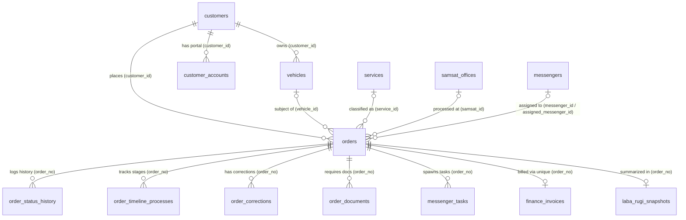
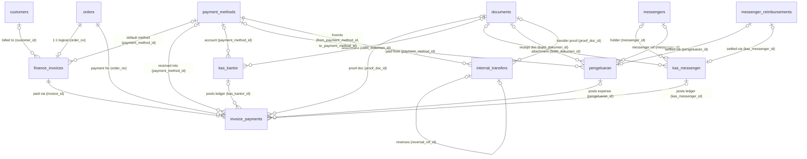
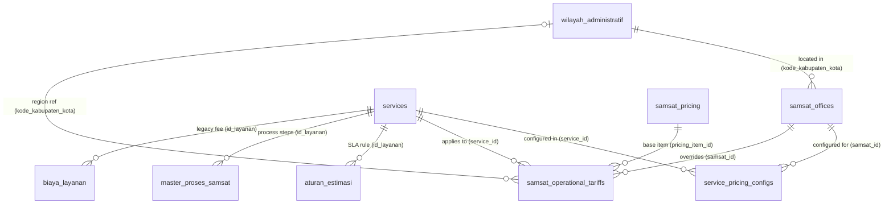
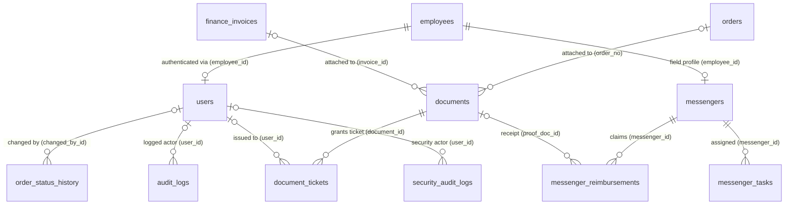

# COMPLETE DATABASE ENTITY RELATIONSHIP & SCHEMA DOCUMENTATION
**Project:** Admin SUN89 / SUNBiroJasa (`d:\Admin\adminsunbirojasa`)  
**Database Engine:** SQLite 3 via Node.js Built-in `node:sqlite` (`DatabaseSync`)  
**Journal Mode & Pragmas:** `PRAGMA journal_mode = WAL`, `PRAGMA foreign_keys = ON`, `PRAGMA busy_timeout = 5000`  
**Source of Truth:** `server/src/database/schema.ts`, `server/src/database/migrations/*`, and live catalog introspection of `isolated_database.sqlite`.

---

## 1. EXECUTIVE SUMMARY & METRICS

| Metric | Count | Details |
| :--- | :---: | :--- |
| **Total Database Tables** | **42** | 17 Core Entities, 14 Supporting Entities, 2 Junction/Link Tables, 7 Audit/System Tables, 2 Legacy Tables |
| **Total Columns** | **517** | Across all 42 tables (100% documented below) |
| **Total Primary Keys** | **42** | 8 `INTEGER PRIMARY KEY AUTOINCREMENT` tables + 34 `TEXT PRIMARY KEY` tables |
| **Declared SQL Foreign Keys** | **54** | Enforced at runtime by SQLite `PRAGMA foreign_keys = ON` across 22 tables |
| **Implicit / Logical Foreign Keys** | **23** | Enforced by application services/repositories & unique indexes |
| **Total Database Indexes** | **112** | 73 explicit `CREATE [UNIQUE] INDEX` + 39 SQLite internal `sqlite_autoindex_*` |

---

## 2. ENTITY CLASSIFICATION & COLOR-CODED OVERVIEW

Visual diagram files generated alongside this document:
- **Full Zoomable Vector ERD:** [ERD_Overview.svg](file:///d:/Admin/adminsunbirojasa/documentation/ERD_Overview.svg)
- **High-Resolution Raster ERD:** [ERD_Overview.png](file:///d:/Admin/adminsunbirojasa/documentation/ERD_Overview.png)

| No | Table Name | Category | Domain | Columns | Primary Key | Auto-Inc | SQL FKs | Logical FKs | Indexes | Purpose / Description |
| :-: | :--- | :--- | :--- | :---: | :--- | :---: | :---: | :---: | :---: | :--- |
| 1 | `aturan_estimasi` | **SUPPORTING** | Pricing, Samsat & Wilayah | 8 | `id` | No | 1 | 0 | 2 | Aturan kalkulasi estimasi waktu selesai berdasarkan jenis layanan dan kantor Samsat. |
| 2 | `audit_logs` | **AUDIT_SYSTEM** | Audit, System & Legacy | 9 | `id` | No | 0 | 1 | 2 | Log jejak audit imutabel atas seluruh aktivitas bisnis dan perubahan data oleh pengguna. |
| 3 | `biaya_layanan` | **LEGACY** | Audit, System & Legacy | 12 | `id` | No | 1 | 0 | 2 | [LEGACY] Tabel konfigurasi biaya layanan versi awal sebelum digantikan oleh service_pricing_configs. |
| 4 | `customer_accounts` | **SUPPORTING** | Customer & Vehicle | 9 | `id` | No | 1 | 0 | 4 | Akun portal pelanggan eksternal yang terhubung ke entitas customers. |
| 5 | `customers` | **CORE** | Customer & Vehicle | 16 | `id` | No | 0 | 0 | 4 | Master data pelanggan (perorangan/korporasi), kontak, identitas NIK, dan agregat loyalitas. |
| 6 | `document_tickets` | **SUPPORTING** | Messenger & Documents | 9 | `ticket_code` | No | 2 | 0 | 3 | Tiket akses sementara (one-time/short-lived token) untuk preview atau unduh dokumen secara aman. |
| 7 | `documents` | **SUPPORTING** | Messenger & Documents | 16 | `id` | No | 2 | 1 | 6 | Repositori metadata dokumen fisik/digital (bukti bayar, KTP, STNK, BPKB, bukti cashback) yang diunggah ke server. |
| 8 | `employees` | **CORE** | Identity, HR & RBAC | 15 | `id` | No | 0 | 0 | 5 | Master data kepegawaian internal (Admin, SVP, Finance, Messenger). |
| 9 | `estimation_templates` | **SUPPORTING** | Pricing, Samsat & Wilayah | 7 | `id` | No | 0 | 0 | 3 | Template estimasi durasi pengerjaan layanan (SLA hari kerja, tahapan proses, catatan dokumen). |
| 10 | `file_deletion_jobs` | **AUDIT_SYSTEM** | Audit, System & Legacy | 9 | `id` | No | 0 | 0 | 2 | Antrean pekerja penghapusan file fisik di disk secara asinkron/terjadwal (termasuk proses GDPR/erasure). |
| 11 | `finance_invoices` | **CORE** | Finance & Invoicing | 31 | `id` | Yes | 2 | 2 | 10 | Tagihan (invoice) resmi atas order: rincian biaya negara vs jasa, pajak, PPN, PPh23, cashback, DP, sisa tagihan, dan status verifikasi. |
| 12 | `harga_dasar_samsat` | **LEGACY** | Audit, System & Legacy | 8 | `id` | No | 0 | 0 | 3 | [LEGACY] Tabel harga dasar Samsat versi awal sebelum digantikan oleh samsat_pricing & samsat_operational_tariffs. |
| 13 | `idempotency_keys` | **AUDIT_SYSTEM** | Audit, System & Legacy | 7 | `key` | No | 0 | 1 | 3 | Penyimpanan kunci idempotensi request mutasi API untuk mencegah duplikasi transaksi finansial/order. |
| 14 | `internal_transfers` | **CORE** | Treasury & Ledgers | 16 | `id` | No | 3 | 1 | 5 | Mutasi pemindahan dana antar rekening/metode pembayaran internal beserta dukung reversal. |
| 15 | `invoice_payments` | **CORE** | Finance & Invoicing | 25 | `id` | Yes | 7 | 0 | 9 | Catatan penerimaan pembayaran cicilan/lunas atas invoice, metode bayar, tujuan kas, dan verifikasi mutasi. |
| 16 | `kas_kantor` | **CORE** | Treasury & Ledgers | 15 | `id` | Yes | 2 | 2 | 3 | Buku besar (ledger) mutasi Kas Kantor (pemasukan pembayaran invoice, pengeluaran operasional, transfer internal). |
| 17 | `kas_messenger` | **CORE** | Treasury & Ledgers | 17 | `id` | Yes | 2 | 2 | 5 | Buku besar (ledger) mutasi Kas Messenger (pencairan kasbon/reimbursement, pembayaran biaya Samsat lapangan). |
| 18 | `laba_rugi_snapshots` | **CORE** | Finance & Invoicing | 14 | `id` | Yes | 4 | 0 | 5 | Snapshot perhitungan Laba Rugi (P&L) per order untuk pelaporan finansial yang konsisten. |
| 19 | `master_proses_samsat` | **SUPPORTING** | Pricing, Samsat & Wilayah | 8 | `id` | No | 1 | 0 | 2 | Referensi urutan tahapan proses pengurusan dokumen di Samsat untuk masing-masing layanan. |
| 20 | `messenger_reimbursements` | **CORE** | Messenger & Documents | 29 | `id` | No | 2 | 4 | 7 | Klaim reimbursement biaya operasional lapangan Messenger, verifikasi Finance, dan pencairan dana. |
| 21 | `messenger_tasks` | **SUPPORTING** | Messenger & Documents | 10 | `id` | No | 2 | 0 | 4 | Penugasan lapangan (task) kepada Messenger untuk order tertentu beserta status penyelesaian. |
| 22 | `messengers` | **CORE** | Identity, HR & RBAC | 6 | `id` | No | 1 | 0 | 4 | Profil operasional petugas lapangan (Messenger) yang terhubung 1:1 dengan tabel employees. |
| 23 | `notification_logs` | **AUDIT_SYSTEM** | Audit, System & Legacy | 8 | `id` | No | 0 | 0 | 2 | Riwayat pengiriman notifikasi ke pelanggan/petugas beserta status keberhasilan dan pesan error. |
| 24 | `notification_settings` | **SUPPORTING** | Audit, System & Legacy | 8 | `id` | No | 0 | 0 | 1 | Konfigurasi global pengiriman notifikasi email/WhatsApp dan pengaturan SMTP. |
| 25 | `order_corrections` | **SUPPORTING** | Order Management | 13 | `id` | No | 1 | 1 | 3 | Pengajuan koreksi data/biaya order dan alur persetujuan (approval/rejection) oleh SVP/Admin. |
| 26 | `order_documents` | **SUPPORTING** | Messenger & Documents | 13 | `id` | No | 1 | 1 | 3 | Dokumen persyaratan spesifik per order beserta status verifikasi kelengkapannya. |
| 27 | `order_status_history` | **SUPPORTING** | Order Management | 8 | `id` | Yes | 2 | 0 | 2 | Riwayat perubahan status order secara kronologis beserta aktor pengubah dan catatan. |
| 28 | `order_timeline_processes` | **SUPPORTING** | Order Management | 12 | `id` | Yes | 1 | 1 | 2 | Tahapan proses pengerjaan order di Samsat/lapangan beserta status dan petugas pelaksana. |
| 29 | `orders` | **CORE** | Order Management | 34 | `order_no` | No | 6 | 0 | 10 | Tabel transaksi utama pesanan biro jasa (status order, pembayaran, rincian biaya PKB/SWDKLLJ/BBNKB/Jasa, profit, estimasi, dan arsip). |
| 30 | `payment_methods` | **SUPPORTING** | Customer & Vehicle | 8 | `id` | No | 0 | 0 | 3 | Master metode pembayaran (Transfer Bank, Kas Tunai, QRIS, Virtual Account) untuk penerimaan dan pengeluaran. |
| 31 | `pengeluaran` | **CORE** | Treasury & Ledgers | 12 | `id` | Yes | 3 | 2 | 4 | Pencatatan pengeluaran biaya operasional kantor maupun penyelesaian biaya layanan/reimbursement. |
| 32 | `role_permissions` | **AUDIT_SYSTEM** | Identity, HR & RBAC | 4 | `role` | No | 0 | 0 | 1 | Matriks izin akses dinamis (Dynamic RBAC) berbasis role dalam format JSON. |
| 33 | `samsat_offices` | **CORE** | Pricing, Samsat & Wilayah | 13 | `id` | No | 1 | 1 | 3 | Master kantor Samsat, cakupan wilayah administratif, kode gerai, dan konfigurasi operasional. |
| 34 | `samsat_operational_tariffs` | **JUNCTION** | Pricing, Samsat & Wilayah | 9 | `id` | No | 4 | 0 | 5 | Tabel penghubung (Junction) override tarif operasional spesifik per Kantor Samsat × Komponen Harga Samsat. |
| 35 | `samsat_pricing` | **CORE** | Pricing, Samsat & Wilayah | 11 | `id` | No | 0 | 0 | 3 | Master komponen tarif dasar operasional Samsat berdasarkan kategori kendaraan dan jenis proses. |
| 36 | `schema_migrations` | **AUDIT_SYSTEM** | Audit, System & Legacy | 3 | `id` | No | 0 | 0 | 1 | Catatan histori eksekusi migrasi skema database SQLite. |
| 37 | `security_audit_logs` | **AUDIT_SYSTEM** | Audit, System & Legacy | 9 | `id` | No | 0 | 1 | 2 | Log audit keamanan khusus (login gagal, pelanggaran akses RBAC, perubahan hak akses, penghapusan permanen). |
| 38 | `service_pricing_configs` | **JUNCTION** | Pricing, Samsat & Wilayah | 9 | `id` | No | 0 | 2 | 3 | Tabel penghubung (Junction) konfigurasi harga jasa layanan spesifik per kombinasi Layanan × Kantor Samsat. |
| 39 | `services` | **CORE** | Pricing, Samsat & Wilayah | 12 | `id` | No | 0 | 0 | 5 | Master jenis layanan biro jasa (Perpanjangan 1 Tahun, 5 Tahun, Balik Nama, Mutasi, Blokir, dll). |
| 40 | `users` | **CORE** | Identity, HR & RBAC | 13 | `id` | Yes | 1 | 0 | 6 | Akun autentikasi pengguna internal, kredensial password hash, sesi token, dan status MFA/aktif. |
| 41 | `vehicles` | **CORE** | Customer & Vehicle | 12 | `id` | No | 1 | 0 | 4 | Master data kendaraan bermotor pelanggan (nopol, merk, tipe, tahun, rangka, mesin, masa berlaku pajak/STNK). |
| 42 | `wilayah_administratif` | **SUPPORTING** | Pricing, Samsat & Wilayah | 10 | `kode_kabupaten_kota` | No | 0 | 0 | 3 | Referensi wilayah administratif (Provinsi, Kabupaten/Kota, kode Kemendagri) untuk pemetaan Samsat. |

---

## 3. DOMAIN-GROUPED MERMAID ERD DIAGRAMS (CROW'S FOOT NOTATION)

### 3.1 Core Order, Customer, Vehicle & Lifecycle Domain

### 3.2 Finance, Invoicing, Treasury & Cash Ledger Domain

### 3.3 Pricing, Services, Samsat & Wilayah Domain

### 3.4 Identity, RBAC, Documents & System Audit Domain

---

## 4. COMPLETE RELATIONSHIP CATALOG (EXPLICIT & IMPLICIT)

### 4.1 Declared SQL Foreign Keys (54 Enforced Constraints)

| No | Source Table (Child) | Source Column | Target Table (Parent) | Target Column | Cardinality | Optionality | ON DELETE | ON UPDATE |
| :-: | :--- | :--- | :--- | :--- | :---: | :---: | :---: | :---: |
| 1 | `aturan_estimasi` | `service_id` | `services` | `id` | N:1 (1:N from Parent) | Mandatory (NOT NULL) | `NO ACTION` | `NO ACTION` |
| 2 | `biaya_layanan` | `service_id` | `services` | `id` | N:1 (1:N from Parent) | Mandatory (NOT NULL) | `NO ACTION` | `NO ACTION` |
| 3 | `customer_accounts` | `customer_id` | `customers` | `id` | N:1 (1:N from Parent) | Mandatory (NOT NULL) | `CASCADE` | `NO ACTION` |
| 4 | `document_tickets` | `issued_by` | `employees` | `id` | N:1 (1:N from Parent) | Optional (Nullable) | `NO ACTION` | `NO ACTION` |
| 5 | `document_tickets` | `order_no` | `orders` | `order_no` | N:1 (1:N from Parent) | Mandatory (NOT NULL) | `CASCADE` | `NO ACTION` |
| 6 | `documents` | `invoice_id` | `finance_invoices` | `invoice_no` | N:1 (1:N from Parent) | Optional (Nullable) | `SET NULL` | `NO ACTION` |
| 7 | `documents` | `order_no` | `orders` | `order_no` | N:1 (1:N from Parent) | Optional (Nullable) | `SET NULL` | `NO ACTION` |
| 8 | `finance_invoices` | `customer_id` | `customers` | `id` | N:1 (1:N from Parent) | Optional (Nullable) | `NO ACTION` | `NO ACTION` |
| 9 | `finance_invoices` | `service_id` | `services` | `id` | N:1 (1:N from Parent) | Optional (Nullable) | `NO ACTION` | `NO ACTION` |
| 10 | `internal_transfers` | `kas_kantor_id` | `kas_kantor` | `id` | N:1 (1:N from Parent) | Mandatory (NOT NULL) | `NO ACTION` | `NO ACTION` |
| 11 | `internal_transfers` | `kas_messenger_id` | `kas_messenger` | `id` | N:1 (1:N from Parent) | Mandatory (NOT NULL) | `NO ACTION` | `NO ACTION` |
| 12 | `internal_transfers` | `messenger_id` | `messengers` | `id` | N:1 (1:N from Parent) | Mandatory (NOT NULL) | `NO ACTION` | `NO ACTION` |
| 13 | `invoice_payments` | `kas_kantor_id` | `kas_kantor` | `id` | N:1 (1:N from Parent) | Optional (Nullable) | `SET NULL` | `NO ACTION` |
| 14 | `invoice_payments` | `document_id` | `documents` | `id` | N:1 (1:N from Parent) | Optional (Nullable) | `SET NULL` | `NO ACTION` |
| 15 | `invoice_payments` | `order_no` | `orders` | `order_no` | N:1 (1:N from Parent) | Mandatory (NOT NULL) | `RESTRICT` | `NO ACTION` |
| 16 | `invoice_payments` | `invoice_no` | `finance_invoices` | `invoice_no` | N:1 (1:N from Parent) | Mandatory (NOT NULL) | `CASCADE` | `NO ACTION` |
| 17 | `invoice_payments` | `reversal_kas_id` | `kas_kantor` | `id` | N:1 (1:N from Parent) | Optional (Nullable) | `NO ACTION` | `NO ACTION` |
| 18 | `invoice_payments` | `verified_by_employee_id` | `employees` | `id` | N:1 (1:N from Parent) | Optional (Nullable) | `NO ACTION` | `NO ACTION` |
| 19 | `invoice_payments` | `metode_pembayaran_id` | `payment_methods` | `id` | N:1 (1:N from Parent) | Optional (Nullable) | `NO ACTION` | `NO ACTION` |
| 20 | `kas_kantor` | `payment_method_id` | `payment_methods` | `id` | N:1 (1:N from Parent) | Optional (Nullable) | `NO ACTION` | `NO ACTION` |
| 21 | `kas_kantor` | `penanggung_jawab_employee_id` | `employees` | `id` | N:1 (1:N from Parent) | Optional (Nullable) | `NO ACTION` | `NO ACTION` |
| 22 | `kas_messenger` | `payment_method_id` | `payment_methods` | `id` | N:1 (1:N from Parent) | Optional (Nullable) | `NO ACTION` | `NO ACTION` |
| 23 | `kas_messenger` | `messenger_id` | `messengers` | `id` | N:1 (1:N from Parent) | Optional (Nullable) | `NO ACTION` | `NO ACTION` |
| 24 | `laba_rugi_snapshots` | `locked_by_employee_id` | `employees` | `id` | N:1 (1:N from Parent) | Optional (Nullable) | `NO ACTION` | `NO ACTION` |
| 25 | `laba_rugi_snapshots` | `service_id` | `services` | `id` | N:1 (1:N from Parent) | Mandatory (NOT NULL) | `NO ACTION` | `NO ACTION` |
| 26 | `laba_rugi_snapshots` | `customer_id` | `customers` | `id` | N:1 (1:N from Parent) | Mandatory (NOT NULL) | `NO ACTION` | `NO ACTION` |
| 27 | `laba_rugi_snapshots` | `order_no` | `orders` | `order_no` | 1:1 | Mandatory (NOT NULL) | `CASCADE` | `NO ACTION` |
| 28 | `master_proses_samsat` | `service_id` | `services` | `id` | N:1 (1:N from Parent) | Mandatory (NOT NULL) | `NO ACTION` | `NO ACTION` |
| 29 | `messenger_reimbursements` | `approved_by_employee_id` | `employees` | `id` | N:1 (1:N from Parent) | Optional (Nullable) | `NO ACTION` | `NO ACTION` |
| 30 | `messenger_reimbursements` | `messenger_id` | `messengers` | `id` | N:1 (1:N from Parent) | Optional (Nullable) | `NO ACTION` | `NO ACTION` |
| 31 | `messenger_tasks` | `messenger_id` | `messengers` | `id` | N:1 (1:N from Parent) | Mandatory (NOT NULL) | `NO ACTION` | `NO ACTION` |
| 32 | `messenger_tasks` | `order_no` | `orders` | `order_no` | N:1 (1:N from Parent) | Mandatory (NOT NULL) | `CASCADE` | `NO ACTION` |
| 33 | `messengers` | `employee_id` | `employees` | `id` | 1:1 | Mandatory (NOT NULL) | `NO ACTION` | `NO ACTION` |
| 34 | `order_corrections` | `order_no` | `orders` | `order_no` | N:1 (1:N from Parent) | Mandatory (NOT NULL) | `CASCADE` | `NO ACTION` |
| 35 | `order_documents` | `order_no` | `orders` | `order_no` | N:1 (1:N from Parent) | Mandatory (NOT NULL) | `CASCADE` | `NO ACTION` |
| 36 | `order_status_history` | `diubah_oleh_employee_id` | `employees` | `id` | N:1 (1:N from Parent) | Optional (Nullable) | `NO ACTION` | `NO ACTION` |
| 37 | `order_status_history` | `order_no` | `orders` | `order_no` | N:1 (1:N from Parent) | Mandatory (NOT NULL) | `CASCADE` | `NO ACTION` |
| 38 | `order_timeline_processes` | `order_no` | `orders` | `order_no` | N:1 (1:N from Parent) | Mandatory (NOT NULL) | `CASCADE` | `NO ACTION` |
| 39 | `orders` | `created_by_employee_id` | `employees` | `id` | N:1 (1:N from Parent) | Optional (Nullable) | `NO ACTION` | `NO ACTION` |
| 40 | `orders` | `samsat_tujuan_id` | `samsat_offices` | `id` | N:1 (1:N from Parent) | Optional (Nullable) | `NO ACTION` | `NO ACTION` |
| 41 | `orders` | `samsat_asal_id` | `samsat_offices` | `id` | N:1 (1:N from Parent) | Optional (Nullable) | `NO ACTION` | `NO ACTION` |
| 42 | `orders` | `vehicle_id` | `vehicles` | `id` | N:1 (1:N from Parent) | Optional (Nullable) | `NO ACTION` | `NO ACTION` |
| 43 | `orders` | `customer_id` | `customers` | `id` | N:1 (1:N from Parent) | Optional (Nullable) | `NO ACTION` | `NO ACTION` |
| 44 | `orders` | `service_id` | `services` | `id` | N:1 (1:N from Parent) | Optional (Nullable) | `NO ACTION` | `NO ACTION` |
| 45 | `pengeluaran` | `payment_method_id` | `payment_methods` | `id` | N:1 (1:N from Parent) | Optional (Nullable) | `NO ACTION` | `NO ACTION` |
| 46 | `pengeluaran` | `penanggung_jawab_employee_id` | `employees` | `id` | N:1 (1:N from Parent) | Optional (Nullable) | `NO ACTION` | `NO ACTION` |
| 47 | `pengeluaran` | `reimbursement_id` | `messenger_reimbursements` | `id` | N:1 (1:N from Parent) | Optional (Nullable) | `NO ACTION` | `NO ACTION` |
| 48 | `samsat_offices` | `kode_kabupaten_kota` | `wilayah_administratif` | `kode_kabupaten_kota` | N:1 (1:N from Parent) | Optional (Nullable) | `NO ACTION` | `NO ACTION` |
| 49 | `samsat_operational_tariffs` | `updated_by_employee_id` | `employees` | `id` | N:1 (1:N from Parent) | Optional (Nullable) | `SET NULL` | `NO ACTION` |
| 50 | `samsat_operational_tariffs` | `created_by_employee_id` | `employees` | `id` | N:1 (1:N from Parent) | Optional (Nullable) | `SET NULL` | `NO ACTION` |
| 51 | `samsat_operational_tariffs` | `pricing_item_id` | `samsat_pricing` | `id` | N:1 (1:N from Parent) | Mandatory (NOT NULL) | `RESTRICT` | `NO ACTION` |
| 52 | `samsat_operational_tariffs` | `samsat_id` | `samsat_offices` | `id` | N:1 (1:N from Parent) | Mandatory (NOT NULL) | `RESTRICT` | `NO ACTION` |
| 53 | `users` | `employee_id` | `employees` | `id` | 1:1 | Optional (Nullable) | `SET NULL` | `NO ACTION` |
| 54 | `vehicles` | `customer_id` | `customers` | `id` | N:1 (1:N from Parent) | Mandatory (NOT NULL) | `NO ACTION` | `NO ACTION` |

### 4.2 Implicit / Logical Foreign Keys (23 Application-Enforced Relationships)

These columns store foreign primary/business keys and participate in SQL `JOIN` queries and transactional integrity checks inside repositories/services, even though they do not declare a `REFERENCES` clause in SQLite DDL:

| No | Source Table | Source Column | Target Table | Target Column | Cardinality | Architectural / Business Notes |
| :-: | :--- | :--- | :--- | :--- | :---: | :--- |
| 1 | `finance_invoices` | `order_no` | `orders` | `order_no` | 1:1 (Unique idx_invoices_order_unique) | Relasi utama Invoice ke Order (dijaga oleh UNIQUE index idx_invoices_order_unique). |
| 2 | `finance_invoices` | `cashback_doc_id` | `documents` | `id` | N:1 (Optional) | Bukti dokumen pencairan cashback pada invoice. |
| 3 | `service_pricing_configs` | `service_id` | `services` | `id` | N:1 | Bagian dari composite logical FK (service_id:samsat_id) ke master layanan. |
| 4 | `service_pricing_configs` | `samsat_id` | `samsat_offices` | `id` | N:1 | Bagian dari composite logical FK (service_id:samsat_id) ke kantor Samsat. |
| 5 | `kas_kantor` | `order_no` | `orders` | `order_no` | N:1 (Optional) | Referensi nomor order terkait mutasi Kas Kantor. |
| 6 | `kas_kantor` | `invoice_no` | `finance_invoices` | `invoice_no` | N:1 (Optional) | Referensi nomor invoice terkait mutasi Kas Kantor. |
| 7 | `pengeluaran` | `order_no` | `orders` | `order_no` | N:1 (Optional) | Referensi nomor order terkait pengeluaran. |
| 8 | `pengeluaran` | `invoice_no` | `finance_invoices` | `invoice_no` | N:1 (Optional) | Referensi nomor invoice terkait pengeluaran. |
| 9 | `kas_messenger` | `order_no` | `orders` | `order_no` | N:1 (Optional) | Referensi nomor order pada mutasi Kas Messenger. |
| 10 | `kas_messenger` | `reimbursement_id` | `messenger_reimbursements` | `id` | N:1 (Optional) | Referensi klaim reimbursement pada mutasi Kas Messenger. |
| 11 | `messenger_reimbursements` | `employee_id` | `employees` | `id` | N:1 (Optional) | Pegawai (Messenger) yang mengajukan reimbursement. |
| 12 | `messenger_reimbursements` | `order_no` | `orders` | `order_no` | N:1 (Optional) | Order terkait klaim reimbursement Messenger. |
| 13 | `messenger_reimbursements` | `pengeluaran_id` | `pengeluaran` | `id` | 1:1 (Optional) | Jurnal pengeluaran yang terbentuk saat reimbursement dibayarkan. |
| 14 | `messenger_reimbursements` | `kas_messenger_id` | `kas_messenger` | `id` | 1:1 (Optional) | Jurnal Kas Messenger yang terbentuk saat reimbursement dibayarkan. |
| 15 | `order_corrections` | `linked_duplicate_order_no` | `orders` | `order_no` | N:1 (Optional) | Nomor order duplikat yang ditautkan pada pengajuan koreksi. |
| 16 | `internal_transfers` | `reversal_ref_id` | `internal_transfers` | `id` | 1:1 (Self-Ref, Optional) | Self-referencing FK ke transaksi transfer internal yang di-reverse. |
| 17 | `samsat_offices` | `id_biaya_layanan` | `biaya_layanan` | `id` | N:1 (Legacy, Optional) | Referensi legacy ke tabel biaya_layanan. |
| 18 | `order_timeline_processes` | `updated_by_messenger_id` | `messengers` | `id` | N:1 (Optional) | Petugas Messenger yang memperbarui tahapan timeline order. |
| 19 | `order_documents` | `uploaded_by_id` | `users` | `id` | N:1 (Optional) | ID pengguna yang mengunggah dokumen persyaratan order. |
| 20 | `documents` | `uploaded_by_id` | `users` | `id` | N:1 (Optional) | ID pengguna yang mengunggah file ke repositori dokumen. |
| 21 | `audit_logs` | `user_id` | `users` | `id` | N:1 (Optional) | ID pengguna pelaku aktivitas pada log audit. |
| 22 | `security_audit_logs` | `user_id` | `users` | `id` | N:1 (Optional) | ID pengguna terkait peristiwa keamanan. |
| 23 | `idempotency_keys` | `user_id` | `users` | `id` | N:1 (Optional) | ID pengguna pemilik kunci idempotensi request. |

---

## 5. COMPLETE TABLE & COLUMN DICTIONARY (ALL 42 TABLES, 517 COLUMNS)

### 5.1 Table: `aturan_estimasi`
- **Category:** `SUPPORTING` (Pricing, Samsat & Wilayah)
- **Description:** Aturan kalkulasi estimasi waktu selesai berdasarkan jenis layanan dan kantor Samsat.
- **Primary Key:** `id`
- **Column Count:** 8
- **Declared SQL Foreign Keys (1):** `service_id -> services.id` (ON DELETE NO ACTION)
- **Logical / Implicit Foreign Keys (0):** None
- **Indexes (2):** `idx_aturan_estimasi_svc` (service_id); `sqlite_autoindex_aturan_estimasi_1` (UNIQUE: id)

| Table | Variable/Column | Data Type | Key | Nullable | Default | Description |
| :--- | :--- | :--- | :---: | :---: | :--- | :--- |
| `aturan_estimasi` | `id` | `TEXT` | PK | NOT NULL | None | Atribut id pada tabel aturan_estimasi | Primary Key identifier |
| `aturan_estimasi` | `nama_formula` | `TEXT` | - | NOT NULL | None | Atribut nama formula pada tabel aturan_estimasi |
| `aturan_estimasi` | `service_id` | `TEXT` | FK, IDX | NOT NULL | None | ID referensi jenis layanan biro jasa | FK -> services.id (ON DELETE NO ACTION, ON UPDATE NO ACTION) |
| `aturan_estimasi` | `koefisien_denda` | `REAL` | - | NOT NULL | `0.48` | Atribut koefisien denda pada tabel aturan_estimasi |
| `aturan_estimasi` | `denda_swdkllj_formula` | `TEXT` | - | NULL | None | Atribut denda swdkllj formula pada tabel aturan_estimasi |
| `aturan_estimasi` | `aturan_pemutihan_json` | `TEXT` | - | NULL | `'{}'` | Atribut aturan pemutihan json pada tabel aturan_estimasi |
| `aturan_estimasi` | `created_at` | `TEXT` | - | NOT NULL | `datetime('now')` | Timestamp waktu pembuatan baris data |
| `aturan_estimasi` | `updated_at` | `TEXT` | - | NOT NULL | `datetime('now')` | Timestamp waktu pembaruan terakhir baris data |

### 5.2 Table: `audit_logs`
- **Category:** `AUDIT_SYSTEM` (Audit, System & Legacy)
- **Description:** Log jejak audit imutabel atas seluruh aktivitas bisnis dan perubahan data oleh pengguna.
- **Primary Key:** `id`
- **Column Count:** 9
- **Declared SQL Foreign Keys (0):** None
- **Logical / Implicit Foreign Keys (1):** `user_id -> users.id`
- **Indexes (2):** `idx_audit_created` (created_at); `sqlite_autoindex_audit_logs_1` (UNIQUE: id)

| Table | Variable/Column | Data Type | Key | Nullable | Default | Description |
| :--- | :--- | :--- | :---: | :---: | :--- | :--- |
| `audit_logs` | `id` | `TEXT` | PK | NOT NULL | None | Atribut id pada tabel audit_logs | Primary Key identifier |
| `audit_logs` | `user_id` | `TEXT` | LFK | NOT NULL | None | ID referensi akun pengguna | Logical FK -> users.id |
| `audit_logs` | `user_name` | `TEXT` | - | NOT NULL | None | Atribut user name pada tabel audit_logs |
| `audit_logs` | `user_role` | `TEXT` | - | NOT NULL | None | Atribut user role pada tabel audit_logs |
| `audit_logs` | `action` | `TEXT` | - | NOT NULL | None | Atribut action pada tabel audit_logs |
| `audit_logs` | `module` | `TEXT` | - | NOT NULL | None | Atribut module pada tabel audit_logs |
| `audit_logs` | `details` | `TEXT` | - | NOT NULL | None | Atribut details pada tabel audit_logs |
| `audit_logs` | `metadata_json` | `TEXT` | - | NULL | None | Atribut metadata json pada tabel audit_logs |
| `audit_logs` | `created_at` | `TEXT` | IDX | NOT NULL | `datetime('now')` | Timestamp waktu pembuatan baris data |

### 5.3 Table: `biaya_layanan`
- **Category:** `LEGACY` (Audit, System & Legacy)
- **Description:** [LEGACY] Tabel konfigurasi biaya layanan versi awal sebelum digantikan oleh service_pricing_configs.
- **Primary Key:** `id`
- **Column Count:** 12
- **Declared SQL Foreign Keys (1):** `service_id -> services.id` (ON DELETE NO ACTION)
- **Logical / Implicit Foreign Keys (0):** None
- **Indexes (2):** `idx_biaya_layanan_svc` (service_id); `sqlite_autoindex_biaya_layanan_1` (UNIQUE: id)

| Table | Variable/Column | Data Type | Key | Nullable | Default | Description |
| :--- | :--- | :--- | :---: | :---: | :--- | :--- |
| `biaya_layanan` | `id` | `TEXT` | PK | NOT NULL | None | Atribut id pada tabel biaya_layanan | Primary Key identifier |
| `biaya_layanan` | `service_id` | `TEXT` | FK, IDX | NOT NULL | None | ID referensi jenis layanan biro jasa | FK -> services.id (ON DELETE NO ACTION, ON UPDATE NO ACTION) |
| `biaya_layanan` | `nama_skema` | `TEXT` | - | NOT NULL | None | Atribut nama skema pada tabel biaya_layanan |
| `biaya_layanan` | `biaya_jasa_reguler` | `REAL` | - | NOT NULL | `0` | Atribut biaya jasa reguler pada tabel biaya_layanan |
| `biaya_layanan` | `biaya_pengurusan_khusus` | `REAL` | - | NOT NULL | `0` | Atribut biaya pengurusan khusus pada tabel biaya_layanan |
| `biaya_layanan` | `biaya_antar_jemput` | `REAL` | - | NOT NULL | `50000` | Atribut biaya antar jemput pada tabel biaya_layanan |
| `biaya_layanan` | `biaya_antar_saja` | `REAL` | - | NOT NULL | `25000` | Atribut biaya antar saja pada tabel biaya_layanan |
| `biaya_layanan` | `biaya_jemput_saja` | `REAL` | - | NOT NULL | `25000` | Atribut biaya jemput saja pada tabel biaya_layanan |
| `biaya_layanan` | `opsen_pkb_daerah` | `REAL` | - | NOT NULL | `0` | Atribut opsen pkb daerah pada tabel biaya_layanan |
| `biaya_layanan` | `biaya_lainnya_json` | `TEXT` | - | NULL | `'{}'` | Atribut biaya lainnya json pada tabel biaya_layanan |
| `biaya_layanan` | `created_at` | `TEXT` | - | NOT NULL | `datetime('now')` | Timestamp waktu pembuatan baris data |
| `biaya_layanan` | `updated_at` | `TEXT` | - | NOT NULL | `datetime('now')` | Timestamp waktu pembaruan terakhir baris data |

### 5.4 Table: `customer_accounts`
- **Category:** `SUPPORTING` (Customer & Vehicle)
- **Description:** Akun portal pelanggan eksternal yang terhubung ke entitas customers.
- **Primary Key:** `id`
- **Column Count:** 9
- **Declared SQL Foreign Keys (1):** `customer_id -> customers.id` (ON DELETE CASCADE)
- **Logical / Implicit Foreign Keys (0):** None
- **Indexes (4):** `idx_cust_accounts_cust` (customer_id); `idx_cust_accounts_email` (email); `sqlite_autoindex_customer_accounts_2` (UNIQUE: email); `sqlite_autoindex_customer_accounts_1` (UNIQUE: id)

| Table | Variable/Column | Data Type | Key | Nullable | Default | Description |
| :--- | :--- | :--- | :---: | :---: | :--- | :--- |
| `customer_accounts` | `id` | `TEXT` | PK | NOT NULL | None | Atribut id pada tabel customer_accounts | Primary Key identifier |
| `customer_accounts` | `customer_id` | `TEXT` | FK, IDX | NOT NULL | None | ID referensi pelanggan | FK -> customers.id (ON DELETE CASCADE, ON UPDATE NO ACTION) |
| `customer_accounts` | `email` | `TEXT` | UQ | NOT NULL | None | Atribut email pada tabel customer_accounts | Unique constraint |
| `customer_accounts` | `password_hash` | `TEXT` | - | NOT NULL | None | Hash kriptografis kata sandi pengguna (scrypt/bcrypt) |
| `customer_accounts` | `password_salt` | `TEXT` | - | NULL | None | Atribut password salt pada tabel customer_accounts |
| `customer_accounts` | `status_akun` | `TEXT` | - | NOT NULL | `'AKTIF'` | Atribut status akun pada tabel customer_accounts |
| `customer_accounts` | `last_login_at` | `TEXT` | - | NULL | None | Timestamp last login |
| `customer_accounts` | `created_at` | `TEXT` | - | NOT NULL | `datetime('now')` | Timestamp waktu pembuatan baris data |
| `customer_accounts` | `updated_at` | `TEXT` | - | NOT NULL | `datetime('now')` | Timestamp waktu pembaruan terakhir baris data |

### 5.5 Table: `customers`
- **Category:** `CORE` (Customer & Vehicle)
- **Description:** Master data pelanggan (perorangan/korporasi), kontak, identitas NIK, dan agregat loyalitas.
- **Primary Key:** `id`
- **Column Count:** 16
- **Declared SQL Foreign Keys (0):** None
- **Logical / Implicit Foreign Keys (0):** None
- **Indexes (4):** `idx_customers_tipe` (tipe_pelanggan); `idx_customers_nama` (nama_lengkap); `idx_customers_wa` (nomor_wa); `sqlite_autoindex_customers_1` (UNIQUE: id)

| Table | Variable/Column | Data Type | Key | Nullable | Default | Description |
| :--- | :--- | :--- | :---: | :---: | :--- | :--- |
| `customers` | `id` | `TEXT` | PK | NOT NULL | None | Atribut id pada tabel customers | Primary Key identifier |
| `customers` | `tipe_pelanggan` | `TEXT` | IDX | NOT NULL | `'PERORANGAN'` | Atribut tipe pelanggan pada tabel customers |
| `customers` | `nama_lengkap` | `TEXT` | IDX | NOT NULL | None | Atribut nama lengkap pada tabel customers |
| `customers` | `nomor_wa` | `TEXT` | IDX | NOT NULL | None | Atribut nomor wa pada tabel customers |
| `customers` | `email` | `TEXT` | - | NULL | None | Atribut email pada tabel customers |
| `customers` | `provinsi` | `TEXT` | - | NULL | None | Atribut provinsi pada tabel customers |
| `customers` | `kota_kabupaten` | `TEXT` | - | NULL | None | Atribut kota kabupaten pada tabel customers |
| `customers` | `kecamatan` | `TEXT` | - | NULL | None | Atribut kecamatan pada tabel customers |
| `customers` | `desa_kelurahan` | `TEXT` | - | NULL | None | Atribut desa kelurahan pada tabel customers |
| `customers` | `rt_rw` | `TEXT` | - | NULL | None | Atribut rt rw pada tabel customers |
| `customers` | `no_rumah` | `TEXT` | - | NULL | None | Atribut no rumah pada tabel customers |
| `customers` | `patokan` | `TEXT` | - | NULL | None | Atribut patokan pada tabel customers |
| `customers` | `detail_alamat` | `TEXT` | - | NULL | None | Atribut detail alamat pada tabel customers |
| `customers` | `link_google_maps` | `TEXT` | - | NULL | None | Atribut link google maps pada tabel customers |
| `customers` | `created_at` | `TEXT` | - | NOT NULL | `datetime('now')` | Timestamp waktu pembuatan baris data |
| `customers` | `updated_at` | `TEXT` | - | NOT NULL | `datetime('now')` | Timestamp waktu pembaruan terakhir baris data |

### 5.6 Table: `document_tickets`
- **Category:** `SUPPORTING` (Messenger & Documents)
- **Description:** Tiket akses sementara (one-time/short-lived token) untuk preview atau unduh dokumen secara aman.
- **Primary Key:** `ticket_code`
- **Column Count:** 9
- **Declared SQL Foreign Keys (2):** `issued_by -> employees.id` (ON DELETE NO ACTION), `order_no -> orders.order_no` (ON DELETE CASCADE)
- **Logical / Implicit Foreign Keys (0):** None
- **Indexes (3):** `idx_doc_tickets_redeemed` (is_redeemed); `idx_doc_tickets_order` (order_no); `sqlite_autoindex_document_tickets_1` (UNIQUE: ticket_code)

| Table | Variable/Column | Data Type | Key | Nullable | Default | Description |
| :--- | :--- | :--- | :---: | :---: | :--- | :--- |
| `document_tickets` | `ticket_code` | `TEXT` | PK | NOT NULL | None | Atribut ticket code pada tabel document_tickets | Primary Key identifier |
| `document_tickets` | `order_no` | `TEXT` | FK, IDX | NOT NULL | None | Nomor unik pesanan (Order Number, mis. ORD-YYYYMMDD-XXXX) | FK -> orders.order_no (ON DELETE CASCADE, ON UPDATE NO ACTION) |
| `document_tickets` | `ticket_type` | `TEXT` | - | NOT NULL | None | Atribut ticket type pada tabel document_tickets |
| `document_tickets` | `purpose` | `TEXT` | - | NOT NULL | None | Atribut purpose pada tabel document_tickets |
| `document_tickets` | `issued_by` | `TEXT` | FK | NULL | None | Identitas pelaku (issued by) | FK -> employees.id (ON DELETE NO ACTION, ON UPDATE NO ACTION) |
| `document_tickets` | `recipient_name` | `TEXT` | - | NOT NULL | None | Atribut recipient name pada tabel document_tickets |
| `document_tickets` | `is_redeemed` | `INTEGER` | IDX | NOT NULL | `0` | Flag boolean (is redeemed) |
| `document_tickets` | `expires_at` | `TEXT` | - | NULL | None | Timestamp expires |
| `document_tickets` | `created_at` | `TEXT` | - | NULL | `datetime('now')` | Timestamp waktu pembuatan baris data |

### 5.7 Table: `documents`
- **Category:** `SUPPORTING` (Messenger & Documents)
- **Description:** Repositori metadata dokumen fisik/digital (bukti bayar, KTP, STNK, BPKB, bukti cashback) yang diunggah ke server.
- **Primary Key:** `id`
- **Column Count:** 16
- **Declared SQL Foreign Keys (2):** `invoice_id -> finance_invoices.invoice_no` (ON DELETE SET NULL), `order_no -> orders.order_no` (ON DELETE SET NULL)
- **Logical / Implicit Foreign Keys (1):** `uploaded_by_id -> users.id`
- **Indexes (6):** `idx_documents_active` (is_active); `idx_documents_storage_name` (storage_name); `idx_documents_invoice` (invoice_id); `idx_documents_order` (order_no); `sqlite_autoindex_documents_2` (UNIQUE: storage_name); `sqlite_autoindex_documents_1` (UNIQUE: id)

| Table | Variable/Column | Data Type | Key | Nullable | Default | Description |
| :--- | :--- | :--- | :---: | :---: | :--- | :--- |
| `documents` | `id` | `TEXT` | PK | NOT NULL | None | Atribut id pada tabel documents | Primary Key identifier |
| `documents` | `order_no` | `TEXT` | FK, IDX | NULL | None | Nomor unik pesanan (Order Number, mis. ORD-YYYYMMDD-XXXX) | FK -> orders.order_no (ON DELETE SET NULL, ON UPDATE NO ACTION) |
| `documents` | `invoice_id` | `TEXT` | FK, IDX | NULL | None | Atribut invoice id pada tabel documents | FK -> finance_invoices.invoice_no (ON DELETE SET NULL, ON UPDATE NO ACTION) |
| `documents` | `document_type` | `TEXT` | - | NOT NULL | None | Atribut document type pada tabel documents |
| `documents` | `original_name` | `TEXT` | - | NOT NULL | None | Atribut original name pada tabel documents |
| `documents` | `storage_name` | `TEXT` | UQ | NOT NULL | None | Atribut storage name pada tabel documents | Unique constraint |
| `documents` | `mime_type` | `TEXT` | - | NOT NULL | None | Atribut mime type pada tabel documents |
| `documents` | `size_bytes` | `INTEGER` | - | NOT NULL | None | Atribut size bytes pada tabel documents |
| `documents` | `sha256` | `TEXT` | - | NOT NULL | None | Atribut sha256 pada tabel documents |
| `documents` | `uploaded_by` | `TEXT` | - | NOT NULL | None | Identitas pelaku (uploaded by) |
| `documents` | `uploaded_by_id` | `TEXT` | LFK | NULL | None | Identitas pelaku (uploaded by id) | Logical FK -> users.id |
| `documents` | `uploaded_by_role` | `TEXT` | - | NULL | None | Atribut uploaded by role pada tabel documents |
| `documents` | `metadata_json` | `TEXT` | - | NULL | None | Atribut metadata json pada tabel documents |
| `documents` | `is_active` | `INTEGER` | IDX | NOT NULL | `1` | Flag boolean (is active) |
| `documents` | `created_at` | `TEXT` | - | NOT NULL | `datetime('now')` | Timestamp waktu pembuatan baris data |
| `documents` | `updated_at` | `TEXT` | - | NOT NULL | `datetime('now')` | Timestamp waktu pembaruan terakhir baris data |

### 5.8 Table: `employees`
- **Category:** `CORE` (Identity, HR & RBAC)
- **Description:** Master data kepegawaian internal (Admin, SVP, Finance, Messenger).
- **Primary Key:** `id`
- **Column Count:** 15
- **Declared SQL Foreign Keys (0):** None
- **Logical / Implicit Foreign Keys (0):** None
- **Indexes (5):** `idx_employees_jabatan` (jabatan); `idx_employees_wilayah` (wilayah); `idx_employees_nik` (nik_ktp); `sqlite_autoindex_employees_2` (UNIQUE: nik_ktp); `sqlite_autoindex_employees_1` (UNIQUE: id)

| Table | Variable/Column | Data Type | Key | Nullable | Default | Description |
| :--- | :--- | :--- | :---: | :---: | :--- | :--- |
| `employees` | `id` | `TEXT` | PK | NOT NULL | None | Atribut id pada tabel employees | Primary Key identifier |
| `employees` | `nik_ktp` | `TEXT` | UQ | NOT NULL | None | Atribut nik ktp pada tabel employees | Unique constraint |
| `employees` | `nama_lengkap` | `TEXT` | - | NOT NULL | None | Atribut nama lengkap pada tabel employees |
| `employees` | `no_hp` | `TEXT` | - | NOT NULL | None | Atribut no hp pada tabel employees |
| `employees` | `tgl_lahir` | `TEXT` | - | NOT NULL | None | Atribut tgl lahir pada tabel employees |
| `employees` | `wilayah` | `TEXT` | IDX | NOT NULL | None | Atribut wilayah pada tabel employees |
| `employees` | `alamat_domisili` | `TEXT` | - | NOT NULL | None | Atribut alamat domisili pada tabel employees |
| `employees` | `jabatan` | `TEXT` | IDX | NOT NULL | None | Atribut jabatan pada tabel employees |
| `employees` | `gaji_pokok` | `REAL` | - | NOT NULL | `0` | Atribut gaji pokok pada tabel employees |
| `employees` | `status_karyawan` | `TEXT` | - | NOT NULL | `'TETAP'` | Atribut status karyawan pada tabel employees |
| `employees` | `created_at` | `TEXT` | - | NOT NULL | `datetime('now')` | Timestamp waktu pembuatan baris data |
| `employees` | `updated_at` | `TEXT` | - | NOT NULL | `datetime('now')` | Timestamp waktu pembaruan terakhir baris data |
| `employees` | `tanggal_bergabung` | `TEXT` | - | NULL | None | Atribut tanggal bergabung pada tabel employees |
| `employees` | `jenis_kelamin` | `TEXT` | - | NULL | `'Laki-laki'` | Atribut jenis kelamin pada tabel employees |
| `employees` | `avatar_url` | `TEXT` | - | NULL | None | Atribut avatar url pada tabel employees |

### 5.9 Table: `estimation_templates`
- **Category:** `SUPPORTING` (Pricing, Samsat & Wilayah)
- **Description:** Template estimasi durasi pengerjaan layanan (SLA hari kerja, tahapan proses, catatan dokumen).
- **Primary Key:** `id`
- **Column Count:** 7
- **Declared SQL Foreign Keys (0):** None
- **Logical / Implicit Foreign Keys (0):** None
- **Indexes (3):** `idx_estimation_vehicle` (tipe_kendaraan); `idx_estimation_service` (service_type); `sqlite_autoindex_estimation_templates_1` (UNIQUE: id)

| Table | Variable/Column | Data Type | Key | Nullable | Default | Description |
| :--- | :--- | :--- | :---: | :---: | :--- | :--- |
| `estimation_templates` | `id` | `TEXT` | PK | NOT NULL | None | Atribut id pada tabel estimation_templates | Primary Key identifier |
| `estimation_templates` | `name` | `TEXT` | - | NOT NULL | None | Atribut name pada tabel estimation_templates |
| `estimation_templates` | `service_type` | `TEXT` | IDX | NOT NULL | None | Atribut service type pada tabel estimation_templates |
| `estimation_templates` | `tipe_kendaraan` | `TEXT` | IDX | NOT NULL | None | Atribut tipe kendaraan pada tabel estimation_templates |
| `estimation_templates` | `koefisien_denda` | `REAL` | - | NOT NULL | `0.48` | Atribut koefisien denda pada tabel estimation_templates |
| `estimation_templates` | `data_json` | `TEXT` | - | NOT NULL | None | Atribut data json pada tabel estimation_templates |
| `estimation_templates` | `updated_at` | `TEXT` | - | NOT NULL | `datetime('now')` | Timestamp waktu pembaruan terakhir baris data |

### 5.10 Table: `file_deletion_jobs`
- **Category:** `AUDIT_SYSTEM` (Audit, System & Legacy)
- **Description:** Antrean pekerja penghapusan file fisik di disk secara asinkron/terjadwal (termasuk proses GDPR/erasure).
- **Primary Key:** `id`
- **Column Count:** 9
- **Declared SQL Foreign Keys (0):** None
- **Logical / Implicit Foreign Keys (0):** None
- **Indexes (2):** `idx_file_del_status` (status); `sqlite_autoindex_file_deletion_jobs_1` (UNIQUE: id)

| Table | Variable/Column | Data Type | Key | Nullable | Default | Description |
| :--- | :--- | :--- | :---: | :---: | :--- | :--- |
| `file_deletion_jobs` | `id` | `TEXT` | PK | NOT NULL | None | Atribut id pada tabel file_deletion_jobs | Primary Key identifier |
| `file_deletion_jobs` | `file_path` | `TEXT` | - | NOT NULL | None | Atribut file path pada tabel file_deletion_jobs |
| `file_deletion_jobs` | `category` | `TEXT` | - | NOT NULL | None | Atribut category pada tabel file_deletion_jobs |
| `file_deletion_jobs` | `status` | `TEXT` | IDX | NOT NULL | `'PENDING'` | Status siklus hidup entitas saat ini | CHECK(status IN ('PENDING', 'PROCESSING', 'COMPLETED', 'FAILED') |
| `file_deletion_jobs` | `retry_count` | `INTEGER` | - | NOT NULL | `0` | Atribut retry count pada tabel file_deletion_jobs |
| `file_deletion_jobs` | `max_retries` | `INTEGER` | - | NOT NULL | `3` | Atribut max retries pada tabel file_deletion_jobs |
| `file_deletion_jobs` | `last_error` | `TEXT` | - | NULL | None | Atribut last error pada tabel file_deletion_jobs |
| `file_deletion_jobs` | `created_at` | `TEXT` | - | NOT NULL | `datetime('now')` | Timestamp waktu pembuatan baris data |
| `file_deletion_jobs` | `updated_at` | `TEXT` | - | NOT NULL | `datetime('now')` | Timestamp waktu pembaruan terakhir baris data |

### 5.11 Table: `finance_invoices`
- **Category:** `CORE` (Finance & Invoicing)
- **Description:** Tagihan (invoice) resmi atas order: rincian biaya negara vs jasa, pajak, PPN, PPh23, cashback, DP, sisa tagihan, dan status verifikasi.
- **Primary Key:** `id` (`AUTOINCREMENT`)
- **Column Count:** 31
- **Declared SQL Foreign Keys (2):** `customer_id -> customers.id` (ON DELETE NO ACTION), `service_id -> services.id` (ON DELETE NO ACTION)
- **Logical / Implicit Foreign Keys (2):** `order_no -> orders.order_no`, `cashback_doc_id -> documents.id`
- **Indexes (10):** `idx_invoices_order` (order_no); `idx_invoices_order_unique` (UNIQUE: order_no); `idx_invoices_composite` (invoice_no, order_no); `idx_invoices_customer_id` (customer_id); `idx_invoices_service_id` (service_id); `idx_invoices_cashback_status` (cashback_status); `idx_invoices_profit_status` (profit_status); `idx_invoices_settlement` (settlement_condition); `idx_invoices_status` (status); `sqlite_autoindex_finance_invoices_1` (UNIQUE: invoice_no)

| Table | Variable/Column | Data Type | Key | Nullable | Default | Description |
| :--- | :--- | :--- | :---: | :---: | :--- | :--- |
| `finance_invoices` | `id` | `INTEGER` | PK, AI | NOT NULL | None | Atribut id pada tabel finance_invoices | Primary Key (Auto-Increment Integer) |
| `finance_invoices` | `invoice_no` | `TEXT` | UQ | NOT NULL | None | Nomor unik tagihan (Invoice Number, mis. INV-YYYYMMDD-XXXX) | Unique constraint |
| `finance_invoices` | `order_no` | `TEXT` | LFK, UQ | NOT NULL | None | Nomor unik pesanan (Order Number, mis. ORD-YYYYMMDD-XXXX) | Logical FK -> orders.order_no | Unique constraint |
| `finance_invoices` | `customer` | `TEXT` | - | NOT NULL | None | Atribut customer pada tabel finance_invoices |
| `finance_invoices` | `layanan` | `TEXT` | - | NOT NULL | None | Atribut layanan pada tabel finance_invoices |
| `finance_invoices` | `status` | `TEXT` | IDX | NOT NULL | `'UNPAID'` | Status siklus hidup entitas saat ini |
| `finance_invoices` | `total_tagihan` | `REAL` | - | NOT NULL | `0` | Atribut total tagihan pada tabel finance_invoices |
| `finance_invoices` | `dibayar` | `REAL` | - | NOT NULL | `0` | Atribut dibayar pada tabel finance_invoices |
| `finance_invoices` | `sisa` | `REAL` | - | NOT NULL | `0` | Atribut sisa pada tabel finance_invoices |
| `finance_invoices` | `data_json` | `TEXT` | - | NOT NULL | None | Atribut data json pada tabel finance_invoices |
| `finance_invoices` | `created_at` | `TEXT` | - | NOT NULL | `datetime('now')` | Timestamp waktu pembuatan baris data |
| `finance_invoices` | `updated_at` | `TEXT` | - | NOT NULL | `datetime('now')` | Timestamp waktu pembaruan terakhir baris data |
| `finance_invoices` | `biaya_samsat` | `REAL` | - | NOT NULL | `0` | Atribut biaya samsat pada tabel finance_invoices |
| `finance_invoices` | `pendapatan_jasa` | `REAL` | - | NOT NULL | `0` | Atribut pendapatan jasa pada tabel finance_invoices |
| `finance_invoices` | `overpayment` | `REAL` | - | NOT NULL | `0` | Atribut overpayment pada tabel finance_invoices |
| `finance_invoices` | `settlement_condition` | `TEXT` | IDX | NOT NULL | `'BALANCED'` | Atribut settlement condition pada tabel finance_invoices |
| `finance_invoices` | `refund_status` | `TEXT` | - | NOT NULL | `'NONE'` | Atribut refund status pada tabel finance_invoices |
| `finance_invoices` | `cashback_nominal` | `REAL` | - | NOT NULL | `0` | Atribut cashback nominal pada tabel finance_invoices |
| `finance_invoices` | `cashback_status` | `TEXT` | IDX | NOT NULL | `'PENDING'` | Status pencairan/penyelesaian cashback (PENDING, PAID, NONE) |
| `finance_invoices` | `cashback_doc_id` | `TEXT` | LFK | NULL | None | Atribut cashback doc id pada tabel finance_invoices | Logical FK -> documents.id |
| `finance_invoices` | `profit_final` | `REAL` | - | NOT NULL | `0` | Atribut profit final pada tabel finance_invoices |
| `finance_invoices` | `profit_status` | `TEXT` | IDX | NOT NULL | `'PENDING'` | Atribut profit status pada tabel finance_invoices |
| `finance_invoices` | `biaya_antar_jemput` | `REAL` | - | NOT NULL | `0` | Atribut biaya antar jemput pada tabel finance_invoices |
| `finance_invoices` | `biaya_jasa` | `REAL` | - | NOT NULL | `0` | Nominal biaya jasa pengurusan biro jasa (pendapatan jasa) |
| `finance_invoices` | `nama_penerima_keluar` | `TEXT` | - | NULL | None | Atribut nama penerima keluar pada tabel finance_invoices |
| `finance_invoices` | `alasan_pending` | `TEXT` | - | NULL | None | Atribut alasan pending pada tabel finance_invoices |
| `finance_invoices` | `service_id` | `TEXT` | FK, IDX | NULL | None | ID referensi jenis layanan biro jasa | FK -> services.id (ON DELETE NO ACTION, ON UPDATE NO ACTION) |
| `finance_invoices` | `customer_id` | `TEXT` | FK, IDX | NULL | None | ID referensi pelanggan | FK -> customers.id (ON DELETE NO ACTION, ON UPDATE NO ACTION) |
| `finance_invoices` | `cost_verification_status` | `TEXT` | - | NOT NULL | `'VERIFIED'` | Atribut cost verification status pada tabel finance_invoices |
| `finance_invoices` | `is_draft_estimate` | `INTEGER` | - | NOT NULL | `0` | Flag boolean (is draft estimate) |
| `finance_invoices` | `is_explicit_zero` | `INTEGER` | - | NOT NULL | `0` | Flag boolean (is explicit zero) |

### 5.12 Table: `harga_dasar_samsat`
- **Category:** `LEGACY` (Audit, System & Legacy)
- **Description:** [LEGACY] Tabel harga dasar Samsat versi awal sebelum digantikan oleh samsat_pricing & samsat_operational_tariffs.
- **Primary Key:** `id`
- **Column Count:** 8
- **Declared SQL Foreign Keys (0):** None
- **Logical / Implicit Foreign Keys (0):** None
- **Indexes (3):** `idx_harga_dasar_tipe` (tipe_kendaraan); `idx_harga_dasar_kat` (kategori); `sqlite_autoindex_harga_dasar_samsat_1` (UNIQUE: id)

| Table | Variable/Column | Data Type | Key | Nullable | Default | Description |
| :--- | :--- | :--- | :---: | :---: | :--- | :--- |
| `harga_dasar_samsat` | `id` | `TEXT` | PK | NOT NULL | None | Atribut id pada tabel harga_dasar_samsat | Primary Key identifier |
| `harga_dasar_samsat` | `nama_item` | `TEXT` | - | NOT NULL | None | Atribut nama item pada tabel harga_dasar_samsat |
| `harga_dasar_samsat` | `kategori` | `TEXT` | IDX | NOT NULL | None | Kategori transaksi atau klasifikasi layanan |
| `harga_dasar_samsat` | `tipe_kendaraan` | `TEXT` | IDX | NOT NULL | None | Atribut tipe kendaraan pada tabel harga_dasar_samsat |
| `harga_dasar_samsat` | `biaya_dasar` | `REAL` | - | NOT NULL | `0` | Atribut biaya dasar pada tabel harga_dasar_samsat |
| `harga_dasar_samsat` | `deskripsi` | `TEXT` | - | NULL | None | Atribut deskripsi pada tabel harga_dasar_samsat |
| `harga_dasar_samsat` | `created_at` | `TEXT` | - | NOT NULL | `datetime('now')` | Timestamp waktu pembuatan baris data |
| `harga_dasar_samsat` | `updated_at` | `TEXT` | - | NOT NULL | `datetime('now')` | Timestamp waktu pembaruan terakhir baris data |

### 5.13 Table: `idempotency_keys`
- **Category:** `AUDIT_SYSTEM` (Audit, System & Legacy)
- **Description:** Penyimpanan kunci idempotensi request mutasi API untuk mencegah duplikasi transaksi finansial/order.
- **Primary Key:** `key`
- **Column Count:** 7
- **Declared SQL Foreign Keys (0):** None
- **Logical / Implicit Foreign Keys (1):** `user_id -> users.id`
- **Indexes (3):** `idx_idempotency_scope_resource` (scope, resource_id); `idx_idempotency_scope` (scope, key); `sqlite_autoindex_idempotency_keys_1` (UNIQUE: key)

| Table | Variable/Column | Data Type | Key | Nullable | Default | Description |
| :--- | :--- | :--- | :---: | :---: | :--- | :--- |
| `idempotency_keys` | `key` | `TEXT` | PK | NOT NULL | None | Atribut key pada tabel idempotency_keys | Primary Key identifier |
| `idempotency_keys` | `scope` | `TEXT` | IDX | NOT NULL | None | Atribut scope pada tabel idempotency_keys |
| `idempotency_keys` | `request_hash` | `TEXT` | - | NOT NULL | None | Atribut request hash pada tabel idempotency_keys |
| `idempotency_keys` | `resource_id` | `TEXT` | IDX | NULL | None | Atribut resource id pada tabel idempotency_keys |
| `idempotency_keys` | `response_json` | `TEXT` | - | NOT NULL | None | Atribut response json pada tabel idempotency_keys |
| `idempotency_keys` | `created_at` | `TEXT` | - | NOT NULL | `datetime('now')` | Timestamp waktu pembuatan baris data |
| `idempotency_keys` | `user_id` | `TEXT` | LFK | NULL | None | ID referensi akun pengguna | Logical FK -> users.id |

### 5.14 Table: `internal_transfers`
- **Category:** `CORE` (Treasury & Ledgers)
- **Description:** Mutasi pemindahan dana antar rekening/metode pembayaran internal beserta dukung reversal.
- **Primary Key:** `id`
- **Column Count:** 16
- **Declared SQL Foreign Keys (3):** `kas_kantor_id -> kas_kantor.id` (ON DELETE NO ACTION), `kas_messenger_id -> kas_messenger.id` (ON DELETE NO ACTION), `messenger_id -> messengers.id` (ON DELETE NO ACTION)
- **Logical / Implicit Foreign Keys (1):** `reversal_ref_id -> internal_transfers.id`
- **Indexes (5):** `idx_transfers_idemp` (idempotency_key); `idx_transfers_messenger` (messenger_id); `idx_transfers_type_date` (transfer_type, transfer_date); `sqlite_autoindex_internal_transfers_2` (UNIQUE: idempotency_key); `sqlite_autoindex_internal_transfers_1` (UNIQUE: id)

| Table | Variable/Column | Data Type | Key | Nullable | Default | Description |
| :--- | :--- | :--- | :---: | :---: | :--- | :--- |
| `internal_transfers` | `id` | `TEXT` | PK | NOT NULL | None | Atribut id pada tabel internal_transfers | Primary Key identifier |
| `internal_transfers` | `transfer_date` | `TEXT` | IDX | NOT NULL | None | Atribut transfer date pada tabel internal_transfers |
| `internal_transfers` | `transfer_type` | `TEXT` | IDX | NOT NULL | None | Atribut transfer type pada tabel internal_transfers |
| `internal_transfers` | `from_account` | `TEXT` | - | NOT NULL | None | Atribut from account pada tabel internal_transfers |
| `internal_transfers` | `to_account` | `TEXT` | - | NOT NULL | None | Atribut to account pada tabel internal_transfers |
| `internal_transfers` | `amount` | `INTEGER` | - | NOT NULL | None | Nominal uang pada transaksi keuangan | CHECK(amount > 0 AND amount <= 9007199254740991) |
| `internal_transfers` | `messenger_id` | `TEXT` | FK, IDX | NOT NULL | None | ID referensi petugas lapangan (Messenger) | FK -> messengers.id (ON DELETE NO ACTION, ON UPDATE NO ACTION) |
| `internal_transfers` | `messenger_name` | `TEXT` | - | NOT NULL | None | Atribut messenger name pada tabel internal_transfers |
| `internal_transfers` | `kas_messenger_id` | `INTEGER` | FK | NOT NULL | None | Atribut kas messenger id pada tabel internal_transfers | FK -> kas_messenger.id (ON DELETE NO ACTION, ON UPDATE NO ACTION) |
| `internal_transfers` | `kas_kantor_id` | `INTEGER` | FK | NOT NULL | None | Atribut kas kantor id pada tabel internal_transfers | FK -> kas_kantor.id (ON DELETE NO ACTION, ON UPDATE NO ACTION) |
| `internal_transfers` | `status` | `TEXT` | - | NOT NULL | `'COMPLETED'` | Status siklus hidup entitas saat ini | CHECK(status IN ('COMPLETED', 'REVERSED') |
| `internal_transfers` | `idempotency_key` | `TEXT` | UQ | NOT NULL | None | Atribut idempotency key pada tabel internal_transfers | Unique constraint |
| `internal_transfers` | `reversal_ref_id` | `TEXT` | LFK | NULL | None | Atribut reversal ref id pada tabel internal_transfers | Logical FK -> internal_transfers.id |
| `internal_transfers` | `notes` | `TEXT` | - | NULL | None | Atribut notes pada tabel internal_transfers |
| `internal_transfers` | `created_by` | `TEXT` | - | NOT NULL | None | Identitas pengguna pembuat data |
| `internal_transfers` | `created_at` | `TEXT` | - | NOT NULL | `datetime('now')` | Timestamp waktu pembuatan baris data |

### 5.15 Table: `invoice_payments`
- **Category:** `CORE` (Finance & Invoicing)
- **Description:** Catatan penerimaan pembayaran cicilan/lunas atas invoice, metode bayar, tujuan kas, dan verifikasi mutasi.
- **Primary Key:** `id` (`AUTOINCREMENT`)
- **Column Count:** 25
- **Declared SQL Foreign Keys (7):** `kas_kantor_id -> kas_kantor.id` (ON DELETE SET NULL), `document_id -> documents.id` (ON DELETE SET NULL), `order_no -> orders.order_no` (ON DELETE RESTRICT), `invoice_no -> finance_invoices.invoice_no` (ON DELETE CASCADE), `reversal_kas_id -> kas_kantor.id` (ON DELETE NO ACTION), `verified_by_employee_id -> employees.id` (ON DELETE NO ACTION), `metode_pembayaran_id -> payment_methods.id` (ON DELETE NO ACTION)
- **Logical / Implicit Foreign Keys (0):** None
- **Indexes (9):** `idx_inv_payments_payment_id` (UNIQUE: payment_id); `idx_inv_payments_composite` (invoice_no, order_no); `idx_inv_payments_void` (is_void); `idx_inv_payments_verified_by` (verified_by_employee_id); `idx_inv_payments_method` (metode_pembayaran_id); `idx_inv_payments_idempotency` (idempotency_key); `idx_inv_payments_order` (order_no); `idx_inv_payments_invoice` (invoice_no); `sqlite_autoindex_invoice_payments_1` (UNIQUE: idempotency_key)

| Table | Variable/Column | Data Type | Key | Nullable | Default | Description |
| :--- | :--- | :--- | :---: | :---: | :--- | :--- |
| `invoice_payments` | `id` | `INTEGER` | PK, AI | NOT NULL | None | Atribut id pada tabel invoice_payments | Primary Key (Auto-Increment Integer) |
| `invoice_payments` | `invoice_no` | `TEXT` | FK, IDX | NOT NULL | None | Nomor unik tagihan (Invoice Number, mis. INV-YYYYMMDD-XXXX) | FK -> finance_invoices.invoice_no (ON DELETE CASCADE, ON UPDATE NO ACTION) |
| `invoice_payments` | `order_no` | `TEXT` | FK, IDX | NOT NULL | None | Nomor unik pesanan (Order Number, mis. ORD-YYYYMMDD-XXXX) | FK -> orders.order_no (ON DELETE RESTRICT, ON UPDATE NO ACTION) |
| `invoice_payments` | `nominal` | `REAL` | - | NOT NULL | None | Nominal uang pada jurnal kas/pengeluaran | CHECK(nominal > 0) |
| `invoice_payments` | `metode_pembayaran` | `TEXT` | - | NOT NULL | None | Atribut metode pembayaran pada tabel invoice_payments |
| `invoice_payments` | `nama_bank` | `TEXT` | - | NULL | None | Atribut nama bank pada tabel invoice_payments |
| `invoice_payments` | `nomor_rekening` | `TEXT` | - | NULL | None | Atribut nomor rekening pada tabel invoice_payments |
| `invoice_payments` | `tanggal_bayar` | `TEXT` | - | NOT NULL | None | Atribut tanggal bayar pada tabel invoice_payments |
| `invoice_payments` | `document_id` | `TEXT` | FK | NULL | None | Atribut document id pada tabel invoice_payments | FK -> documents.id (ON DELETE SET NULL, ON UPDATE NO ACTION) |
| `invoice_payments` | `kas_kantor_id` | `INTEGER` | FK | NULL | None | Atribut kas kantor id pada tabel invoice_payments | FK -> kas_kantor.id (ON DELETE SET NULL, ON UPDATE NO ACTION) |
| `invoice_payments` | `status_verifikasi` | `TEXT` | - | NOT NULL | `'TERVERIFIKASI'` | Atribut status verifikasi pada tabel invoice_payments |
| `invoice_payments` | `idempotency_key` | `TEXT` | UQ | NULL | None | Atribut idempotency key pada tabel invoice_payments | Unique constraint |
| `invoice_payments` | `verified_by` | `TEXT` | - | NULL | None | Identitas pejabat/petugas yang memverifikasi transaksi |
| `invoice_payments` | `verified_at` | `TEXT` | - | NULL | None | Timestamp waktu verifikasi transaksi |
| `invoice_payments` | `catatan` | `TEXT` | - | NULL | None | Atribut catatan pada tabel invoice_payments |
| `invoice_payments` | `created_at` | `TEXT` | - | NOT NULL | `datetime('now')` | Timestamp waktu pembuatan baris data |
| `invoice_payments` | `metode_pembayaran_id` | `TEXT` | FK, IDX | NULL | None | Atribut metode pembayaran id pada tabel invoice_payments | FK -> payment_methods.id (ON DELETE NO ACTION, ON UPDATE NO ACTION) |
| `invoice_payments` | `verified_by_employee_id` | `TEXT` | FK, IDX | NULL | None | Atribut verified by employee id pada tabel invoice_payments | FK -> employees.id (ON DELETE NO ACTION, ON UPDATE NO ACTION) |
| `invoice_payments` | `is_void` | `INTEGER` | IDX | NOT NULL | `0` | Flag boolean (is void) |
| `invoice_payments` | `void_reason` | `TEXT` | - | NULL | None | Atribut void reason pada tabel invoice_payments |
| `invoice_payments` | `voided_by` | `TEXT` | - | NULL | None | Identitas pelaku (voided by) |
| `invoice_payments` | `voided_at` | `TEXT` | - | NULL | None | Timestamp voided |
| `invoice_payments` | `reversal_kas_id` | `INTEGER` | FK | NULL | None | Atribut reversal kas id pada tabel invoice_payments | FK -> kas_kantor.id (ON DELETE NO ACTION, ON UPDATE NO ACTION) |
| `invoice_payments` | `payment_id` | `TEXT` | UQ | NULL | None | Atribut payment id pada tabel invoice_payments | Unique constraint |
| `invoice_payments` | `payment_method_snapshot` | `TEXT` | - | NULL | None | Atribut payment method snapshot pada tabel invoice_payments |

### 5.16 Table: `kas_kantor`
- **Category:** `CORE` (Treasury & Ledgers)
- **Description:** Buku besar (ledger) mutasi Kas Kantor (pemasukan pembayaran invoice, pengeluaran operasional, transfer internal).
- **Primary Key:** `id` (`AUTOINCREMENT`)
- **Column Count:** 15
- **Declared SQL Foreign Keys (2):** `payment_method_id -> payment_methods.id` (ON DELETE NO ACTION), `penanggung_jawab_employee_id -> employees.id` (ON DELETE NO ACTION)
- **Logical / Implicit Foreign Keys (2):** `order_no -> orders.order_no`, `invoice_no -> finance_invoices.invoice_no`
- **Indexes (3):** `idx_kas_kantor_payment_method` (payment_method_id); `idx_kas_kantor_penanggung_jawab` (penanggung_jawab_employee_id); `idx_kas_kantor_order` (order_no)

| Table | Variable/Column | Data Type | Key | Nullable | Default | Description |
| :--- | :--- | :--- | :---: | :---: | :--- | :--- |
| `kas_kantor` | `id` | `INTEGER` | PK, AI | NOT NULL | None | Atribut id pada tabel kas_kantor | Primary Key (Auto-Increment Integer) |
| `kas_kantor` | `tanggal` | `TEXT` | - | NOT NULL | None | Atribut tanggal pada tabel kas_kantor |
| `kas_kantor` | `keterangan` | `TEXT` | - | NOT NULL | None | Catatan atau deskripsi rincian transaksi |
| `kas_kantor` | `status` | `TEXT` | - | NOT NULL | None | Status siklus hidup entitas saat ini |
| `kas_kantor` | `debit` | `REAL` | - | NOT NULL | `0` | Atribut debit pada tabel kas_kantor |
| `kas_kantor` | `kredit` | `REAL` | - | NOT NULL | `0` | Atribut kredit pada tabel kas_kantor |
| `kas_kantor` | `saldo` | `REAL` | - | NOT NULL | `0` | Atribut saldo pada tabel kas_kantor |
| `kas_kantor` | `created_at` | `TEXT` | - | NOT NULL | `datetime('now')` | Timestamp waktu pembuatan baris data |
| `kas_kantor` | `penanggung_jawab` | `TEXT` | - | NULL | None | Atribut penanggung jawab pada tabel kas_kantor |
| `kas_kantor` | `order_no` | `TEXT` | LFK, IDX | NULL | None | Nomor unik pesanan (Order Number, mis. ORD-YYYYMMDD-XXXX) | Logical FK -> orders.order_no |
| `kas_kantor` | `invoice_no` | `TEXT` | LFK | NULL | None | Nomor unik tagihan (Invoice Number, mis. INV-YYYYMMDD-XXXX) | Logical FK -> finance_invoices.invoice_no |
| `kas_kantor` | `kategori` | `TEXT` | - | NULL | None | Kategori transaksi atau klasifikasi layanan |
| `kas_kantor` | `penanggung_jawab_employee_id` | `TEXT` | FK, IDX | NULL | None | Atribut penanggung jawab employee id pada tabel kas_kantor | FK -> employees.id (ON DELETE NO ACTION, ON UPDATE NO ACTION) |
| `kas_kantor` | `payment_method_id` | `TEXT` | FK, IDX | NULL | None | ID referensi metode pembayaran / rekening kas | FK -> payment_methods.id (ON DELETE NO ACTION, ON UPDATE NO ACTION) |
| `kas_kantor` | `payment_method_snapshot` | `TEXT` | - | NULL | None | Atribut payment method snapshot pada tabel kas_kantor |

### 5.17 Table: `kas_messenger`
- **Category:** `CORE` (Treasury & Ledgers)
- **Description:** Buku besar (ledger) mutasi Kas Messenger (pencairan kasbon/reimbursement, pembayaran biaya Samsat lapangan).
- **Primary Key:** `id` (`AUTOINCREMENT`)
- **Column Count:** 17
- **Declared SQL Foreign Keys (2):** `payment_method_id -> payment_methods.id` (ON DELETE NO ACTION), `messenger_id -> messengers.id` (ON DELETE NO ACTION)
- **Logical / Implicit Foreign Keys (2):** `order_no -> orders.order_no`, `reimbursement_id -> messenger_reimbursements.id`
- **Indexes (5):** `idx_kas_messenger_payment_method` (payment_method_id); `idx_kas_messenger_messenger_id` (messenger_id); `idx_kas_messenger_reimb` (reimbursement_id); `idx_kas_messenger_tanggal` (tanggal); `idx_kas_messenger_messenger` (messenger)

| Table | Variable/Column | Data Type | Key | Nullable | Default | Description |
| :--- | :--- | :--- | :---: | :---: | :--- | :--- |
| `kas_messenger` | `id` | `INTEGER` | PK, AI | NOT NULL | None | Atribut id pada tabel kas_messenger | Primary Key (Auto-Increment Integer) |
| `kas_messenger` | `tanggal` | `TEXT` | IDX | NOT NULL | None | Atribut tanggal pada tabel kas_messenger |
| `kas_messenger` | `jenis` | `TEXT` | - | NOT NULL | None | Atribut jenis pada tabel kas_messenger |
| `kas_messenger` | `messenger` | `TEXT` | IDX | NOT NULL | None | Atribut messenger pada tabel kas_messenger |
| `kas_messenger` | `keterangan` | `TEXT` | - | NOT NULL | None | Catatan atau deskripsi rincian transaksi |
| `kas_messenger` | `debit` | `REAL` | - | NOT NULL | `0` | Atribut debit pada tabel kas_messenger |
| `kas_messenger` | `kredit` | `REAL` | - | NOT NULL | `0` | Atribut kredit pada tabel kas_messenger |
| `kas_messenger` | `total` | `REAL` | - | NOT NULL | `0` | Atribut total pada tabel kas_messenger |
| `kas_messenger` | `penanggung_jawab` | `TEXT` | - | NULL | None | Atribut penanggung jawab pada tabel kas_messenger |
| `kas_messenger` | `order_no` | `TEXT` | LFK | NULL | None | Nomor unik pesanan (Order Number, mis. ORD-YYYYMMDD-XXXX) | Logical FK -> orders.order_no |
| `kas_messenger` | `created_at` | `TEXT` | - | NOT NULL | `datetime('now')` | Timestamp waktu pembuatan baris data |
| `kas_messenger` | `reimbursement_id` | `TEXT` | LFK, IDX | NULL | None | Atribut reimbursement id pada tabel kas_messenger | Logical FK -> messenger_reimbursements.id |
| `kas_messenger` | `receipt_url` | `TEXT` | - | NULL | None | Atribut receipt url pada tabel kas_messenger |
| `kas_messenger` | `kategori` | `TEXT` | - | NULL | None | Kategori transaksi atau klasifikasi layanan |
| `kas_messenger` | `messenger_id` | `TEXT` | FK, IDX | NULL | None | ID referensi petugas lapangan (Messenger) | FK -> messengers.id (ON DELETE NO ACTION, ON UPDATE NO ACTION) |
| `kas_messenger` | `payment_method_id` | `TEXT` | FK, IDX | NULL | None | ID referensi metode pembayaran / rekening kas | FK -> payment_methods.id (ON DELETE NO ACTION, ON UPDATE NO ACTION) |
| `kas_messenger` | `payment_method_snapshot` | `TEXT` | - | NULL | None | Atribut payment method snapshot pada tabel kas_messenger |

### 5.18 Table: `laba_rugi_snapshots`
- **Category:** `CORE` (Finance & Invoicing)
- **Description:** Snapshot perhitungan Laba Rugi (P&L) per order untuk pelaporan finansial yang konsisten.
- **Primary Key:** `id` (`AUTOINCREMENT`)
- **Column Count:** 14
- **Declared SQL Foreign Keys (4):** `locked_by_employee_id -> employees.id` (ON DELETE NO ACTION), `service_id -> services.id` (ON DELETE NO ACTION), `customer_id -> customers.id` (ON DELETE NO ACTION), `order_no -> orders.order_no` (ON DELETE CASCADE)
- **Logical / Implicit Foreign Keys (0):** None
- **Indexes (5):** `idx_pnl_locked_by` (locked_by_employee_id); `idx_pnl_service` (service_id); `idx_pnl_customer` (customer_id); `idx_pnl_order` (order_no); `sqlite_autoindex_laba_rugi_snapshots_1` (UNIQUE: order_no)

| Table | Variable/Column | Data Type | Key | Nullable | Default | Description |
| :--- | :--- | :--- | :---: | :---: | :--- | :--- |
| `laba_rugi_snapshots` | `id` | `INTEGER` | PK, AI | NOT NULL | None | Atribut id pada tabel laba_rugi_snapshots | Primary Key (Auto-Increment Integer) |
| `laba_rugi_snapshots` | `order_no` | `TEXT` | FK, UQ | NOT NULL | None | Nomor unik pesanan (Order Number, mis. ORD-YYYYMMDD-XXXX) | FK -> orders.order_no (ON DELETE CASCADE, ON UPDATE NO ACTION) | Unique constraint |
| `laba_rugi_snapshots` | `tanggal_pembukuan` | `TEXT` | - | NOT NULL | None | Atribut tanggal pembukuan pada tabel laba_rugi_snapshots |
| `laba_rugi_snapshots` | `customer_id` | `TEXT` | FK, IDX | NOT NULL | None | ID referensi pelanggan | FK -> customers.id (ON DELETE NO ACTION, ON UPDATE NO ACTION) |
| `laba_rugi_snapshots` | `service_id` | `TEXT` | FK, IDX | NOT NULL | None | ID referensi jenis layanan biro jasa | FK -> services.id (ON DELETE NO ACTION, ON UPDATE NO ACTION) |
| `laba_rugi_snapshots` | `omzet_tagihan` | `REAL` | - | NOT NULL | None | Atribut omzet tagihan pada tabel laba_rugi_snapshots |
| `laba_rugi_snapshots` | `modal_samsat_riil` | `REAL` | - | NOT NULL | None | Atribut modal samsat riil pada tabel laba_rugi_snapshots |
| `laba_rugi_snapshots` | `biaya_taktis_lapangan` | `REAL` | - | NULL | `0` | Atribut biaya taktis lapangan pada tabel laba_rugi_snapshots |
| `laba_rugi_snapshots` | `cashback_mitra` | `REAL` | - | NULL | `0` | Atribut cashback mitra pada tabel laba_rugi_snapshots |
| `laba_rugi_snapshots` | `laba_kotor` | `REAL` | - | NOT NULL | None | Atribut laba kotor pada tabel laba_rugi_snapshots |
| `laba_rugi_snapshots` | `laba_bersih` | `REAL` | - | NOT NULL | None | Atribut laba bersih pada tabel laba_rugi_snapshots |
| `laba_rugi_snapshots` | `is_locked` | `INTEGER` | - | NULL | `1` | Flag boolean (is locked) |
| `laba_rugi_snapshots` | `locked_by_employee_id` | `TEXT` | FK, IDX | NULL | None | Atribut locked by employee id pada tabel laba_rugi_snapshots | FK -> employees.id (ON DELETE NO ACTION, ON UPDATE NO ACTION) |
| `laba_rugi_snapshots` | `created_at` | `TEXT` | - | NULL | `datetime('now')` | Timestamp waktu pembuatan baris data |

### 5.19 Table: `master_proses_samsat`
- **Category:** `SUPPORTING` (Pricing, Samsat & Wilayah)
- **Description:** Referensi urutan tahapan proses pengurusan dokumen di Samsat untuk masing-masing layanan.
- **Primary Key:** `id`
- **Column Count:** 8
- **Declared SQL Foreign Keys (1):** `service_id -> services.id` (ON DELETE NO ACTION)
- **Logical / Implicit Foreign Keys (0):** None
- **Indexes (2):** `idx_master_proses_svc` (service_id, urutan); `sqlite_autoindex_master_proses_samsat_1` (UNIQUE: id)

| Table | Variable/Column | Data Type | Key | Nullable | Default | Description |
| :--- | :--- | :--- | :---: | :---: | :--- | :--- |
| `master_proses_samsat` | `id` | `TEXT` | PK | NOT NULL | None | Atribut id pada tabel master_proses_samsat | Primary Key identifier |
| `master_proses_samsat` | `service_id` | `TEXT` | FK, IDX | NOT NULL | None | ID referensi jenis layanan biro jasa | FK -> services.id (ON DELETE NO ACTION, ON UPDATE NO ACTION) |
| `master_proses_samsat` | `nama_proses` | `TEXT` | - | NOT NULL | None | Atribut nama proses pada tabel master_proses_samsat |
| `master_proses_samsat` | `urutan` | `INTEGER` | IDX | NOT NULL | `1` | Atribut urutan pada tabel master_proses_samsat |
| `master_proses_samsat` | `estimasi_durasi_menit` | `INTEGER` | - | NOT NULL | `30` | Atribut estimasi durasi menit pada tabel master_proses_samsat |
| `master_proses_samsat` | `deskripsi_klien` | `TEXT` | - | NULL | None | Atribut deskripsi klien pada tabel master_proses_samsat |
| `master_proses_samsat` | `created_at` | `TEXT` | - | NOT NULL | `datetime('now')` | Timestamp waktu pembuatan baris data |
| `master_proses_samsat` | `updated_at` | `TEXT` | - | NOT NULL | `datetime('now')` | Timestamp waktu pembaruan terakhir baris data |

### 5.20 Table: `messenger_reimbursements`
- **Category:** `CORE` (Messenger & Documents)
- **Description:** Klaim reimbursement biaya operasional lapangan Messenger, verifikasi Finance, dan pencairan dana.
- **Primary Key:** `id`
- **Column Count:** 29
- **Declared SQL Foreign Keys (2):** `approved_by_employee_id -> employees.id` (ON DELETE NO ACTION), `messenger_id -> messengers.id` (ON DELETE NO ACTION)
- **Logical / Implicit Foreign Keys (4):** `employee_id -> employees.id`, `order_no -> orders.order_no`, `pengeluaran_id -> pengeluaran.id`, `kas_messenger_id -> kas_messenger.id`
- **Indexes (7):** `idx_reimb_approved_by` (approved_by_employee_id); `idx_reimb_messenger_id` (messenger_id); `idx_reimb_kas_msg` (kas_messenger_id); `idx_reimb_status` (status); `idx_reimb_order` (order_no); `idx_reimb_employee` (employee_id); `sqlite_autoindex_messenger_reimbursements_1` (UNIQUE: id)

| Table | Variable/Column | Data Type | Key | Nullable | Default | Description |
| :--- | :--- | :--- | :---: | :---: | :--- | :--- |
| `messenger_reimbursements` | `id` | `TEXT` | PK | NOT NULL | None | Atribut id pada tabel messenger_reimbursements | Primary Key identifier |
| `messenger_reimbursements` | `employee_id` | `TEXT` | LFK, IDX | NOT NULL | None | ID referensi pegawai internal (mis. EMP-001) | Logical FK -> employees.id |
| `messenger_reimbursements` | `messenger_name` | `TEXT` | - | NOT NULL | None | Atribut messenger name pada tabel messenger_reimbursements |
| `messenger_reimbursements` | `order_no` | `TEXT` | LFK, IDX | NULL | None | Nomor unik pesanan (Order Number, mis. ORD-YYYYMMDD-XXXX) | Logical FK -> orders.order_no |
| `messenger_reimbursements` | `category` | `TEXT` | - | NOT NULL | None | Atribut category pada tabel messenger_reimbursements |
| `messenger_reimbursements` | `amount` | `REAL` | - | NOT NULL | `0` | Nominal uang pada transaksi keuangan |
| `messenger_reimbursements` | `approved_amount` | `REAL` | - | NULL | `0` | Atribut approved amount pada tabel messenger_reimbursements |
| `messenger_reimbursements` | `rejected_amount` | `REAL` | - | NULL | `0` | Atribut rejected amount pada tabel messenger_reimbursements |
| `messenger_reimbursements` | `date` | `TEXT` | - | NOT NULL | None | Atribut date pada tabel messenger_reimbursements |
| `messenger_reimbursements` | `note` | `TEXT` | - | NULL | None | Atribut note pada tabel messenger_reimbursements |
| `messenger_reimbursements` | `receipt_url` | `TEXT` | - | NULL | None | Atribut receipt url pada tabel messenger_reimbursements |
| `messenger_reimbursements` | `receipt_name` | `TEXT` | - | NULL | None | Atribut receipt name pada tabel messenger_reimbursements |
| `messenger_reimbursements` | `status` | `TEXT` | IDX | NOT NULL | `'Diajukan'` | Status siklus hidup entitas saat ini |
| `messenger_reimbursements` | `items_json` | `TEXT` | - | NULL | None | Atribut items json pada tabel messenger_reimbursements |
| `messenger_reimbursements` | `submitted_at` | `TEXT` | - | NOT NULL | `datetime('now')` | Timestamp submitted |
| `messenger_reimbursements` | `reviewed_at` | `TEXT` | - | NULL | None | Timestamp reviewed |
| `messenger_reimbursements` | `reviewed_by` | `TEXT` | - | NULL | None | Identitas pelaku (reviewed by) |
| `messenger_reimbursements` | `review_notes` | `TEXT` | - | NULL | None | Atribut review notes pada tabel messenger_reimbursements |
| `messenger_reimbursements` | `paid_at` | `TEXT` | - | NULL | None | Timestamp paid |
| `messenger_reimbursements` | `paid_by` | `TEXT` | - | NULL | None | Identitas pelaku (paid by) |
| `messenger_reimbursements` | `payment_method` | `TEXT` | - | NULL | None | Atribut payment method pada tabel messenger_reimbursements |
| `messenger_reimbursements` | `transaction_ref` | `TEXT` | - | NULL | None | Atribut transaction ref pada tabel messenger_reimbursements |
| `messenger_reimbursements` | `pengeluaran_id` | `INTEGER` | LFK | NULL | None | Atribut pengeluaran id pada tabel messenger_reimbursements | Logical FK -> pengeluaran.id |
| `messenger_reimbursements` | `created_at` | `TEXT` | - | NOT NULL | `datetime('now')` | Timestamp waktu pembuatan baris data |
| `messenger_reimbursements` | `updated_at` | `TEXT` | - | NOT NULL | `datetime('now')` | Timestamp waktu pembaruan terakhir baris data |
| `messenger_reimbursements` | `kas_messenger_id` | `INTEGER` | LFK, IDX | NULL | None | Atribut kas messenger id pada tabel messenger_reimbursements | Logical FK -> kas_messenger.id |
| `messenger_reimbursements` | `channel` | `TEXT` | - | NULL | None | Atribut channel pada tabel messenger_reimbursements |
| `messenger_reimbursements` | `messenger_id` | `TEXT` | FK, IDX | NULL | None | ID referensi petugas lapangan (Messenger) | FK -> messengers.id (ON DELETE NO ACTION, ON UPDATE NO ACTION) |
| `messenger_reimbursements` | `approved_by_employee_id` | `TEXT` | FK, IDX | NULL | None | Atribut approved by employee id pada tabel messenger_reimbursements | FK -> employees.id (ON DELETE NO ACTION, ON UPDATE NO ACTION) |

### 5.21 Table: `messenger_tasks`
- **Category:** `SUPPORTING` (Messenger & Documents)
- **Description:** Penugasan lapangan (task) kepada Messenger untuk order tertentu beserta status penyelesaian.
- **Primary Key:** `id`
- **Column Count:** 10
- **Declared SQL Foreign Keys (2):** `messenger_id -> messengers.id` (ON DELETE NO ACTION), `order_no -> orders.order_no` (ON DELETE CASCADE)
- **Logical / Implicit Foreign Keys (0):** None
- **Indexes (4):** `idx_messenger_tasks_status` (status); `idx_messenger_tasks_messenger` (messenger_id); `idx_messenger_tasks_order` (order_no); `sqlite_autoindex_messenger_tasks_1` (UNIQUE: id)

| Table | Variable/Column | Data Type | Key | Nullable | Default | Description |
| :--- | :--- | :--- | :---: | :---: | :--- | :--- |
| `messenger_tasks` | `id` | `TEXT` | PK | NOT NULL | None | Atribut id pada tabel messenger_tasks | Primary Key identifier |
| `messenger_tasks` | `order_no` | `TEXT` | FK, IDX | NOT NULL | None | Nomor unik pesanan (Order Number, mis. ORD-YYYYMMDD-XXXX) | FK -> orders.order_no (ON DELETE CASCADE, ON UPDATE NO ACTION) |
| `messenger_tasks` | `messenger_id` | `TEXT` | FK, IDX | NOT NULL | None | ID referensi petugas lapangan (Messenger) | FK -> messengers.id (ON DELETE NO ACTION, ON UPDATE NO ACTION) |
| `messenger_tasks` | `tipe_tugas` | `TEXT` | - | NOT NULL | None | Atribut tipe tugas pada tabel messenger_tasks | CHECK(tipe_tugas IN ('JEMPUT_BERKAS', 'PROSES_SAMSAT', 'ANTAR_HASIL') |
| `messenger_tasks` | `status` | `TEXT` | IDX | NULL | `'DITUGASKAN'` | Status siklus hidup entitas saat ini | CHECK(status IN ('DITUGASKAN', 'MENUJU_LOKASI', 'SELESAI', 'BATAL') |
| `messenger_tasks` | `waktu_penugasan` | `TEXT` | - | NULL | `datetime('now')` | Atribut waktu penugasan pada tabel messenger_tasks |
| `messenger_tasks` | `waktu_selesai` | `TEXT` | - | NULL | None | Atribut waktu selesai pada tabel messenger_tasks |
| `messenger_tasks` | `foto_bukti_url` | `TEXT` | - | NULL | None | Atribut foto bukti url pada tabel messenger_tasks |
| `messenger_tasks` | `catatan` | `TEXT` | - | NULL | None | Atribut catatan pada tabel messenger_tasks |
| `messenger_tasks` | `created_at` | `TEXT` | - | NULL | `datetime('now')` | Timestamp waktu pembuatan baris data |

### 5.22 Table: `messengers`
- **Category:** `CORE` (Identity, HR & RBAC)
- **Description:** Profil operasional petugas lapangan (Messenger) yang terhubung 1:1 dengan tabel employees.
- **Primary Key:** `id`
- **Column Count:** 6
- **Declared SQL Foreign Keys (1):** `employee_id -> employees.id` (ON DELETE NO ACTION)
- **Logical / Implicit Foreign Keys (0):** None
- **Indexes (4):** `idx_messengers_status` (status_tugas); `idx_messengers_employee` (employee_id); `sqlite_autoindex_messengers_2` (UNIQUE: employee_id); `sqlite_autoindex_messengers_1` (UNIQUE: id)

| Table | Variable/Column | Data Type | Key | Nullable | Default | Description |
| :--- | :--- | :--- | :---: | :---: | :--- | :--- |
| `messengers` | `id` | `TEXT` | PK | NOT NULL | None | Atribut id pada tabel messengers | Primary Key identifier |
| `messengers` | `employee_id` | `TEXT` | FK, UQ | NOT NULL | None | ID referensi pegawai internal (mis. EMP-001) | FK -> employees.id (ON DELETE NO ACTION, ON UPDATE NO ACTION) | Unique constraint |
| `messengers` | `plat_motor_operasional` | `TEXT` | - | NOT NULL | None | Atribut plat motor operasional pada tabel messengers |
| `messengers` | `wilayah_tugas_utama` | `TEXT` | - | NOT NULL | None | Atribut wilayah tugas utama pada tabel messengers |
| `messengers` | `status_tugas` | `TEXT` | IDX | NULL | `'STANDBY'` | Atribut status tugas pada tabel messengers | CHECK(status_tugas IN ('STANDBY', 'ON_DUTY', 'LIBUR') |
| `messengers` | `created_at` | `TEXT` | - | NULL | `datetime('now')` | Timestamp waktu pembuatan baris data |

### 5.23 Table: `notification_logs`
- **Category:** `AUDIT_SYSTEM` (Audit, System & Legacy)
- **Description:** Riwayat pengiriman notifikasi ke pelanggan/petugas beserta status keberhasilan dan pesan error.
- **Primary Key:** `id`
- **Column Count:** 8
- **Declared SQL Foreign Keys (0):** None
- **Logical / Implicit Foreign Keys (0):** None
- **Indexes (2):** `idx_notif_logs_created` (created_at); `sqlite_autoindex_notification_logs_1` (UNIQUE: id)

| Table | Variable/Column | Data Type | Key | Nullable | Default | Description |
| :--- | :--- | :--- | :---: | :---: | :--- | :--- |
| `notification_logs` | `id` | `TEXT` | PK | NOT NULL | None | Atribut id pada tabel notification_logs | Primary Key identifier |
| `notification_logs` | `type` | `TEXT` | - | NOT NULL | None | Atribut type pada tabel notification_logs |
| `notification_logs` | `recipient` | `TEXT` | - | NOT NULL | None | Atribut recipient pada tabel notification_logs |
| `notification_logs` | `title` | `TEXT` | - | NOT NULL | None | Atribut title pada tabel notification_logs |
| `notification_logs` | `reference_no` | `TEXT` | - | NULL | None | Atribut reference no pada tabel notification_logs |
| `notification_logs` | `status` | `TEXT` | - | NOT NULL | None | Status siklus hidup entitas saat ini |
| `notification_logs` | `error_message` | `TEXT` | - | NULL | None | Atribut error message pada tabel notification_logs |
| `notification_logs` | `created_at` | `TEXT` | IDX | NOT NULL | `datetime('now')` | Timestamp waktu pembuatan baris data |

### 5.24 Table: `notification_settings`
- **Category:** `SUPPORTING` (Audit, System & Legacy)
- **Description:** Konfigurasi global pengiriman notifikasi email/WhatsApp dan pengaturan SMTP.
- **Primary Key:** `id`
- **Column Count:** 8
- **Declared SQL Foreign Keys (0):** None
- **Logical / Implicit Foreign Keys (0):** None
- **Indexes (1):** `sqlite_autoindex_notification_settings_1` (UNIQUE: id)

| Table | Variable/Column | Data Type | Key | Nullable | Default | Description |
| :--- | :--- | :--- | :---: | :---: | :--- | :--- |
| `notification_settings` | `id` | `TEXT` | PK | NOT NULL | `'global'` | Atribut id pada tabel notification_settings | Primary Key identifier |
| `notification_settings` | `recipient_emails` | `TEXT` | - | NOT NULL | `'[]'` | Atribut recipient emails pada tabel notification_settings |
| `notification_settings` | `notify_tagihan_reminder` | `INTEGER` | - | NOT NULL | `1` | Atribut notify tagihan reminder pada tabel notification_settings |
| `notification_settings` | `notify_tagihan_perubahan` | `INTEGER` | - | NOT NULL | `1` | Atribut notify tagihan perubahan pada tabel notification_settings |
| `notification_settings` | `notify_order_update` | `INTEGER` | - | NOT NULL | `1` | Atribut notify order update pada tabel notification_settings |
| `notification_settings` | `notify_proses_gagal` | `INTEGER` | - | NOT NULL | `1` | Atribut notify proses gagal pada tabel notification_settings |
| `notification_settings` | `updated_at` | `TEXT` | - | NOT NULL | `datetime('now')` | Timestamp waktu pembaruan terakhir baris data |
| `notification_settings` | `updated_by` | `TEXT` | - | NULL | None | Identitas pengguna pengubah data terakhir |

### 5.25 Table: `order_corrections`
- **Category:** `SUPPORTING` (Order Management)
- **Description:** Pengajuan koreksi data/biaya order dan alur persetujuan (approval/rejection) oleh SVP/Admin.
- **Primary Key:** `id`
- **Column Count:** 13
- **Declared SQL Foreign Keys (1):** `order_no -> orders.order_no` (ON DELETE CASCADE)
- **Logical / Implicit Foreign Keys (1):** `linked_duplicate_order_no -> orders.order_no`
- **Indexes (3):** `idx_order_corrections_status` (status); `idx_order_corrections_order` (order_no); `sqlite_autoindex_order_corrections_1` (UNIQUE: id)

| Table | Variable/Column | Data Type | Key | Nullable | Default | Description |
| :--- | :--- | :--- | :---: | :---: | :--- | :--- |
| `order_corrections` | `id` | `TEXT` | PK | NOT NULL | None | Atribut id pada tabel order_corrections | Primary Key identifier |
| `order_corrections` | `order_no` | `TEXT` | FK, IDX | NOT NULL | None | Nomor unik pesanan (Order Number, mis. ORD-YYYYMMDD-XXXX) | FK -> orders.order_no (ON DELETE CASCADE, ON UPDATE NO ACTION) |
| `order_corrections` | `category` | `TEXT` | - | NOT NULL | None | Atribut category pada tabel order_corrections |
| `order_corrections` | `linked_duplicate_order_no` | `TEXT` | LFK | NULL | None | Atribut linked duplicate order no pada tabel order_corrections | Logical FK -> orders.order_no |
| `order_corrections` | `reason` | `TEXT` | - | NOT NULL | None | Atribut reason pada tabel order_corrections |
| `order_corrections` | `status` | `TEXT` | IDX | NOT NULL | `'Diajukan'` | Status siklus hidup entitas saat ini | CHECK(status IN ('Diajukan', 'Disetujui', 'Ditolak') |
| `order_corrections` | `requested_by` | `TEXT` | - | NOT NULL | None | Identitas pelaku (requested by) |
| `order_corrections` | `requested_at` | `TEXT` | - | NOT NULL | `datetime('now')` | Timestamp requested |
| `order_corrections` | `reviewed_by` | `TEXT` | - | NULL | None | Identitas pelaku (reviewed by) |
| `order_corrections` | `reviewed_at` | `TEXT` | - | NULL | None | Timestamp reviewed |
| `order_corrections` | `review_notes` | `TEXT` | - | NULL | None | Atribut review notes pada tabel order_corrections |
| `order_corrections` | `created_at` | `TEXT` | - | NOT NULL | `datetime('now')` | Timestamp waktu pembuatan baris data |
| `order_corrections` | `updated_at` | `TEXT` | - | NOT NULL | `datetime('now')` | Timestamp waktu pembaruan terakhir baris data |

### 5.26 Table: `order_documents`
- **Category:** `SUPPORTING` (Messenger & Documents)
- **Description:** Dokumen persyaratan spesifik per order beserta status verifikasi kelengkapannya.
- **Primary Key:** `id`
- **Column Count:** 13
- **Declared SQL Foreign Keys (1):** `order_no -> orders.order_no` (ON DELETE CASCADE)
- **Logical / Implicit Foreign Keys (1):** `uploaded_by_id -> users.id`
- **Indexes (3):** `idx_order_documents_arah` (arah_dokumen); `idx_order_documents_order` (order_no); `sqlite_autoindex_order_documents_1` (UNIQUE: id)

| Table | Variable/Column | Data Type | Key | Nullable | Default | Description |
| :--- | :--- | :--- | :---: | :---: | :--- | :--- |
| `order_documents` | `id` | `TEXT` | PK | NOT NULL | None | Atribut id pada tabel order_documents | Primary Key identifier |
| `order_documents` | `order_no` | `TEXT` | FK, IDX | NOT NULL | None | Nomor unik pesanan (Order Number, mis. ORD-YYYYMMDD-XXXX) | FK -> orders.order_no (ON DELETE CASCADE, ON UPDATE NO ACTION) |
| `order_documents` | `arah_dokumen` | `TEXT` | IDX | NOT NULL | None | Atribut arah dokumen pada tabel order_documents | CHECK(arah_dokumen IN ('MASUK', 'KELUAR') |
| `order_documents` | `kategori_dokumen` | `TEXT` | - | NOT NULL | None | Atribut kategori dokumen pada tabel order_documents |
| `order_documents` | `nama_file_asli` | `TEXT` | - | NOT NULL | None | Atribut nama file asli pada tabel order_documents |
| `order_documents` | `storage_path` | `TEXT` | - | NOT NULL | None | Atribut storage path pada tabel order_documents |
| `order_documents` | `mime_type` | `TEXT` | - | NOT NULL | None | Atribut mime type pada tabel order_documents |
| `order_documents` | `file_size` | `INTEGER` | - | NOT NULL | None | Atribut file size pada tabel order_documents |
| `order_documents` | `sha256_hash` | `TEXT` | - | NOT NULL | None | Atribut sha256 hash pada tabel order_documents |
| `order_documents` | `status_verifikasi` | `TEXT` | - | NULL | `'PENDING'` | Atribut status verifikasi pada tabel order_documents | CHECK(status_verifikasi IN ('PENDING', 'VALID', 'DITOLAK') |
| `order_documents` | `keterangan` | `TEXT` | - | NULL | None | Catatan atau deskripsi rincian transaksi |
| `order_documents` | `uploaded_by_id` | `TEXT` | LFK | NOT NULL | None | Identitas pelaku (uploaded by id) | Logical FK -> users.id |
| `order_documents` | `created_at` | `TEXT` | - | NULL | `datetime('now')` | Timestamp waktu pembuatan baris data |

### 5.27 Table: `order_status_history`
- **Category:** `SUPPORTING` (Order Management)
- **Description:** Riwayat perubahan status order secara kronologis beserta aktor pengubah dan catatan.
- **Primary Key:** `id` (`AUTOINCREMENT`)
- **Column Count:** 8
- **Declared SQL Foreign Keys (2):** `diubah_oleh_employee_id -> employees.id` (ON DELETE NO ACTION), `order_no -> orders.order_no` (ON DELETE CASCADE)
- **Logical / Implicit Foreign Keys (0):** None
- **Indexes (2):** `idx_order_status_history_employee` (diubah_oleh_employee_id); `idx_order_status_history_order` (order_no)

| Table | Variable/Column | Data Type | Key | Nullable | Default | Description |
| :--- | :--- | :--- | :---: | :---: | :--- | :--- |
| `order_status_history` | `id` | `INTEGER` | PK, AI | NOT NULL | None | Atribut id pada tabel order_status_history | Primary Key (Auto-Increment Integer) |
| `order_status_history` | `order_no` | `TEXT` | FK, IDX | NOT NULL | None | Nomor unik pesanan (Order Number, mis. ORD-YYYYMMDD-XXXX) | FK -> orders.order_no (ON DELETE CASCADE, ON UPDATE NO ACTION) |
| `order_status_history` | `step_sebelumnya` | `INTEGER` | - | NOT NULL | None | Atribut step sebelumnya pada tabel order_status_history |
| `order_status_history` | `step_baru` | `INTEGER` | - | NOT NULL | None | Atribut step baru pada tabel order_status_history |
| `order_status_history` | `stage_name` | `TEXT` | - | NOT NULL | None | Atribut stage name pada tabel order_status_history |
| `order_status_history` | `catatan` | `TEXT` | - | NULL | None | Atribut catatan pada tabel order_status_history |
| `order_status_history` | `diubah_oleh_employee_id` | `TEXT` | FK, IDX | NULL | None | Atribut diubah oleh employee id pada tabel order_status_history | FK -> employees.id (ON DELETE NO ACTION, ON UPDATE NO ACTION) |
| `order_status_history` | `waktu_transisi` | `TEXT` | - | NULL | `datetime('now')` | Atribut waktu transisi pada tabel order_status_history |

### 5.28 Table: `order_timeline_processes`
- **Category:** `SUPPORTING` (Order Management)
- **Description:** Tahapan proses pengerjaan order di Samsat/lapangan beserta status dan petugas pelaksana.
- **Primary Key:** `id` (`AUTOINCREMENT`)
- **Column Count:** 12
- **Declared SQL Foreign Keys (1):** `order_no -> orders.order_no` (ON DELETE CASCADE)
- **Logical / Implicit Foreign Keys (1):** `updated_by_messenger_id -> messengers.id`
- **Indexes (2):** `idx_order_timeline_status` (status); `idx_order_timeline_order` (order_no)

| Table | Variable/Column | Data Type | Key | Nullable | Default | Description |
| :--- | :--- | :--- | :---: | :---: | :--- | :--- |
| `order_timeline_processes` | `id` | `INTEGER` | PK, AI | NOT NULL | None | Atribut id pada tabel order_timeline_processes | Primary Key (Auto-Increment Integer) |
| `order_timeline_processes` | `order_no` | `TEXT` | FK, IDX | NOT NULL | None | Nomor unik pesanan (Order Number, mis. ORD-YYYYMMDD-XXXX) | FK -> orders.order_no (ON DELETE CASCADE, ON UPDATE NO ACTION) |
| `order_timeline_processes` | `nama_proses` | `TEXT` | - | NOT NULL | None | Atribut nama proses pada tabel order_timeline_processes |
| `order_timeline_processes` | `urutan` | `INTEGER` | - | NOT NULL | None | Atribut urutan pada tabel order_timeline_processes |
| `order_timeline_processes` | `status` | `TEXT` | IDX | NULL | `'MENUNGGU'` | Status siklus hidup entitas saat ini | CHECK(status IN ('MENUNGGU', 'SEDANG_DIPROSES', 'SELESAI', 'TERKENDALA') |
| `order_timeline_processes` | `estimasi_durasi_menit` | `INTEGER` | - | NOT NULL | `30` | Atribut estimasi durasi menit pada tabel order_timeline_processes |
| `order_timeline_processes` | `waktu_mulai` | `TEXT` | - | NULL | None | Atribut waktu mulai pada tabel order_timeline_processes |
| `order_timeline_processes` | `estimasi_selesai` | `TEXT` | - | NULL | None | Atribut estimasi selesai pada tabel order_timeline_processes |
| `order_timeline_processes` | `waktu_selesai` | `TEXT` | - | NULL | None | Atribut waktu selesai pada tabel order_timeline_processes |
| `order_timeline_processes` | `catatan_kendala` | `TEXT` | - | NULL | None | Atribut catatan kendala pada tabel order_timeline_processes |
| `order_timeline_processes` | `updated_by_messenger_id` | `TEXT` | LFK | NULL | None | Atribut updated by messenger id pada tabel order_timeline_processes | Logical FK -> messengers.id |
| `order_timeline_processes` | `created_at` | `TEXT` | - | NULL | `datetime('now')` | Timestamp waktu pembuatan baris data |

### 5.29 Table: `orders`
- **Category:** `CORE` (Order Management)
- **Description:** Tabel transaksi utama pesanan biro jasa (status order, pembayaran, rincian biaya PKB/SWDKLLJ/BBNKB/Jasa, profit, estimasi, dan arsip).
- **Primary Key:** `order_no`
- **Column Count:** 34
- **Declared SQL Foreign Keys (6):** `created_by_employee_id -> employees.id` (ON DELETE NO ACTION), `samsat_tujuan_id -> samsat_offices.id` (ON DELETE NO ACTION), `samsat_asal_id -> samsat_offices.id` (ON DELETE NO ACTION), `vehicle_id -> vehicles.id` (ON DELETE NO ACTION), `customer_id -> customers.id` (ON DELETE NO ACTION), `service_id -> services.id` (ON DELETE NO ACTION)
- **Logical / Implicit Foreign Keys (0):** None
- **Indexes (10):** `idx_orders_created_by` (created_by_employee_id); `idx_orders_samsat_tujuan_id` (samsat_tujuan_id); `idx_orders_samsat_asal_id` (samsat_asal_id); `idx_orders_vehicle_id` (vehicle_id); `idx_orders_customer_id` (customer_id); `idx_orders_service_id` (service_id); `idx_orders_customer` (customer); `idx_orders_archived` (is_archived); `idx_orders_stage` (current_stage_name); `sqlite_autoindex_orders_1` (UNIQUE: order_no)

| Table | Variable/Column | Data Type | Key | Nullable | Default | Description |
| :--- | :--- | :--- | :---: | :---: | :--- | :--- |
| `orders` | `order_no` | `TEXT` | PK | NOT NULL | None | Nomor unik pesanan (Order Number, mis. ORD-YYYYMMDD-XXXX) | Primary Key identifier |
| `orders` | `customer` | `TEXT` | IDX | NOT NULL | None | Atribut customer pada tabel orders |
| `orders` | `nomor_hp` | `TEXT` | - | NOT NULL | None | Atribut nomor hp pada tabel orders |
| `orders` | `layanan` | `TEXT` | - | NOT NULL | None | Atribut layanan pada tabel orders |
| `orders` | `nopol` | `TEXT` | - | NOT NULL | None | Nomor Polisi kendaraan bermotor (plat nomor) |
| `orders` | `current_step` | `INTEGER` | - | NOT NULL | `1` | Atribut current step pada tabel orders |
| `orders` | `current_stage_name` | `TEXT` | IDX | NOT NULL | `'Verifikasi'` | Atribut current stage name pada tabel orders |
| `orders` | `payment_status` | `TEXT` | - | NOT NULL | `'Belum Lunas'` | Status pembayaran (BELUM_BAYAR, DP, KURANG_BAYAR, LUNAS, dll) |
| `orders` | `total_biaya` | `REAL` | - | NOT NULL | `0` | Total keseluruhan biaya sebelum atau sesudah penyesuaian |
| `orders` | `is_archived` | `INTEGER` | IDX | NOT NULL | `0` | Flag arsip (soft-archive: 0 = aktif, 1 = diarsipkan) |
| `orders` | `data_json` | `TEXT` | - | NOT NULL | None | Atribut data json pada tabel orders |
| `orders` | `created_at` | `TEXT` | - | NOT NULL | `datetime('now')` | Timestamp waktu pembuatan baris data |
| `orders` | `updated_at` | `TEXT` | - | NOT NULL | `datetime('now')` | Timestamp waktu pembaruan terakhir baris data |
| `orders` | `biaya_antar_jemput` | `REAL` | - | NOT NULL | `0` | Atribut biaya antar jemput pada tabel orders |
| `orders` | `biaya_jasa` | `REAL` | - | NOT NULL | `0` | Nominal biaya jasa pengurusan biro jasa (pendapatan jasa) |
| `orders` | `nama_penerima_keluar` | `TEXT` | - | NULL | None | Atribut nama penerima keluar pada tabel orders |
| `orders` | `bank_uang_keluar` | `TEXT` | - | NULL | None | Atribut bank uang keluar pada tabel orders |
| `orders` | `metode_pembayaran_keluar` | `TEXT` | - | NULL | None | Atribut metode pembayaran keluar pada tabel orders |
| `orders` | `alasan_pending` | `TEXT` | - | NULL | None | Atribut alasan pending pada tabel orders |
| `orders` | `service_id` | `TEXT` | FK, IDX | NULL | None | ID referensi jenis layanan biro jasa | FK -> services.id (ON DELETE NO ACTION, ON UPDATE NO ACTION) |
| `orders` | `tanggal_masuk_berkas` | `TEXT` | - | NULL | None | Atribut tanggal masuk berkas pada tabel orders |
| `orders` | `samsat_asal` | `TEXT` | - | NULL | None | Atribut samsat asal pada tabel orders |
| `orders` | `samsat_tujuan` | `TEXT` | - | NULL | `'-'` | Atribut samsat tujuan pada tabel orders |
| `orders` | `customer_id` | `TEXT` | FK, IDX | NULL | None | ID referensi pelanggan | FK -> customers.id (ON DELETE NO ACTION, ON UPDATE NO ACTION) |
| `orders` | `vehicle_id` | `TEXT` | FK, IDX | NULL | None | ID referensi kendaraan bermotor | FK -> vehicles.id (ON DELETE NO ACTION, ON UPDATE NO ACTION) |
| `orders` | `samsat_asal_id` | `TEXT` | FK, IDX | NULL | None | Atribut samsat asal id pada tabel orders | FK -> samsat_offices.id (ON DELETE NO ACTION, ON UPDATE NO ACTION) |
| `orders` | `samsat_tujuan_id` | `TEXT` | FK, IDX | NULL | `'-'` | Atribut samsat tujuan id pada tabel orders | FK -> samsat_offices.id (ON DELETE NO ACTION, ON UPDATE NO ACTION) |
| `orders` | `cashback_mitra` | `REAL` | - | NULL | `0` | Atribut cashback mitra pada tabel orders |
| `orders` | `channel_order` | `TEXT` | - | NULL | `'LOKET_ADMIN'` | Atribut channel order pada tabel orders |
| `orders` | `created_by_employee_id` | `TEXT` | FK, IDX | NULL | None | Atribut created by employee id pada tabel orders | FK -> employees.id (ON DELETE NO ACTION, ON UPDATE NO ACTION) |
| `orders` | `is_cost_verified` | `INTEGER` | - | NOT NULL | `1` | Flag boolean apakah seluruh komponen biaya telah terverifikasi (0/1) |
| `orders` | `cost_completeness_status` | `TEXT` | - | NOT NULL | `'COMPLETE'` | Status kelengkapan biaya order (VERIFIED, PARTIAL_ESTIMATE, dll) |
| `orders` | `cost_verified_at` | `TEXT` | - | NULL | None | Timestamp cost verified |
| `orders` | `cost_verified_by` | `TEXT` | - | NULL | None | Identitas pelaku (cost verified by) |

### 5.30 Table: `payment_methods`
- **Category:** `SUPPORTING` (Customer & Vehicle)
- **Description:** Master metode pembayaran (Transfer Bank, Kas Tunai, QRIS, Virtual Account) untuk penerimaan dan pengeluaran.
- **Primary Key:** `id`
- **Column Count:** 8
- **Declared SQL Foreign Keys (0):** None
- **Logical / Implicit Foreign Keys (0):** None
- **Indexes (3):** `idx_payment_methods_tunai_active` (UNIQUE: nama_metode); `idx_payment_methods_account` (UNIQUE: nama_metode, EXPR, nomor_rekening); `sqlite_autoindex_payment_methods_1` (UNIQUE: id)

| Table | Variable/Column | Data Type | Key | Nullable | Default | Description |
| :--- | :--- | :--- | :---: | :---: | :--- | :--- |
| `payment_methods` | `id` | `TEXT` | PK | NOT NULL | None | Atribut id pada tabel payment_methods | Primary Key identifier |
| `payment_methods` | `nama_metode` | `TEXT` | UQ | NOT NULL | None | Atribut nama metode pada tabel payment_methods | Unique constraint |
| `payment_methods` | `bank` | `TEXT` | - | NOT NULL | `''` | Atribut bank pada tabel payment_methods |
| `payment_methods` | `nama_rekening` | `TEXT` | - | NULL | `''` | Atribut nama rekening pada tabel payment_methods |
| `payment_methods` | `nomor_rekening` | `TEXT` | IDX | NULL | `''` | Atribut nomor rekening pada tabel payment_methods |
| `payment_methods` | `status` | `TEXT` | - | NOT NULL | `'Aktif'` | Status siklus hidup entitas saat ini |
| `payment_methods` | `created_at` | `TEXT` | - | NOT NULL | `datetime('now')` | Timestamp waktu pembuatan baris data |
| `payment_methods` | `updated_at` | `TEXT` | - | NOT NULL | `datetime('now')` | Timestamp waktu pembaruan terakhir baris data |

### 5.31 Table: `pengeluaran`
- **Category:** `CORE` (Treasury & Ledgers)
- **Description:** Pencatatan pengeluaran biaya operasional kantor maupun penyelesaian biaya layanan/reimbursement.
- **Primary Key:** `id` (`AUTOINCREMENT`)
- **Column Count:** 12
- **Declared SQL Foreign Keys (3):** `payment_method_id -> payment_methods.id` (ON DELETE NO ACTION), `penanggung_jawab_employee_id -> employees.id` (ON DELETE NO ACTION), `reimbursement_id -> messenger_reimbursements.id` (ON DELETE NO ACTION)
- **Logical / Implicit Foreign Keys (2):** `order_no -> orders.order_no`, `invoice_no -> finance_invoices.invoice_no`
- **Indexes (4):** `idx_pengeluaran_payment_method` (payment_method_id); `idx_pengeluaran_penanggung_jawab` (penanggung_jawab_employee_id); `idx_pengeluaran_reimbursement` (reimbursement_id); `idx_pengeluaran_order` (order_no)

| Table | Variable/Column | Data Type | Key | Nullable | Default | Description |
| :--- | :--- | :--- | :---: | :---: | :--- | :--- |
| `pengeluaran` | `id` | `INTEGER` | PK, AI | NOT NULL | None | Atribut id pada tabel pengeluaran | Primary Key (Auto-Increment Integer) |
| `pengeluaran` | `tanggal` | `TEXT` | - | NOT NULL | None | Atribut tanggal pada tabel pengeluaran |
| `pengeluaran` | `keterangan` | `TEXT` | - | NOT NULL | None | Catatan atau deskripsi rincian transaksi |
| `pengeluaran` | `nominal` | `REAL` | - | NOT NULL | `0` | Nominal uang pada jurnal kas/pengeluaran |
| `pengeluaran` | `penanggung_jawab` | `TEXT` | - | NULL | None | Atribut penanggung jawab pada tabel pengeluaran |
| `pengeluaran` | `created_at` | `TEXT` | - | NOT NULL | `datetime('now')` | Timestamp waktu pembuatan baris data |
| `pengeluaran` | `order_no` | `TEXT` | LFK, IDX | NULL | None | Nomor unik pesanan (Order Number, mis. ORD-YYYYMMDD-XXXX) | Logical FK -> orders.order_no |
| `pengeluaran` | `invoice_no` | `TEXT` | LFK | NULL | None | Nomor unik tagihan (Invoice Number, mis. INV-YYYYMMDD-XXXX) | Logical FK -> finance_invoices.invoice_no |
| `pengeluaran` | `kategori` | `TEXT` | - | NULL | None | Kategori transaksi atau klasifikasi layanan |
| `pengeluaran` | `reimbursement_id` | `TEXT` | FK, IDX | NULL | None | Atribut reimbursement id pada tabel pengeluaran | FK -> messenger_reimbursements.id (ON DELETE NO ACTION, ON UPDATE NO ACTION) |
| `pengeluaran` | `penanggung_jawab_employee_id` | `TEXT` | FK, IDX | NULL | None | Atribut penanggung jawab employee id pada tabel pengeluaran | FK -> employees.id (ON DELETE NO ACTION, ON UPDATE NO ACTION) |
| `pengeluaran` | `payment_method_id` | `TEXT` | FK, IDX | NULL | None | ID referensi metode pembayaran / rekening kas | FK -> payment_methods.id (ON DELETE NO ACTION, ON UPDATE NO ACTION) |

### 5.32 Table: `role_permissions`
- **Category:** `AUDIT_SYSTEM` (Identity, HR & RBAC)
- **Description:** Matriks izin akses dinamis (Dynamic RBAC) berbasis role dalam format JSON.
- **Primary Key:** `role`
- **Column Count:** 4
- **Declared SQL Foreign Keys (0):** None
- **Logical / Implicit Foreign Keys (0):** None
- **Indexes (1):** `sqlite_autoindex_role_permissions_1` (UNIQUE: role)

| Table | Variable/Column | Data Type | Key | Nullable | Default | Description |
| :--- | :--- | :--- | :---: | :---: | :--- | :--- |
| `role_permissions` | `role` | `TEXT` | PK | NOT NULL | None | Peran otorisasi pengguna (Admin, SVP, Finance, Messenger) | Primary Key identifier |
| `role_permissions` | `permissions_json` | `TEXT` | - | NOT NULL | None | Objek JSON berisi daftar granular permissionRBAC untuk role terkait |
| `role_permissions` | `updated_at` | `TEXT` | - | NOT NULL | `datetime('now')` | Timestamp waktu pembaruan terakhir baris data |
| `role_permissions` | `updated_by` | `TEXT` | - | NULL | None | Identitas pengguna pengubah data terakhir |

### 5.33 Table: `samsat_offices`
- **Category:** `CORE` (Pricing, Samsat & Wilayah)
- **Description:** Master kantor Samsat, cakupan wilayah administratif, kode gerai, dan konfigurasi operasional.
- **Primary Key:** `id`
- **Column Count:** 13
- **Declared SQL Foreign Keys (1):** `kode_kabupaten_kota -> wilayah_administratif.kode_kabupaten_kota` (ON DELETE NO ACTION)
- **Logical / Implicit Foreign Keys (1):** `id_biaya_layanan -> biaya_layanan.id`
- **Indexes (3):** `idx_samsat_biaya` (id_biaya_layanan); `idx_samsat_wilayah` (kode_kabupaten_kota); `sqlite_autoindex_samsat_offices_1` (UNIQUE: id)

| Table | Variable/Column | Data Type | Key | Nullable | Default | Description |
| :--- | :--- | :--- | :---: | :---: | :--- | :--- |
| `samsat_offices` | `id` | `TEXT` | PK | NOT NULL | None | Atribut id pada tabel samsat_offices | Primary Key identifier |
| `samsat_offices` | `name` | `TEXT` | - | NOT NULL | None | Atribut name pada tabel samsat_offices |
| `samsat_offices` | `wilayah` | `TEXT` | - | NOT NULL | None | Atribut wilayah pada tabel samsat_offices |
| `samsat_offices` | `alamat` | `TEXT` | - | NULL | None | Atribut alamat pada tabel samsat_offices |
| `samsat_offices` | `kode_kabupaten_kota` | `TEXT` | FK, IDX | NULL | None | Atribut kode kabupaten kota pada tabel samsat_offices | FK -> wilayah_administratif.kode_kabupaten_kota (ON DELETE NO ACTION, ON UPDATE NO ACTION) |
| `samsat_offices` | `is_verified` | `INTEGER` | - | NOT NULL | `1` | Flag boolean (is verified) |
| `samsat_offices` | `status_aktif` | `INTEGER` | - | NOT NULL | `1` | Atribut status aktif pada tabel samsat_offices |
| `samsat_offices` | `created_at` | `TEXT` | - | NOT NULL | `datetime('now')` | Timestamp waktu pembuatan baris data |
| `samsat_offices` | `updated_at` | `TEXT` | - | NOT NULL | `datetime('now')` | Timestamp waktu pembaruan terakhir baris data |
| `samsat_offices` | `id_biaya_layanan` | `TEXT` | LFK, IDX | NULL | None | Atribut id biaya layanan pada tabel samsat_offices | Logical FK -> biaya_layanan.id |
| `samsat_offices` | `nama_kantor` | `TEXT` | - | NULL | None | Atribut nama kantor pada tabel samsat_offices |
| `samsat_offices` | `provinsi` | `TEXT` | - | NULL | None | Atribut provinsi pada tabel samsat_offices |
| `samsat_offices` | `alamat_lengkap` | `TEXT` | - | NULL | None | Atribut alamat lengkap pada tabel samsat_offices |

### 5.34 Table: `samsat_operational_tariffs`
- **Category:** `JUNCTION` (Pricing, Samsat & Wilayah)
- **Description:** Tabel penghubung (Junction) override tarif operasional spesifik per Kantor Samsat × Komponen Harga Samsat.
- **Primary Key:** `id`
- **Column Count:** 9
- **Declared SQL Foreign Keys (4):** `updated_by_employee_id -> employees.id` (ON DELETE SET NULL), `created_by_employee_id -> employees.id` (ON DELETE SET NULL), `pricing_item_id -> samsat_pricing.id` (ON DELETE RESTRICT), `samsat_id -> samsat_offices.id` (ON DELETE RESTRICT)
- **Logical / Implicit Foreign Keys (0):** None
- **Indexes (5):** `idx_samsat_tariffs_active` (is_active); `idx_samsat_tariffs_item` (pricing_item_id); `idx_samsat_tariffs_office` (samsat_id); `sqlite_autoindex_samsat_operational_tariffs_2` (UNIQUE: samsat_id, pricing_item_id); `sqlite_autoindex_samsat_operational_tariffs_1` (UNIQUE: id)

| Table | Variable/Column | Data Type | Key | Nullable | Default | Description |
| :--- | :--- | :--- | :---: | :---: | :--- | :--- |
| `samsat_operational_tariffs` | `id` | `TEXT` | PK | NOT NULL | None | Atribut id pada tabel samsat_operational_tariffs | Primary Key identifier |
| `samsat_operational_tariffs` | `samsat_id` | `TEXT` | FK, IDX | NOT NULL | None | ID referensi kantor Samsat tujuan | FK -> samsat_offices.id (ON DELETE RESTRICT, ON UPDATE NO ACTION) |
| `samsat_operational_tariffs` | `pricing_item_id` | `TEXT` | FK, IDX | NOT NULL | None | Atribut pricing item id pada tabel samsat_operational_tariffs | FK -> samsat_pricing.id (ON DELETE RESTRICT, ON UPDATE NO ACTION) |
| `samsat_operational_tariffs` | `nominal` | `INTEGER` | - | NOT NULL | None | Nominal uang pada jurnal kas/pengeluaran | CHECK(nominal >= 0) |
| `samsat_operational_tariffs` | `is_active` | `INTEGER` | IDX | NOT NULL | `1` | Flag boolean (is active) | CHECK(is_active IN (0, 1) |
| `samsat_operational_tariffs` | `created_by_employee_id` | `TEXT` | FK | NULL | None | Atribut created by employee id pada tabel samsat_operational_tariffs | FK -> employees.id (ON DELETE SET NULL, ON UPDATE NO ACTION) |
| `samsat_operational_tariffs` | `updated_by_employee_id` | `TEXT` | FK | NULL | None | Atribut updated by employee id pada tabel samsat_operational_tariffs | FK -> employees.id (ON DELETE SET NULL, ON UPDATE NO ACTION) |
| `samsat_operational_tariffs` | `created_at` | `TEXT` | - | NOT NULL | `datetime('now')` | Timestamp waktu pembuatan baris data |
| `samsat_operational_tariffs` | `updated_at` | `TEXT` | - | NOT NULL | `datetime('now')` | Timestamp waktu pembaruan terakhir baris data |

### 5.35 Table: `samsat_pricing`
- **Category:** `CORE` (Pricing, Samsat & Wilayah)
- **Description:** Master komponen tarif dasar operasional Samsat berdasarkan kategori kendaraan dan jenis proses.
- **Primary Key:** `id`
- **Column Count:** 11
- **Declared SQL Foreign Keys (0):** None
- **Logical / Implicit Foreign Keys (0):** None
- **Indexes (3):** `idx_samsat_pricing_active` (is_active); `idx_samsat_pricing_lookup` (kategori, tipe_kendaraan); `sqlite_autoindex_samsat_pricing_1` (UNIQUE: id)

| Table | Variable/Column | Data Type | Key | Nullable | Default | Description |
| :--- | :--- | :--- | :---: | :---: | :--- | :--- |
| `samsat_pricing` | `id` | `TEXT` | PK | NOT NULL | None | Atribut id pada tabel samsat_pricing | Primary Key identifier |
| `samsat_pricing` | `nama_item` | `TEXT` | - | NOT NULL | None | Atribut nama item pada tabel samsat_pricing |
| `samsat_pricing` | `kategori` | `TEXT` | IDX | NOT NULL | None | Kategori transaksi atau klasifikasi layanan |
| `samsat_pricing` | `tipe_kendaraan` | `TEXT` | IDX | NOT NULL | None | Atribut tipe kendaraan pada tabel samsat_pricing |
| `samsat_pricing` | `biaya_dasar` | `INTEGER` | - | NOT NULL | `0` | Atribut biaya dasar pada tabel samsat_pricing | CHECK(biaya_dasar >= 0) |
| `samsat_pricing` | `deskripsi` | `TEXT` | - | NULL | None | Atribut deskripsi pada tabel samsat_pricing |
| `samsat_pricing` | `is_active` | `INTEGER` | IDX | NOT NULL | `1` | Flag boolean (is active) | CHECK(is_active IN (0, 1) |
| `samsat_pricing` | `is_configured` | `INTEGER` | - | NOT NULL | `0` | Flag boolean (is configured) | CHECK(is_configured IN (0, 1) |
| `samsat_pricing` | `data_json` | `TEXT` | - | NOT NULL | None | Atribut data json pada tabel samsat_pricing |
| `samsat_pricing` | `created_at` | `TEXT` | - | NOT NULL | `datetime('now')` | Timestamp waktu pembuatan baris data |
| `samsat_pricing` | `updated_at` | `TEXT` | - | NOT NULL | `datetime('now')` | Timestamp waktu pembaruan terakhir baris data |

### 5.36 Table: `schema_migrations`
- **Category:** `AUDIT_SYSTEM` (Audit, System & Legacy)
- **Description:** Catatan histori eksekusi migrasi skema database SQLite.
- **Primary Key:** `id`
- **Column Count:** 3
- **Declared SQL Foreign Keys (0):** None
- **Logical / Implicit Foreign Keys (0):** None
- **Indexes (1):** `sqlite_autoindex_schema_migrations_1` (UNIQUE: id)

| Table | Variable/Column | Data Type | Key | Nullable | Default | Description |
| :--- | :--- | :--- | :---: | :---: | :--- | :--- |
| `schema_migrations` | `id` | `TEXT` | PK | NOT NULL | None | Atribut id pada tabel schema_migrations | Primary Key identifier |
| `schema_migrations` | `applied_at` | `TEXT` | - | NOT NULL | `datetime('now')` | Timestamp applied |
| `schema_migrations` | `description` | `TEXT` | - | NULL | None | Atribut description pada tabel schema_migrations |

### 5.37 Table: `security_audit_logs`
- **Category:** `AUDIT_SYSTEM` (Audit, System & Legacy)
- **Description:** Log audit keamanan khusus (login gagal, pelanggaran akses RBAC, perubahan hak akses, penghapusan permanen).
- **Primary Key:** `id`
- **Column Count:** 9
- **Declared SQL Foreign Keys (0):** None
- **Logical / Implicit Foreign Keys (1):** `user_id -> users.id`
- **Indexes (2):** `idx_security_audit_created` (created_at); `sqlite_autoindex_security_audit_logs_1` (UNIQUE: id)

| Table | Variable/Column | Data Type | Key | Nullable | Default | Description |
| :--- | :--- | :--- | :---: | :---: | :--- | :--- |
| `security_audit_logs` | `id` | `TEXT` | PK | NOT NULL | None | Atribut id pada tabel security_audit_logs | Primary Key identifier |
| `security_audit_logs` | `user_id` | `TEXT` | LFK | NOT NULL | None | ID referensi akun pengguna | Logical FK -> users.id |
| `security_audit_logs` | `user_name` | `TEXT` | - | NOT NULL | None | Atribut user name pada tabel security_audit_logs |
| `security_audit_logs` | `user_role` | `TEXT` | - | NOT NULL | None | Atribut user role pada tabel security_audit_logs |
| `security_audit_logs` | `action` | `TEXT` | - | NOT NULL | None | Atribut action pada tabel security_audit_logs |
| `security_audit_logs` | `module` | `TEXT` | - | NOT NULL | None | Atribut module pada tabel security_audit_logs |
| `security_audit_logs` | `details` | `TEXT` | - | NOT NULL | None | Atribut details pada tabel security_audit_logs |
| `security_audit_logs` | `metadata_json` | `TEXT` | - | NULL | None | Atribut metadata json pada tabel security_audit_logs |
| `security_audit_logs` | `created_at` | `TEXT` | IDX | NOT NULL | `datetime('now')` | Timestamp waktu pembuatan baris data |

### 5.38 Table: `service_pricing_configs`
- **Category:** `JUNCTION` (Pricing, Samsat & Wilayah)
- **Description:** Tabel penghubung (Junction) konfigurasi harga jasa layanan spesifik per kombinasi Layanan × Kantor Samsat.
- **Primary Key:** `id`
- **Column Count:** 9
- **Declared SQL Foreign Keys (0):** None
- **Logical / Implicit Foreign Keys (2):** `service_id -> services.id`, `samsat_id -> samsat_offices.id`
- **Indexes (3):** `idx_service_pricing_samsat` (samsat_id); `idx_service_pricing_service` (service_id); `sqlite_autoindex_service_pricing_configs_1` (UNIQUE: id)

| Table | Variable/Column | Data Type | Key | Nullable | Default | Description |
| :--- | :--- | :--- | :---: | :---: | :--- | :--- |
| `service_pricing_configs` | `id` | `TEXT` | PK | NOT NULL | None | Atribut id pada tabel service_pricing_configs | Primary Key identifier |
| `service_pricing_configs` | `service_id` | `TEXT` | LFK, IDX | NOT NULL | None | ID referensi jenis layanan biro jasa | Logical FK -> services.id |
| `service_pricing_configs` | `service_name` | `TEXT` | - | NOT NULL | None | Atribut service name pada tabel service_pricing_configs |
| `service_pricing_configs` | `samsat_id` | `TEXT` | LFK, IDX | NOT NULL | None | ID referensi kantor Samsat tujuan | Logical FK -> samsat_offices.id |
| `service_pricing_configs` | `wilayah` | `TEXT` | - | NOT NULL | None | Atribut wilayah pada tabel service_pricing_configs |
| `service_pricing_configs` | `biaya_jasa` | `REAL` | - | NOT NULL | `0` | Nominal biaya jasa pengurusan biro jasa (pendapatan jasa) |
| `service_pricing_configs` | `biaya_antar_jemput` | `REAL` | - | NOT NULL | `50000` | Atribut biaya antar jemput pada tabel service_pricing_configs |
| `service_pricing_configs` | `data_json` | `TEXT` | - | NOT NULL | None | Atribut data json pada tabel service_pricing_configs |
| `service_pricing_configs` | `updated_at` | `TEXT` | - | NOT NULL | `datetime('now')` | Timestamp waktu pembaruan terakhir baris data |

### 5.39 Table: `services`
- **Category:** `CORE` (Pricing, Samsat & Wilayah)
- **Description:** Master jenis layanan biro jasa (Perpanjangan 1 Tahun, 5 Tahun, Balik Nama, Mutasi, Blokir, dll).
- **Primary Key:** `id`
- **Column Count:** 12
- **Declared SQL Foreign Keys (0):** None
- **Logical / Implicit Foreign Keys (0):** None
- **Indexes (5):** `idx_services_status_urutan` (status_aktif, urutan); `idx_services_kode` (kode_layanan); `sqlite_autoindex_services_3` (UNIQUE: nama_layanan); `sqlite_autoindex_services_2` (UNIQUE: kode_layanan); `sqlite_autoindex_services_1` (UNIQUE: id)

| Table | Variable/Column | Data Type | Key | Nullable | Default | Description |
| :--- | :--- | :--- | :---: | :---: | :--- | :--- |
| `services` | `id` | `TEXT` | PK | NOT NULL | None | Atribut id pada tabel services | Primary Key identifier |
| `services` | `kode_layanan` | `TEXT` | UQ | NOT NULL | None | Atribut kode layanan pada tabel services | Unique constraint |
| `services` | `nama_layanan` | `TEXT` | UQ | NOT NULL | None | Atribut nama layanan pada tabel services | Unique constraint |
| `services` | `kategori` | `TEXT` | - | NOT NULL | None | Kategori transaksi atau klasifikasi layanan |
| `services` | `memerlukan_samsat_tujuan` | `INTEGER` | - | NOT NULL | `0` | Atribut memerlukan samsat tujuan pada tabel services |
| `services` | `deskripsi` | `TEXT` | - | NULL | None | Atribut deskripsi pada tabel services |
| `services` | `status_aktif` | `INTEGER` | IDX | NOT NULL | `1` | Atribut status aktif pada tabel services |
| `services` | `urutan` | `INTEGER` | IDX | NOT NULL | `1` | Atribut urutan pada tabel services |
| `services` | `created_at` | `TEXT` | - | NOT NULL | `datetime('now')` | Timestamp waktu pembuatan baris data |
| `services` | `updated_at` | `TEXT` | - | NOT NULL | `datetime('now')` | Timestamp waktu pembaruan terakhir baris data |
| `services` | `requirements` | `TEXT` | - | NOT NULL | `'[]'` | Atribut requirements pada tabel services |
| `services` | `requirements_version` | `INTEGER` | - | NOT NULL | `1` | Atribut requirements version pada tabel services |

### 5.40 Table: `users`
- **Category:** `CORE` (Identity, HR & RBAC)
- **Description:** Akun autentikasi pengguna internal, kredensial password hash, sesi token, dan status MFA/aktif.
- **Primary Key:** `id` (`AUTOINCREMENT`)
- **Column Count:** 13
- **Declared SQL Foreign Keys (1):** `employee_id -> employees.id` (ON DELETE SET NULL)
- **Logical / Implicit Foreign Keys (0):** None
- **Indexes (6):** `idx_users_status` (status); `idx_users_role` (role); `idx_users_employee_id` (UNIQUE: employee_id); `idx_users_email` (UNIQUE: email); `sqlite_autoindex_users_2` (UNIQUE: email); `sqlite_autoindex_users_1` (UNIQUE: employee_id)

| Table | Variable/Column | Data Type | Key | Nullable | Default | Description |
| :--- | :--- | :--- | :---: | :---: | :--- | :--- |
| `users` | `id` | `INTEGER` | PK, AI | NOT NULL | None | Atribut id pada tabel users | Primary Key (Auto-Increment Integer) |
| `users` | `employee_id` | `TEXT` | FK, UQ | NULL | None | ID referensi pegawai internal (mis. EMP-001) | FK -> employees.id (ON DELETE SET NULL, ON UPDATE NO ACTION) | Unique constraint |
| `users` | `email` | `TEXT` | UQ | NOT NULL | None | Atribut email pada tabel users | Unique constraint |
| `users` | `password_hash` | `TEXT` | - | NOT NULL | None | Hash kriptografis kata sandi pengguna (scrypt/bcrypt) |
| `users` | `password_salt` | `TEXT` | - | NOT NULL | None | Atribut password salt pada tabel users |
| `users` | `nama` | `TEXT` | - | NOT NULL | None | Atribut nama pada tabel users |
| `users` | `jabatan` | `TEXT` | - | NOT NULL | `'ADMIN'` | Atribut jabatan pada tabel users |
| `users` | `role` | `TEXT` | IDX | NOT NULL | `'admin'` | Peran otorisasi pengguna (Admin, SVP, Finance, Messenger) |
| `users` | `status` | `TEXT` | IDX | NOT NULL | `'Aktif'` | Status siklus hidup entitas saat ini |
| `users` | `avatar_url` | `TEXT` | - | NULL | None | Atribut avatar url pada tabel users |
| `users` | `last_login_at` | `TEXT` | - | NULL | None | Timestamp last login |
| `users` | `created_at` | `TEXT` | - | NOT NULL | `datetime('now')` | Timestamp waktu pembuatan baris data |
| `users` | `updated_at` | `TEXT` | - | NOT NULL | `datetime('now')` | Timestamp waktu pembaruan terakhir baris data |

### 5.41 Table: `vehicles`
- **Category:** `CORE` (Customer & Vehicle)
- **Description:** Master data kendaraan bermotor pelanggan (nopol, merk, tipe, tahun, rangka, mesin, masa berlaku pajak/STNK).
- **Primary Key:** `id`
- **Column Count:** 12
- **Declared SQL Foreign Keys (1):** `customer_id -> customers.id` (ON DELETE NO ACTION)
- **Logical / Implicit Foreign Keys (0):** None
- **Indexes (4):** `idx_vehicles_nopol` (nopol); `idx_vehicles_customer` (customer_id); `sqlite_autoindex_vehicles_2` (UNIQUE: nopol); `sqlite_autoindex_vehicles_1` (UNIQUE: id)

| Table | Variable/Column | Data Type | Key | Nullable | Default | Description |
| :--- | :--- | :--- | :---: | :---: | :--- | :--- |
| `vehicles` | `id` | `TEXT` | PK | NOT NULL | None | Atribut id pada tabel vehicles | Primary Key identifier |
| `vehicles` | `customer_id` | `TEXT` | FK, IDX | NOT NULL | None | ID referensi pelanggan | FK -> customers.id (ON DELETE NO ACTION, ON UPDATE NO ACTION) |
| `vehicles` | `nopol` | `TEXT` | UQ | NOT NULL | None | Nomor Polisi kendaraan bermotor (plat nomor) | Unique constraint |
| `vehicles` | `r4_r2` | `TEXT` | - | NOT NULL | None | Atribut r4 r2 pada tabel vehicles | CHECK(r4_r2 IN ('R4', 'R2') |
| `vehicles` | `merk` | `TEXT` | - | NULL | None | Merk pabrikan kendaraan |
| `vehicles` | `model` | `TEXT` | - | NULL | None | Atribut model pada tabel vehicles |
| `vehicles` | `tahun_pembuatan` | `INTEGER` | - | NULL | None | Tahun pembuatan/perakitan kendaraan |
| `vehicles` | `warna` | `TEXT` | - | NULL | None | Atribut warna pada tabel vehicles |
| `vehicles` | `nomor_rangka` | `TEXT` | - | NULL | None | Nomor rangka (VIN) kendaraan |
| `vehicles` | `nomor_mesin` | `TEXT` | - | NULL | None | Nomor mesin kendaraan |
| `vehicles` | `nama_pemilik_stnk` | `TEXT` | - | NOT NULL | None | Atribut nama pemilik stnk pada tabel vehicles |
| `vehicles` | `created_at` | `TEXT` | - | NULL | `datetime('now')` | Timestamp waktu pembuatan baris data |

### 5.42 Table: `wilayah_administratif`
- **Category:** `SUPPORTING` (Pricing, Samsat & Wilayah)
- **Description:** Referensi wilayah administratif (Provinsi, Kabupaten/Kota, kode Kemendagri) untuk pemetaan Samsat.
- **Primary Key:** `kode_kabupaten_kota`
- **Column Count:** 10
- **Declared SQL Foreign Keys (0):** None
- **Logical / Implicit Foreign Keys (0):** None
- **Indexes (3):** `idx_wilayah_nama` (nama_kabupaten_kota); `idx_wilayah_provinsi` (kode_provinsi); `sqlite_autoindex_wilayah_administratif_1` (UNIQUE: kode_kabupaten_kota)

| Table | Variable/Column | Data Type | Key | Nullable | Default | Description |
| :--- | :--- | :--- | :---: | :---: | :--- | :--- |
| `wilayah_administratif` | `kode_kabupaten_kota` | `TEXT` | PK | NOT NULL | None | Atribut kode kabupaten kota pada tabel wilayah_administratif | Primary Key identifier |
| `wilayah_administratif` | `kode_provinsi` | `TEXT` | IDX | NOT NULL | None | Atribut kode provinsi pada tabel wilayah_administratif |
| `wilayah_administratif` | `nama_provinsi` | `TEXT` | - | NOT NULL | None | Atribut nama provinsi pada tabel wilayah_administratif |
| `wilayah_administratif` | `nama_kabupaten_kota` | `TEXT` | IDX | NOT NULL | None | Atribut nama kabupaten kota pada tabel wilayah_administratif |
| `wilayah_administratif` | `jenis_wilayah` | `TEXT` | - | NOT NULL | None | Atribut jenis wilayah pada tabel wilayah_administratif | CHECK(jenis_wilayah IN ('Kabupaten', 'Kota') |
| `wilayah_administratif` | `status_aktif` | `INTEGER` | - | NOT NULL | `1` | Atribut status aktif pada tabel wilayah_administratif |
| `wilayah_administratif` | `sumber_referensi` | `TEXT` | - | NOT NULL | `'Kepmendagri No. 300.2.2-2138 Tahun 2025'` | Atribut sumber referensi pada tabel wilayah_administratif |
| `wilayah_administratif` | `tahun_referensi` | `INTEGER` | - | NOT NULL | `2025` | Atribut tahun referensi pada tabel wilayah_administratif |
| `wilayah_administratif` | `created_at` | `TEXT` | - | NOT NULL | `datetime('now')` | Timestamp waktu pembuatan baris data |
| `wilayah_administratif` | `updated_at` | `TEXT` | - | NOT NULL | `datetime('now')` | Timestamp waktu pembaruan terakhir baris data |
